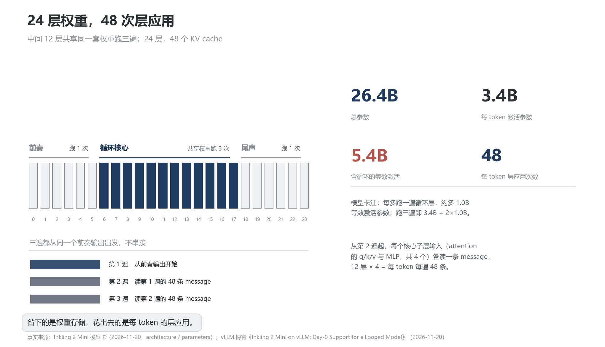
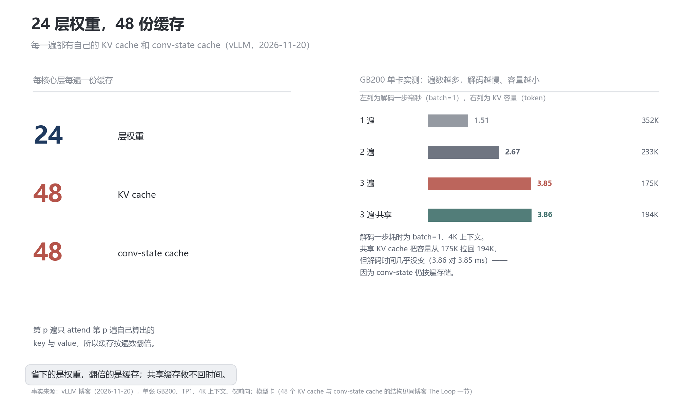
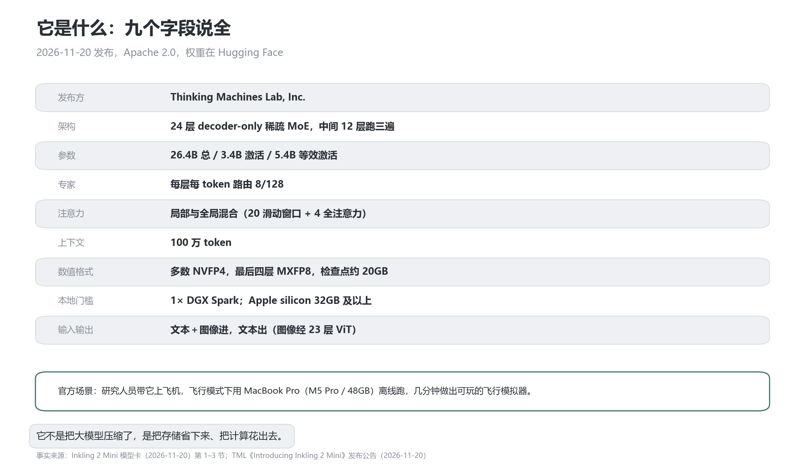

# 24 层权重、48 次层应用、20GB 检查点：Inkling 2 Mini 到底是个什么东西

11 月 20 日，Thinking Machines Lab 以 Apache 2.0 发布了 Inkling 2 Mini，权重放在 Hugging Face 上。

先把最容易说错的一件事说清：它不是"26.4B 参数的小模型"，而是一个**每处理一个 token 要跑 48 次层应用**的模型。前者说的是它有多大，后者说的是它有多忙。这两个数字都不是 26.4B。

## 它的形状：24 层拆成三段

模型卡第 2 节写得很直接：24 层 decoder-only transformer，稀疏 MoE 前馈，中间 12 层**共享同一套权重跑三遍**，于是 24 层权重换来 48 次层应用——6 + 3×12 + 6。

vLLM 的 Day-0 支持博客把这三段起了名字：前奏（层 0–5）、循环核心（层 6–17）、尾声（层 18–23）。前奏和尾声各跑一次，核心跑三遍，尾声从最后一遍接着往下走。

这里有个细节决定了它和普通循环模型的区别：**三遍不是串起来的**。普通 looped 模型把第 p 遍的输出喂给第 p+1 遍；Inkling 2 Mini 的三遍全部从同一个前奏输出出发，第 p+1 遍只能通过 message 看到第 p 遍。

message 是逐个子层读的。从第二遍开始，每个核心子层的每个输入（attention 的 query、key、value 输入，加 MLP 输入）各读一条 message，用学出来的 query 从前一遍对应位置读。12 个核心层乘 4 个输入，就是每 token 每遍读 48 条。

读进来之后由一个 rank-64 控制器按通道合并，用 tanh 门控决定保留多少原输入、吸收多少上一遍的信息——不是简单相加。

## 它的账：三个参数口径，别混着用

模型卡给了三个数字，指的是三件不同的事：

- **总参数 26.4B**——权重存了多少，决定检查点有多大。
- **激活 3.4B**——单次前向里真正参与计算的权重。
- **等效激活 5.4B**——把循环算进去之后，每 token 实际吃到的权重激活量。

模型卡专门注了一句：循环层每多跑一遍，约多 1.0B 等效激活参数；跑三遍就是 3.4B 加两个 1.0B，即 5.4B。

所以"26.4B 参数、3.4B 激活"这句话本身没错，但它会让人低估这个模型的算力开销。**真正的每个 token 开销是 5.4B，不是 3.4B。** 论文表里的 Params 一栏，TML 自己填的是"5.4/26.4"。

## 它的内存：24 层权重，48 份缓存

这是循环机制最不像"免费"的地方。

vLLM 博客写得明白：每个核心层的每一遍都有自己的 KV cache 和 conv-state cache，第 p 遍只 attend 第 p 遍自己为更早 token 算出来的 key 和 value。**模型有 24 层，但有 48 个 KV cache 和 48 个 conv-state cache。**

省下的确实是权重存储——20GB 的检查点装得进 32GB 的 Mac。但运行时的账不是 20GB 的账。

同一篇博客给了一组实测数字，单卡 GB200、4K 上下文、只算前向：

| 遍数 | 解码一步（batch 1） | 解码一步（batch 32） | KV cache 容量 |
|---|---|---|---|
| 1 遍 | 1.51 ms | 3.81 ms | 35.2 万 token |
| 2 遍 | 2.67 ms | 5.92 ms | 23.3 万 token |
| 3 遍 | 3.85 ms | 8.11 ms | 17.5 万 token |
| 3 遍，共享 KV cache | 3.86 ms | 8.10 ms | 19.4 万 token |

从 1 遍到 3 遍，解码慢了 2.55 倍，KV cache 容量少了整整一半。共享 KV cache 能把容量从 17.5 万拉回 19.4 万，但解码时间几乎没变——因为每一遍的 conv-state cache 还在。

注意共享缓存那一行：容量只从 17.5 万回到 19.4 万，省不出多少——因为每一遍的 conv-state cache 还在。真正省 KV 得靠减遍数，趋势是每个 token 的缓存从 35.2 万一路掉到 17.5 万，大致对半。

## 它的规格：一次说全

- **发布**：2026 年 11 月 20 日，Apache 2.0，权重在 Hugging Face（thinkingmachines/Inkling-2-Mini）。
- **架构**：多模态自回归 looped transformer，每层每 token 路由 8/128 个专家，注意力是局部与全局混合（20 层滑动窗口 + 4 层全注意力），图像经 23 层 ViT 编码。
- **上下文**：100 万 token。
- **数值格式**：大部分权重原生 NVFP4，最后四层 MXFP8。检查点约 20GB。
- **本地门槛**：1× NVIDIA DGX Spark；Apple silicon 32GB 及以上（MacBook、Mac mini、Mac Studio）；其他平台建议 32GB 以上显存。
- **软件**：Apple silicon 上走 Ollama、Exo Labs；NVIDIA 上走 SGLang、vLLM、Unsloth、NVIDIA Dynamo、Tokenspeed；另有 GGUF 量化版。

官方还给了一个场景：研究人员带着它上飞机，在飞行模式下用一台 MacBook Pro（M5 Pro、48GB）离线跑，几分钟做出了一个可玩的飞行模拟器。断网、单机、消费级芯片三个条件同时成立，仍然跑完了一次完整的代码生成任务。

## 落到：它是一个关于"算力花在哪"的设计

把上面这些放在一起，Inkling 2 Mini 的形状就清楚了。

它没有把参数堆到千亿，而是把中间 12 层权重反复用三遍，用循环换深度。代价写在三个地方：每 token 的等效激活从 3.4B 变成 5.4B，KV 缓存从 24 份变成 48 份，解码一步慢 2.55 倍。

换来的是 20GB 的检查点、32GB 的 Mac 就能装下、100 万 token 的上下文，以及一张标着 20.1 的第三方智能指数。

它不是"小而全"的模型，也不是"把大模型压缩了"。它是一个把存储省下来、把计算花出去的设计——省的地方在硬盘和显存，花的地方在每个 token 的层应用次数。

---

*事实来源：Thinking Machines Lab《Introducing Inkling 2 Mini》（2026-11-20，thinkingmachines.ai/news/inkling-2-mini/）：Apache 2.0 发布、权重托管于 Hugging Face、循环层描述、DeepSWE v1.1 48.2% 与 Vals Index v2.2 46.5%、26.4B 总参数／3.4B 激活／5.4B 每 token 权重激活、大部分权重原生 NVFP4 且最后四层 MXFP8、总内存约 20GB、演示机 M5 Pro 48GB 飞行模式下数分钟构建可玩飞行模拟器。Inkling 2 Mini 模型卡（thinkingmachines.ai/model-card/inkling-2-mini/）：法律主体 Thinking Machines Lab, Inc.、发布日期 2026-11-20、Apache 2.0、多模态自回归 looped transformer、24 层 decoder-only 稀疏 MoE、中间 12 层共享权重跑三遍形成 48 次层应用、每层每 token 路由 8/128 专家、局部与全局注意力混合、图像经 ViT 编码进共享隐空间、参数 26.4B／3.4B 激活、每多一遍约增 1.0B 等效激活参数故三遍为 5.4B、NVFP4 与 MXFP8、上下文 100 万 token、单检查点约 20GB、支持 1× DGX Spark 与 32GB 及以上 Apple silicon、其他平台建议 32GB 以上显存、所需软件（Apple silicon：Ollama、Exo Labs；NVIDIA：SGLang、vLLM、Unsloth、Dynamo、Tokenspeed；另有 Unsloth／llama.cpp 的 GGUF 量化版）。vLLM 博客《Inkling 2 Mini on vLLM: Day-0 Support for a Looped Model》（2026-11-20，vllm.ai/blog/2026-11-20-inkling2-mini，作者 Inferact、Thinking Machines、NVIDIA）：24 层分为 prelude（0–5）、loop core（6–17）、coda（18–23），prelude 与 coda 各跑一次、core 跑三遍共享权重、coda 从最后一遍继续；三遍全部从前奏输出出发、第 p+1 遍仅通过 message 看到第 p 遍；从第二遍起每个核心子层输入（attention 的 query/key/value 输入与 MLP 输入）各读一条 message，12 层×4 输入即每 token 每遍读 48 条；rank-64 控制器按通道合并 message（tanh 门控）；每核心层每遍各有 KV cache 与 conv-state cache，24 层对应 48 个 KV cache 与 48 个 conv-state cache；每层 hidden size 2,304、20 层滑动窗口与 4 层全注意力、24 个 query 头与 8 个 KV 头、128 个路由专家 top-8、层 0–19 为 NVFP4 层 20–23 为 MXFP8、图像经 23 层 ViT；GB200 单卡 TP1 4K 上下文仅前向的实测：1 遍 1.51ms（batch 1）／3.81ms（batch 32）／35.2 万 token 容量，2 遍 2.67ms／5.92ms／23.3 万，3 遍 3.85ms／8.11ms／17.5 万，3 遍共享 KV cache 3.86ms／8.10ms／19.4 万，且共享 KV cache 因 conv-state 仍按遍存储而释放有限。*

*需说明三点。其一，vLLM 博客摘要中写的是"26B 总参数、3.5B 激活"，与模型卡的 26.4B／3.4B 有出入；本文一律采用模型卡口径，博客该处数字未被采用。其二，"等效激活 5.4B"与"激活 3.4B"是同一模型的两个不同口径，模型卡参数表中 Params 栏填的是"5.4/26.4"，本文三个数字并列给出，未用其中一个替代另一个。其三，vLLM 的性能表标注为单张 GB200、TP1、4K 上下文、仅前向的实测，不等同于消费级设备上的实际速度；"解码慢 2.55 倍"是在该表 1 遍与 3 遍之间按 3.85÷1.51 计算所得，属本文算术，非官方结论。*
