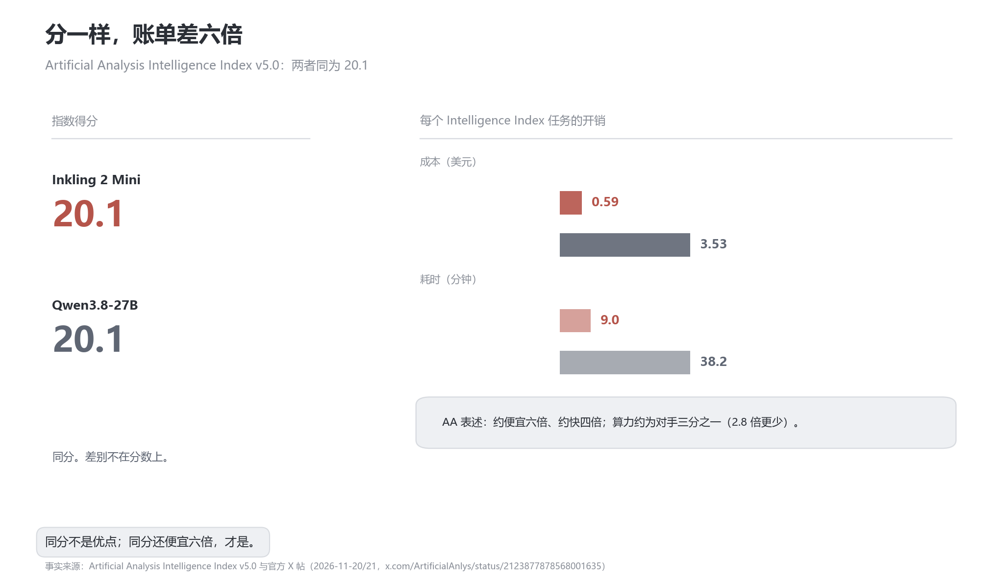
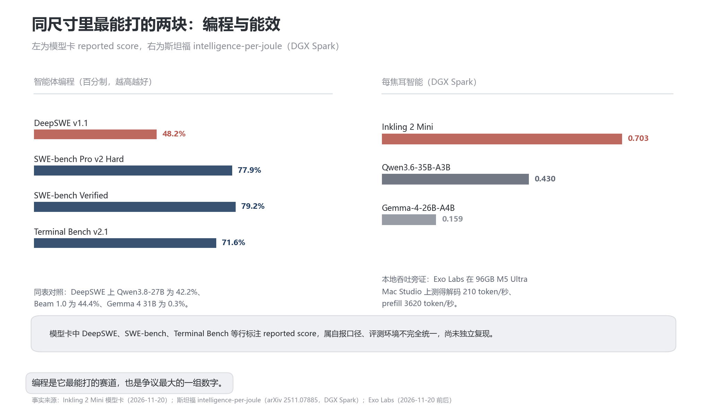
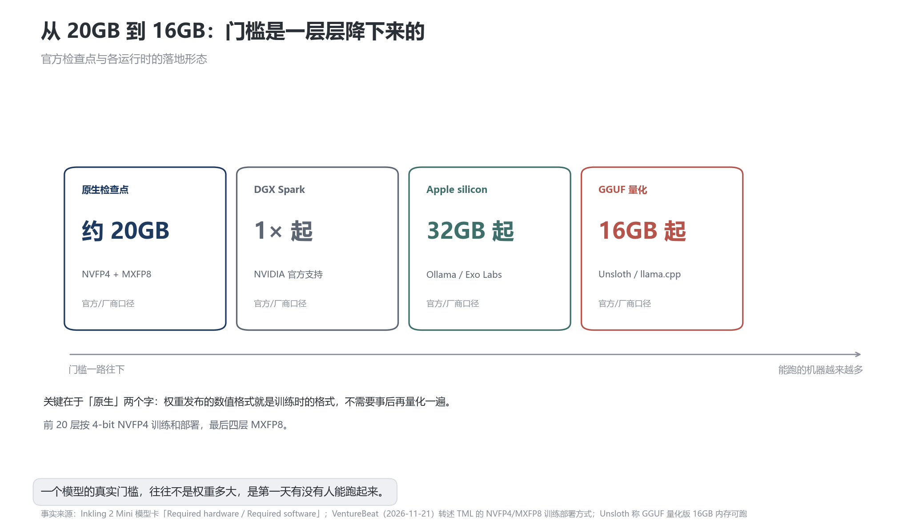

# 同分、六分之一价格、四倍速度：Inkling 2 Mini 真正值钱的地方在哪

2026 年 11 月 20 日，Mira Murati 创办的 Thinking Machines Lab 以 Apache 2.0 开放了一个新模型：Inkling 2 Mini。它总参数 26.4B、每 token 激活 3.4B，检查点约 20GB，装得进一台 32GB 的 Mac。它的架构不寻常——24 层里有 12 层共享同一套权重反复跑三遍，每处理一个 token 实际发生 48 次层应用。

先说最有分量的那个对照。

Artificial Analysis 的 Intelligence Index v5.0 给 Inkling 2 Mini 打 20.1。同一张表里，阿里的稠密模型 Qwen3.8-27B 也是 20.1。分数一样，但每个 Intelligence Index 任务，Inkling 2 Mini 花 0.59 美元、9.0 分钟，Qwen3.8-27B 花 3.53 美元、38.2 分钟。

AA 自己的说法是：约便宜六倍、约快四倍。它还报了一个独立测算——Inkling 2 Mini 用的算力约为对手的三分之一（2.8 倍更少）。

同分不是它的优点。**同分还便宜六倍，才是。**

## 优点一：它把"能跑"的门槛降到了笔记本

模型卡"所需硬件"一栏写着：单个检查点约 20GB，1× NVIDIA DGX Spark，或者一台 32GB 及以上的 Mac。

同公司的 Inkling 2 Small 是 594B 总参数，Inkling 是 975B——那是要一整个集群去接的东西。

但它不是靠"砍"到这个尺寸的。VentureBeat 报道里 TML 的做法是：训练中途把专家从 384 个剪到 128 个，再从一个更大的内部模型蒸馏 1 万亿 token 把网络"治好"（healing），随后做监督微调和 2.2 万亿 token 的强化学习。前 20 层原生按 4-bit NVFP4 训练和部署，最后四层 MXFP8。

关键在于"原生"两个字。权重发布的数值格式就是训练时的格式，不需要事后再量化一遍——而事后量化正是小模型掉点最多的地方。

## 优点二：省的是权重存储，花的是计算

开头那组 AA 的成本对比容易被误解成"这个模型更省算力"。不全是。

它的设计逻辑是：把存储省下来，把计算花出去。中间 12 层共享权重跑三遍，24 层权重换来 48 次层应用，每个 token 的等效激活从 3.4B 提到 5.4B。

这个交易在本地设备上划算。消费级芯片的瓶颈通常是内存容量和带宽，不是峰值算力；少读一遍权重、多算几遍，正好压在强项上。Exo Labs 在 96GB M5 Ultra Mac Studio 上报的是解码 210 token/秒、prefill 3620 token/秒。

不过在服务端，这笔交易的成本会显出来。vLLM 在单卡 GB200 上的实测是：1 遍解码 1.51 毫秒，3 遍 3.85 毫秒，慢 2.55 倍；KV cache 容量从 35.2 万 token 掉到 17.5 万。**同一个模型，本地是优点，机房是开销。** 这一点必须先分清场景。

## 优点三：智能体编程确实是它的强项

这是它最能打的赛道。

模型卡列出的数字：DeepSWE v1.1 48.2%（同表 Qwen3.8-27B 42.2%，Beam 1.0 44.4%，Gemma 4 31B 0.3%）；SWE-bench Pro v2 Hard 77.9%（Qwen 73.8%，Beam 77.2%）；SWE-bench Verified 79.2%；Terminal Bench v2.1 71.6%。

视觉侧也不弱：OmniDocBench v1.6 得 92.8%，同表最高；GroundingME 55.5%，同表最高；PerceptionBench 57.5%，同表最高。

斯坦福那份 intelligence-per-joule 基准（arXiv 2511.07885）在 DGX Spark 上跑出的每焦耳智能是 0.703，对照 Qwen3.6-35B-A3B 的 0.430、Gemma-4-26B-A4B 的 0.159。

有一处必须说清：模型卡里 DeepSWE、BrowseComp 这类行标着"Best reported score"，是按各家自报口径录入，评测环境不完全统一。**只有 AA Index 和 Vals Index 是第三方独立指数。** 本文引用的编程分数属前者，尚未被独立复现。

## 优点四：知识不够，它去查

TML 在公告里承认：循环提升的是推理，**不能让权重存下更多事实**，知识主要由参数总量决定。它没打算靠参数解决这件事，而是换成用搜索和工具补。

数字对得上。BrowseComp 79.0%、DeepSearchQA 85.3%、MCP Atlas 82.7%，都是同尺寸里靠前的。含义是：当你要的是"给我查准"，而不是"它本来就知道"，26.4B 够用。

## 优点五：许可和生态没给下游留坑

Apache 2.0，加一份模型可接受使用政策。这意味着可以下载、改、微调、再分发、嵌进闭源商业产品，不用开源自己的下游应用，也没有收入门槛。

生态响应也是加分项。发布当天 vLLM 就给了 Day-0 支持（Blackwell、Hopper、DGX Spark），镜像是 `vllm/vllm-openai:inkling-2-mini`；Ollama、Exo Labs、SGLang、Unsloth、llama.cpp、NVIDIA Dynamo、Tokenspeed 同期跟上；Unsloth 还发了能在 16GB 内存上跑的 GGUF 量化版。

一个模型的真实门槛，往往不是权重多大，是第一天有没有人能跑起来。

## 落到：它值钱不是因为小

把五条放在一起，Inkling 2 Mini 的优点其实是同一件事的五个侧面：**它把同分能力挪到了一个便宜得多、也轻得多的位置上。**

20.1 分本身没有意义——Qwen3.8-27B 也是 20.1。有意义的是这个 20.1 只需要 20GB、32GB 的 Mac、六分之一的钱和四分之一的时间。

同分不是优点，账单差一个量级才是。也因此，它的优点全都有前提：不缺算力也不在乎单价，六倍差价就不算优点；要的是知识密度极高的长尾问答，靠搜索补也可能不如一次答对。TML 自己在公告里就承认这个边界——循环提升的是推理，不能让权重存下更多事实。

---

*事实来源：Artificial Analysis Intelligence Index v5.0 与官方 X 帖（2026-11-20/21，x.com/ArtificialAnlys/status/2123877878568001635）：Inkling 2 Mini 与 Qwen3.8-27B 同为 20.1，每 Intelligence Index 任务 0.59 美元／9.0 分钟 对 3.53 美元／38.2 分钟，AA 表述为"约便宜六倍、约快四倍"，算力约为对手三分之一（2.8 倍更少）。Inkling 2 Mini 模型卡（thinkingmachines.ai/model-card/inkling-2-mini/）：单检查点约 20GB、1× DGX Spark、Apple silicon 32GB 及以上、其他平台建议 32GB 以上显存；参数 26.4B／3.4B 激活／5.4B 每 token 权重激活；DeepSWE v1.1 48.2%（Qwen3.8-27B 42.2%、Beam 1.0 44.4%、Gemma 4 31B 0.3%）、SWE-bench Pro v2 Hard 77.9%（Qwen 73.8%、Beam 77.2%）、SWE-bench Verified 79.2%、Terminal Bench v2.1 71.6%、BrowseComp 79.0%、DeepSearchQA 85.3%、MCP Atlas 82.7%、OmniDocBench v1.6 92.8%、GroundingME 55.5%、PerceptionBench 57.5%、AA-Omniscience v1.1 为 -8.6；表中 DeepSWE、BrowseComp 等行标注为 Best/Second-best reported score，AA Index 与 Vals Index 列于 Third Party Index 分组。Thinking Machines Lab《Introducing Inkling 2 Mini》（2026-11-20）：Apache 2.0、权重于 Hugging Face、循环提升推理但不让权重存下更多事实（"knowledge is mostly a function of total parameter count"）、以搜索和工具弥补知识缺口。vLLM 博客（2026-11-20）：Day-0 支持 Blackwell／Hopper／DGX Spark、镜像 vllm/vllm-openai:inkling-2-mini、GB200 单卡 TP1 4K 上下文 1 遍 1.51ms 与 3 遍 3.85ms（batch 1）、KV cache 容量 35.2 万 与 17.5 万 token，以及 loop_share_cache 与 loop_num_passes 选项。VentureBeat（2026-11-21，Carl Franzen）：专家从 384 剪至 128、从一个更大的内部 Inkling 模型蒸馏 1 万亿 token 做 healing、随后监督微调与 2.2 万亿 token 强化学习、前 20 层原生 NVFP4 与最后四层 MXFP8；TML 内部缩放实验称非循环基线在 512K token 智能体轨迹上需多 140% 推理算力才能匹配 loss；斯坦福 intelligence-per-joule 基准（arXiv 2511.07885）在 DGX Spark 上 Inkling 2 Mini 0.703、Qwen3.6-35B-A3B 0.430、Gemma-4-26B-A4B 0.159；Exo Labs 在 96GB M5 Ultra Mac Studio 上解码 210 token/秒、prefill 3620 token/秒；Ollama、Exo、SGLang、vLLM、Unsloth、llama.cpp、Dynamo、Tokenspeed 首日支持，Unsloth 称 16GB 内存可跑 GGUF 量化版。*

*需说明四点。其一，AA 的"六倍便宜、四倍快"是按每个 Intelligence Index 任务的成本与耗时计算，不是按每百万 token 单价；两者口径不同，不能互相换算。其二，DeepSWE v1.1、SWE-bench Pro v2、BrowseComp、OmniDocBench 等行在模型卡中标注为 reported score，属各实验室自报、评测环境不完全统一，本文已注明尚未被独立复现；真正来自第三方的只有 AA Index（20.1）与 Vals Index（46.5%）。其三，"省存储、花计算在本地划算"是本文分析，TML 官方未作此表述；vLLM 的 GB200 数据说明该交易在服务端呈相反方向，两种场景结论相反，不能只引用一侧。其四，"斯坦福 intelligence-per-joule 基准"与 Exo Labs 的吞吐数字分别来自 arXiv 论文与厂商 X 帖，本文未独立复现，仅作为旁证引用，未以其取代模型卡数据。*

