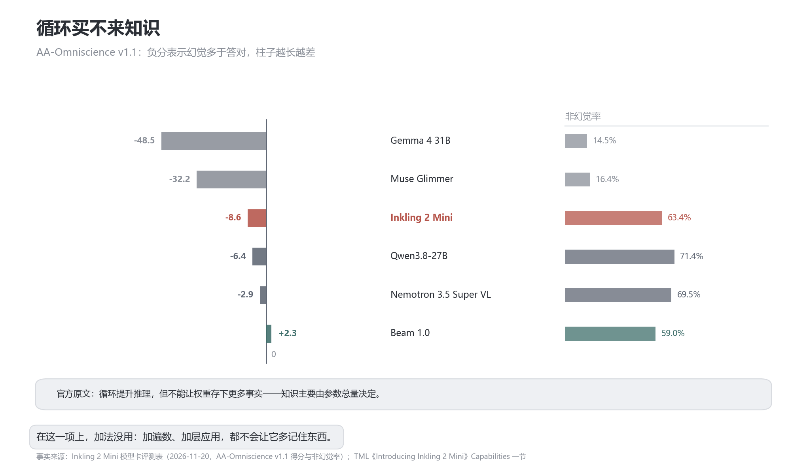
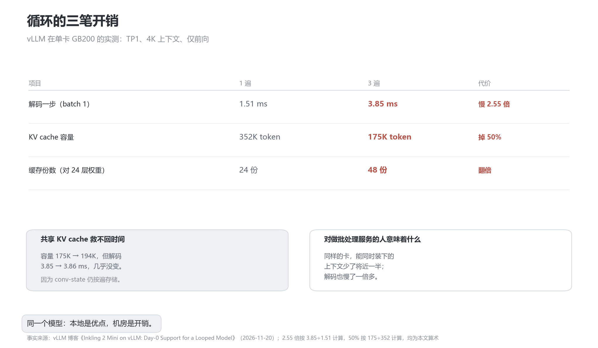
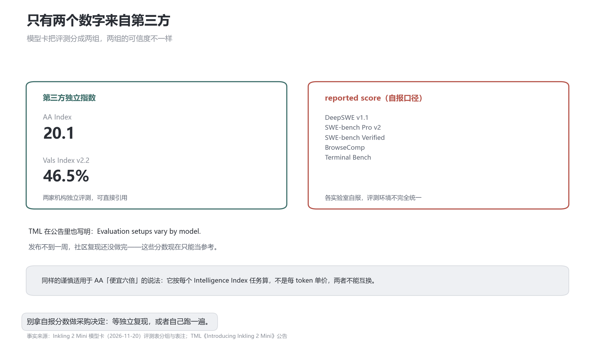

# 知识不涨、多轮不行、循环绕圈：Inkling 2 Mini 的五个代价

2026 年 11 月 20 日，Thinking Machines Lab 以 Apache 2.0 开放了 Inkling 2 Mini。它总参数 26.4B、每 token 激活 3.4B，检查点约 20GB，装得进一台 32GB 的 Mac；Artificial Analysis 的智能指数给到 20.1，与 Qwen3.8-27B 持平，每个任务只要 0.59 美元。

这些数字都很漂亮。这篇文章要讲的，是它们背后的账。

它的架构不寻常：24 层里有 12 层共享权重反复跑三遍，每 token 实际发生 48 次层应用，计入循环的等效激活是 5.4B 而不是 3.4B。这个设计换来了"小得能装进笔记本"，但也划出了几条硬边界——**不是能力差一点，而是结构性的。**

## 代价一：循环买不来知识，这是设计前提

TML 在公告里写得很直白：循环提升推理，但不能让权重存下更多事实，知识主要由参数总量决定。

这不是谦辞。在可变循环研究版上，长上下文基准（GraphWalks BFS、MRCR v2）随遍数增加而变好；知识型基准（AA-Omniscience、SimpleQA Verified、SimpleVQA、WorldVQA）**不随遍数变好**。

主模型上也对得上。AA-Omniscience v1.1 得 -8.6，不信口开河的比例 63.4%；对照 Qwen3.8-27B 是 -6.4、71.4%，Nemotron 3.5 Super VL 是 -2.9、69.5%。

结论很硬：**加法没用。** 加遍数、加层应用，都不会让它多记住东西。这是参数总量的事，26.4B 就是 26.4B。

## 代价二：多轮和"一堆约束"，它明显偏科

官方 Limitations 一节的原话：它不是多轮聊天和多重约束指令最强的小模型——MultiChallenge 得 50.0%，ComplexConstraints v1.1 得 33.4%，两项都落后于 Qwen3.8-27B。

值得注意的是第二项。ComplexConstraints 33.4% 这个数，按模型卡表格**高于** Qwen3.8-27B 的 30.1%，也高于 Gemma 4 31B 的 31.6%；真正落后 Qwen 的是 MultiChallenge。

这是我复核时纠正的一处：**官方那句"两项都落后于 Qwen3.8-27B"与它自己模型卡里的表格数字不一致。** 而 50.0% 这个 MultiChallenge 成绩，在模型卡表格里查不到 Qwen 的对照数。

表格里能确认的是：ComplexConstraints 33.4% 低于同表的 Muse Glimmer 35.6% 和 Beam 1.0 42.9%。所以"多约束指令不是强项"成立，"落后 Qwen"在公开数据上站不住。

## 代价三：循环的开销，在服务端是实打实的

循环的算盘是"省存储、花计算"。这在笔记本上成立——消费级芯片的瓶颈是内存容量，不是峰值算力。到了机房，方向反过来。

vLLM 在单卡 GB200 上的实测：1 遍解码 1.51 毫秒、3 遍 3.85 毫秒，慢 2.55 倍；KV cache 容量从 35.2 万 token 降到 17.5 万，掉了整整一半。原因很朴素——模型有 24 层，但有 48 个 KV cache 和 48 个 conv-state cache，每一遍都得自己存。

这里有个细节值得注意：共享 KV cache 能把容量从 17.5 万拉回 19.4 万，但**解码时间几乎没变**（3.86 毫秒对 3.85 毫秒）。因为 conv-state 还是按遍存的。所以"省内存"这条路，靠改配置走不通。

对做批处理服务的人来说，这笔账直接体现为：同样的卡，能同时装下的上下文少了将近一半。

## 代价四：循环能把算力耗在自己绕圈上

这是循环架构最难预判的失效方式。模型擅长智能体任务，就意味着擅长"多试几次"；而循环是让它"想得更久"。两者叠在一起，容易绕不出来。

VentureBeat 提到少数早期测试者反馈游戏机制生成时的偶发失败，以及在非英语（如中文）上出现重复调试循环。

我**没有找到对该模型失控循环的独立量化统计**，所以这一条标为"机制上合理、但缺证据"，不作为已知劣势引用。

## 代价五：发布第三天的数据，还没被独立复现

模型卡里 DeepSWE v1.1、SWE-bench Pro v2、BrowseComp、Terminal Bench 这些行，标注是 "Best reported score"——按各家自报口径录入，评测环境不完全统一，harness 版本和上下文设置并不一致。

真正来自第三方的只有两个：AA Index 20.1 和 Vals Index 46.5%。

这不等于数字有问题，而是说：**这些分数现在只能当参考。** 发布不到一周的模型，社区复现还没做完。TML 自己在公告里也写明"Evaluation setups vary by model"。

同样的谨慎适用于 AA"便宜六倍"的说法——那是按每个 Intelligence Index 任务算的，不是每 token 单价，两者不能互换。

## 落到：哪些人不该选它

不适合的场景挺清楚：

**要知识密度的地方别用。** 长尾事实问答、需要模型"本来就知道"的场合，26.4B 加上循环帮不上忙。

**多轮对话为主的产品要小心。** MultiChallenge 50.0% 是它自己列出来的短处。

**做高并发托管服务要先算账。** 48 份缓存、2.55 倍解码时间，省下的权重存储换不回服务端的内存容量。

**别拿自报分数做采购决定。** 等独立复现，或者自己跑一遍。

它真正的位置在另一侧：单机、离线、智能体编程、长上下文、知识靠检索补。这几个条件同时成立时，上面那些代价才换得回来。

---

*事实来源：Thinking Machines Lab《Introducing Inkling 2 Mini》（2026-11-20，thinkingmachines.ai/news/inkling-2-mini/）："While looping improves the model's reasoning, it doesn't enable its weights to store more facts—knowledge is mostly a function of total parameter count"；在可变循环研究版上长上下文基准（GraphWalks BFS、MRCR v2）随遍数提升而知识型基准（AA-Omniscience、SimpleQA Verified、SimpleVQA、WorldVQA）不随遍数提升；Limitations 一节称 Inkling 2 Mini 不是多轮聊天与多重约束指令最强的小模型，给出 MultiChallenge 50.0% 与 ComplexConstraints v1.1 33.4%，并称两项均落后于 Qwen3.8-27B；公告评测表注 "Evaluation setups vary by model"。Inkling 2 Mini 模型卡（thinkingmachines.ai/model-card/inkling-2-mini/）评测表：AA-Omniscience v1.1 得 -8.6、非幻觉率 63.4%（Qwen3.8-27B 为 -6.4 与 71.4%，Nemotron 3.5 Super VL 为 -2.9 与 69.5%，Gemma 4 31B 为 -48.5 与 14.5%，Muse Glimmer 为 -32.2 与 16.4%，Beam 1.0 为 2.3 与 59.0%）；ComplexConstraints v1.1 得 33.4%（Muse Glimmer 35.6%、Beam 1.0 42.9%、Gemma 4 31B 31.6%、Qwen3.8-27B 30.1%、Dory 1.0 4B 17.9%、SenseNova-Loop-9B 10.1%），且模型卡表格中未见 Qwen3.8-27B 的 MultiChallenge 数据；DeepSWE v1.1、SWE-bench Pro v2、BrowseComp、Terminal Bench 等行标注为 Best/Second-best reported score，AA Index 与 Vals Index 列于 Third Party Index 分组。vLLM 博客《Inkling 2 Mini on vLLM: Day-0 Support for a Looped Model》（2026-11-20）：24 层对应 48 个 KV cache 与 48 个 conv-state cache；GB200 单卡 TP1 4K 上下文仅前向，1 遍 1.51ms（batch 1）、3 遍 3.85ms，KV cache 容量 35.2 万 对 17.5 万 token，3 遍共享 KV cache 为 3.86ms 与 19.4 万 token，并说明共享缓存释放有限是因 conv-state 仍按遍存储。VentureBeat（2026-11-21，Carl Franzen）：少数早期测试者反馈游戏机制生成偶发任务失败、循环模型运行时早期量化怪癖；并转述 TML 文档称模型在非英语（如中文）上可能落入重复调试循环或产生被截断的措辞。*

*需说明四点。其一，官方公告 Limitations 中"两项均落后于 Qwen3.8-27B"与模型卡表格不一致：按表格，ComplexConstraints v1.1 一项 Inkling 2 Mini 为 33.4%、Qwen3.8-27B 为 30.1%，前者更高；MultiChallenge 50.0% 在模型卡表格中无 Qwen3.8-27B 对照数据。本文以表格为准，并在正文写明这处不一致。其二，"循环会把算力耗在自己绕圈上"属机制推演，缺少对该模型的独立量化证据，正文已标注为不采用的判断。其三，"2.55 倍"按 vLLM 表中 3.85÷1.51 计算，"掉了一半"按 175÷352 计算，均为本文算术，非官方结论。其四，AA 的"六倍便宜"按每个 Intelligence Index 任务计算，不是每百万 token 单价，与模型卡的自报分数分属两种口径，不可互换。*

