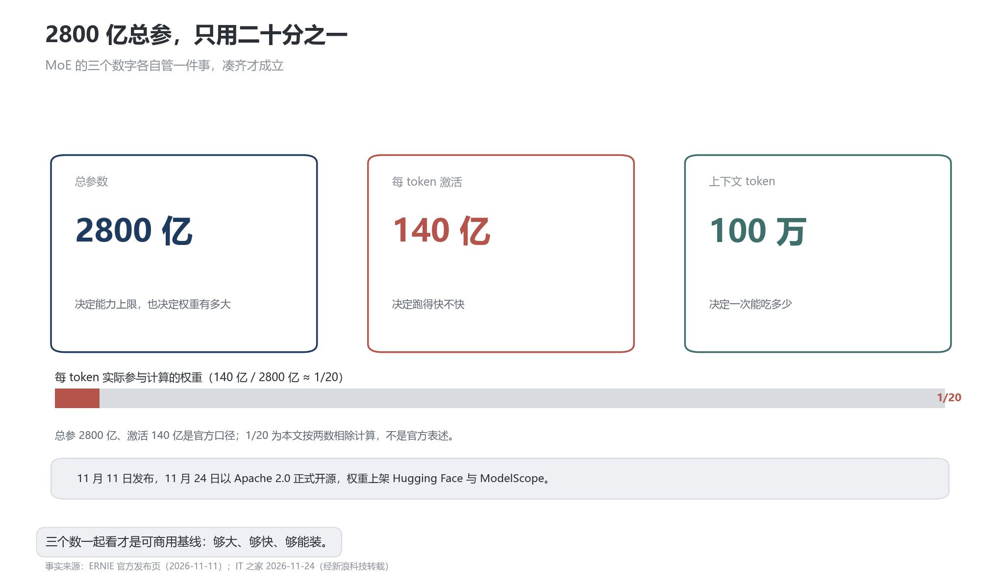
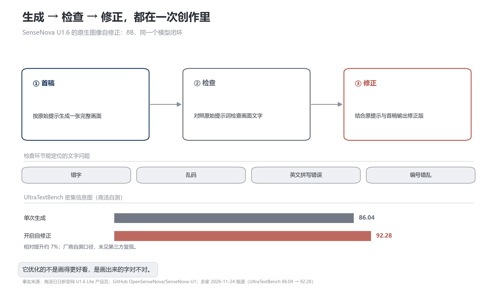
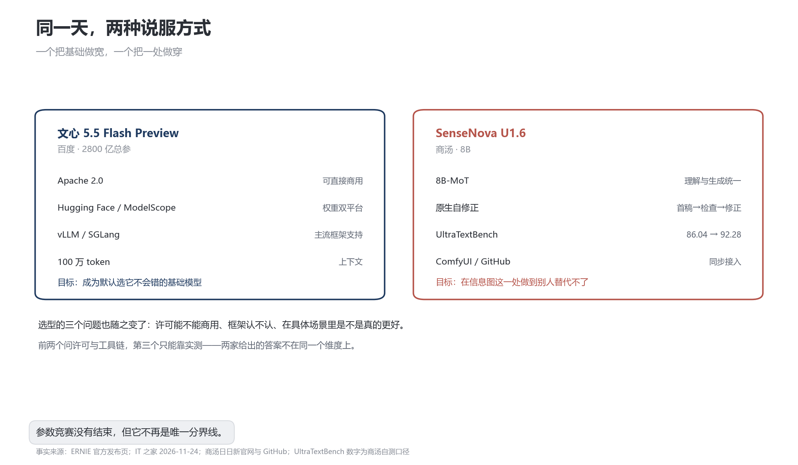

# 2800 亿开源、8B 会自己改图：同一天两个方向，国产开源不只在拼大小了

11 月 24 日，两条开源消息撞在一起。

百度的文心 5.5 Flash Preview 正式开源，Apache 2.0，权重上架 Hugging Face 和 ModelScope，支持 vLLM、SGLang 部署。商汤发布并开源 SenseNova U1.6，参数只有 8B，但第一次给这个系列的开源模型带上了原生图像自修正。

一条 2800 亿参数，一条 8B。放在一起看，才是这天真正值得写的。

## 先看大的那条

文心 5.5 Flash Preview 今年 11 月 11 日发布，是基于此前开源的文心 5.5 Flash Base 的首个后训练版本。规格很硬：MoE 架构，总参数 2800 亿，每个 token 激活 140 亿，上下文 100 万 token，官方给的解码速度是每秒 200 token 以上。

这三个数放在一起才有意义。2800 亿总参决定能力上限，140 亿激活决定它跑得动——只有总参的二十分之一参与计算，这是它能维持每秒 200 token 的结构性原因。100 万上下文则是另一件事：能一次吃进一整个代码库。

Apache 2.0 加这三个数字，等于给国内开源界又抬了一档"可商用基线"：拿下来就能改、能微调、能嵌进闭源产品，不用开源自己的下游代码，也没有收入门槛。

榜单表现是不均衡的。在偏业务流自动化的 AutomationBench 上得 61.9，高于 Claude Opus 5.5 的 58.0；Terminal-Bench 4.0 得 46.5，低于 Claude Opus 5.5 的 63.6，但高于 DeepSeek V4.1 Flash 的 40.9；DRACO 和 APEX-Agents 两项落后于腾讯 Hy4 和 Claude Opus 5.5。

CodeArena WebDev 榜单上得 1668 分。媒体普遍写成"开源第二、国产第四"，但这一栏要留一分谨慎：同一榜单上，Qwen3.8-Max 曾以 1668 分位列第 4，Kimi K3 是 1658 分，而不同时期的榜单版本与"Max"档位的统计口径并不一致。**"国产第四"这个位次，取决于统计范围怎么划。**

## 再看小的那条

商汤的 SenseNova U1.6 走的是完全相反的路：8B。

它延续 U 系列"理解与生成统一"的范式——同一个模型既看懂图也生成图，不用为文生图和图像编辑各部署一套。真正的新东西是**原生图像自修正**。

机制是这样的：模型先生成首稿，再对照原始提示词检查画面，找出文字问题——错字、乱码、拼写错、编号错乱，给出需要修改的位置，再结合原提示和首稿输出修正版。整个过程在一次创作里完成，不是人工返工。

官方演示里有个具体的例子：一张 SOUL 音乐海报，模型自己发现了英文单词里多插进去的一处空格。这错误小到人要贴近看，但它能定位。

效果数字来自商汤自己的测试：开启自修正后，UltraTextBench 密集信息图测试从单次生成的 86.04 升到 92.28，相对提升约 7%；内部用户评测的美学得分比 U1.5 Lite 高约 10%。

这两个数字都是厂商口径，没有第三方复现。但方向是清楚的：**它优化的不是"画得更好看"，是"画出来的字对不对"。**

## 两条路的交点在哪

看起来一大一小，其实解决的是同一个问题——**开源模型该拿什么说服人用。**

下游真正在意的不是参数表上那几行，而是三件：许可能不能商用，部署框架支不支持，在自己的场景里到底行不行。

这三件事，两家的答案不一样，但都在回答同一题。

百度这边，答案是"把可商用基线做扎实"：Apache 2.0、双平台权重、vLLM 和 SGLang 两条部署路径、百万上下文。它想成为"默认选它不会错"的基础模型。

商汤这边，答案是"把一件事做穿"：不追规模，把 8B 的全部力气压在信息图的文字准确性上——海报、UI、图表，这些场景对错一个字就是废稿。自修正是垂直能力，不是通用能力。

## 落到：比的不再是大小

同一天两条消息，指向的其实是同一个转折。

**参数竞赛没有结束，但它不再是唯一分界线。** 2800 亿当然是竞争力，可它旁边站着的那个 8B 说明：一个模型能不能被用起来，还取决于它有没有一处别人替代不了的专长。

对选型的人来说，判断标准也在变。以前问"它多大、多少分"，现在要问：许可能不能直接商用、推理框架认不认、在我要的那个场景里是不是真的更好。

前两个问题，文心这类模型已经给了肯定答案。第三个，商汤用 8B 做了示范——把"生成完还得人来改字"这一步，塞回模型自己身上。

开源竞争的下一段，不是谁更大，而是谁能在某个具体位置上不可或缺。

---

*事实来源：百度 ERNIE 官方发布页《Introducing ERNIE 5.5 Flash Preview》（2026-11-11，ernie.baidu.com/release/ernie-5-5-flash-preview/）：ERNIE 5.5 Flash Base 的首个后训练版本、280B 总参数、14B 激活、1M token 上下文、擅长编程／3D 建模／知识工作／内容创作、API 已上线千帆、权重将以 Apache 2.0 开源（原文 "will be open-sourced under Apache 2.0 soon"）、公告表注 "Evaluation setups vary by model"。开源与规格细节据 IT 之家 2026-11-24《百度文心 5.5 Flash Preview 正式开源：2800 亿参数 140 亿激活，编程能力位居开源模型前列》（经新浪科技转载）：11 月 24 日正式开源、Apache 2.0、权重与配套资源上架 Hugging Face 与 ModelScope、支持 vLLM 与 SGLang、MoE 架构、总参数 2800 亿、每 token 激活 140 亿、最长 100 万 token 上下文、官方定位编程／3D 建模／知识工作／内容创作、生成速度每秒超 200 token；AutomationBench 61.9（Claude Opus 5.5 为 58.0、DeepSeek V4.1 Flash 1017 为 57.2）、Terminal-Bench 4.0 46.5（Claude Opus 5.5 为 63.6、GPT-6.1 Sol 为 56.1、DeepSeek V4.1 Flash 为 40.9）、DRACO 与 APEX-Agents 1.1 落后于 Hy4 与 Claude Opus 5.5、CodeArena WebDev 1668 分、略高于 DeepSeek-V4.1-Flash 的 1664 分与 Kimi K3 的 1658 分、与 Qwen3.8-Max 的 1670 分接近；正文"开源模型第二、国产模型第四"为媒体表述。CodeArena 榜单历史口径据 Arena AI 官方 LinkedIn 帖（Qwen3.8-Max 以 1668 分位列 Frontend Code Arena 第 4，前有 Claude Opus 5 Max 1705、Kimi K3 Max 1676，与 Claude Opus 5 High 1669 接近）与智东西 2026-10-19 报道（DeepSeek-V4.1-Flash-1017 在该榜得 1670 分为当时最高开源模型）——两处均显示该榜单存在分数相近但档位与版本不同的情况。商汤 SenseNova U1.6 据商汤日日新官网 SenseNova U1.6 Lite 产品页（sensenova.cn/u1-6-lite）：面向日常创作、首次实现在生成中自发思考、在迭代中修正完善、准确呈现文字信息；开源权重与 GitHub 仓库 OpenSenseNova/SenseNova-U1（Apache-2.0）；Hugging Face 模型卡 ID 为 sensenova/SenseNova-U1.6-8B-MoT，标注用于原生多模态推理含图像生成、图像编辑与 U1.6 自修正／交错协议，且须使用匹配的 U1.6 runtime。发布与开源细节、自修正机制、基准数据据多家 2026-11-24 报道（北京商报、科创板日报／网易、搜狐、格隆汇、魔搭社区、AI 工具集、ZNDS）：11 月 24 日发布并开源、参数规模 8B、8B-MoT 架构、延续 U1.5 图像理解与生成统一设计、首次为该系列 8B 开源模型引入原生图像自修正、权重开放至 GitHub／Hugging Face／ModelScope、同步接入 ComfyUI；自修正流程为首稿→对照原始提示词检查画面→针对文字模糊、错字乱码、英文拼写错误、编号错乱提出修改意见→结合原提示与首稿输出修正版；开启自修正后 UltraTextBench 密集信息图得分由 86.04 升至 92.28（相对提升约 7%）、内部用户评测美学得分较 U1.5 Lite 高约 10%；官方演示含 SOUL 音乐海报识别英文多插空格一例；API 服务版本 U1.6 Lite 已接入商汤小浣熊、Seko、Kapi 相机。*

*需说明四点。其一，"开源模型第二、国产模型第四"是媒体对 CodeArena WebDev 1668 分的表述，本文照引并加了限定：该榜单上 Qwen3.8-Max 曾在某一版本以 1668 分位列第 4、Kimi K3 为 1658 分，而 Arena 榜单存在"Max／High"档位与版本差异，"国产第四"取决于统计范围，无法独立确认具体名次。其二，UltraTextBench 86.04→92.28、美学 +10% 均为商汤自测评测，非第三方独立复现；AutomationBench、Terminal-Bench、CodeArena 等分数亦为百度或媒体口径，本文均按来源标注，未作交叉验证。其三，百度官方发布页（11 月 11 日）原文只说权重"将很快以 Apache 2.0 开源"，正式开源信息来自 11 月 24 日媒体报道；文中把"11 月 11 日发布"与"11 月 24 日开源"分开表述，未混为一谈。其四，"可商用基线""专用能力""不只在拼大小"等为作者分析，两家公司均未作此表述；文心 5.5 Flash Preview 为后训练中间检查点，官方明示"训练未完成，部分能力可能仍不足"，引用其分数时应注意这一前提。*

