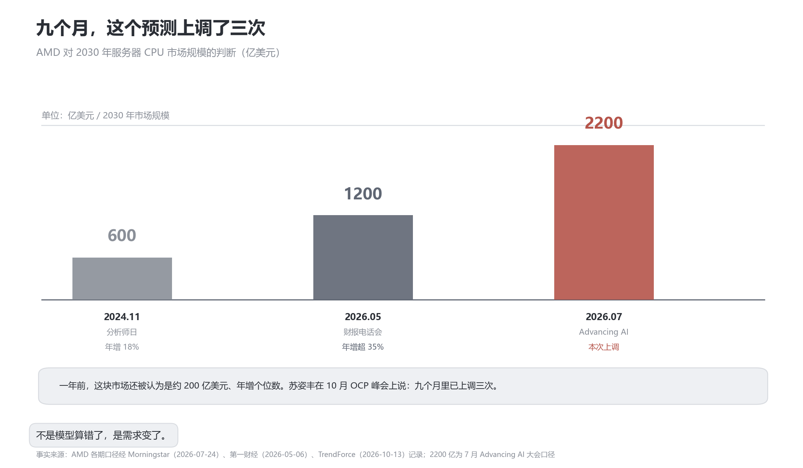
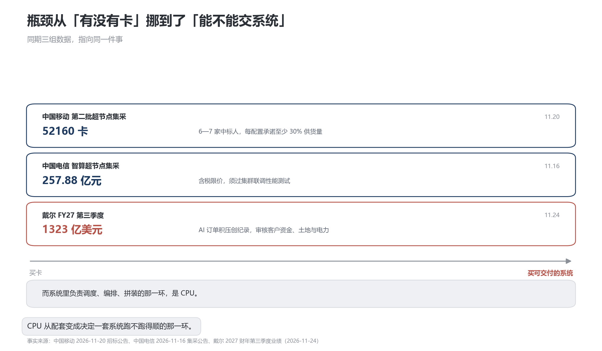
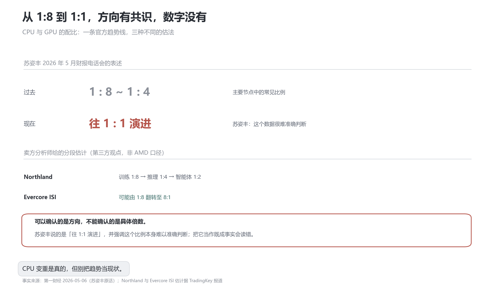

# AMD 把 2030 年服务器 CPU 市场从 1200 亿调到 2200 亿：AI 推理在重估 CPU

AI 算力的叙事一直是 GPU 的：谁有卡，谁就有算力。所以当 AMD 首席执行官苏姿丰把 2030 年服务器 CPU 的市场规模从 1200 亿美元上调到 2200 亿时，这个数字值得停下来看一眼。

上调发生在 7 月 23 日的 Advancing AI 2026 大会。按投研机构 Morningstar 的记录，这是继 3 月给出 1200 亿美元之后，AMD 年内再一次上调——从上一个年度算起，它对这块市场的判断已经翻了不止一倍。

## 先看清这个数字的来路

要理解 2200 亿的分量，得把这条曲线摊开。

2024 年 11 月，AMD 分析师日给的口径是约 600 亿美元、年增 18%。2026 年 5 月的财报电话会上，苏姿丰把年增速上调到超 35%，2030 年规模改为超 1200 亿美元。到 7 月，这个数变成 2200 亿。

她自己在 10 月的 OCP 峰会上说过原因："过去九个月里，我们已经把这个 TAM 上调了三次。"更早一年，这块市场被认为只有约 200 亿美元、年增个位数。

三次上调，不是模型算错了，是需求变了。

## 为什么 CPU 变重了

苏姿丰在 5 月财报电话会上给了一个具体的变化：**过去主要节点里 CPU 与 GPU 的比例是 1:8 到 1:4，现在正在往 1:1 演进。**

同期她把 2026 年称作"推理之年"，并说推理大约占到市场 60%，此后会成为常态。

这句话解释了 CPU 为什么重新重要。训练是把海量数据喂进 GPU 反复迭代，CPU 只是把数据搬进搬出的配角；推理和智能体不一样——一次任务要拆成很多步，每一步都要调度、编排、发工具调用、处理返回值、管上下文。这些活都在 CPU 上。

AMD 数据中心部门一位高管把这层意思说得很直白：智能体不是一次前向计算，是成千上万次决策，每次决策都要 CPU 在中间协调。

需要说清的是，1:1 是方向不是现状。苏姿丰自己的表述是"很难准确判断"这个比例，只是"确实看到了变化的趋势"。卖方分析师的估计也不一致：Northland 认为智能体阶段是 1:2，Evercore ISI 甚至认为可能反转到 8:1。**方向有共识，具体数字没有。**

## 同期发生的另外几件事

把镜头拉回国内和整机侧，会发现另一条线索在汇合。

11 月 20 日，中国移动发布第二批 AI 超节点集采，合计 52160 卡，中标人从 5 家扩到 6—7 家，还要求每家对每个配置承诺至少 30% 的供货量。4 天前，中国电信的智算超节点集采最高投标限价 257.88 亿元，并要求中标产品过集群联调性能测试，跑不出指标不予供货。

11 月 24 日，戴尔公布 2027 财年第三季度业绩：单季新增 AI 服务器订单 602 亿美元，确认收入只有 220 亿，期末积压冲到 1323 亿美元，创历史纪录。

三件事的共同点不在芯片上。运营商在压交付能力和系统联调，戴尔在审核客户"有没有资金、土地和电力"，并在发货前测试完整机架。**瓶颈从"有没有 GPU"挪到了"能不能把芯片、网络、存储和电力组成一套可交付的系统"。**

而系统里那个负责调度和拼装的角色，是 CPU。

## 落到：被重新定价的是什么

回到最初那个数字。2200 亿美元是 AMD 对市场的判断，它同时也是卖方——这个身份要记住。Morningstar 的态度是"认方向上调，但不认为 AMD 能拿到 1100 亿的服务器 CPU 收入"，把 2030 年的估计放在一个明显更低的水平。

但它指出的方向值得采信，因为它和另外两组数据对得上：一边是运营商和整机厂在买"系统"而不是"卡"，一边是推理和智能体把越来越多的活推回 CPU。

如果这个判断成立，被重估的不只是 CPU 的出货量，还有它在系统里的位置——从 GPU 的配套，变成决定一套系统能不能跑起来、跑得多顺的那一环。

这也解释了为什么 CPU 厂商开始谈"机架级集成"：AMD 在 OCP 上发布的 Helion 机架，最高 32000 多个 Zen 6 核心，同时能装 32 颗 Instinct MI350 GPU。核心数和 GPU 数摆在一起报，本身就是一种表态。

---

*事实来源：AMD 2030 年服务器 CPU TAM 由 1200 亿美元上调至 2200 亿美元，发生于 2026 年 7 月 23 日 Advancing AI 2026 大会；据 Morningstar 分析师 Brian Colello 2026-07-24 研报《AMD: Firm Raises the Server CPU Bar Yet Again at Its Advancing AI Event》："The highlight for us was AMD boosting its server CPU TAM to $220 billion… This is up from AMD's March forecast of $120 billion"，并称该 TAM 与英伟达近期给出的 2000 亿美元可比，AMD 目标为该 TAM 的 50% 份额，Morningstar 自身估计 2030 年 AMD 服务器 CPU 收入 110 亿美元量级（较 2025 年 90 亿美元）不认为其能达成 1100 亿美元；同文记 AMD 将 2030 年 AI 加速器整体 TAM 由 1.0 万亿上调至 1.4 万亿美元，含 GPU、内存、CPU 与网络。TAM 上调链条：2024 年 11 月分析师日约 600 亿美元、年增 18%；2026 年 5 月财报电话会上调至年增超 35%、2030 年超 1200 亿美元。据第一财经 2026-05-06《AMD预计2030年服务器CPU市场规模超1200亿美元，盘后涨超16%》（记者郑栩彤）：苏姿丰原话"业内有一些关于（AI计算）CPU和GPU部署比例的讨论，这个数据很难准确判断，但确实看到了变化的趋势。过去主要节点中的CPU、GPU比例在1:8到1:4之间，现在已经在往1:1的比例演进"；同期称去年 11 月预计 3~5 年服务器 CPU 市场年增 18%，基于需求信号上调至超 35%、2030 年超 1200 亿美元；AMD 2026 年第一季度营收 102.53 亿美元、数据中心业务收入 58 亿美元同比增 57%、连续四个季度服务器 CPU 收入创纪录且同比增幅超 50%。"三次上调"与"推理约占市场 60%"及"2026 是推理之年"据 TrendForce 2026-10-13《[OCP in Focus] Lisa Su Calls 2026 "Year of Inference" as AMD Lifts 2030 CPU TAM Forecast to $200B+》，引苏姿丰 10 月 12 日 OCP Global Summit 2026 主题演讲原话"We have actually raised the TAM on this three times in the last nine months…"，并称一年前该市场约 200 亿美元、年增个位数；Helion 机架为 OCP 合规标准 21 英寸机架、风冷或液冷、最高 32000 多个 Zen 6 核心（较其他竞品机架多 40%）、可装最多 32 颗 Instinct MI350 GPU，生态伙伴自 11 月 26 日起供货。分析师分歧据 TradingKey 2026 年报道（Northland 分析师 Gus Richard：训练 1:8、推理 1:4、智能体 1:2；Evercore ISI 分析师 Mark Lipacis：可能由 1:8 翻转到 8:1）。中国移动第二批 AI 超节点集采（2026-11-20 公告，合计 52160 卡、6—7 家中标人、每家每配置承诺至少 30% 供货量）、中国电信 2026 年智算超节点（N 系列）集采（2026-11-16 公告，最高投标限价 257.88 亿元含税、须通过集群联调性能测试）、戴尔 2027 财年第三季度业绩（2026-11-24：单季新增 AI 服务器订单 602 亿美元、确认收入 220 亿美元、期末 AI 订单积压 1323 亿美元；副董事长兼 COO Jeff Clarke 称订单"每一项都严格审核客户质量以及获得资金、土地和电力的能力"，并在发货前测试完整机架）——以上三项数据源与工作区同批已核实的 2026-11-25/004 稿一致。*

*需说明四点。其一，2200 亿美元是 AMD 作为卖方给出的 TAM 判断，非第三方测算；Morningstar 明确表示不预期 AMD 达到该 TAM 的 50% 份额，本文已写明这一立场差异。其二，"CPU 与 GPU 向 1:1 迁移"是苏姿丰描述的趋势方向，她本人称这个比例"很难准确判断"，且不同卖方估计差异很大（1:2 至 8:1），本文未把 1:1 当作既成事实。其三，素材称该上调"同日"发生，与实际情况不符——上调发生于 2026 年 7 月 23 日 Advancing AI 2026 大会，与 11 月的运营商集采、戴尔财报并非同日；本文按真实时间线分别表述，并用"同期""汇合"连接，未混为一天。其四，"瓶颈从有没有 GPU 挪到能不能组成可交付系统""CPU 被重新定价"为作者分析，AMD 与相关机构均未作此表述。*
