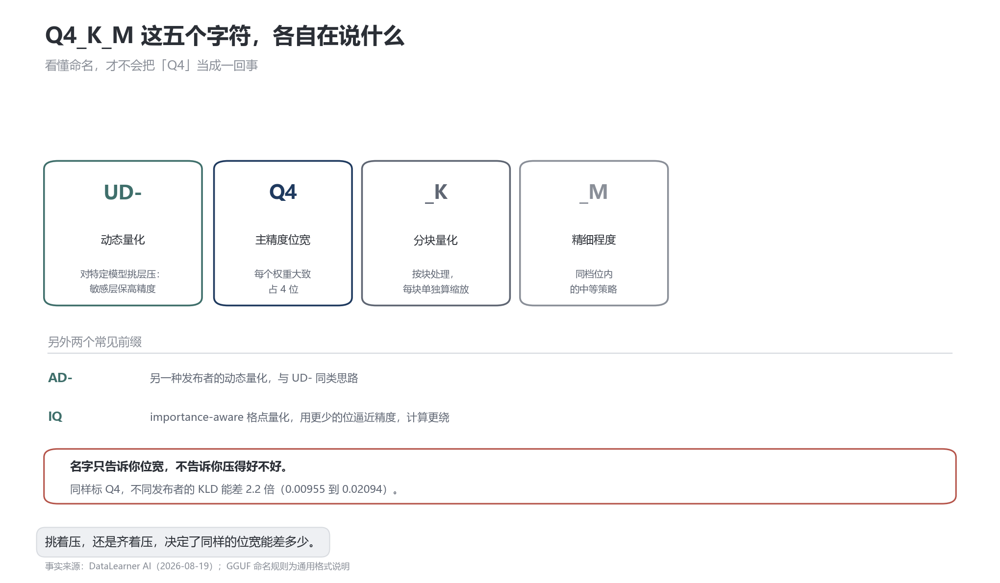
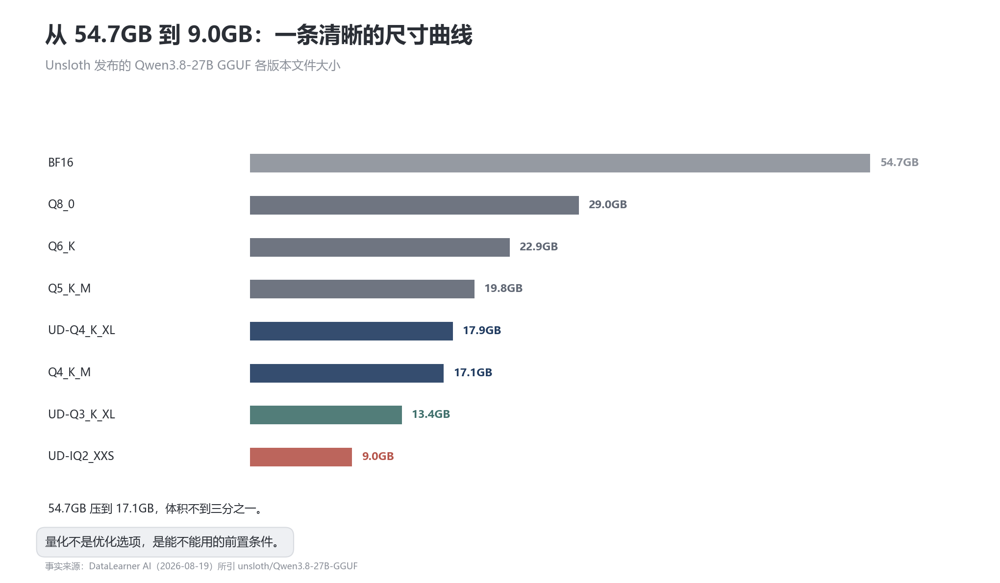
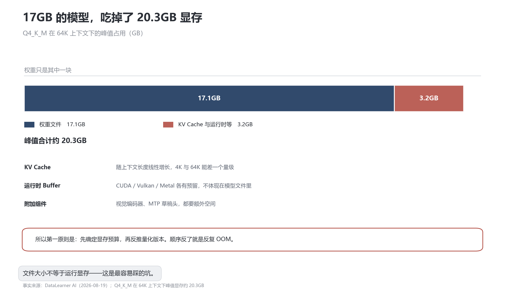
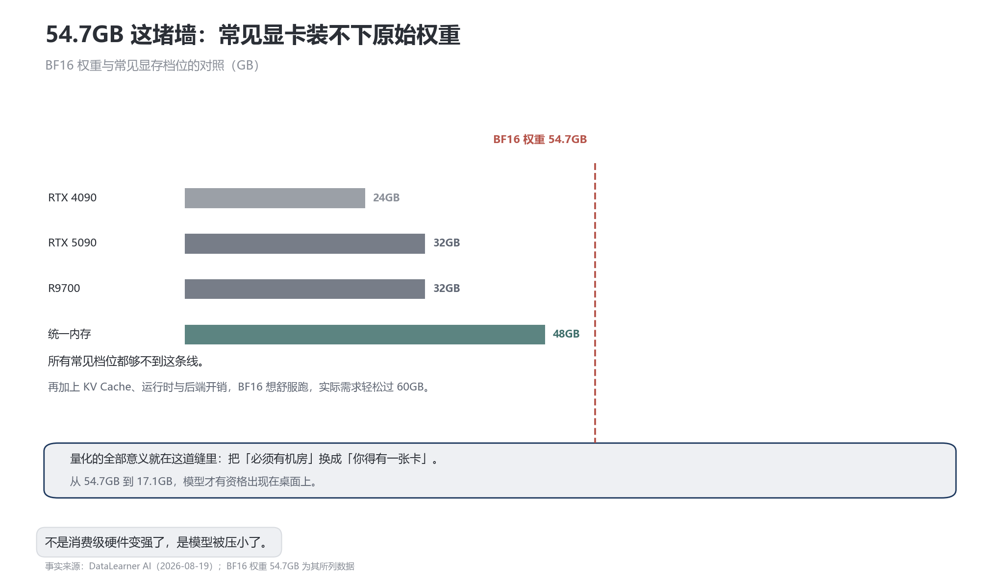
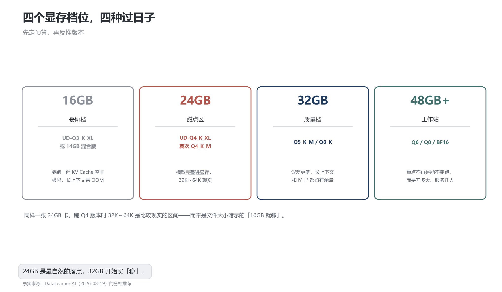

# 量化到底是什么：把一个 27B 模型从 54.7GB 压到 17GB，钱省在哪，代价又在哪

Qwen3.8-27B 最近在本地模型圈里被讨论得很多。原因不是它参数大——27B 在今天不算大——而是它把一个相当能打的 Coding、Agent 和长上下文能力，塞进了消费级显卡有机会跑起来的体积里。

官方数据摆在那儿：Terminal Bench 2.1 得 73.0，SWE-bench Pro 得 61.7，Artificial Analysis 的 Intelligence Index 是 52。这个成绩已经不属于"能在本地聊聊天就不错"的档次。

但真正卡住人的不是"它强不强"，是另一件事：原始 BF16 权重大约 54.7GB，你手上那张卡装不下。

于是所有人都绕不开同一个词——量化。这篇就讲清楚三件事：量化是什么，为什么非做不可，以及它和显存到底是什么关系。

## 一、量化是什么：把每个数字的位数砍下来

大模型的权重本质是一大堆浮点数。训练和原始发布时，每个数字通常占 16 位（BF16），少数场景用 32 位。

量化就是把这些数字的位数压低：从 16 位压到 8 位、6 位、5 位、4 位，极端情况下压到 2 位甚至更低。位数少了，存储每个数字占的空间就少，整个模型文件自然变小。

道理就这么简单。但真正决定成败的是"怎么压"——因为简单粗暴地砍位数，模型会垮。

所以实际的做法要精细得多。以 GGUF 格式里那些看起来像乱码的名字为例：Q4_K_M、UD-Q4_K_XL、IQ3_XXS，每个字母都在说明不同的策略。

Q 后面跟的数字是主精度位宽；K 表示用了 K-quant 分块量化，把权重按块处理、每块单独算缩放系数；M、S、XL、XXS 这些后缀标的是同一档位内的精细程度。而 I 开头（如 IQ3）用的是更复杂的格点量化（importance-aware），用更少的位逼近同样的精度，代价是计算更绕。

更进一步的是 UD 和 AD 这类前缀——它们代表发布者对特定模型做过动态量化：哪些层敏感就保留高精度，哪些层不敏感就压得更狠。

一句话：**量化不是"一刀切降精度"，而是"挑着压"。** 挑得好不好，直接决定了同样标称 Q4 的两个文件，实际能力可能差一截。

## 二、为什么非量化不可：54.7GB 那堵墙

先把这笔账算清楚。Qwen3.8-27B 的 BF16 权重是 54.7GB——注意，这只是权重本身。

要真的跑起来，你还得给 KV Cache 留位置（上下文越长占得越多），给运行时 Buffer 留位置，给 CUDA、Vulkan 或 Metal 这些后端留开销。如果模型带视觉组件或者启用 MTP（多 token 预测），还要再往上加。

加起来，BF16 想舒服地跑，实际需求轻松越过 60GB。这不是消费级单卡能碰的区间——24GB 的 4090 差了一倍多，32GB 的 5090 也不够。

所以量化在这里不是一个"优化选项"，而是**能不能用**的前置条件。

社区已经把这个需求填得很满。以 Unsloth 发布的 GGUF 为例，一条清晰的尺寸曲线摆在那里：

- BF16：54.7GB，原始参考版本
- Q8_0：29.0GB，接近原始精度
- Q6_K：22.9GB，高质量量化
- Q5_K_M：19.8GB，质量与占用的折中
- UD-Q4_K_XL：17.9GB，很有竞争力的 4bit 方案
- Q4_K_M：17.1GB，最通用的 4bit 方案
- UD-Q3_K_XL：13.4GB，面向 16GB 显存
- UD-IQ2_XXS：9.0GB，极限低显存体验版

从 54.7GB 到 17.1GB，体积压到不到三分之一。这就是量化最直观的价值：**它把一款原本只属于机房的模型，搬到了桌面上。**

## 三、最容易踩的坑：文件大小不等于运行显存

这是全篇最该记住的一句话。

你看到一个 Q4 模型是 17GB，很自然会想"我有 16GB 显存，差不多能跑"。这个推断会把你带进坑里。

因为 17GB 只是权重躺在硬盘上的大小。真正加载进显存运行时，还要额外算上这几笔：

**第一笔是 KV Cache。** 它随上下文长度线性增长。同样一个模型，跑 4K 上下文和跑 64K 上下文，KV Cache 的占用能差出一个量级。长上下文不是免费的。

**第二笔是运行时 Buffer 和后端开销。** CUDA、Vulkan、Metal 各有各的预留，这部分不体现在模型文件里，但实打实占显存。

**第三笔是附加组件。** 视觉编码器、MTP 的草稿头，都要额外的空间。

所以本地部署的第一原则不是"看模型文件多大"，而是反过来：**先确定你的显存预算，再反推该选哪个量化版本。** 顺序搞反了，就是反复下载、反复 OOM。

有一组实测能让这件事更具体：Q4_K_M 在 64K 上下文下，峰值显存大约 20.3GB。也就是说，一张 24GB 的 3090 或 4090 跑这个版本，32K 到 64K 是比较现实的区间——而不是文件大小暗示的"16GB 就够"。

## 四、按显存反推：四个档位的真实差别

顺着"先定预算"的思路，四个常见档位的选择逻辑其实很清楚。

**16GB：能跑，但是妥协档。** 可选 UD-Q3_K_XL（13.4GB），或者社区针对混合架构定制的 14GB 左右特殊版本。问题有三个：量化误差更高、留给 KV Cache 的空间极其有限、一旦上长上下文或开视觉就容易 OOM。结论是——它能运行，但不是这款模型舒服的档位。重度 Coding 和 Agent 用途下，16GB 更像"能体验"，不是"长期最佳"。

**24GB：最值得推荐的甜点区。** 道理很直接：Q4_K_M 是 17.1GB、UD-Q4_K_XL 是 17.9GB，一张 24GB 卡可以把模型完整放进显存，同时还留出 KV Cache 和运行时的余量。这就是 Qwen3.8-27B 最自然的落点。普通用户问"先下哪个"，答案通常是 UD-Q4_K_XL，其次 Q4_K_M。

**32GB：进入"质量更舒服"的区间。** 到这一档，重点变了——不再只是"能不能塞进去"，而是能考虑 Q5_K_M、Q6_K，或者更高质量的动态 Q5/Q6 版本。量化误差更低、长上下文能留更多空间、开 MTP 后还能维持性能。如果你的场景以 Coding 和 Agent 为主，32GB 配 Q5/Q6 往往比 24GB 配 Q4 更稳。

**48GB 以上：追求质量上限。** Q6、Q8，视后端和空间甚至 BF16 都能考虑。这时问题已经不是"能不能跑"，而是长上下文开多大、要不要开 MTP、要不要跑视觉、要不要给多人共享。

## 五、两件容易混淆的事：dense 和内存带宽

最后澄清两个常被搞混的点。

**第一，Qwen3.8-27B 是 dense 模型，不是 MoE。** 很多人习惯了 35B-A3B 这类 MoE——总参数大，但每个 token 只激活一小部分，所以低配设备上也能跑得不错。Qwen3.8-27B 不一样，每个 token 都要完整走 27B 的参数。

这解释了一个看起来矛盾的现象：某些 Qwen MoE 模型在低配设备上还挺快，Qwen3.8-27B 参数总量更小，CPU 上反而更慢。这不是模型退步，是计算结构不同。

**第二，Apple Silicon 上量化的收益格外明显。** 因为大模型解码过程很大程度是内存带宽受限——每生成一个 token，都要把整套权重从内存搬一遍。量化把权重体积压小，搬运的数据量就少，速度自然上去。所以在 Mac 上，用 BF16 的速度去判断"这个模型能不能用"，会得出完全错误的结论。

这也顺带解释了纯 CPU 用户的处境：能跑，但不适合重度使用。带宽和算力都不是为这种负载准备的。

## 落到：量化是在买一张门票

回到最开始那个数字：54.7GB 到 17GB。

量化做的不是让模型变强，而是让它在你的硬件上**存在**。它把"必须有机房"这个前提，换成了"你得有一张 24GB 的卡"。

这笔交易里，体积是明面上的账，另外两笔账要往后看：量化会损失一些能力，而损失的多少取决于压到哪一档、用的哪个版本；同时，显存省下来之后，还要在上下文长度和速度之间再分一次。

所以"选哪个量化版本"从来不是一个孤立的问题。它连着三件事：你的卡有多少显存，你能接受多少能力损失，以及你打算把上下文开到多长、速度要多快。这三件事必须一起算，任何一项单独拍板，都会让你反复下载、反复重配。

---

*事实来源：本文数据与判断依据 DataLearner AI 博客《Qwen3.8-27B 本地部署完全指南：量化版本怎么选，效果差多少，速度有多快？》（2026-08-19，datalearner.com/blog/qwen3-8-27b-local-deployment-quantization-guide）。其中：Qwen3.8-27B 为 27B dense 模型，官方模型卡数据 Terminal Bench 2.1 得 73.0、SWE-bench Pro 得 61.7、CoWorkBench 得 70.7、Artificial Analysis Intelligence Index 为 52；BF16 原始权重约 54.7GB；Unsloth 发布的 GGUF 版本尺寸曲线为 BF16 54.7GB、Q8_0 29.0GB、Q6_K 22.9GB、Q5_K_M 19.8GB、UD-Q4_K_XL 17.9GB、Q4_K_M 17.1GB、UD-Q3_K_XL 13.4GB、UD-IQ2_XXS 9.0GB；运行时显存在权重之外还需 KV Cache、Runtime Buffer、CUDA/Vulkan/Metal 后端开销、长上下文额外占用，以及视觉组件或 MTP 的额外开销；Q4_K_M 在 64K 上下文下峰值显存约 20.3GB。Q8/Q6/Q5/Q4/Q3/Q2 的档位定位、16GB 可选 UD-Q3_K_XL 与社区定制约 14GB 混合量化版本、24GB 首选 UD-Q4_K_XL 次选 Q4_K_M、32GB 考虑 Q5_K_M 与 Q6_K、48GB 以上可考虑 Q6/Q8 乃至 BF16，均为该文给出的推荐。GGUF 命名规则（Q 为位宽、K 为 K-quant 分块量化、M/S/XL/XXS 为同档精细度、I 开头为 importance-aware 格点量化、UD/AD 为动态量化）为对该格式的通用说明。文中"先确定显存预算再反推量化版本""文件大小不等于运行显存"为该文明确提出的原则。*

*需说明三点。其一，Qwen3.8-27B 的模型规格与榜单成绩引自该文转述的官方模型卡，本文未另行核对 Hugging Face 原始页面。其二，各量化版本的具体文件名、大小与发布者归属（Unsloth、AtomicChat、LM Studio、ggml-org 等）来自该文所列的 Hugging Face 仓库与社区测试，属第三方发布，非 Qwen 官方提供。其三，"dense 模型每个 token 都要完整走 27B""Apple Silicon 解码受内存带宽限制"为该文的解释性表述，本文沿用并作了通俗化改写；KV Cache 随上下文线性增长、128K 约为 64K 的两倍，为通行技术常识，非该文明示数据。*
