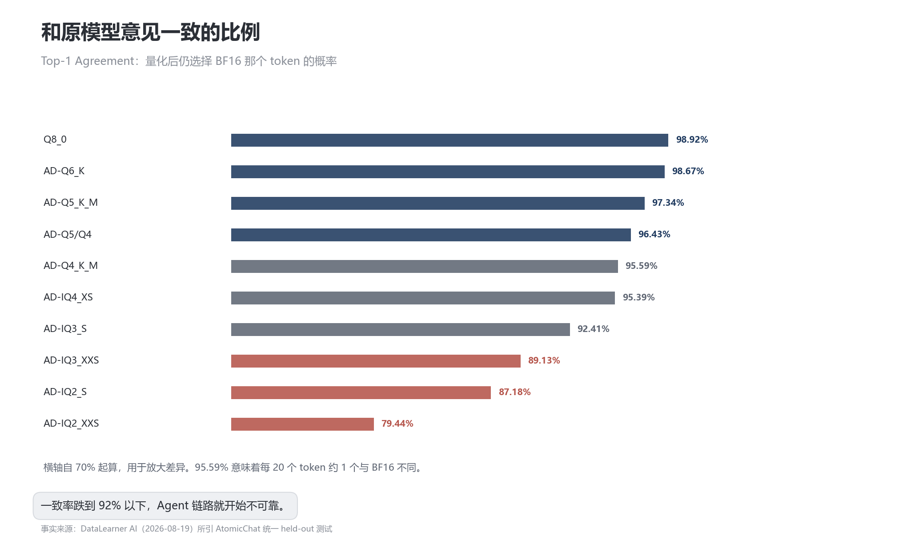
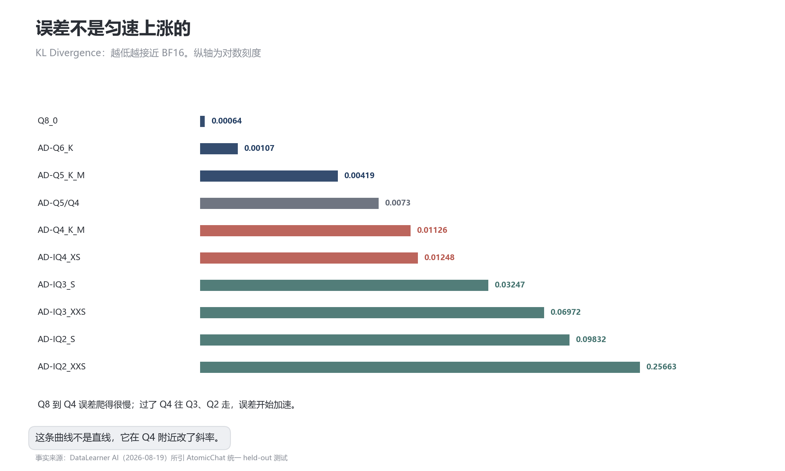
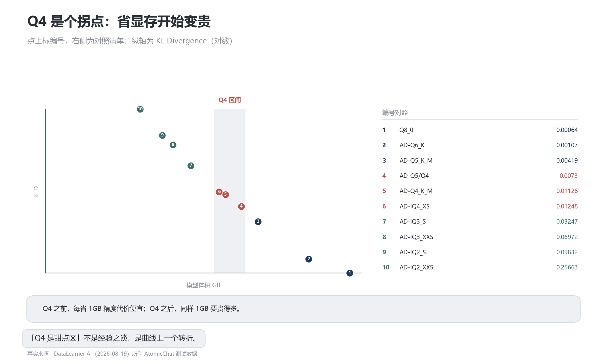
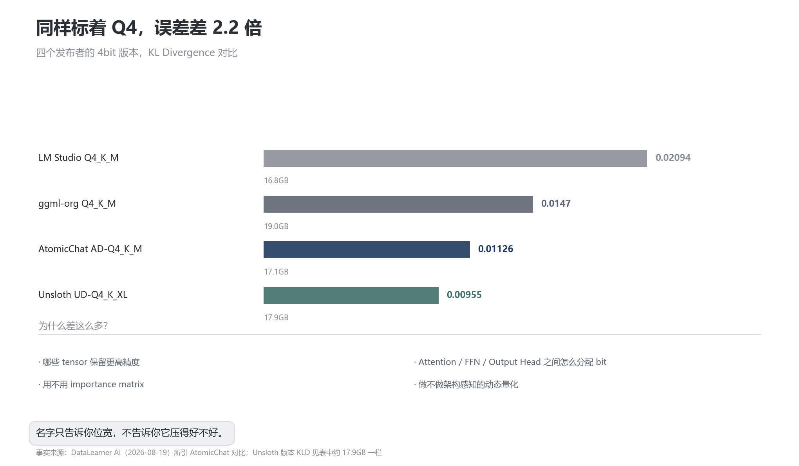
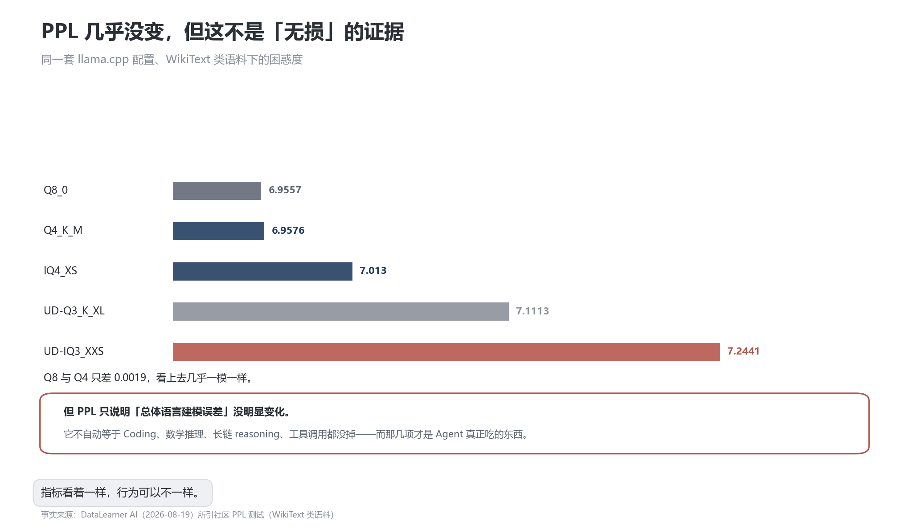

# 量化到底损失了什么：四个指标，两种陷阱，一个拐点

Qwen3.8-27B 是 27B 的 dense 模型，BF16 原始权重大约 54.7GB。想把它装进一张 24GB 或 32GB 的消费级显卡，只能靠量化——把权重的位数从 16 位压到 8、6、5、4 位，体积能降到三分之一左右。

但量化不是免费的，它会损失能力。而"损失了多少能力"这件事很难直接看见。模型还能正常回话，代码还能正常写，你很难凭感觉判断它比原始版本差了多少。所以社区才需要指标——用数字把那点细微的退化挤出来。

对 Qwen3.8-27B 这种明确定位在 Coding 和 Agent 上的模型，这件事尤其重要。因为这类任务不是"答对答错"的二元判断，而是几十步连续操作里每一步都不能偏。单步错一点，走到第十步就完全跑偏了。

## 一、先认识两个能看见损失的指标

目前最有参考价值的一组数据，来自 AtomicChat 对不同 GGUF 版本做的统一 held-out 测试。它给了两个指标，分工很明确。

**KL Divergence（KLD）**，衡量的是量化后模型的输出分布，和 BF16 原始分布之间差多远。数值越低越接近，0 就是完全一致。

**Top-1 Agreement**，衡量的是量化后的模型有多大概率，仍然选择 BF16 会选的那个下一个 token。这是个更直白的指标——可以直接读成"和原模型的意见一致率"。

两个指标放在一起看，才有意义。KLD 反映整体分布的偏移，Top-1 反映最关键那个决策是否还对。有些量化方案 KLD 略微上升但 Top-1 掉得不多，说明它偏移的是那些本来就无关紧要的低概率选项。

还要说明这组数据为什么可信：它做的是统一 held-out 测试，所有版本都在同一批模型没见过的样本上、用同样方法测。很多流传的量化对比并不满足这一点——语料不同、配置不同，结果就没法横向比较。

数据是这样的：

- Q8_0：28.9GB，KLD 0.00064，Top-1 98.92%
- AD-Q6_K：25.0GB，KLD 0.00107，Top-1 98.67%
- AD-Q5_K_M：20.2GB，KLD 0.00419，Top-1 97.34%
- AD-Q5/Q4：18.6GB，KLD 0.00730，Top-1 96.43%
- AD-Q4_K_M：17.1GB，KLD 0.01126，Top-1 95.59%
- AD-IQ4_XS：16.5GB，KLD 0.01248，Top-1 95.39%
- AD-IQ3_S：13.8GB，KLD 0.03247，Top-1 92.41%
- AD-IQ3_XXS：12.1GB，KLD 0.06972，Top-1 89.13%
- AD-IQ2_S：11.1GB，KLD 0.09832，Top-1 87.18%
- AD-IQ2_XXS：9.0GB，KLD 0.25663，Top-1 79.44%

先别急着记具体小数，看趋势。趋势比任何一个数字都重要。

## 二、Q4 是一个很明显的拐点

把上面那张表按体积排序读一遍，会发现变化不是匀速的。

**从 Q8 到 Q4 这一段，体积掉得很凶，但误差爬得很慢。** Q8_0 是 28.9GB、Top-1 98.92%，一路压到 Q4_K_M 的 17.1GB，体积少了 41%，Top-1 只掉到 95.59%——掉了 3.3 个百分点。

**从 Q4 再往下压，误差开始加速。** Q4_K_M 到 IQ3_S：体积从 17.1GB 降到 13.8GB（少 19%），Top-1 从 95.59% 掉到 92.41%（掉 3.2 个百分点）。同样的跌幅，付出的体积代价小了一半。

再往下更陡。IQ3_XXS 到 IQ2_XXS：体积从 12.1GB 到 9.0GB，Top-1 从 89.13% 直接摔到 79.44%——**掉了将近 10 个百分点。**

这就是"Q4 是甜点区"这句话的数据依据。它不是一句经验之谈，而是曲线上一个确实存在的转折：在 Q4 之前，你每省一 GB 显存付出的精度代价相对便宜；过了 Q4，同样的显存省下来要贵得多。

Q5 的位置值得单独说。AD-Q5_K_M 是 20.2GB、Top-1 97.34%，比 Q4_K_M 只多占 3.1GB，却把一致率抬高近 1.8 个百分点——**每多花 1.7GB 换 1 个百分点，这笔交换是划算的。**

具体到档位，可以这样读：

- **Q8/Q6**：精度接近原始，适合要质量上限的人
- **Q5**：质量和体积平衡得很好
- **Q4**：进入性价比最划算的区间
- **Q3/Q2**：可以跑，但妥协肉眼可见

## 三、同样叫 Q4，误差能差一倍

这里有个特别容易被忽略的事实：**不同人发布的 Q4，不是一回事。**

AtomicChat 做过一组对比，把 4bit 附近的几个版本放在一起：

- LM Studio Q4_K_M：16.8GB，KLD 0.02094
- ggml-org Q4_K_M：19.0GB，KLD 0.01470
- AtomicChat AD-Q4_K_M：17.1GB，KLD 0.01126
- Unsloth UD-Q4_K_XL：约 17.9GB，KLD 0.00955

最差和最好的差了 2.2 倍——同样是标着 4bit 的东西。

原因在于量化从来不是"统一把 16 位变 4 位"这么机械。真正影响结果的是这些选择：哪些 tensor 保留更高精度、Attention 和 FFN 与 Output Head 之间怎么分配 bit、用不用 importance matrix、做不做架构感知的动态量化。

所以"Q4 版本怎么选"这个问题，不能只看名字。**名字只告诉你位宽，不告诉你它压得好不好。** 还得看发布者有没有做过针对性优化、有没有公开质量测试数据。

就现有公开材料看，Unsloth 的 UD-Q4_K_XL 和 AtomicChat 的 AD-Q4_K_M 都属于值得关注的那一类；如果你更看重兼容性和通用性，传统 Q4_K_M 仍是最保险的入口。

## 四、PPL 几乎不变，但这不等于"无损"

现在要讲第二个陷阱，也是更隐蔽的一个。

社区里流传着不少基于 WikiText 的 PPL（困惑度）测试。有人用同一套 llama.cpp 配置跑出过这样的结果：

- Q8_0：PPL 6.9557
- Q4_K_M：PPL 6.9576
- IQ4_XS：PPL 7.0130
- UD-Q3_K_XL：PPL 7.1113
- UD-IQ3_XXS：PPL 7.2441

看到这里，很多人会得出一个结论：Q4 的 PPL 和 Q8 几乎一样（6.9576 对 6.9557，差 0.002），所以 Q4 基本无损。

这个结论不能算完全错，但必须加限制。

因为 PPL 只说明一件事：**模型在通用语料上的整体语言建模误差没有明显变化。** 它不自动等于另外四件事：

- Coding 能力完全没掉
- 数学推理完全没掉
- 长链 reasoning 完全没掉
- Tool Calling 和 Agent 行为完全没掉

而前面那组 KLD 和 Top-1 数据恰好说明了这一点：即便 Q4 的 PPL 已经很贴近原模型，它的 token 级行为仍然和 BF16 有可测量的差异——95.59% 的一致率，意味着每 20 个 token 里大约就有 1 个选的和原模型不一样。

在闲聊场景，这个差异基本感知不到。在 Agent 场景，一次工具调用的参数错一个字，整条链路就可能失败。

举个具体的例子：让模型调用搜索工具，参数里有个日期字段。95.59% 的一致率意味着，二十次里约有一次它会把日期写成别的格式。这个 token 在语言建模上完全合理，PPL 几乎不会因此上涨，但对严格校验格式的工具来说，这次调用就是失败的。

这就是为什么 Agent 场景对量化的宽容度远低于聊天：**损失不是平均分布的，它更可能落在低概率但高风险的决策点上。**

所以更准确的说法是：**Q4 在总体语言建模指标上非常接近原模型，但在高难任务和复杂 agent 场景里，仍然可能比 Q5/Q6 更容易出现细微退化。**

这也直接推出一条实践建议：如果你的目标不是日常聊天，而是把 Qwen3.8-27B 当相对严肃的 Coding Agent，那么只要硬件允许，优先考虑 Q5 或 Q6，而不是永远默认 Q4。

## 五、这些指标该怎么用

把四个指标的分工理一遍：**KLD** 看整体分布偏移，适合横向比较不同发布者的同一档位；**Top-1 Agreement** 看关键决策的一致率，最直观，适合判断能不能当主力；**PPL** 看通用语言建模，适合快速筛掉明显崩坏的版本，但不适合作为"无损"的证据；**真实任务评测**才是最终裁判，可惜这部分公开数据最少。

务实的顺序是：先用 PPL 排除明显不合格的，再用 KLD 和 Top-1 在同一档位里挑发布者，最后用自己的实际任务跑一遍。

## 落到：损失是连续的，不是有或没有

量化损失最容易被误解成"能用"和"不能用"两个状态。实际上它是一条连续的曲线，你每往下压一档，都在往曲线的更陡处走一点。

Q4 之所以被反复推荐，是因为它恰好落在曲线开始变陡之前——显存已经降得足够低，行为还没出现明显崩塌。而 Q3、Q2 之所以要慎用，是因为那里每省一点空间，都在拿掉相当一部分一致性。

还有一个反直觉的结论值得记住：**同样的位宽，不同的压法，损失可以差一倍以上。** 这意味着在选型时，"选 Q4"只是第一步，"选谁压的 Q4"才是第二步。

指标能告诉你损失有多大，但不能替你决定能接受多少。那个答案取决于你拿这个模型做什么——聊天可以宽容，Agent 不能。

---

*事实来源：本文数据与判断依据 DataLearner AI 博客《Qwen3.8-27B 本地部署完全指南：量化版本怎么选，效果差多少，速度有多快？》（2026-08-19）。其中：KL Divergence 与 Top-1 Agreement 数据来自 AtomicChat 对不同 GGUF 版本做的统一 held-out 测试，具体为 Q8_0 28.9GB／KLD 0.00064／Top-1 98.92%、AD-Q6_K 25.0GB／0.00107／98.67%、AD-Q5_K_M 20.2GB／0.00419／97.34%、AD-Q5/Q4 18.6GB／0.00730／96.43%、AD-Q4_K_M 17.1GB／0.01126／95.59%、AD-IQ4_XS 16.5GB／0.01248／95.39%、AD-IQ3_S 13.8GB／0.03247／92.41%、AD-IQ3_XXS 12.1GB／0.06972／89.13%、AD-IQ2_S 11.1GB／0.09832／87.18%、AD-IQ2_XXS 9.0GB／0.25663／79.44%；同为 4bit 附近的横向对比为 LM Studio Q4_K_M 16.8GB／KLD 0.02094、ggml-org Q4_K_M 19.0GB／0.01470、AtomicChat AD-Q4_K_M 17.1GB／0.01126、Unsloth UD-Q4_K_XL 约 17.9GB／0.00955；基于 WikiText 类语料的 PPL 测试为 Q8_0 6.9557、Q4_K_M 6.9576、IQ4_XS 7.0130、UD-Q3_K_XL 7.1113、UD-IQ3_XXS 7.2441；"Q4 是拐点""Q4 在总体语言建模指标上非常接近原模型，但在高难任务和复杂 agent 场景仍可能比 Q5/Q6 更容易出现细微退化""若目标是严肃 Coding Agent，硬件允许时优先 Q5 或 Q6"均为该文判断；影响量化结果的因素包括哪些 tensor 保留更高精度、Attention/FFN/Output Head 的 bit 分配、是否使用 importance matrix、是否做架构感知的动态量化。*

*需说明四点。其一，KLD 与 Top-1 Agreement 属第三方社区测试结果（AtomicChat 发布于 Hugging Face），非 Qwen 官方发布，本文照引未作独立复现。其二，PPL 测试结果为社区测试者在同一套 llama.cpp 配置下跑出，语料为 WikiText 或类似语料，不同语料与配置会得出不同数值。其三，"二十次里大约有一次"由 95.59% 一致率换算而来，属本文算术，用于说明量级，非该文表述；参数格式错误导致工具调用失败的具体场景为本文举例，非实测案例。其四，"损失更可能落在低概率但高风险的决策点上"为作者分析，该文未以此措辞表述。*
