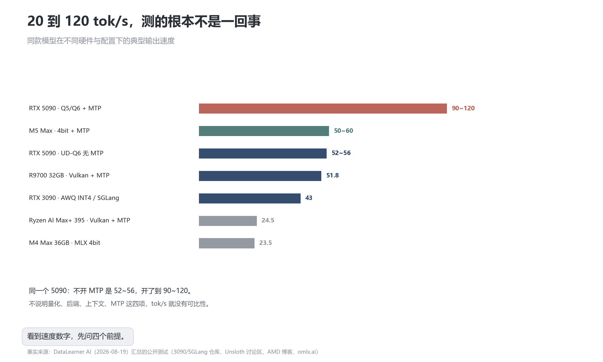
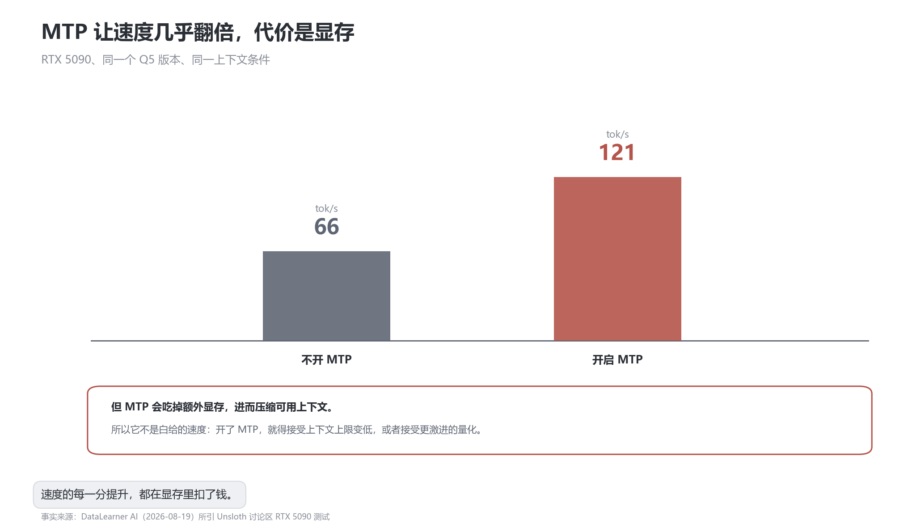
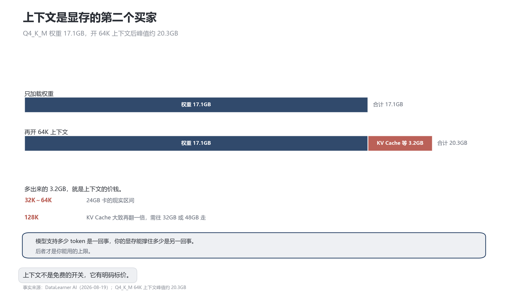
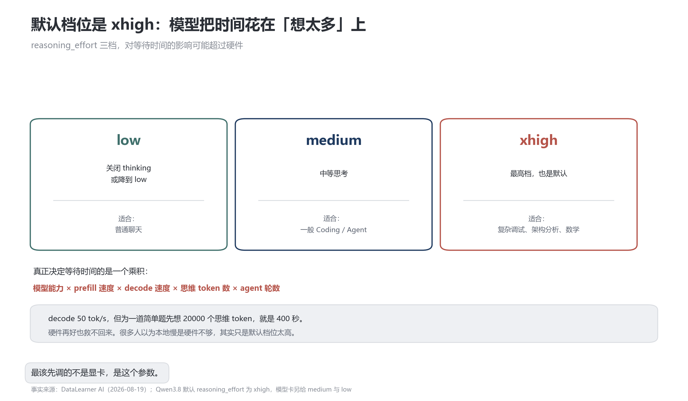
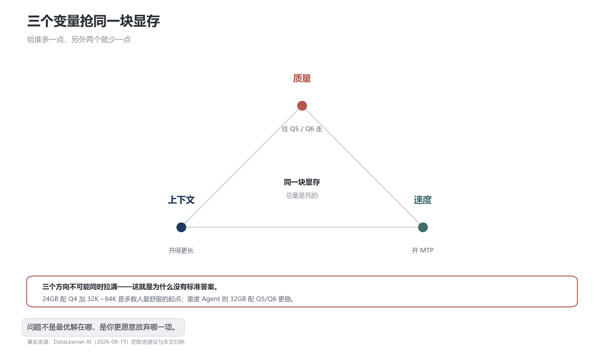

# 质量、上下文、速度：三个变量抢同一块显存，你只能选两个

Qwen3.8-27B 的 BF16 权重约 54.7GB，想装进 24GB 或 32GB 的消费级显卡，必须量化。而一旦量化，问题就分成两层：先选版本（Q4、Q5、Q6……），再定这一版本怎么用。

很多人卡在第二层。因为你最终要回答的不是"Q4 损失了多少"，而是"我这台机器上，到底该怎么配"。

这个问题没有统一答案，原因是三个变量在抢同一块显存：**质量要占、上下文要占、速度也要占。** 显存总量是死的，你在这三项里给谁多一点，另外两项就少一点。

先把最容易搞混的一件事说清楚。

## 一、为什么有人测出 20 tok/s，有人却测出 100

关于 Qwen3.8-27B 的速度，网上能看到差别极大的数字：有人 20 tok/s，有人 40 到 60，还有人直接跑到 100 以上。

这些数字并不一定互相矛盾，因为大家测的根本不是同一件事。至少要区分四个变量：

**量化版本。** Q4 和 Q6 的权重体积不同，每生成一个 token 要搬运的数据量就不同。在带宽受限的场景，这一项直接决定速度。

**后端。** llama.cpp、SGLang、MLX、Ollama，四套东西的优化路径完全不一样，同一张卡上跑出来的数可能差两三成。

**上下文长度。** 这是最容易被忽略的变量。上下文越长，KV Cache 越大，注意力计算量也越大，速度自然往下掉。

**是否开启 MTP。** 这一项能让速度接近翻倍，后面单独讲。

所以看到一个 tok/s 数字，第一反应该是问：什么量化、什么后端、多长上下文、开没开 MTP。四个条件不说清楚，这个数字基本没有参考价值。

## 二、Prefill 和 Decode 是两个速度

还有一个更基础的区分：**Prefill 速度和 Decode 速度不是一回事。**

Prefill 是模型读输入的过程——你给它的提示词、历史对话、工具返回的结果，都要先过一遍。Decode 是它一个字一个字往外吐的过程。大多数人说的 tok/s 指的是后者。

但对 Agent 场景来说，**Prefill 往往更关键。**

原因在于 Agent 的工作方式：它会不断把历史上下文、工具调用结果、代码片段重新喂回模型。每一轮都要重新 prefill 几万甚至十几万 token。如果 prefill 慢，那么即使解码能到 50 tok/s，整体体验依然很差——你在等它"读完"，而不是等它"说完"。

这就解释了一个常见困惑：明明单看 tok/s 还不错，实际用起来却觉得卡。因为测速通常用短提示，而 Agent 用的是长上下文加多轮。

## 三、MTP：几乎翻倍，代价是显存

Qwen3.8-27B 原生训练了 MTP（Multi-Token Prediction），可以通过投机解码一次尝试预测多个 token，再由主模型验证。对的部分直接采纳，错的部分回退。

效果很可观。在 RTX 5090 的一个测试里，同一个 Q5 版本：不开 MTP 大约 66 tok/s，开启后大约 121 tok/s。**几乎翻倍。**

但代价必须说清：**MTP 会吃掉额外显存，进而压缩可用上下文。**

这就回到了那个三方争夺的格局。MTP 不是白给的速度，它是用在显存里划走一块换来的。你开了 MTP，就得接受上下文上限变低，或者接受更激进的量化。

顺带一提，这也是判断一个速度数据是否可信的关键：如果一个"超高 tok/s"的结论没说上下文长度、也没说有没有开 MTP，那它很可能是在最有利的条件下测出来的峰值，不代表你能拿到的体验。

## 四、上下文是显存的第二个买家

上下文对显存的消耗是线性的，这一点值得单独强调，因为它最容易被低估。

前面提过一组实测：Q4_K_M 在 64K 上下文下，峰值显存大约 20.3GB。而模型文件本身只有 17.1GB。也就是说，**光是把上下文开到 64K，就多吃了 3GB 以上。**

这条曲线往上走得更快。上下文从 64K 到 128K，KV Cache 大致再翻一倍。所以一张 24GB 的卡，跑 Q4 版本，32K 到 64K 是比较现实的区间；想上到 128K 甚至更长，就得往 32GB 或 48GB 走。

这里有个反直觉的地方：很多人以为"上下文长度"是模型的固有属性，只要模型支持 100 万 token，就应该能开到 100 万。实际上**模型支持多少是一回事，你的显存能撑住多少是另一回事。** 后者才是你能用的上限。

## 五、Reasoning Effort：最隐蔽的时间成本

最后一个变量跟硬件无关，但对体感的影响可能最大。

Qwen3.8 默认开启 thinking，而且默认 `reasoning_effort` 是 **xhigh**——最高档。模型卡里还给了 `medium` 和 `low` 两档。

这意味着什么？意味着你问一个普通问题，它可能先思考两万个 token 再开口。

本地用户经常只盯着 tok/s，但真正决定等待时间的是一个乘积关系：**模型能力 × prefill 速度 × decode 速度 × 思维 token 数 × agent 所需轮数。**

如果 decode 是 50 tok/s，但你为了一个简单问题等了 20000 个思维 token，那就是 400 秒。硬件再好也救不回来。

有人在实际使用后提过这点：Qwen3.8-27B 效果不错，但默认配置有比较明显的 overthinking 倾向。很多人误以为本地模型慢是硬件不够，其实有时候只是默认档位太高，模型把时间花在"想太多"上了。

实践中比较合理的分档是：**普通聊天关掉 thinking 或降到 low；一般 Coding 和 Agent 用 medium；复杂调试、架构分析、数学问题才用 xhigh。**

## 六、不同硬件上的实际速度长什么样

把公开测试里的数据整理一下，大概是这样一条谱系：

- RTX 3090 24GB，AWQ INT4 / SGLang：约 43 tok/s
- RTX 5090 32GB，UD-Q6 / llama.cpp，不开 MTP：约 52 到 56 tok/s
- RTX 5090 32GB，Q5/Q6 加 MTP：常见 90 到 120 tok/s
- Radeon AI PRO R9700 32GB，llama.cpp Vulkan 加 MTP：最高约 51.8 tok/s
- Ryzen AI Max+ 395，llama.cpp Vulkan 加 MTP：最高约 24.5 tok/s
- M4 Max 36GB，MLX 4bit：约 23.5 tok/s
- M5 Max，优化 4bit 加 MTP：社区约 50 到 60 tok/s

这张表最有意思的地方是 5090 那两行：同一张卡、同样的量化，开不开 MTP 差了将近一倍。所以讨论"5090 跑这个模型快不快"，答案完全取决于你问的是哪一种配置。

另外要注意 AMD 那两款和 Mac 的数字：它们看起来低，但那是不同功耗、不同架构下的结果，不能直接和独显比。

## 七、Apple Silicon 和纯 CPU 的特殊情况

这两类平台值得单独说，因为它们的瓶颈和独显不一样。

**Apple Silicon 上，量化的收益格外明显。** 解码很大程度受内存带宽限制——每生成一个 token 都要把整套权重从内存搬一遍。量化把体积压小，搬运量就少，速度自然上来。所以在 Mac 上，别用 BF16 的速度去判断"这模型能不能用"。

32GB 以上统一内存的 Mac，用 4bit 加 MLX 的组合已经有不错的可行性，这也是 Mac 用户比较推荐的路径。

**纯 CPU 则是另一回事：能跑，但不适合重度使用。** 这里要理解 Qwen3.8-27B 和 MoE 模型的区别。很多人习惯了 35B-A3B 这类结构——总参数大，但每个 token 只激活一小部分，所以低配设备上还算快。Qwen3.8-27B 是 dense 模型，每个 token 都要完整走 27B。

于是就出现那个反差：某些 Qwen MoE 在低配设备上跑得挺顺，Qwen3.8-27B 参数总量更小，CPU 上反而更慢。这不是模型退步，是计算结构变了——它把省下来的"选择性"换成了更稳定的能力。

## 落到：没有最优解，只有取舍

把五个变量放回同一个框架里，取舍就清楚了。

**要质量**，就往 Q5、Q6 走，代价是显存占用上升、能开的上下文变短。
**要长上下文**，就得在量化档位上让一步，或者加显存。
**要速度**，可以开 MTP，但 MTP 要占显存，最终又回到前两项的让渡。

三个方向不可能同时拉满。这就是为什么"Qwen3.8-27B 该怎么配"没有标准答案——它取决于你更愿意放弃哪一项。

不过可以给一个粗略的起点：24GB 显存配 UD-Q4_K_XL 或 Q4_K_M，上下文控制在 32K 到 64K，是大多数人最舒服的组合；如果你的场景是重度 Coding Agent，32GB 配 Q5/Q6 会更稳，因为你把"质量"这一项的权重调高了，代价是硬件预算。

最后提醒一句：这些参数都能调，成本很低。真正贵的不是试错，是拿着默认配置就下结论说"这模型本地不好用"。

---

*事实来源：本文数据与判断依据 DataLearner AI 博客《Qwen3.8-27B 本地部署完全指南：量化版本怎么选，效果差多少，速度有多快？》（2026-08-19）。其中：速度测试需区分量化版本、后端（llama.cpp／SGLang／MLX／Ollama）、上下文长度、是否开启 MTP 四个变量，并须区分 Prefill Speed 与 Decode Speed；典型速度区间为 RTX 3090 24GB 跑 AWQ INT4 / SGLang 约 43 tok/s、RTX 5090 32GB 跑 UD-Q6 / llama.cpp 无 MTP 约 52～56 tok/s、RTX 5090 32GB 跑 Q5/Q6 加 MTP 常见约 90～120 tok/s、Radeon AI PRO R9700 32GB 跑 llama.cpp Vulkan 加 MTP 最高约 51.8 tok/s、Ryzen AI Max+ 395 同后端加 MTP 最高约 24.5 tok/s、M4 Max 36GB 跑 MLX 4bit 约 23.5 tok/s、M5 Max 优化 4bit 加 MTP 社区约 50～60 tok/s；MTP 在 RTX 5090 上同一 Q5 版本由约 66 tok/s 提升至约 121 tok/s，且 MTP 会占用额外显存进而压缩可用上下文；Qwen3.8 默认开启 thinking 且默认 reasoning_effort 为 xhigh，模型卡另给 medium 与 low 两档；有人在实际体验中指出该模型默认配置存在 overthinking 倾向；建议普通聊天关闭 thinking 或降至 low、一般 Coding 与 Agent 用 medium、复杂调试与架构分析与数学问题用 xhigh；Q4_K_M 在 64K 上下文下峰值显存约 20.3GB；Qwen3.8-27B 为 dense 模型，每 token 完整经过 27B 参数，与 35B-A3B 等 MoE 结构不同；32GB 以上统一内存的 Apple Silicon 可考虑 4bit 加 MLX 组合；纯 CPU 能跑但不适合重度使用。*

*需说明四点。其一，所有 tok/s 数字均来自该文汇总的公开测试与社区讨论（含 0xSero 的 3090/SGLang 仓库、Unsloth GGUF 讨论区、AMD 官方博客、omlx.ai 基准页），非本文实测，不同环境下结果会显著不同。其二，"Prefill 往往比 Decode 更关键"是该文对 Agent 场景的判断，本文沿用；"测速通常用短提示而 Agent 用长上下文多轮"为作者补充解释。其三，上文所述"上下文从 64K 到 128K，KV Cache 大致再翻一倍"为基于线性关系的推算，非该文明示数据。其四，"24GB 配 Q4 加 32K～64K 是最舒服组合""32GB 配 Q5/Q6 更适合重度 Agent"为该文推荐与本文归纳，未考虑具体任务差异。*
