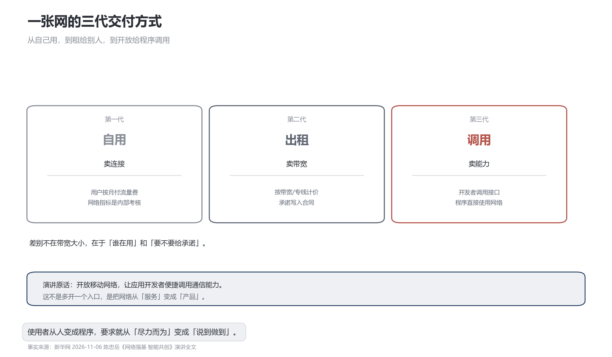
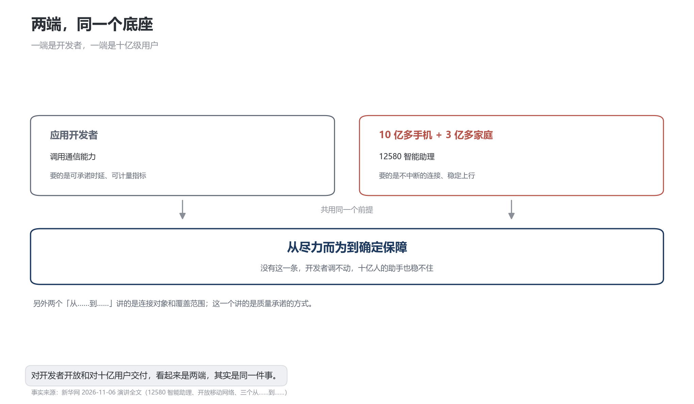
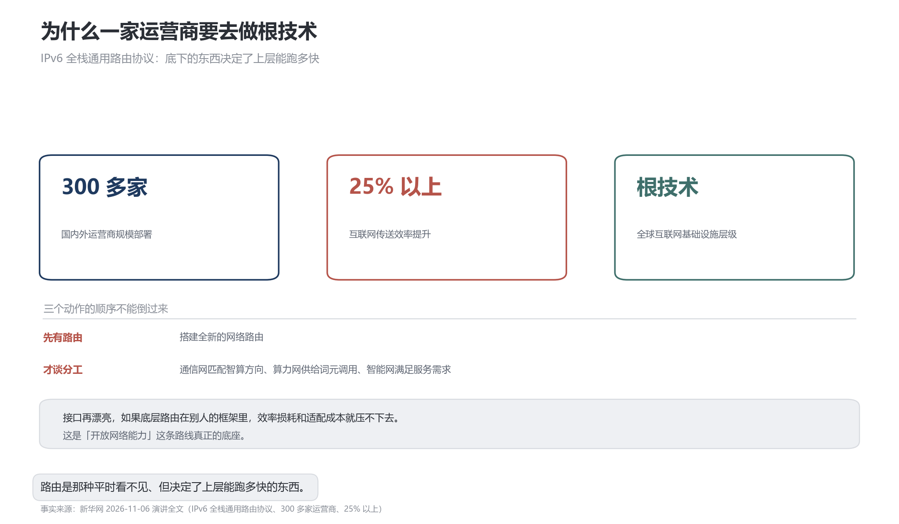

# 网络也能被"调用"：从修好给人用，到开放给程序用

11 月 6 日上午，中国移动董事长陈忠岳在广州的 2026 移动网络大会上做了一场题为《网络强基 智能共创》的主旨演讲。

整场演讲里，最容易被一眼带过的是这句话：**"开放移动网络，让应用开发者便捷调用通信能力。"**

它夹在"推出 12580 智能助理"和"汇聚内容资源"之间，前后都是面向消费者的表述，看起来不显眼。但对做网络的人来说，这句话的分量可能比前后两句都重——它说的是，这张网的使用者变了。

## 一、一张网的三代卖法

过去网络是怎么交付的？修好，然后卖连接。运营商负责把基站建到位、把带宽提上来，用户按月付流量费。网络的性能指标（覆盖率、时延、速率）是内部考核用的，用户能感知到的只有"快不快、稳不稳"。

这个模式下，网络的边界是清晰的：**它是被人用的。**

"开放移动网络"意味着另一件事：把网络能力拆成可调用的接口，让程序直接调用。这时候使用者不只是人，还有应用。应用需要的不是"一个月 30GB"，而是"这条消息要在 50 毫秒内送到"、"这次上行要给我 100Mbps"、"这个终端要优先保障"。

这里面有个关键的转变。人的需求是模糊的，网络尽力而为就够了；**程序的需求是明确的，达不到就是失败。** 一旦网络能力被写成接口，它就必须能给出确定的承诺、可计量的指标，否则调用方没法把它放进自己的业务逻辑里。

所以"开放"这两个字，本质上不是多开一个入口，是把网络从"服务"变成"产品"。

演讲里其实给了两个已经在这条路上的例子：建优铁路 5G 专网，加快超级上行的技术创新、产业协作和现网部署。铁路专网要的是可承诺的时延和可靠性，超级上行要的是把上行速率从"能用"提到"够用"。这两件事共同点在于——它们都不是"把带宽做大"，而是"把某一项指标变成可以写进合同的东西"。

而能被写进合同，才谈得上被程序调用。

## 二、12580：同一件事的消费侧镜像

演讲紧接着提到："推出 12580 智能助理，让 10 亿多手机客户、3 亿多家庭客户都拥有中国移动随身智能助手。"

这两个数字值得停一下。10 亿多手机客户、3 亿多家庭客户——这是国内任何一家互联网公司都难以企及的用户规模。而这个规模，恰恰是"网络能力开放"的另一面。

因为智能助手这类服务，对网络的要求和传统通话完全不同。它需要的是低时延的往返、稳定的上行、以及在移动状态下不中断的连接。如果网络只是一根"尽力而为"的管道，助手的体验就会随时延和抖动而崩掉。

3 亿多家庭客户这一侧又是另一种账。家庭场景是固定位置、多设备、长时间在线，对带宽的要求高于对移动性的要求。把它和 10 亿多手机客户摆在同一句话里，意味着这张网要同时接住"到处走的人"和"待在家的一屋子设备"——这两类负载的峰值时段、突发模式、故障容忍度都不一样。

换句话说，**要让 10 亿人用上随身助手，前提是这张网先学会"承诺"。**

再往回看演讲里通信网那三个"从……到……"——从人人通信到人机交互、从地面覆盖到空天地海、从尽力而为到确定保障——第三个正是这里的技术前提。前两个讲连接对象和覆盖范围变了，第三个讲的是质量承诺的方式变了。

对开发者开放和对 10 亿用户交付，看起来是两端，其实共用同一个底座。

## 三、底座为什么是根技术

演讲收尾处有一句容易漏掉的话：中国移动主导和定义了 IPv6 全栈通用路由协议，这是全球互联网根技术，已在国内外 300 多家运营商网络规模部署，促进互联网传送效率提升 25% 以上。

300 多家运营商、25%——这两个数字解释了一件事：为什么一家运营商要去碰"根技术"。

因为当你打算把网络能力开放给全世界的应用调用时，你面对的不再是自己的一张网，而是跨网、跨域、跨国的路由。你的接口再漂亮，如果底层的路由协议在别人的框架里，效率损耗和适配成本就压不下去。

演讲里的表述是，全面应用这个技术"搭建全新的网络路由，让通信网更加匹配智算方向，算力网更强供给词元调用，智能网更好满足服务需求"。

注意这个顺序：先有路由，才谈得上三张网各自的分工。路由是那种平时看不见、但决定了上层能跑多快的东西。

## 落到：谁在用这张网

把三件事放在一起看，逻辑是连贯的。

开发者调用通信能力，是让**程序**用这张网；12580 服务 10 亿多手机客户和 3 亿多家庭客户，是让**人**用这张网；IPv6 根技术撑住跨网路由，是让这**两种用法同时成立**还不互相拖累。

陈忠岳在演讲里给通信网的定位是"不只是流量管道，更应成为数智底座"。这句话如果只当成口号，读不出什么。但如果把它和"开放移动网络"这条具体动作放在一起，它的意思就清楚了：

管道只管把东西送到，底座要负责让上面长出东西。而能不能长出东西，取决于这张网有没有把能力交出去——交给开发者，也交给那 10 亿个随身助手。

---

*事实来源：2026 移动网络大会于 2026 年 11 月 5 日至 7 日在广州举行，中国移动董事长陈忠岳于 11 月 6 日上午发表题为《网络强基 智能共创》的主旨演讲。演讲通信网部分原文："从人人通信到人机交互、从地面覆盖到空天地海、从尽力而为到确定保障，通信网不只是'流量管道'，更应成为'数智底座'"；"依托通信网能力升级，加快'全球通'服务焕新。推出 12580 智能助理，让 10 亿多手机客户、3 亿多家庭客户都拥有中国移动随身智能助手。开放移动网络，让应用开发者便捷调用通信能力；汇聚内容资源，让广大消费者顺畅享用网络服务"；"中国移动主导和定义了 IPv6 全栈通用路由协议，是全球互联网根技术，已在国内外 300 多家运营商网络规模部署，促进互联网传送效率提升 25% 以上。中国移动全面应用这个技术，搭建全新的网络路由，让通信网更加匹配智算方向，算力网更强供给词元调用，智能网更好满足服务需求"；发展思路部分为"贯彻落实'六张网'建设部署，制定实施网络强基、全栈创新发展战略，坚持智为先、算为要、通为本，一体建强通信网、算力网、智能网"。以上均据新华网 2026-11-06 10:52 刊发的演讲全文（news.cn/info/20261106/04c53cb5449f4fada3bfde5a07860cc7/c.html）。本文为今日头条"网络强基 智能共创"征文活动方向一（织就新一代通信网，筑牢数智发展底座）而作。*

*需说明三点。其一，"开放移动网络"具体以何种形式开放（API 形态、开放范围、时间表、计费方式），演讲未披露，本文未作推测，仅就其含义展开分析。其二，"网络从服务变成产品""接口必须给出确定承诺"等为作者分析，中国移动未以此措辞表述；演讲对应表述为"从尽力而为到确定保障""让应用开发者便捷调用通信能力"。其三，10 亿多手机客户与 3 亿多家庭客户为演讲所给口径，本文照引，未另行核对其统计基准与时点。*