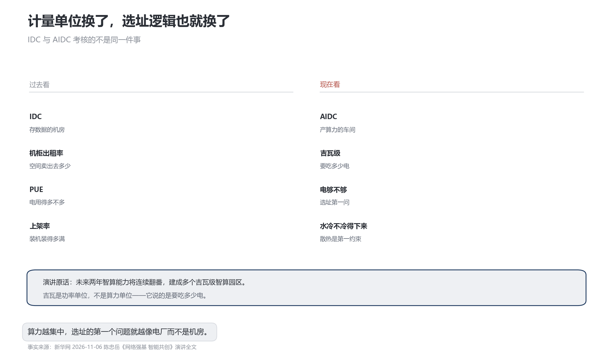
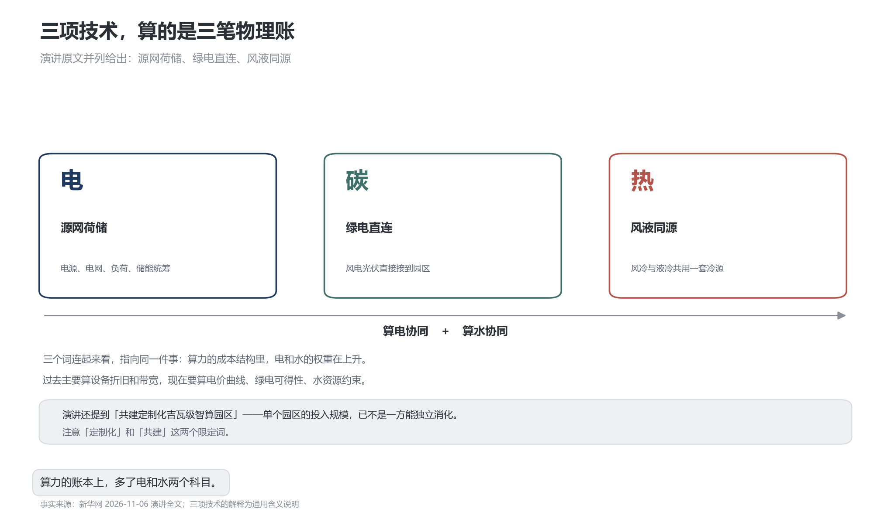
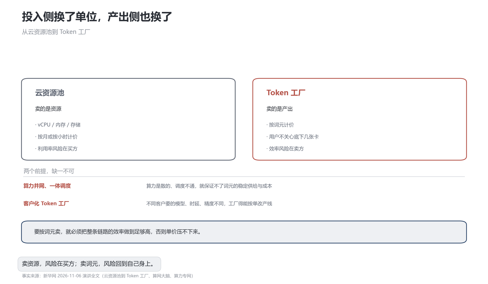

# 吉瓦之后：算力建设的瓶颈，从机房挪到了变电站

算力建设的新闻里，我们习惯了看"多少张卡""多少 P 算力"。所以当中国移动董事长陈忠岳在 11 月 6 日的《网络强基 智能共创》主旨演讲里说"建成多个吉瓦级智算园区"时，这个单位值得单独拎出来讲。

**吉瓦是功率单位，不是算力单位。**

一个吉瓦等于一百万千瓦。用这个单位描述园区，说的是它要吃多少电，而不是它有多少机柜。这个换算一换，整件事的性质就变了。

## 一、为什么用瓦特计量

传统 IDC 的考核指标是机柜出租率、PUE、上架率——本质上是"空间和效率"的生意。机房有多大、塞了多少台服务器、电用得多不多。

AIDC 不是这个逻辑。智算集群的特点是功率密度极高，而且必须持续跑满。一批 AI 加速卡满载时的功耗，和传统机架不在一个量级。于是选址的第一个问题不再是"楼够不够大"，而是"这附近有没有这么多电"。

演讲里的表述是：今年中国移动投资的最大增量在算力，在建成多个万卡智算集群的基础上，正在布局建设多个超大规模智算集群，未来两年智算能力将连续翻番，建成多个吉瓦级智算园区。

"连续翻番"和"吉瓦级"放在一起，意味着电力需求的曲线也是陡的。翻番一次是两倍，连续翻番就是四倍量级。这个增速，不是一个园区自己能解决的——它必须接进电网的规划里。

所以演讲紧接着谈的不是芯片，是"连算成网"：拓展 400G OTN 能力，全面贯通国家算力枢纽；加大空芯光纤应用；加快 CDN 扩容升级。这三个动作分别在解决"入算连接""算间互联""边缘分发"。

算力越集中，连接就越关键。一个吉瓦级园区如果连不出去，它就只是一个耗电的大房子。

## 二、算电协同、算水协同：三个技术词的分量

演讲在"共创"部分提到三项技术：源网荷储、绿电直连、风液同源，落点是"推动算电协同、算水协同"。

这三项技术各自在解决一件具体的事。

**源网荷储**指的是把电源、电网、负荷、储能放在一起统筹。对智算园区来说，它是那个"负荷"——而且是波动大、基数大的负荷。配套储能意味着可以在电价低谷时充、高峰时放，也可以在电网紧张时主动让出一部分。

**绿电直连**是把风电、光伏这类绿电直接接到园区，减少中间环节。这既是成本问题，也是碳排问题——智算园区的能耗规模，绕不开绿电比例这道关。

**风液同源**说的是散热。高功率密度机架靠风扇吹不动了，必须上液冷。而"同源"意味着风冷和液冷的冷源统一规划，不是各建一套。

三个词连起来看，指向同一件事：**算力的成本结构里，电和水的权重在上升。** 过去建机房主要算设备折旧和带宽，现在要算电价曲线、绿电可得性、水资源约束。

演讲里还有一句"共建定制化吉瓦级智算园区"——注意"定制化"和"共建"。这说明单个吉瓦级园区的投入规模，已经不是一方能独立承担和独立消化的了。

## 三、Token 工厂：产出侧也换了单位

投入侧从机柜变成瓦特，产出侧的计量单位也换了。

演讲的提法是"从云资源池到 Token 工厂"。这个转换很值得琢磨。

云资源池卖的是资源——你有多少 vCPU、多少 GB 内存、多少存储，按月或按小时计价。用户买回去自己用，用得好不好是你的事。这是"卖原料"。

Token 工厂卖的是产出——按词元计价。用户不关心底下有几张卡、跑的是哪个模型，只关心"我要的这个结果，多少词元、多少钱"。

这两个模式的差别，在于**风险归谁**。卖资源，资源利用率的风险在买方；卖词元，效率和成本的风险在卖方。要按词元卖，就必须把整条链路的效率做到足够高，否则单价压不下来。

配套的动作也印证了这个方向：升级算网大脑，推动算力并网、一体调度，实现算力供需精准对接；联建算力专网，支撑客户化 Token 工厂部署。

"算力并网、一体调度"是前提——如果你的算力是散的、调度不通的，就没法保证词元的稳定供给和成本。"客户化 Token 工厂"是关键——不同客户要的模型、时延、精度不一样，工厂得能按订单改产线。

## 落到：三道题，一道比一道硬

把这条线索拉通，算力建设现在要回答三道题。

第一道是**电**：吉瓦级园区的电从哪来、多少钱、绿电占多少。第二道是**水与热**：高功率密度怎么散出去，风液同源能不能把冷源统一。第三道是**连接**：400G OTN、空芯光纤、CDN，把散在各地的算力连成一张可调度的网。

三道题都答完，才轮到"卖什么"——是按资源池卖，还是按词元卖。

演讲给算力网的定位是"不只是看投入，更需要比产出"。这句话放在这个背景下就不难理解了：当投入侧的约束变成电和水，产出侧的计价变成词元，唯一能证明这笔投入合理的方式，就是把单位产出的成本压下来。

2027 年，中国移动计划进一步加大算力投资、确保智算能力倍增。倍增的是算力，但真正要同步解决的，是那三道物理题。

---

*事实来源：2026 移动网络大会于 2026 年 11 月 5 日至 7 日在广州举行，中国移动董事长陈忠岳于 11 月 6 日上午发表题为《网络强基 智能共创》的主旨演讲。算力网部分原文："从 IDC 到 AIDC、从 CPU 到 GPU、从云资源池到 Token 工厂，算力建设不只是'看投入'，更需要'比产出'"；"今年中国移动投资的最大增量在算力，在建成多个万卡智算集群的基础上，正在布局建设多个超大规模智算集群，未来两年智算能力将连续翻番，建成多个吉瓦级智算园区"；"推进连算成网，拓展 400G OTN 能力，全面贯通国家算力枢纽、各类算力资源，加大空芯光纤应用，加快 CDN 扩容升级，让入算连接更顺畅、算间互联更高效、边缘分发更敏捷。升级算网大脑，推动算力并网、一体调度，实现算力供需精准对接"；"推出 AIDC 全栈解决方案，共建定制化吉瓦级智算园区。加强卡间、机间互联技术创新……创新应用源网荷储、绿电直连、风液同源等技术，推动算电协同、算水协同。联建算力专网，支撑客户化 Token 工厂部署"；"升级'移动云'服务，建强算网一体、安全可信、敏捷高效的智算云"；"2027 年，中国移动计划进一步提升采购总量，加大算力投资、确保智算能力倍增"。以上均据新华网 2026-11-06 10:52 刊发的演讲全文（news.cn/info/20261106/04c53cb5449f4fada3bfde5a07860cc7/c.html）。本文为今日头条"网络强基 智能共创"征文活动方向二（建设一体化算力网，激活数字增长新引擎）而作。*

*需说明四点。其一，吉瓦级园区的具体选址、建成时间、单园区功率规模与用电量，演讲均未披露，本文未作推算，仅说明该单位为功率口径。其二，"连续翻番即四倍量级"为本文按两轮翻番所作的算术说明，非官方表述。其三，源网荷储、绿电直连、风液同源的具体技术方案与实施范围演讲未展开，本文对三个词的解释属通用技术含义说明，不代表中国移动的具体做法；"算力成本结构中电与水权重上升""卖资源与卖词元的风险归属差异"为作者分析。其四，2027 年"加大算力投资"的具体金额，演讲未给出，另有媒体援引的口径（算力投资 1000 亿元以上）属第三方报道，本文未采用。*