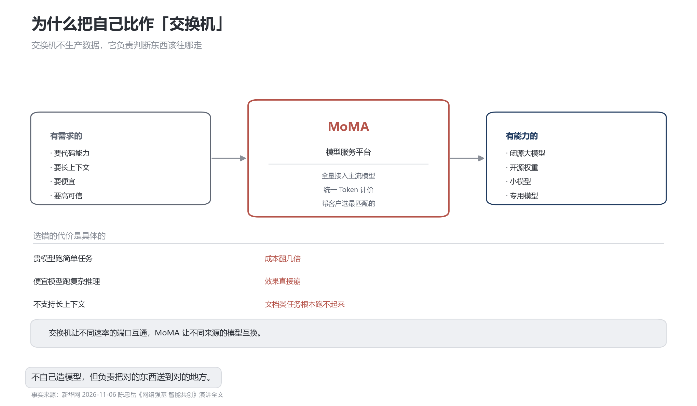
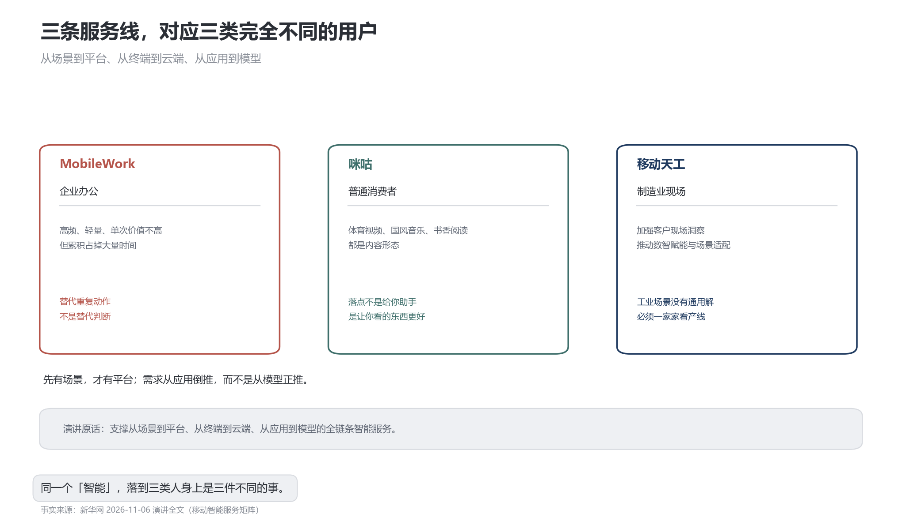
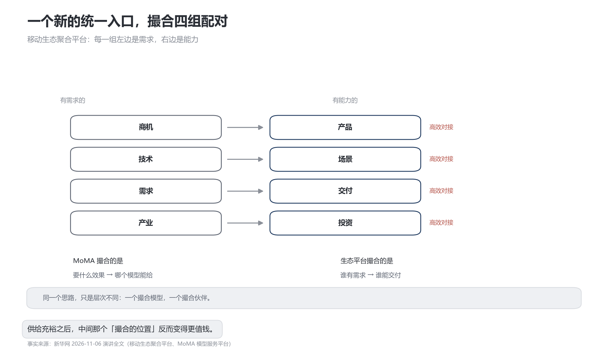

# 模型泛滥之后，最值钱的本事是"帮你选对那一个"

中国移动董事长陈忠岳在 11 月 6 日的《网络强基 智能共创》主旨演讲里，给智能网下了一个不太常见的定义。

他说，中国移动致力于打造智能服务的**"交换机""路由器"**。

一家运营商用自己最熟悉的两样设备来比喻智能服务，这个自我定位值得琢磨。交换机和路由器在网络里干的活，不是生产数据，也不是存储数据——它们负责判断"这个东西该往哪走"。

把这个比喻搬到智能服务上，意思就是：**不自己造模型，但负责把对的东西送到对的地方。**

## 一、MoMA 做的那件事

演讲里对应的落点是 MoMA 模型服务平台，表述是：全量接入主流模型，降低 Token 成本、提升使用效能，帮客户选择最匹配的模型、让客户享用高可信的服务。

这句话的核心是"帮客户选择最匹配的模型"。这句话听起来像一句客气话，但在当下的模型格局里，它是一个真实存在的痛点。

现在市面上的主流模型不是太少，是太多。闭源的、开源的、大的、小的、擅长代码的、擅长长文的、便宜的、贵的——每过几周就有新的出来。对一个要落地 AI 应用的企业来说，"选哪个"这件事本身的成本已经很高：要试、要测、要算账、还要担心选了之后被锁死。

而选错的代价是具体的。用贵模型跑简单任务，成本翻几倍；用便宜模型跑复杂推理，效果直接崩；用一个不支持长上下文的模型处理文档，根本跑不起来。

所以"帮客户选"这件事，本质上是在做三件事：**统一入口**（不用一家家去对接）、**可比口径**（同样的 Token 计价，能横向比）、**可替换**（选错了能换，不被绑死）。

再回到交换机这个比喻——交换机让不同速率的端口之间能互通，MoMA 让不同来源的模型之间能互换。逻辑是一样的。

## 二、从"能用"到"用得上"：三个落点

演讲给的服务矩阵是三条线：MobileWork 智能体赋能工作提效；咪咕平台升级做优体育视频、国风音乐、书香阅读；移动天工平台协同行业伙伴加强客户现场洞察，打造先进制造标杆应用。

这三条线对应的其实是三类完全不同的用户。

**MobileWork** 面向的是企业内部的日常办公。这类场景的特点是高频、轻量、单人单次价值不高，但累积起来占掉大量时间。智能体在这里的价值是替代重复动作，不是替代判断。

**咪咕** 面向的是普通消费者，做的是内容体验。这里的关键词是"体育视频、国风音乐、书香阅读"——都是内容形态，不是工具形态。这说明面向消费者的智能，落点不是"给你一个助手"，而是"让你看的东西更好"。

**移动天工** 面向的是制造业现场。这条线的表述最实在：加强客户现场洞察，推动数智赋能与场景更加适配，打造先进制造标杆应用。注意"现场洞察"和"更加适配"——工业场景里没有通用解，必须一家一家去看产线。

三条线放在一起，正好对应演讲那句"从场景到平台、从终端到云端、从应用到模型的全链条"。**先有场景，才有平台；需求从应用倒推，而不是从模型正推。**

## 三、统一入口这件事

演讲接近尾声时提到一个新东西：中国移动将发布移动生态聚合平台，作为服务全球合作伙伴的统一入口，实现商机与产品、技术与场景、需求与交付、产业与投资的高效对接。

这句话里有四组配对：商机对产品、技术对场景、需求对交付、产业对投资。

四组配对的共同点是——**每一组的左边是"有需求的"，右边是"有能力的"，中间缺一个撮合的地方。**

这和前面 MoMA 的逻辑其实是同一套思路，只是层次不同。MoMA 撮合的是"客户要什么效果"和"哪个模型能给出这个效果"；生态聚合平台撮合的是"谁有需求"和"谁能交付"。

再往上，演讲还提到持续做强泛全联盟，推动终端功能提升、通信能力升级，打造 AI 定制终端，实现端网业高效协同。

到这里，三张网就接上了：通信网负责把字节送到，算力网负责把词元供上，智能网负责把意图执行掉。而"选对那一个"这个动作，贯穿在这三层的每一层里。

## 落到：为什么"选"比"造"更稀缺

模型这件事，正在从稀缺走向过剩。一年多前，能拿出一个可用的大模型是新闻；现在，每周都有新的开源权重放出来。

当供给变得充裕，价值就往两端走：一端是造出真正更强的模型，另一端是**帮别人在海量选项里做出正确判断**。

前者需要顶尖的研发能力，能做的机构很少。后者需要的是规模、渠道、以及对场景的理解——恰好是运营商这类角色的长处。

陈忠岳给智能网的定位是"不只是技术能力，更要看产业价值"，并强调要"更加注重连接、协同、普惠，让更多人用得上、用得起、用得好"。

把这三句话和"交换机"的比喻连起来读，意思就清楚了：智能服务的价值不在于它自己有多聪明，而在于它能不能让**别人**用上、用得起——这正是交换机存在的理由。

---

*事实来源：2026 移动网络大会于 2026 年 11 月 5 日至 7 日在广州举行，中国移动董事长陈忠岳于 11 月 6 日上午发表题为《网络强基 智能共创》的主旨演讲。智能网部分原文："从模型到智能体、从知识生成到任务执行、从单点智能到规模应用，智能服务不只是'技术能力'，更要看'产业价值'"；"中国移动致力于打造智能服务的'交换机''路由器'，依托通信基础和算力资源，协同建设网络化智能基础设施，创新构建智能互联网，实现模型、数据、智能体的安全可信供给、泛在高效互联，支撑从场景到平台、从终端到云端、从应用到模型的全链条智能服务"；"做大智能服务产业价值，需要更加注重连接、协同、普惠，让更多人用得上、用得起、用得好。中国移动将与全球合作伙伴一道，依托 MoMA 模型服务平台，全量接入主流模型，降低 Token 成本、提升使用效能，帮客户选择最匹配的模型、让客户享用高可信的服务"；"构建'移动智能'服务矩阵，推出 MobileWork 智能体，赋能工作提效；推动咪咕平台升级，做优体育视频、国风音乐、书香阅读体验，丰富数智生活；建强'移动天工'平台，协同行业伙伴加强客户现场洞察，推动数智赋能与场景更加适配，打造更多先进制造标杆应用"；"持续做强泛全联盟，共同推动终端功能提升、通信能力升级，打造 AI 定制终端，实现端网业高效协同，让智能服务触手可及"；"中国移动将发布移动生态聚合平台，作为服务全球合作伙伴的统一入口，实现商机与产品、技术与场景、需求与交付、产业与投资的高效对接"。以上均据新华网 2026-11-06 10:52 刊发的演讲全文（news.cn/info/20261106/04c53cb5449f4fada3bfde5a07860cc7/c.html）。本文为今日头条"网络强基 智能共创"征文活动方向三（创新构建融合融通智能网，释放智能产业价值）而作。*

*需说明四点。其一，MoMA 平台的具体定价方式、接入模型的完整名单与"降低 Token 成本"的幅度，演讲未披露，本文未作数字推测。其二，"选择成本已成为落地 AI 的真实痛点""选错的三类代价"为作者基于通用行业情况所作的分析，中国移动未以此措辞表述。其三，MobileWork、咪咕升级、移动天工的具体功能边界与上线节奏，演讲未展开，本文对三类用户的划分属作者归纳。其四，移动生态聚合平台的发布时间与形态演讲未给出，"四组配对"的分组为本文按原文字面所作的结构化说明。*