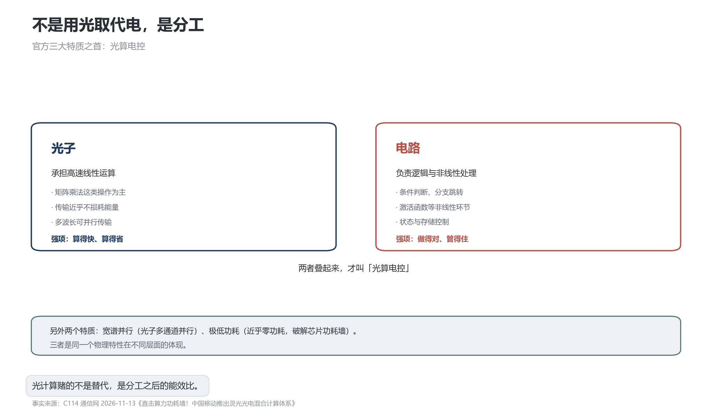
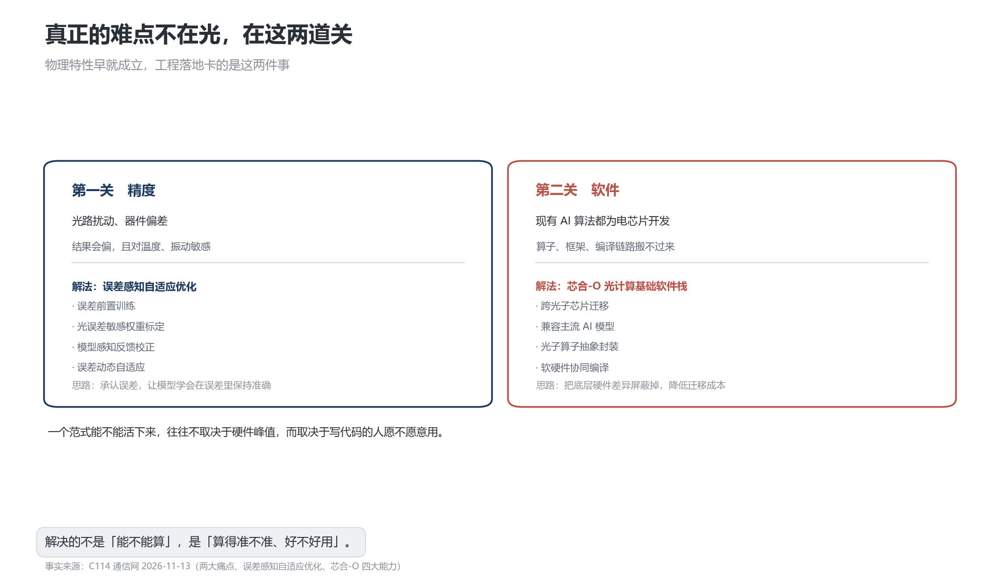
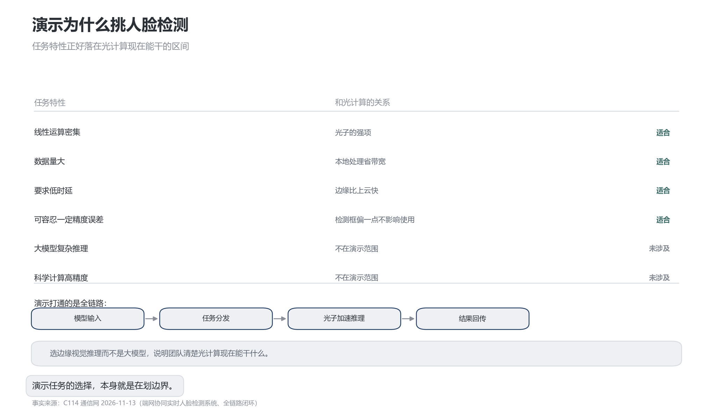

# 光做线性运算，电做逻辑判断：绕开功耗墙的一条新路

算力这件事，现在最贵的不是芯片，是电。

一个吉瓦级智算园区要吃掉一座中型城市的电量，这件事已经被反复讨论过。但讨论通常停在"怎么供电"——风光接入、储能配套、液冷散热。很少有人往更前面问一步：**如果计算本身不需要那么多电呢？**

11 月 5 日，中国移动在 2026 移动网络大会上正式推出"灵光"光电混合计算技术体系，走的正是这条路。它不谈怎么给芯片供电，谈的是换一种计算介质。

## 一、为什么盯上了光

先说清楚光计算在赌什么。

电信号在芯片里跑，有两个绕不开的成本：一是电阻导致的发热，二是频率提上去之后功耗非线性上升。这就是所谓的"功耗墙"——不是你不想做得更快，是再快就要烧掉。

光子的物理特性不一样。它在传输过程中近乎不损耗能量，而且不同波长的光可以在同一根波导里并行传输、互不干扰。这两点直接对应两个好处：**功耗低，并行度高。**

但光计算不是万能的。光子擅长的是线性运算——矩阵乘法这类操作，光路天然就能做，又快又省。可它不擅长逻辑判断和非线性处理，那恰恰是电子的强项。

所以"灵光"的核心思路不是用光取代电，而是**分工**。它的表述是"光算电控"：光子承担高速线性运算，电路负责逻辑与非线性处理。两者各做各自擅长的那部分。

体系还有另外两个特质：宽谱并行，依托光子多通道并行突破传统电计算的算力上限；极低功耗，挖掘光子近乎零功耗的特性来破解芯片功耗墙。

## 二、真正的难点不在光，在误差和软件

如果只看物理特性，光计算早该普及了。它没普及，是因为两个工程难题。

**第一个是精度。** 光路会有扰动，器件会有制造偏差，这些误差累积起来，会让光子神经网络算出来的结果偏掉。电芯片上的计算是确定的，同样的输入永远得到同样的输出；光路不是，它对温度、振动、器件状态都敏感。

中国移动的解法放在模型算法层，叫"误差感知自适应优化"。具体包含几个机制：误差前置训练（在训练阶段就把误差考虑进去）、光误差敏感权重标定（找出哪些权重对光误差更敏感）、模型感知反馈校正、误差动态自适应。**思路是承认误差存在，然后让模型学会在误差里保持准确**，而不是试图把误差消灭。

**第二个是软件。** 现在所有的 AI 模型都是为电芯片写的，算子、框架、编译链路全是围绕 GPU 和 NPU 设计的，没法直接搬到光计算硬件上跑。

对应的产物是"芯合-O"光计算基础软件栈，四个能力：跨光子芯片迁移、兼容主流 AI 模型、光子算子抽象封装、软硬件协同编译。它构建了专用计算库、通信库和编译运行环境，作用是把底层光子硬件的差异屏蔽掉。

这一层的意义容易被低估。**一个计算范式能不能活下来，往往不取决于硬件峰值，而取决于写代码的人愿不愿意用。** 如果迁移成本高到没人愿意适配，硬件再好也只能待在实验室。

## 三、现场演示选了什么任务

大会上，中国移动和曦智科技联合做了一次实物演示，用的是曦智的天枢·光立方光电混合计算系统，配上自研的"芯合-O"软件栈。

跑的任务是**实时人脸检测**，场景定在边缘。

这个选择有讲究。人脸检测是典型的视觉推理任务：数据量大、要求低时延、但对精度的容忍度相对宽松（检测框稍微偏一点不影响使用）。它正好落在光计算有优势的区间——线性运算密集、对功耗敏感、可以接受一定误差。

演示打通的是全链路：模型输入、任务分发、光子加速推理、结果回传，形成闭环，还支持可视化任务编排和模型解析加载。中国移动把它称为"端网协同的实时人脸检测系统"。

注意这里没有选大模型推理，也没有选科学计算。**选边缘视觉推理，说明团队清楚光计算现在能干什么、不能干什么。**

## 落到：后摩尔时代的一条备选路

光计算不是新概念，几十年来反复被提起又反复沉寂。它每次沉寂的原因都差不多：实验室里跑得通，工程上落不了地。

"灵光"这次拿出来的东西，价值不在"光计算多快"，而在于它正面回答了那两个让光计算落不了地的问题——精度怎么保、软件怎么迁。这两个问题有答案，才有后面的产业化。

中国移动给这件事的布局是"四位一体"：技术、标准、专利论文、产业合作同步推进。这个组合说明它没有把光计算当成一个短期项目，而是当成一条需要铺标准、攒专利、拉伙伴的长线。

至于这条路最终能不能走通，现在判断还太早。可以确认的是：**当电的功耗墙越来越硬，往别的物理介质上找解法，就成了必须有人去做的事。**

绿色智算这个词，过去主要指用绿电、降 PUE。如果光计算这条线能走通，"绿色"的含义会往前挪一层——从"少浪费电"，变成"少用电"。

---

*事实来源：2026 移动网络大会于 2026 年 11 月 5 日至 7 日在广州举行。11 月 5 日，中国移动在大会上正式推出"灵光"光电混合计算技术体系，并联合曦智科技带来搭载自研"芯合-O"光计算基础软件栈与曦智光电混合计算系统的实时人脸检测实物演示。据 C114 通信网 2026-11-13《直击算力功耗墙！中国移动推出"灵光"光电混合计算体系及其应用实践》：体系采用自底向上硬件层—基础软件层—模型算法层—应用层四层分层架构，具备光算电控、宽谱并行、极低功耗三大核心特质；光算电控为"光子承担高速线性运算，电路负责逻辑与非线性处理"；宽谱并行为"依托光子多通道并行计算的天然能力，突破传统电计算算力上限"；极低功耗为"挖掘光子近乎零功耗的物理特性，破解芯片功耗墙"；两大痛点为光路扰动与器件偏差带来的光学精度误差、现有 AI 算法模型面向电芯片开发难以直接适配光计算硬件；算法层解法为"误差感知自适应优化"，含误差前置训练、光误差敏感权重标定、模型感知反馈校正、误差动态自适应；软件层产物为"芯合-O"光计算基础软件栈，具备跨光子芯片迁移、兼容主流 AI 模型、光子算子抽象封装、软硬件协同编译四大亮点，构建专用计算库、通信库以及编译运行环境；现场演示与曦智科技天枢·光立方光电混合计算系统深度协同，实现可视化任务编排、模型解析加载等全生命周期管控，打通模型输入—任务分发—光子加速推理—结果回传闭环，搭建面向边缘场景的端网协同实时人脸检测系统；产业布局为"技术、标准、专利论文、产业合作四位一体"；后续方向为深耕光计算底层硬件、基础软件、算法优化、场景验证全链条，拓展边缘视觉推理等应用场景。*

*需说明四点。其一，本次演示为实时人脸检测单一任务的实物演示，"光计算已具备通用 AI 算力能力"并非官方表述，本文亦未作此推断；光计算相对电芯片的具体加速比、功耗节省比例，报道未给出数据，本文未作量化。其二，本文关于光计算物理特性（光子传输低损耗、多波长并行、不擅长非线性）的说明属通用技术常识，非该报道原文；"光计算几十年来反复沉寂"为背景性描述，未指向具体项目。其三，"光算电控""分工"等表述源自官方三大特质中的说法，本文对"为什么是分工而非替代"的解释属作者分析。其四，"灵光"体系的商用时间表、部署规模与适配芯片型号，报道均未披露，本文未作推测。*