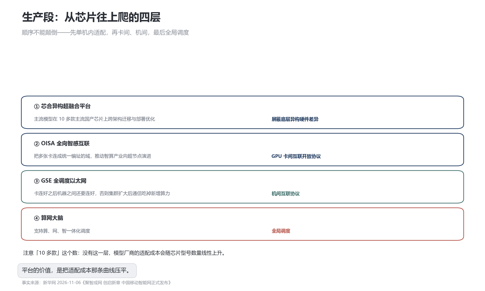
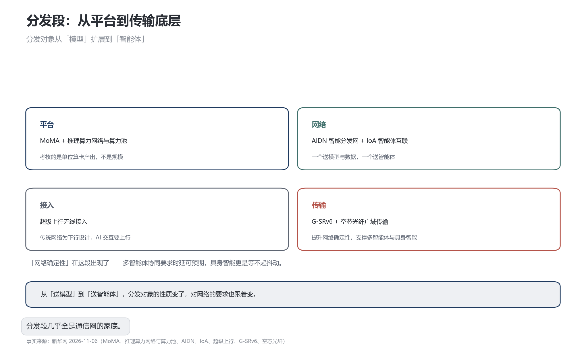
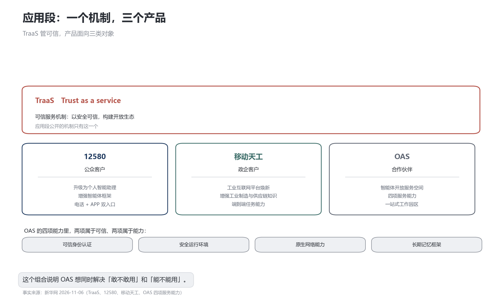

# 一张网管 Token 的生产、分发、应用：智能网发布时披露的那套技术栈

11 月 6 日，中国移动在 2026 移动网络大会上正式发布了智能网。

官方给它的定义是：与通信网、算力网协同构建的网络化人工智能基础设施，充当智能要素的"交换机"和"路由器"。

这个比喻层面的解释，讨论的人已经不少。真正值得细看的是另一句——**"打造了覆盖 Token 生产、分发、应用的全流程核心能力体系。"**

这句话之所以重要，是因为它把"智能"这个抽象的词，拆成了三段可以用工程语言描述的流程。而每一段下面，都挂着一串具体的平台、协议和产品。

## 一、生产：先让模型能在国产芯片上跑起来

Token 生产这一段，解决的是"算力从哪出"。

第一块是"芯合"异构超融合平台。它的作用是屏蔽底层异构硬件的差异，让主流模型能在 10 多款主流国产芯片上完成跨架构迁移和部署优化。

这个数字值得停一下。10 多款国产芯片，意味着模型不用为每一家芯片单独重写一遍——**如果没有这一层，模型厂商的适配成本会随芯片型号数量线性上升，国产芯片越多，落地越难。** 平台的价值就是把这条曲线压平。

第二块是 GPU 卡间互联开放协议 OISA，全向智感互联。它指向的方向是超节点——把多张卡连成一个统一编址的域，而不是靠传统网络在卡与卡之间来回搬数据。

第三块是机间互联协议 GSE，全调度以太网，目标是提升智算集群的算力效率。卡与卡之间连好了，机与机之间还得连得好，否则集群规模上去之后，通信开销会吃掉新增算力。

最后落在算网大脑上，支持算、网、智一体化调度。

这四个东西的排列顺序有讲究：**先解决单机内的异构适配，再解决卡间互联，再解决机间互联，最后才是全局调度。** 这是一个从芯片往集群往上爬的顺序，不能颠倒。

## 二、分发：模型和智能体都得能送到

生产出来的 Token 要送到需要的地方，这一段是分发。

第一层是平台和池子：MoMA 模型服务平台，加上推理算力网络和算力池。官方的表述是"使单位算卡 Token 产出的效能更高、性能更佳"——注意口径是单位算卡的产出，考核的是效率，不是规模。

第二层是网络设施：智能分发网 AIDN，智能体互联 IoA。这两个名字透露了分发对象的扩展——AIDN 分发的是模型和数据，IoA 分发的是智能体。**从"送模型"到"送智能体"，是分发对象性质的变化。**

第三层是接入能力。增强超级上行无线接入能力，用来匹配 AI 流量模型的变化。这里的关键词是"上行"——传统移动网络是为下行下载设计的，而 AI 应用（尤其是语音、视觉交互）对上行带宽和时延的要求高得多。

第四层是传输底层：推动中国移动主导和定义的 IPv6 全栈通用互联网协议 G-SRv6 应用，攻关突破新型空芯光纤广域传输技术，持续提升网络确定性，以支持多智能体协同和具身智能发展。

"网络确定性"这个词在分发这一段出现了。原因不难理解：多智能体协同要求每个环节的时延可预期，具身智能更是如此——机器人做一个动作，等不起网络的随机抖动。

## 三、应用：可信这件事怎么落地

Token 到了用户手里，第三段是应用。

这一段官方只给了一个机制名：TraaS，Trust as a service，可信服务机制，"以安全可信，构建开放生态"。

配套的是三个产品形态。

面向公众，12580"一按我帮您"升级为个人智能助理。升级点写明是增强智能体框架，使其具备更强的需求理解与规划、执行，及中长期记忆能力，入口是 12580 电话和 APP。

面向政企，"移动天工"工业互联网平台焕新，增强工业制造和供应链的知识和 skills，提升智能体端到端任务的理解、规划、执行能力。

还有一个新的：智能体开放服务空间 OAS，提供四项服务能力——可信身份认证、原生网络能力、安全运行环境和长期记忆框架，支持多样化商业模式，定位是"为入驻合作伙伴打造智能体一站式工作园区"。

四项能力里有两项（身份认证、安全运行环境）属于可信范畴，另外两项（原生网络能力、长期记忆框架）属于能力范畴。**这个组合说明 OAS 想同时解决"敢不敢用"和"能不能用"。**

## 落到：Token 把三张网串起来了

把三段连起来看，会发现智能网并不孤立。

生产段依赖的是算力网——芯合、OISA、GSE 全是算力侧的事。分发段依赖的是通信网——超级上行、G-SRv6、空芯光纤，全是网络侧的事。应用段的三个产品，才真正是智能网自己的落点。

这解释了官方为什么说智能网是"与通信网、算力网协同构建"的。它不是第三张独立的网，是把前两张网的能力按 Token 这条线索重新组织了一遍。

而这条线索之所以能串起来，是因为三段用的是同一个计量单位。生产者按 Token 算产出，分发者按 Token 算效能，应用者按 Token 算成本。**有了统一的计价单位，跨层调度才有依据。**

从这个角度看，"智能网"这个名字容易让人误解。它更像一套把算力变成可交付智能服务的流程标准——只不过这套标准，恰好长在一张网上。

---

*事实来源：中国移动于 2026 年 11 月 6 日在 2026 移动网络大会（11 月 5 日至 7 日，广州）上正式发布智能网。据新华网 2026-11-06《聚智成网 创启新章 中国移动智能网正式发布》：该智能网是"与通信网、算力网协同构建的网络化人工智能基础设施"，"作为智能要素的'交换机'和'路由器'"；"通过全栈创新，打造了覆盖 Token 生产、分发、应用的全流程核心能力体系"。Token 生产方面："打造'芯合'异构超融合平台，屏蔽底层异构硬件差异，实现主流模型在 10 多款主流国产芯片上跨架构迁移和部署优化。推出 GPU 卡间互联开放协议 OISA（全向智感互联），推动智算产业加速向超节点演进。创新机间互联协议 GSE（全调度以太网），提升智算集群算力效率。升级算网大脑，支持算、网、智一体化调度。"Token 分发方面："打造 MoMA 模型服务平台，以及推理算力网络和算力池，使单位算卡 Token 产出的效能更高、性能更佳。构建智能分发网 AIDN、智能体互联 IoA 等分发互联网络，实现模型、智能体、数据的云边协同和高效互通。增强超级上行无线接入能力，更好匹配 AI 流量模型变化。大力推动中国移动主导和定义的 IPV6 全栈通用互联网协议（G-SRv6)应用，攻关突破新型空芯光纤广域传输技术，持续提升网络确定性，更好支持多智能体协同和具身智能发展。"Token 应用方面："创新 TraaS（Trust as a service）可信服务机制，以安全可信，构建开放生态。"产品侧："面向公众客户，焕新 12580'一按我帮您'，升级为个人智能助理。通过增强智能体框架，使其具备更强的需求理解与规划、执行，及中长期记忆等能力，为用户提供便捷接入的 12580 电话、APP 等入口。""面向政企客户，焕新'移动天工'工业互联网平台，通过增强工业制造和供应链的知识和 skills，提升智能体端到端任务的理解、规划、执行能力。""构建智能体开放服务空间（OAS），提供可信身份认证、原生网络能力、安全运行环境和长期记忆框架四项服务能力，灵活支持多样化商业模式，为入驻合作伙伴打造智能体一站式工作园区。"*

*需说明四点。其一，"10 多款主流国产芯片"为官方口径，具体芯片型号、厂商与适配模型清单报道未列，本文未作补充。其二，OISA、GSE、AIDN、IoA、G-SRv6、TraaS、OAS 等均为报道中出现的技术或机制名称，其技术细节、成熟度与部署范围报道未展开；本文对各名称作用的说明依据报道原文字面，未额外推断。其三，"分发对象从模型扩展到智能体""四项能力分属可信与能力两类""三段共用 Token 作为统一计价单位"等为作者分析，中国移动未以此措辞表述。其四，智能网的商用时间表、覆盖范围与计费方式报道未披露，本文未作推测；文中"三张网分工"的表述源自同场主旨演讲，非本次发布的智能网专项说明。*