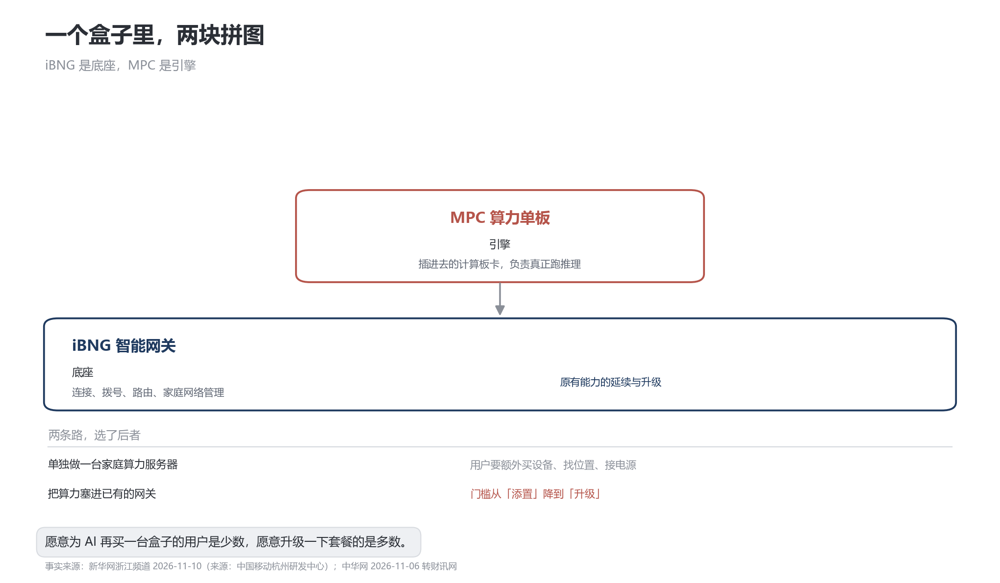
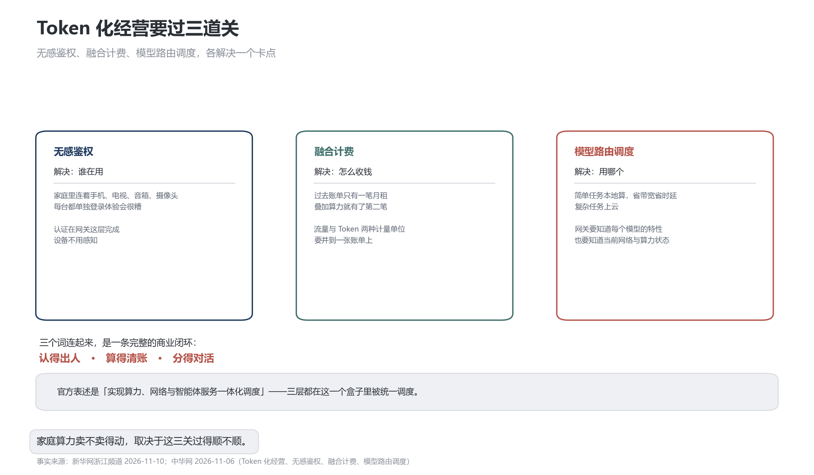
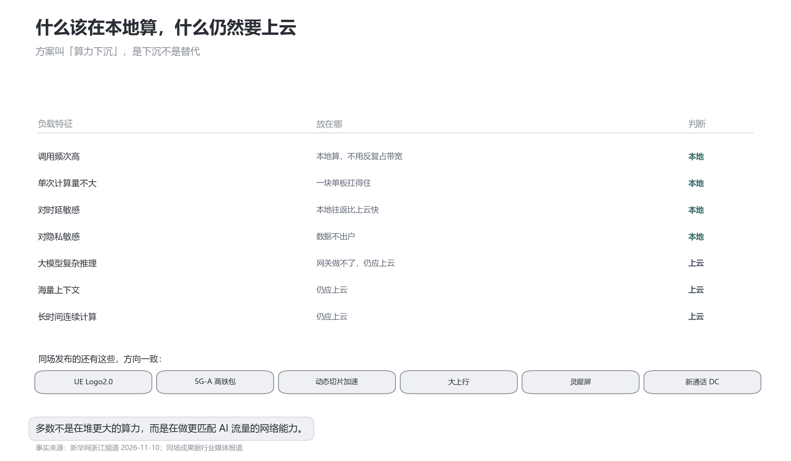

# 把算力塞进家里的网关：家庭宽带开始按 Token 卖

家里那个宽带网关，过去二十年只干一件事：把外面的信号转进来。

11 月 6 日，在 2026 中国移动网络大会期间，中国移动与华为联办的"数智生活 AI+创新合作论坛"上，发布了一个叫"家宽边缘算力网关"（BCG）的方案。中国移动杭州研发中心同步给出的说明是：以 iBNG 智能网关为底座、MPC 算力单板为引擎，把算力下沉到家庭边缘。

一句话概括这件事：**那个只负责转信号的盒子，开始带算力了。**

## 一、BCG 的两块拼图

方案的构成是两个部件，分工很清楚。

**底座是 iBNG 智能网关。** 这是原有家庭网关能力的延续和升级——负责连接、拨号、路由、家庭网络管理这些基础功能。把它叫"底座"，意思是算力是长在它上面的，不是另起一台设备。

**引擎是 MPC 算力单板。** 这是一块插进去的计算板卡，负责真正跑模型推理。把它叫"引擎"，说明它提供的是算力，不是连接。

这个结构选择值得说一下。如果要做家庭算力，通常有两条路：一是单独做一台家庭算力服务器，二是把算力塞进已有的网关里。

中国移动选了后者。**这个选择意味着家庭算力不需要用户额外买一台设备、额外找一个位置、额外接一次电。** 门槛从"添置"降到了"升级"。

对一个要铺到几千万户家庭的方案来说，这个差别是决定性的。愿意为了 AI 再买一台盒子的用户是少数，愿意升级一下宽带套餐的用户是多数。

## 二、Token 化经营：三个词各自解决什么

方案里还有一句关键表述：**开启 Token 化经营，支持无感鉴权、融合计费和模型路由调度。**

这三个词，对应的是"怎么把家庭算力卖出去"这条链路上的三个卡点。

**无感鉴权，解决"谁在用"。** 家庭网络里可能连着一台手机、一台电视、一个音箱、一个摄像头。这些设备调用的算力，算谁的账？如果每台设备都要单独登录、单独认证，用户体验会很糟。无感鉴权的意思是：认证在网关这一层完成，设备不用感知。

**融合计费，解决"怎么收钱"。** 过去家庭宽带的账单是一笔——月租。如果叠加算力，就有了第二笔。两笔分开收，用户会觉得复杂；合在一起，才像是一个套餐。这背后是计费系统要能把"流量"和"Token"两种完全不同的计量单位并到一张账单上。

**模型路由调度，解决"用哪个"。** 一次请求该由家里的单板算，还是送到云端算？简单任务本地算，省带宽省时延；复杂任务上云。这个判断谁来做——网关。所以它必须知道每个模型的特性，也必须知道当前的网络和算力状态。

三个词连起来看，是一条完整的商业闭环：**认得出人、算得清账、分得对活。**

官方对这一层的总结是"实现算力、网络与智能体服务一体化调度"。注意顺序：算力、网络、智能体。三层都在这一个盒子里被统一调度。

## 三、家庭的算力，边界在哪

把算力放进家庭，有一个必须回答的问题：**它到底能跑什么？**

从方案定位看，BCG 面向的是智能体服务。而智能体这类应用的负载特点很明确：调用频次高、单次计算量不大、对时延敏感、对隐私敏感。

这四点恰好是家庭边缘的强项。频次高，本地算不用反复占用带宽；单次量小，一块单板扛得住；时延敏感，本地往返比上云快一个数量级；隐私敏感，数据不出户。

反过来，需要大模型做复杂推理、需要海量上下文、需要长时间连续计算的任务，家庭网关做不了，也仍然应该上云。**方案叫"算力下沉到家庭边缘"，是下沉，不是替代。**

同一天这个论坛上发布的其他东西，也印证了整个思路的方向：UE Logo2.0、5G-A 高铁尊享服务体验包、动态切片专属加速、大上行赋能 Mobile AI、灵犀屏、新通话 DC 生态共建倡议。这些大多不是"更大的算力"，而是"更匹配 AI 流量的网络能力"。

其中"大上行"和 BCG 是一对。AI 应用（语音、视觉交互）对上行带宽的要求远高于传统下载型应用；而当算力下到家庭之后，上行要承载的不只是用户数据，还有家庭与云之间的模型协同流量。

官方对 BCG 的定位是：家庭宽带从传统"卖流量"的连接通道，升级为可调度算力、承载智能体服务的"家庭算智底座"。

## 落到：家庭宽带的价值重新算一遍

宽带这件事，过去二十年是纯粹的规模生意：用户越多、单价越低、ARPU 缓慢下滑。所有人都在同一个方向上竞争——谁的带宽更大、谁的价格更低。

BCG 提供的是另一个方向：**在同一个盒子里增加一种新的可计量产出。**

一旦算力可以被计量（Token）、可以被计费（融合计费）、可以被调度（模型路由），家庭宽带就不再只是流量的批发商。它变成了一个能同时交付连接和算力的入口。

这条路能不能走通，取决于两件事：家庭侧真实需求有多大，以及单板的成本能不能压到可接受的水平。前者现在还没有答案，后者取决于规模。

但至少方向是清楚的。当云端的算力成本被电费和土地推着往上走时，把一部分算力放到离用户最近的节点上——家里那个本来就通着电、连着网、24 小时开着的盒子里——是一笔值得算的账。

---

*事实来源：2026 中国移动网络大会于 2026 年 11 月 5 日至 7 日在广州举行。11 月 6 日，中国移动与华为联办"数智生活 AI+创新合作论坛"，论坛主题为"通信焕新，智启新局"；在论坛统一视频发布环节，中国移动联合华为发布家宽边缘算力网关（BCG）创新方案。据新华网浙江频道 2026-11-10（来源：中国移动杭州研发中心）："以 iBNG 智能网关为底座、MPC 算力单板为引擎，把算力下沉到家庭边缘；同时开启 Token 化经营，支持无感鉴权、融合计费和模型路由调度，实现算力、网络与智能体服务一体化调度，重新定义家庭网络。"据中华网 2026-11-06 转财讯网报道："该方案以 iBNG 智能网关为底座、MPC 算力单板为引擎，将算力能力下沉至家庭，并赋能 Token 经营，实现算力、网络与智能体服务一体化调度。这意味着，家庭宽带正在从传统'卖流量'的连接通道升级为可调度算力、承载智能体服务的家庭算智底座。"同场论坛发布的成果另据行业媒体报道包括 UE Logo2.0、5G-A 高铁尊享服务体验包、动态切片专属加速、大上行赋能 Mobile AI、灵犀屏、新通话 DC 生态共建倡议。*

*需说明五点。其一，BCG 的算力规格（单板算力、可承载模型参数量、并发能力）、上市时间、定价方式与试点规模，公开报道均未披露，本文未作任何数值推测；文中"单板扛得住""本地往返快一个数量级"等为基于边缘计算一般特性的定性判断，非官方数据。其二，iBNG 与 MPC 的具体技术含义报道仅给出名称与"底座／引擎"的角色定位，本文对两者分工的解释依据该定位作通俗说明，未涉及其技术实现。其三，"无感鉴权、融合计费、模型路由调度"三词各自解决的问题为作者分析，报道未展开其实现方式。其四，本文"家庭算力适合高频、小算力、低时延、强隐私负载，不适合大模型复杂推理"的边界判断为作者分析，中国移动未以此措辞表述。其五，"ARPU 缓慢下滑""宽带是规模生意"属行业一般性描述，未引用具体统计数据。*