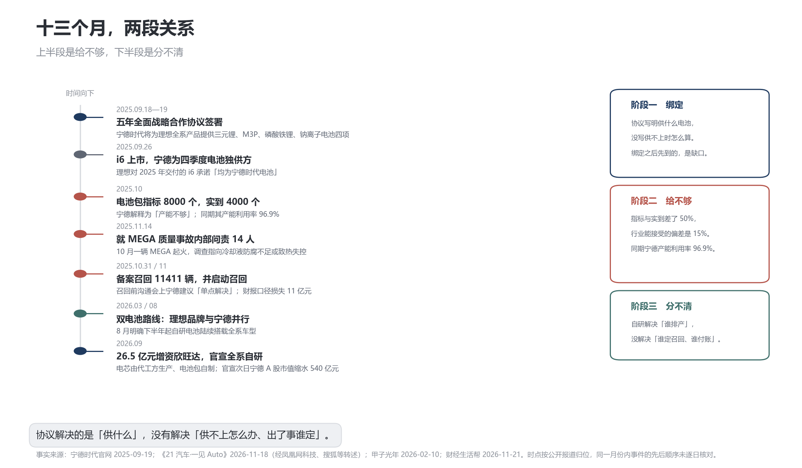
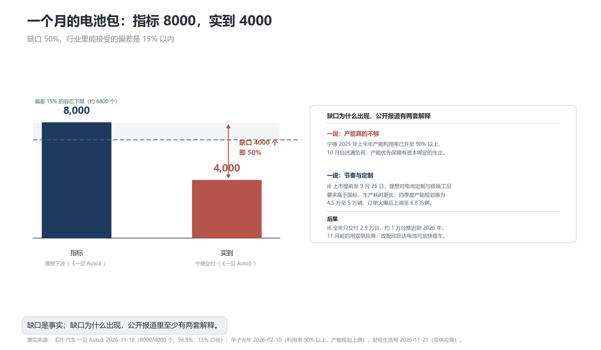
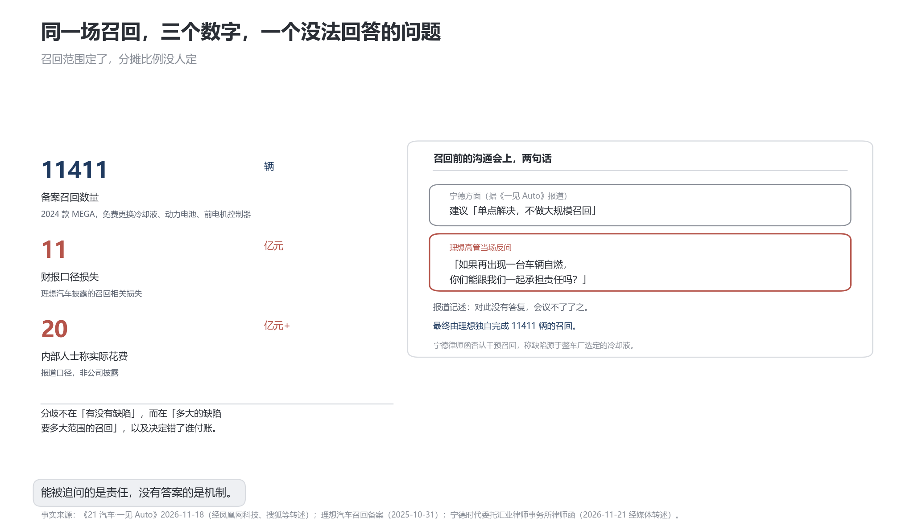

# 一场召回 11 亿，2.9 万台交付，每天 3 封催款邮件：理想和宁德时代之间，那条一直没画出来的线

2026 年 9 月，理想汽车用 26.5 亿元增资欣旺达动力，随后宣布全系车型切换到自研电池：电芯由欣旺达与中创新航代工，电池包由理想自制。

在外界看来，这是一次"分手"。但在两家公司对外的口径里，什么都没有发生——理想说双方仍是战略合作关系，月度技术例会照常，理想不久前还向宁德时代发去了下一代车型的技术开发包；目前在售车型中，全新 L9 的部分车型和 i8 四驱高性能版，用的仍是宁德时代的电池。

真正变化的不是关系状态，而是装机数字。乘联分会数据显示，2026 年 6 月，理想还是宁德时代的第四大客户，占其装机量 6.8%，同期是欣旺达的第五大客户，占 6.4%；到 8 月，理想从宁德时代前五大客户名单中消失，同时成为欣旺达的第一大客户，占比 39%。

这些数字本身说明不了对错。值得拆开看的是：一年前还在一起签五年协议的两家公司，中间到底经过了什么。

## 一、协议签得很全，签的是"供什么"

2025 年 9 月 18 日，李想、马东辉到福建宁德，与宁德时代曾毓群、韩伟见面，签署五年全面战略合作协议。按宁德时代官网通稿，宁德时代将为理想汽车全系产品提供动力电池系统，"包括但不限于三元锂电池、M3P 电池、磷酸铁锂电池和钠离子电池等"；同一份通稿写明，"截至目前，搭载宁德时代电池的理想汽车累计交付量突破 100 万辆"。据《21 汽车·一见 Auto》（下称《一见 Auto》）报道，双方合作始于理想 ONE 时代，11 年间理想累计为宁德时代贡献至少 500 亿元营收——这一数字出自该报道的测算，未见两家公司单独披露。

八天后，9 月 26 日，理想 i6 上市。这是理想第一款纯电五座 SUV，承担走量任务。据多家汽车媒体报道，理想当时向用户承诺 2025 年交付的 i6 均采用宁德时代电池；甲子光年 2026 年 2 月还提到，李想此行目的之一，就是为 i6 沟通电池供应。

一份写明四种技术路线、覆盖全系产品的五年协议，加上一次为单一车型专程上门的沟通，构成了外界理解的"绑定"。但协议解决的是供什么，没有解决供不上怎么办。

## 二、8000 个指标，4000 个到货

《一见 Auto》报道，2025 年第四季度，宁德时代是 i6 的电池独供方；理想 10 月下发的电池包产能指标是 8000 个，宁德时代实际交付 4000 个，理由是"产能不够"。同期宁德时代产能利用率已达 96.9%，接近满产，产能优先保障有资本绑定的车企。一位车企电池高管对该媒体的评价是："供应商产能供应出现 15% 以内的偏差是可以接受的，但超过 50% 偏差，属于是巨大的供应失误。"

后果落在交付上。据该报道，2025 年内 i6 只交付 2.9 万台，约 1 万台推迟到 2026 年。到 2025 年 11 月，理想方面承认 i6 订单已超过 7 万台，并把原因归于"核心零部件供应的规划和产能爬坡"；同月，i6 启用双供应商，用户改配欣旺达电池可以加快提车。

关于缺口为什么出现，公开报道并不只有一套解释。甲子光年 2026 年 2 月的分析提到，宁德时代 2025 年上半年产能利用率已爬升至 90% 以上，10 月自述满负荷，但同期对问界、蔚来等客户供货并未明显短缺；该报道认为，i6 交付困难还与理想对电池包定制化要求高、上市时间从此前预期的年底提前至 9 月 26 日有关，而理想为四季度预备的产能原为 4.5 万至 5 万辆，订单火爆后才上调至 6.8 万辆。

两套解释指向不同，但有一点双方都不否认：指标和到货之间的落差，没有一条能直接兑现的条款来兜底。

## 三、一次召回，和一句没有答案的问话

据《一见 Auto》报道，2025 年 10 月，一辆搭载宁德时代电池的理想 MEGA 在行驶中起火。理想复核数据后认定，2024 年生产的同批次 MEGA 冷却液防腐性能不足，极端情况下可能造成动力电池热失控。2025 年 10 月 31 日，理想备案召回 11411 辆 2024 款 MEGA，免费更换冷却液、动力电池和前电机控制器。

召回之前，据该报道，双方在沟通会上分歧明显：宁德时代方面建议"单点解决，不做大规模召回"，理由是"没必要，这件事可以大事化小"。理想高管当场反问："如果再出现一台车辆自燃，你们能跟我们一起承担责任吗？"报道记述，对方没有给出答复，会议不了了之。最终，理想独自完成了这次召回。代价是财报口径约 11 亿元，据接近情况的内部人士向该媒体透露，实际花费超过 20 亿元，全部来自公司账上现金。2025 年 11 月 14 日，理想就这起批量质量事故内部问责 14 人。

这段叙述需要放进平衡的另一半。2026 年 11 月 21 日，宁德时代委托汇业律师事务所向小红书发出律师函，要求删除相关文章。据多家媒体转述的函件内容，宁德时代称召回原因是"冷却液防腐性能不足"，并非电芯或电池包本身缺陷，且冷却液由整车厂选定，文章"捏造其隐瞒风险，缺乏事实依据"；对于催款邮件的指控，函件称相关表述系"文中化名匿名信源的单方口述，未提供任何邮件原件、收发记录"，宁德时代系"依约进行对账与到期付款提醒"，属正常商业结算。同日，红星资本局采访到的理想汽车回应是：双方没有产生缝隙，战略合作仍然维持。《一见 Auto》原文目前已全网不可见。

争议集中在两处：召回决定该怎么谈，账该怎么算。

## 四、把命运拿回来，是一种解法，但不是全部答案

据《一见 Auto》报道，i6 供应紧张那段时间，李想"几乎每一天都在焦虑电池的产能"，"焦虑点在于拿不出招来应对，命运掌握在别人手里"；复盘会上的结论是"自己的命运，不能掌握在别人手里"。

之后的动作是分步走的。2026 年 3 月财报电话会上，总裁马东辉表示，从 2026 年起理想所有车型将采用理想品牌电池与宁德时代电池并行的双路线；8 月 26 日二季度财报沟通会上，李想进一步说明下半年起自研电池会陆续搭载全系车型。9 月，理想以 26.5 亿元增资欣旺达动力；9 月 7 日，理想官方微博称自研电池已在 L8、L6、i8 上装车。路线上，这是把"排产"收回自己手里；成本上也有现实考虑——据两家公司财报，2024 年欣旺达动力电池均价约 5.98 元/Wh，宁德时代约 6.64 元/Wh，前者低约一成。

据《一见 Auto》援引理想供应部门员工的说法，官宣自研电池之后，他每天至少收到宁德时代 3 封催款邮件，"各种理由找你要钱"；宁德时代在律师函中已否认这一性质。

据同一篇报道，另有一件更早的对峙：2025 年 9 月前后，理想供应链员工带十余辆物流卡车前往宁德时代溧阳基地提 i8 电池包。当时 i8 销量不及预期，理想希望暂停这批电池的生产、消化库存，宁德时代坚持已生产的货必须拉走；卡车滞留导致厂区周边道路拥堵，宁德时代以扰乱交通秩序、存在生产安全隐患为由报警。这一情节经多家媒体转述，双方均未公开说明事发细节。

自研电池之后，理想不再被动接受分配。但"谁定召回范围、谁承担决定错误的成本"这个问题并没有随之消失——它只是从两家公司之间，挪到了理想与代工方之间。

## 五、这不是两家公司的私事

把理想与宁德时代放到一边，这个故事在行业里重复出现：小米推出自有电池品牌"龙甲电池"，鸿蒙智行通过巨鲸电池平台引入多家电池厂商。主机厂共同的动作，是不再满足于被动接受供应商的产能分配和风险定义。

背后有一个结构性的东西。车企每年发给供应商的"量纲"，通常不是具有法律约束力的订单；但供应商要按这个预测去投重资产、建产线。市场冷热一旦切换，预测偏差带来的成本由谁分摊，至今没有成熟机制——产能紧张时由车企承担交付压力，产能过剩时由供应商承担闲置成本，两种情况下合同都帮不上忙。安全责任的分配同样如此：整车厂依据《缺陷汽车产品召回管理条例》对整车负责，电池供应商的质保责任限于电芯与电池包本身。当缺陷横跨两者的边界——比如一颗由整车厂选定的冷却液——"多大的缺陷需要多大范围的召回"就成了判断题，而答案往往由更有能力独自承担代价的一方给出。

理想最终选择了召回，代价自付。从消费者角度看，这是正确的结果；但从产业角度看，一个只能靠"某一方自己认了"来达成正确结果的责任机制，是不可持续的。

我国新能源汽车产销量已连续多年居全球首位，动力电池装车量占全球一半以上。这样一个产业，靠个别企业的自觉和现金储备来消化质量责任，成本太高，也不公平。真正需要补上的，是让责任可预期、可分摊、可执行的规则：量纲与订单怎么衔接，预测偏差怎么分摊，安全缺陷的判定与召回决策怎么协同，成本怎么在链条上合理分配。规则清楚了，企业才不必用"把命运拿回来"这种成本最高的方式来保护自己。

截至目前，理想与宁德时代仍称彼此是战略伙伴。这句话可能是外交辞令，也可能是事实。但无论哪种，**下一次出现 8000 和 4000 的差距、下一次出现"要不要召回"的分歧时，答案不应该再取决于谁先沉默。**

---

*事实来源：宁德时代官网 2025-09-19《理想汽车与宁德时代达成全面战略合作》（协议内容、参与人员、"累计交付量突破 100 万辆"）；《21 汽车·一见 Auto》2026-11-18《理想宁德，后会友期》（原文现已全网不可见，内容经凤凰网科技、搜狐、红星资本局、财经生活帮等多家媒体转述：i6 电池包指标 8000 个与实到 4000 个、产能利用率 96.9%、15% 偏差口径、2025 年内 i6 交付 2.9 万台、11 年 500 亿元营收、MEGA 冷却液防腐缺陷与 11411 辆召回、召回沟通会上的"单点解决"建议与高管反问、财报口径 11 亿元与内部人士称超 20 亿元、溧阳提货冲突、每天至少 3 封催款邮件、复盘结论"自己的命运，不能掌握在别人手里"）；理想汽车召回备案（2025-10-31）与 2025 年 11 月 14 日内部问责 14 人；甲子光年 2026-02-10《理想 i6 延迟交付，问题并不在宁德时代》（2025 年上半年宁德产能利用率 90% 以上、10 月满负荷自述、i6 上市提前至 9 月 26 日、四季度产能规划 4.5 万至 5 万辆后上调至 6.8 万辆、问界与蔚来供货情况、欣旺达与宁德时代 2024 年电池均价 5.98 元/Wh 与 6.64 元/Wh）；甲子光年 2026-02-11 转述工信部申报信息（i6 三个产品型号电池单体企业分别为宁德时代与欣旺达）；财经生活帮 2026-11-21（乘联分会数据：2026 年 6 月理想占宁德装机 6.8%、占欣旺达 6.4%，8 月退出宁德前五大客户、占欣旺达 39%；2026 年 3 月与 8 月两次财报沟通会表述；9 月 7 日理想官方微博；在售车型电池配置；律师函内容）；新浪科技 2026-11-21 与新浪新闻转述（宁德时代委托汇业律师事务所律师函：催款邮件系"依约进行对账与到期付款提醒"、召回原因为冷却液防腐性能不足且"并非电芯或电池包本身缺陷"、"冷却液由整车厂选定"）；界面新闻 2026-10-28（宁德时代未回复询问）；红星资本局 2026-11-19（理想称"没有产生缝隙，战略合作仍然维持"）。*

*需说明五点。其一，本文对理想与宁德时代的叙述，主要依据《21 汽车·一见 Auto》的单篇调查报道及其被多家媒体的转述，该报道原文已全网不可见，其中"建议单点解决""每天至少 3 封催款邮件""会议不了了之"等情节均为匿名信源口述，宁德时代已在律师函中逐项否认，本文并列呈现双方说法，未作真伪判断。其二，8000 个与 4000 个、96.9%、2.9 万台、11 年 500 亿元等数字，除宁德时代官网"累计交付突破 100 万辆"外，均未见两家公司正式披露，属媒体口径；"11 年为理想贡献至少 500 亿元营收"与"累计交付突破 100 万辆"分属不同来源、不同时点，本文未作合并推算。其三，i6 缺口的成因，本文同时列出产能紧张与节奏/定制两套解释，两者并非互斥，公开信息不足以判定权重。其四，溧阳提货冲突的时间、参与人数、报警理由等细节，各转述版本表述不一（有"2025 年 9 月"与"2025 年 9 月 4 日"之别，随行人数有"十余人"与"5 至 6 人"之别），本文采用"2025 年 9 月前后"的表述并标注转述性质。其五，文中关于"量纲不具法律约束力""责任机制缺位"的判断，属作者基于公开事实的分析，非两家公司或监管部门的表述；涉及召回的法定义务，依据为《缺陷汽车产品召回管理条例》对生产者召回义务的规定，具体条款适用应以现行法规与主管部门认定为准。*
