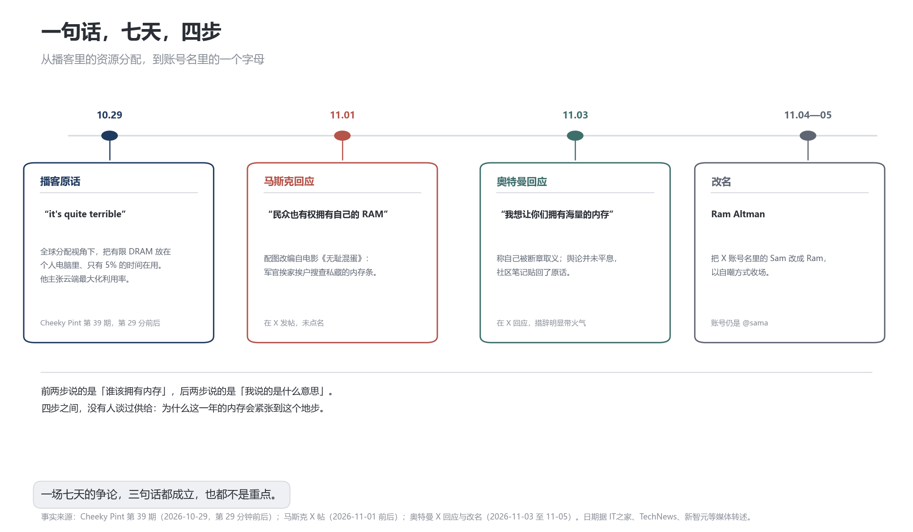
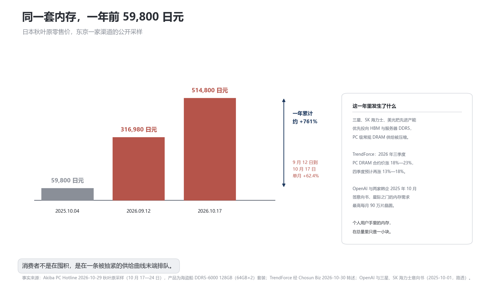
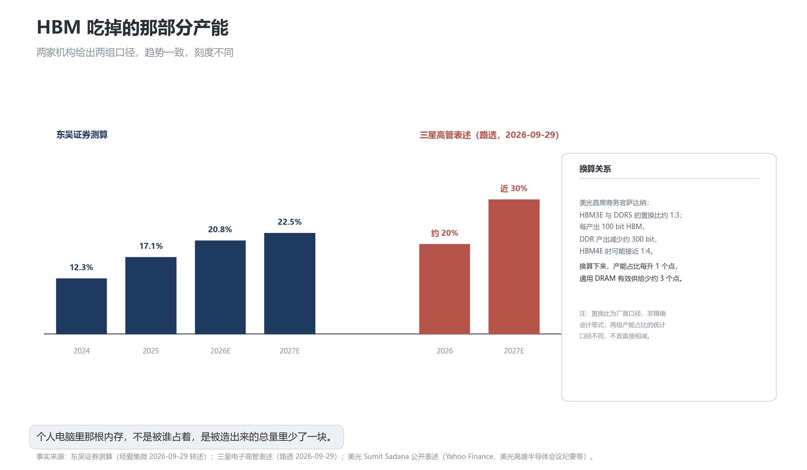

# 5% 的利用率，761% 的涨幅：奥特曼那句话真正说错的地方

2026 年 10 月 29 日，Stripe 联合创始人 John Collison 的播客《Cheeky Pint》发布了第 39 期，标题是《为什么萨姆·奥特曼反对单一超级智能》。约 29 分 30 秒处，话题转到"本地推理"——当时有不少人认为，开源模型越来越强，以后在家里就能跑 AI，数据中心没那么重要了。

奥特曼不同意。他的原话是：

> "But from a global allocation perspective, actually, it's quite terrible to have everybody have a bunch of the world's limited supply of DRAM sitting in their own computer. And be used 5% of the time."

紧接着他说："你要在这条供应极度受限的环境里应对问题，就希望云端有最大化的利用率"，以及"考虑到世界的硅产能终究有限，我们有一个共同利益"。

后面这句话被截了出来，前面那句"从全球资源分配的角度"被丢掉了。三天后，埃隆·马斯克在 X 上发帖："民众也有权拥有自己的 RAM！"配图借用了电影《无耻混蛋》里的桥段——军官挨家挨户搜查民众私藏的内存条。又过了两天，11 月 3 日，奥特曼发帖回应，说自己被断章取义，他真正想说的是"我想让你们拥有海量的内存，咱们多造点"；社区笔记随后把播客原话贴了回来。11 月 4 日至 5 日，他把 X 的账号名从 Sam Altman 改成了 Ram Altman，用一个字母自嘲收场。

这场风波里，三句话都成立：内存确实常常闲置，个人确实有权处置自己买的东西，云端也确实能把同一块内存摊销给更多人。问题在于，三句话都没有碰到争论真正的起点——这一年的内存，为什么会紧张到这个地步。

## 一、先看谁在为"5%"付钱

把"效率"这个词拆开，会发现它有两层意思。

第一层是物理层面的利用率：一根内存在个人电脑里，确实大部分时间闲着。第二层是经济层面的：这根内存是谁买的，谁承担了稀缺带来的溢价。奥特曼谈的是第一层，反对者守的是第二层——他们说的不是"用得多不多"，而是"谁说了算"。

两个层次之所以对不上，原因很直接。据日本渠道 Akiba PC 在 10 月 29 日的采样，海盗船 DDR5-6000 128GB（64GB×2）套装在秋叶原的报价，从 2025 年 10 月 4 日被纳入追踪时的 59,800 日元，涨到 2026 年 10 月 17 日的 514,800 日元，一年累计涨幅约 761%；其中仅 9 月 12 日到 10 月 17 日一个月，就涨了 62.4%。

## 二、紧张的源头不在这 5% 里

这套内存的价格，是被谁推上去的？

2026 年 9 月 29 日，三星电子一位执行副总裁在路透的报道中表示，HBM 明年将占到行业 DRAM 总产能的近 30%，而目前约为 20%。东吴证券的测算路径略有不同：HBM 占 DRAM 总产能的比重从 2024 年的 12.3% 升至 2025 年的 17.1%、2026 年的 20.8%，2027 年达 22.5%。两组数字的统计口径并不一致，不宜直接相减，但方向相同——HBM 正在吃掉越来越大的份额。

份额本身还不足以说明压力有多大，真正的杠杆是"置换比"。美光执行副总裁兼首席商务官 Sumit Sadana 曾公开表示，HBM3E 与 DDR5 的置换比约为 1:3，即生产 100 bit 的 HBM，会让 DDR 的产出减少约 300 bit；到下一代 HBM4E，这个比例可能接近 1:4。

原因是物理的：一颗 HBM 需要把多颗 DRAM 裸片堆叠起来，同等容量下消耗的晶圆面积是通用 DRAM 的数倍。产能一旦从通用 DRAM 挪去 HBM，减掉的不是"同等容量"，而是好几倍的容量。

需求侧还有一件事。2025 年 10 月 1 日，OpenAI 与三星、SK 海力士签署意向书，为"星际之门"计划锁定存储芯片供应，按路透等媒体的报道，OpenAI 的总需求可能达到每月 90 万片晶圆。

把这几件事连起来看：个人电脑里的一根内存，并不是被谁"占着"，它是在一个被 AI 资本开支重新分配过的产能结构里，晚到了一步。把 DRAM 紧张归因于个人用户"利用率低"，等于把供给侧的故事讲成了需求侧的问题。

而在这个时点讨论"存量利用率"的人，面对的是刚刚用近八倍价格买下一套内存的普通用户。这些用户没有"闲置"这笔资产，他们是在为一个自己无法影响的供给结构付钱。用"你把内存放着不用是浪费"去描述这种处境，无论出发点如何，听上去都会像在指责受害者。

## 三、为什么这句话会从奥特曼嘴里说出来

到这里，可以谈一个更敏感的问题：为什么是这个行业里的这位 CEO，在讲"效率"。

同一个人在同一个播客里还谈到，内存厂商长期以来"投 200 亿美元只赚回 190 亿"，他称之为"看不见的手正在失灵"。这句话指向的是扩产决策和长期供应合同，不是终端用户的硬件处置权——前者是产业问题，后者是消费者权利问题，两者之间并不存在必然的推论关系。

问题出在他的论证路径上。他从"厂商不敢扩产"直接跳到了"所以内存应该集中到云端用"。这个跳步不一定有恶意，却会真实地影响判断：OpenAI 的核心产品正是云端服务，通过订阅和 API 提供访问。如果开源模型能在本地设备上流畅运行，用户对云端的依赖会削弱——这是产品形态决定的，不需要推测动机。

所以这里需要的不是指责，而是一个基本的分析习惯：**当一家公司的商业模式恰好建立在"云端优于本地"这个假设之上时，它关于"效率"的论证，需要放在利益相关方的框架里审视。**就像看电池厂商论证"电池该集中供应"、看运营商论证"算力该集中调度"一样，先看说话的人在什么位置，再看他说的话成不成立。

顺带说一句，这样的审视对奥特曼本人未必不利。他在这场风波里最站得住的一段，恰恰是谈供给的那一段：厂商不敢扩产、"看不见的手"失灵——这是可以被财报和产能数据验证的判断，也已经指向了正确的方向。可惜它被后排那句话盖住了。

## 四、真正的公共问题：稀缺资源的分配不能只靠一句话

把奥特曼从这桩事里拿出来，留下的问题反而更值得记录。

内存是一种典型的周期性产业。价格暴涨时，全行业扩产；产能集中释放，价格崩塌；于是厂商记住教训，下一次涨价也不敢轻易投新厂。这个循环重复了几十年，结果是：每一次需求侧的剧烈变化（这次是 AI），供给侧都来不及响应，最后由最没有议价能力的一端承担价格。

在这一轮里，承担者是个人消费者。他们买不到更便宜的内存，也影响不了三星、SK 海力士、美光的产能分配，更谈不上参与 OpenAI 与这两家签下的长期意向。他们的"低利用率"，不是浪费的证据。

真正需要讨论的问题有三个：

**第一，产能扩张的决策由谁承担风险。**存储厂商因为历史上的巨亏而谨慎，这个谨慎有它的道理；但如果 AI 带来的需求是长期性的，那么让厂商不敢扩产的机制，本身就值得被检视。

**第二，长期协议与公开市场的比例怎么定。**当一个客户的需求可以达到全球月产晶圆的相当比例时，公开市场的价格就不再只由散户的买卖决定。这类协议需要什么样的透明度，目前没有共识。

**第三，终端用户的成本能不能被看见。**内存涨到普通用户买不起，这个信号在产业叙事里常常被"AI 需求强劲"盖过去。但对多数家庭而言，一台电脑能不能升级，是有实际分量的支出。

这三个问题都没有标准答案，但它们指向同一个方向：**稀缺资源的分配，不能靠某一家公司关于"效率"的一句判断来解决，也不能靠一位亿万富翁的一句玩笑来回答。**它需要的是产能信息更透明、长期协议更可预期、末端成本被如实计量的市场机制。

## 五、一句话的边界

回到那句原话。把它完整地读一遍，会发现奥特曼说的其实是"从全球分配的角度"，这是一种宏观视角；而听众接收到的，是"你的内存应该给别人用"，这是一种具体的剥夺感。视角不同，感受就不同，这是传播的常态，不完全是他的错。

但他随后做的事，暴露了另一个更普遍的问题：当一个人站在产业链的强势位置讨论"效率"时，他很容易忘记自己讨论的是别人付过钱的东西。这种遗忘不一定有恶意，却会真实地伤害对话的信任。

马斯克的回帖之所以传播得那么广，不是因为它论证严密，而是因为它说出了很多人的直觉：**我买的硬件，处置权在我。**这句话在技术上无法解决任何供给问题，但它在权利上划出了一条线。

两条线都需要。效率需要有人算，权利也需要有人守。缺了任何一条，讨论都会变成各说各话。

内存会有一天不再紧缺，价格会回落，Ram Altman 这个名字也会被改回去。但下一次出现类似的争论时，我们至少应该先问一句：**在这条供给曲线的最末端，是谁在付钱。**

---

*事实来源：Cheeky Pint 第 39 期《Why Sam Altman is against a single superintelligence》（2026-10-29 发布，第 29 分钟前后；"it's quite terrible..."、"used 5% of the time"、"maximum utilization in the cloud"、"we all have a shared interest"、DRAM 厂商"投 200 亿美元赚回 190 亿"、"看不见的手正在失灵"均为该期原话，经节目转录与 CellCog、AI Weekly 转述核对）；Futurism 2026-10-30 报道（经 AI Weekly 转述）；马斯克 X 帖（2026-11-01 前后，"民众也有权拥有自己的 RAM"，配图为改编自《无耻混蛋》的梗图，据 TechNews 科技新报 2026-11-03、IT之家 2026-11-02 转述）；奥特曼 X 回应（2026-11-03 起，"我想让你们拥有海量的内存，咱们多造点"、称被断章取义）与账号改名 Ram Altman（2026-11-04 至 11-05，账号仍为 @sama），据新智元 2026-11-08、虎嗅 2026-11-05 转述；Akiba PC Hotline 2026-10-29 秋叶原采样（采样窗口 10 月 17—24 日），产品为海盗船 DDR5-6000 128GB（64GB×2）套装，59,800 日元（2025-10-04 纳入追踪）→316,980 日元（2026-09-12）→514,800 日元（2026-10-17），单月涨幅 62.4%，累计约 761%，经 IT之家 2026-10-30、TweakTown、游民星空等转述；路透 2026-09-29 报道三星电子高管关于 HBM 占 DRAM 总产能比重（2026 年约 20%、2027 年近 30%）的表述，经 TrendForce 转述；东吴证券测算（HBM 占 DRAM 总产能 2024 年 12.3%、2025 年 17.1%、2026 年 20.8%、2027 年 22.5%），经爱集微 2026-09-29 转述；美光执行副总裁兼首席商务官 Sumit Sadana 关于 HBM3E 与 DDR5 约 1:3、HBM4E 或接近 1:4 置换比的表述（美光高盛半导体会议纪要、Yahoo Finance 等转述）；Tom's Hardware 关于 HBM 每 GB 消耗晶圆容量约为 DDR5 三倍的报道；TrendForce 经 Chosun Biz 2026-10-30 转述（2026 年三季度 PC DRAM 合约价涨 18%—23%，四季度预计再涨 13%—18%）；OpenAI 与三星、SK 海力士意向书（2025-10-01，OpenAI 需求可能达每月 90 万片晶圆，据路透、华尔街见闻、中央社等报道）。*

*需说明五点。其一，本文引用的播客原话依据节目转录与两家技术博客的核对，中文译文为作者所译；"5%"是奥特曼在节目中的口头估计，未给出测算口径与出处。其二，HBM 占 DRAM 产能的比重存在多组口径（东吴证券 2026 年 20.8%、三星高管约 20%、Counterpoint 另有 2024 年 17% 至 2026 年 26% 的路径），本文只并列其中两组并明确标注"口径不同、不宜直接相减"，未取中位数或加权平均。其三，美光的"1:3 置换比"是厂商对晶圆产能消耗的经验表述，不是精确会计等式，本文在正文与图表中均按此处理。其四，59,800→514,800 日元为特定品牌、特定频率、单一零售渠道的采样，不代表所有 128GB DDR5 套装的普遍涨幅；"约 761%"是该产品的一年累计涨幅，与"内存整体涨价"不是同一口径。其五，第四节列出的"长期协议与公开市场的比例""产能扩张风险由谁承担"等，属作者基于公开信息的分析框架，非任何机构或监管部门的表述；文中对 OpenAI 商业模式与论证路径的讨论，依据其公开产品形态与公开表述，不构成对动机的事实认定。*
