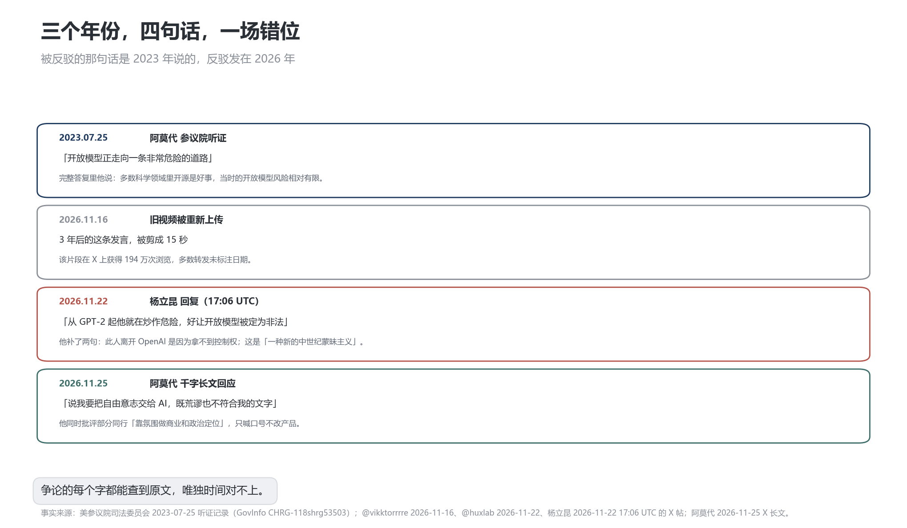
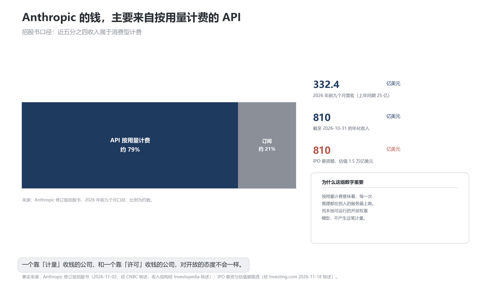
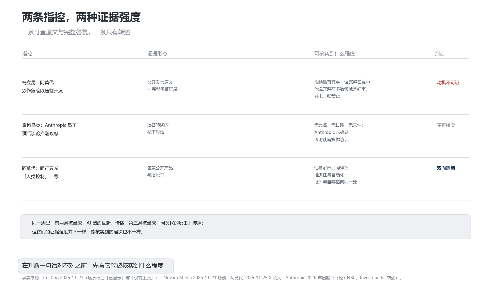

# 说 AI 危险的人，卖的是 API；推开放权重的人，早就不靠开源了

2026 年 11 月 25 日，"AI 教父"、图灵奖得主杨立昆在 X 上发文，把矛头对准 Anthropic 的 CEO 达里奥·阿莫代：

> "自 GPT-2 以来，达里奥的那套说辞一直是为了炒作危险，好让开放模型被定为非法，从而让他自己继续掌握控制权。"

紧接着他补了两句：这个人离开 OpenAI，是因为在那里拿不到控制权；这就像奥斯曼帝国禁止阿拉伯文印刷术，好让教义的解释权留在少数人手里——"这是一种新的中世纪蒙昧主义"。

一个图灵奖得主，骂另一个顶级 AI 公司的 CEO"靠渲染危险来垄断"，这本身就足够上头条。但真要读懂这件事，得先弄清一个大多数人不知道的时间差。

## 一、被反驳的那句话，是三年前说的

杨立昆回应的，不是什么新言论，而是一段 2023 年 7 月 25 日美国参议院司法委员会听证会的视频。那段视频在 11 月 16 日被重新上传到 X，获得 194 万次浏览，然后在 11 月 22 日被一位中文用户引用，杨立昆当天下午回复了它。

更关键的是，那段片段并不完整。

查听证记录会发现，在同一个回答里，阿莫代先说："在大多数科学领域，开源是好事，它加速进步。"他还说，就当时已经发布的开放模型而言，"风险相对有限"。他真正担心的，是未来几年会出现规模更大的开放模型："当一个模型以不受控的方式发布出去，你就完全没有能力做任何事，它彻底不在你手里了。"

在这段回答里，他并没有主张禁止开放模型。

那这是不是说杨立昆骂错了？也不尽然。他想说的是这个人在别处可能主张过什么，以及为什么。他的依据不是文件，而是一个判断：如果一个人从 GPT-2 时代就在渲染风险，而他的公司正好靠闭源收费，那么这套说辞值得被放在利益相关方的框架里审视。

所以这场争论的真实形状是：**一个可以核实的事实（他确实警告过开放模型的风险）＋ 一个无法核实的动机判断（他是为了让开放模型非法）**。前者站得住，后者只是推论。

## 二、但"嘴上主义、心里生意"这句话，对两边都成立

真正有意思的地方，是双方各自的位置。

先说杨立昆这一边。他现在的身份是 AMI Labs 创始人兼主席、纽约大学教授，曾任 Meta 首席 AI 科学家。Meta 在 2026 年 8 月发布了开放权重模型 Muse Glimmer。开放权重对 Meta 意味着什么？意味着别人可以免费下载、本地部署、二次开发——它换来的不是许可费，是生态位和人才。

再说阿莫代这一边，数字更清楚。

Anthropic 在 2026 年完成上市，IPO 募资 810 亿美元，估值 1.5 万亿美元。修订后的招股书显示：2026 年前九个月营收 332.4 亿美元，上年同期是 25 亿美元；第三季度单季约 170 亿美元；截至 10 月 31 日的年化收入约 810 亿美元。

而据媒体对招股书的解读，这份收入里**近五分之四来自按用量计费的 API**——用户每调用一次，公司就收一次钱；其余的才是 Pro、Max、Team 这类订阅席位。

这个结构决定了一件事：**每一次推理发生在别人的服务器上，才产生这笔计量。**而一个能在本地跑起来的开放权重模型，不产生任何计量。

这不是说阿莫代因此就在说谎。它只说明一件事：**在"开放还是封闭"这个具体问题上，两家公司的利益方向天然不同，而两家公司都在用自己的方式解释"安全"。**

## 三、同一个人，同一周，另一条被翻出来的旧话

就在这场争论的前几天，《华尔街日报》11 月 21 日刊出阿莫代兄妹的人物特写，其中提到：他在 OpenAI 任职期间，曾在内部讨论中提出，沉浸式电子游戏或许能缓解"AI 导致失业所引发的政治冲突"。

这话被媒体概括成"用游戏安抚失业者"，随后在社交平台上被大量转述为"让人打游戏就没空闹事了"。

需要说清楚的是：这出自内部的 Slack 讨论，不是正式政策提案，报道本身也没有把它当作提案。而且那段讨论发生的时点，是他在 OpenAI 担任研究副总裁期间，距离他创办 Anthropic 还有一段时间。

但它之所以引发反弹，是因为它触碰了一件具体的事：**AI 造成的失业，是一个真实的、有家庭在承担的代价。把一个社会问题用一种娱乐化的方式"消化"掉，无论原意如何，都会让人觉得说话的人站在代价之外。**

而这条旧话与前面那场"自由意志"之争，恰好是同一件事的两面。11 月 25 日，阿莫代发了一篇约千字的长文，否认自己主张人类应该把自由意志交给 AI，原话是："不，我不认为我们应该把'人类自由意志'交给 AI 系统，说我有这种主张是荒谬的。"

同一篇文章里，他有一段更值得注意的话：他承认，在某些场景下"以过于端到端的方式使用 AI，可能造成严重的就业冲击，放缓甚至停止部分 AI 部署、给人们更多适应时间，或许是有道理的"。

同一篇文章里，他也批评了同行：一些 AI 公司的 CEO 在做"靠氛围的商业和政治定位"，反复重复"人类控制与能动性""AI 应该只是工具"这类口号，产品上却什么都没变。

这段批评很锋利。但它同时也适用于他自己：**一家靠 API 用量计费、产品线持续向"端到端自动化"推进的公司，说出"减缓部署"这句话时，听众有理由问一句：那你准备在哪里慢下来？**

## 四、把"互撕"还原成"立场"，才能看清争的是什么

这一周里，围绕 Anthropic 的指控不止一条。

物理学家马克斯·泰格马克在 11 月 21 日的一档访谈里说，"和 Anthropic 的员工喝了几杯之后，话题常常会转向推翻美国政府"。这条说法没有具名、没有日期、没有文件，Anthropic 也没有确认。同一周末，还有一份 92 人联署的声明，称 Anthropic"不是一家安全的 AI 公司"。

把这些放在一起看，会发现一个模式：**关于 AI 安全的公共讨论，正在越来越多地由"某个人说"构成，而不是由"某份文件写了什么"构成。**

杨立昆的指控有原文可查，但动机没有证据；泰格马克的说法无从核实；阿莫代的自辩有长文可读，但"哪里慢下来"仍然模糊。

这不是要各打五十大板。它指向一个更实际的问题：**当"安全"成为一门生意的一部分时，谁来给"安全"这个词定标准？**

如果是靠公开发言来定，那么最有传播力的人赢；如果是靠产品来定，那么占市场份额最大的人赢；如果是靠监管来定，那么最先写进法规的那一版定义赢。这三种路径目前同时在跑，而跑得最快的那条，并不一定是让普通人最安全的那条。

## 五、开放与封闭，最后落在谁身上

绕了一圈，回到最朴素的问题：这场争论和普通人有什么关系。

关系在于，**开放还是封闭，决定了你未来用 AI 的方式。**

开放权重意味着：模型可以下载到自己的机器上，数据不出门，断网也能用，不必为每一次调用付费，也不必担心某家公司改了价格、改了政策、或者关掉了服务。代价是，安全护栏要靠使用者自己，滥用也更难拦住。

闭源 API 意味着：模型更强、更新更快、护栏由公司维护，出了事有人负责。代价是，你的每一次使用都在被计量，也都在别人的规则之下。

这两种模式都有道理，都需要存在。真正的问题不在这两者之间的选择，而在于**这个选择正在被"安全"这个词提前替你做掉**——当一方说"开放很危险"，另一方说"封闭是垄断"，普通人听到的往往只是两个立场，而不是两种代价。

阿莫代在长文里写了一句值得记住的话：这些决定"有些会由社会做出，有些由政府做出，有些由 AI 公司做出，还有些会以分散的方式，由个人作为消费者表达自己的偏好"。

这句话是对的。但要让最后那一项真正成立，前提是**个人还有得选**——而"有得选"，恰恰取决于市场上是否还存在可以本地运行的开放权重模型。

所以杨立昆那句话里最站得住的部分，不是"他想垄断"这个动机判断，而是它背后那个可以被验证的问题：**如果监管以"安全"的名义把开放权重这条路关掉，获益的是谁，受损的是谁。**

这个问题没有标准答案。但它至少应该被公开地问出来，而不是被一句"你这是断章取义"或一句"你这是炒作危险"挡回去。

---

*事实来源：杨立昆 2026-11-22 17:06 UTC 在 X 的回复（"Dario's spiel since GPT-2 has always been about hyping the dangers so that open models would be made illegal and he would stay in control."、"He left OpenAI because he wasn't going to have control."、"It's like the Ottoman Empire banning the printing press for Arabic so they would keep in control of the dogma."、"It's a new form of medieval obscurantism."），据 CellCog 2026-11-23 的逐字记录与截图核对，中文为作者所译；IT之家 2026-11-25、TechNews 科技新报 2026-11-25、36氪 2026-11-25 等中文媒体转述；@vikktorrrre 2026-11-16 上传的听证片段（1,943,202 次浏览）、@huxlab 2026-11-22 07:57 UTC 的引用帖（据 CellCog 记录）；美国参议院司法委员会隐私、技术与法律小组委员会 2023-07-25 听证《Oversight of A.I.: Principles for Regulation》（GovInfo 编号 CHRG-118shrg53503，阿莫代原话"in most scientific fields, open source is a good thing"、"the risks are relatively limited"、"When a model is released in an uncontrolled manner, there's no ability to do that. It's entirely out of your hands."）；阿莫代 2026-11-25 在 X 的长文（"No, I do not believe that we should 'surrender human free will' to AI systems, and it's absurd to suggest that I do."、"turning over governance to AI is a terrible idea"、"vibes-based commercial and political positioning"、关于端到端自动化可能造成严重就业冲击与放缓部署的段落），据 Digit.in 2026-11-26 全文转录，另见 TechCrunch、The Verge、Axios 2026-11-25 报道；《华尔街日报》2026-11-21 的阿莫代兄妹人物特写（沉浸式电子游戏与 AI 失业所引发的政治冲突），据 The Verge 2026-11-22、India Today、GamesRadar+、IBTimes UK、Techmeme 等转述；Anthropic 修订版招股书（2026-11-02，2026 年前九个月营收 332.4 亿美元、第三季度约 170 亿美元）据 CNBC 转述，收入结构（约五分之四为按用量的 API 消费）据 Investopedia 对招股书的解读；IPO 募资 810 亿美元、估值 1.5 万亿美元据路透（Investing.com 2026-11-18 转述）；截至 2026-10-31 年化收入 810 亿美元据 IPO 文件（Reuters/Investing.com）；杨立昆现任职务（AMI Labs 创始人兼主席、纽约大学教授、前 Meta 首席 AI 科学家）据其 X 个人简介及公开报道；Meta 开放权重模型 Muse Glimmer 于 2026-08 发布，据纽约时报中文网 2026-08-11；泰格马克相关说法出自 Novara Media 2026-11-21 迈克尔·沃克的访谈（YouTube 完整版），据 CellCog 2026-11-23 记录；92 人联署声明据同一来源。*

*需说明五点。其一，本文对杨立昆指控的引用，均以 CellCog 逐字记录与截图、以及多家中文媒体报道为准，英文原文为作者所译；该回复本身未提供证据，属其个人对动机的解读，本文明确标注为"指控"而非"结论"。其二，2023 年听证的完整答复引自 GovInfo 听证记录；这不排除阿莫代在别处主张过限制开放模型，但被传播的那段视频不能证明这一点。其三，Anthropic 的收入结构比例（约 79%／21%）系媒体对招股书的概括，招股书原文为"近五分之四来自消费型计费"的表述，本文按"约数"处理，未精确到小数。其四，关于"沉浸式电子游戏"的说法，源自《华尔街日报》对内部 Slack 讨论的描述，非正式政策提案，且时间点在他在 OpenAI 任职期间，本文已明确标注，不作"现行主张"理解。其五，本文对"开放权重意味着什么""闭源 API 意味着什么"的描述属一般性技术—商业说明；关于"监管若限制开放权重，获益与受损者分别是谁"的问句，是作者提出的分析问题，不代表任何机构立场，也不构成对任何国家的政策评价。*
