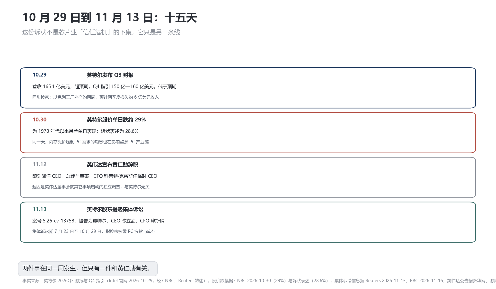
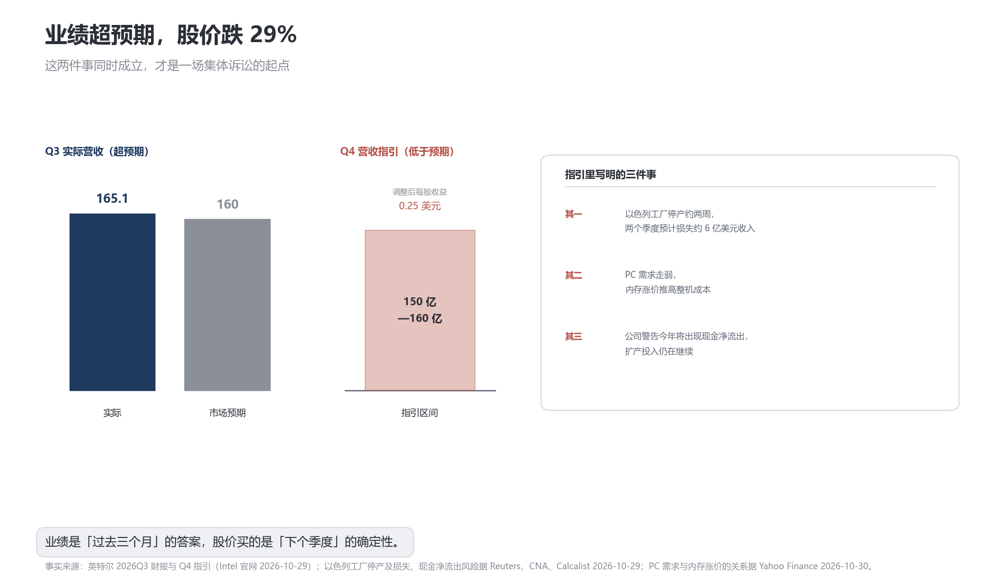
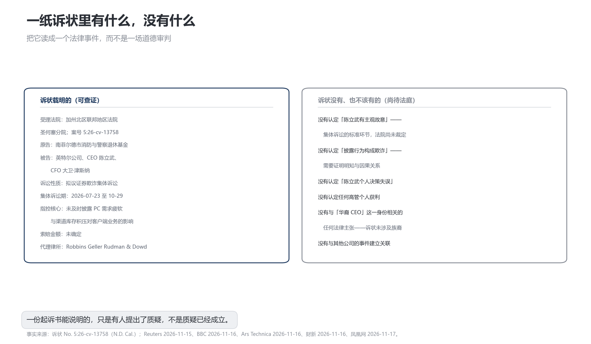

# 28.6% 的一天，和十天后的一纸诉状：英特尔这次被起诉，与黄仁勋无关

2026 年 11 月 13 日，美国加州北区联邦地区法院圣何塞分院收到一份起诉书，案号 5:26-cv-13758。

被告有三个：英特尔公司、首席执行官陈立武（Lip-Bu Tan）、首席财务官大卫·津斯纳（David Zinsner）。原告是密歇根州南菲尔德市消防与警察退休基金牵头的股东。这是一起拟议的证券欺诈集体诉讼，代理律所是 Robbins Geller Rudman & Dowd，索赔金额未定。

这份诉状在中国互联网上被贴了一个标签："黄仁勋之后，又一个华裔 CEO 被起诉"。

这个标签很顺口，但它把两件本来没有因果关系的事，缝成了一条故事线。

## 一、先把时间线摆对

黄仁勋是 2026 年 11 月 12 日辞职的——即刻卸任 CEO、总裁与董事职务，CFO 科莱特·克雷斯出任临时 CEO。起因是英伟达董事会就其它事项启动的独立调查，与英特尔没有任何关系。

英特尔那份诉状，是第二天（11 月 13 日）递进去的。而它真正的起因，要往前再推两周：10 月 29 日美股盘后，英特尔发布第三季度财报。

那次财报有个反差：**季度营收 165.1 亿美元，同比增长 21%，还略高于市场预期的 160 亿美元。**但公司给出的第四季度指引是 150 亿至 160 亿美元，调整后每股收益 0.25 美元，低于华尔街预期。

第二天，10 月 30 日，英特尔股价单日下跌约 29%——按 CNBC 的说法，是 1970 年代以来最差的一个交易日。诉状里用的数字是 28.6%。

所以，被起诉的直接原因，不是"华裔 CEO"这个身份，也不是"和黄仁勋同框"，而是一个在美国资本市场极其常见的情形：**业绩说明会上说了什么、没说什么，被股东认为误导了他们。**

## 二、这一次告的到底是什么

诉状的指控其实很具体，也很"技术"。

集体诉讼期是 2026 年 7 月 23 日到 10 月 29 日。原告主张：在这段时间里，英特尔没有及时披露个人电脑需求持续疲软、渠道库存积压对公司客户端业务（CCPG，客户端计算事业部）的真实影响，导致投资者在信息不充分的情况下做出了投资决策。

换句话说，告的不是"业绩差"，而是"你早就知道，却没说透"。

这个区分很关键。在美股，业绩差本身不构成欺诈——市场每天都有公司业绩不达预期。真正会被起诉的，是"披露的时间点和完整度"：如果一个不利趋势在内部已经清晰，对外却仍用模糊措辞，那么在此期间买入的股东，就有理由主张自己被骗了。

值得注意的是，英特尔这次指引里列明的拖累项，并不只是 PC。

一是以色列的一座工厂停产约两周，公司预计在两个季度内因此损失约 6 亿美元收入。二是 PC 需求走弱——而这一轮 PC 疲软，与内存价格暴涨直接相关：整机物料成本被推高，消费者的换机意愿被压下去。三是公司同时警告，今年将出现现金净流出，而扩产投入仍在继续。

这三件事叠在一起，构成了一个典型的"周期底部"画像：**主营需求在缩、成本在涨、现金在流出、投入不能停。**

## 三、陈立武的处境，是一个结构性的处境

把镜头拉远一点，会看到更值得写的东西。

陈立武是 2025 年 3 月 12 日被英特尔董事会任命为 CEO 的，3 月 18 日到任，是这家公司历史上第九任 CEO。他接手的是一个被寄予"复兴"厚望、但已经连续多年落后于对手的公司：制程落后、代工业务找不到足够的外部客户、AI 芯片几乎缺席。

换句话说，他的任务本身就是一个高风险的赌注：**在需要大额投入的转型期，同时承受业绩下滑和资本市场的不耐烦。**

这种处境下，集体诉讼几乎是必然会被触发的机制，而不是偶然事件。原因很简单：转型期的公司，往往会选择"给市场信心"，而给信心与充分披露之间，边界极其模糊。一旦下一个季度数据打脸，此前那些"我们预计下半年会改善"的措辞，就会被逐句翻出来，作为"误导"的证据。

这不是英特尔一家的故事。2026 年的半导体行业正处在一个奇特的时点：AI 需求把先进制程和高端存储的产能抽走了，PC 与通用服务器这些"老业务"反而被挤压。英特尔恰好同时站在两条曲线的交叉点上——它既想吃到 AI 的增量，又背着 PC 的存量。

所以，与其说这是一场"信任危机"，不如说这是**一家转型中的老公司在周期底部被问责**。这类诉讼在美国资本市场每年都有几百起，绝大多数以和解告终，很少有人真的走到判决。

## 四、一纸诉状里有什么，没有什么

在中国的舆论场里，这类事件很容易被讲成两个版本的故事：一个是"美国资本市场的集体诉讼制度很成熟，能约束高管"；另一个是"又一个华人 CEO 被针对了"。

两个版本都过头了。

诉状载明的部分是可查的：法院、案号、原被告、诉讼性质、集体诉讼期、指控核心、代理律所。这些都能核到。

但诉状"没有"的部分，同样重要：它没有认定陈立武存在主观故意，没有认定披露行为构成欺诈，没有认定他个人决策失误，也没有任何与"华裔"身份相关的主张——这份诉状从头到尾不涉及族裔。而且，**法院尚未对任何一项指控作出认定**。

## 五、接下来会发生什么

这一点很少有人讲清楚，但它恰恰决定了这条新闻的分量。

在美国，证券集体诉讼有一套相当固化的流程。递状只是起点，接下来通常是：法院审查是否指定首席原告（通常由损失最大的机构投资者担任）；被告提出驳回动议，主张原告未能满足证券法对"误导性陈述"与"主观故意"的严格举证要求；如果驳回不成立，进入证据开示，双方开始交换内部邮件、董事会纪要与财务模型；最后绝大多数案件以和解收尾，金额从数百万到数亿美元不等。

也就是说，这类案件的核心战场从来不在"舆论"，而在**内部文件的物证**：管理层在什么时点看到了什么数据、董事会在什么时点讨论过库存、对外表述与内部判断之间差了多久。这些都不是媒体转述能提供的。

这也解释了为什么英特尔方面通常不会在第一时间回应——在驳回动议提出之前，任何公开辩解都可能成为对方的材料。

对中国读者来说，这套机制最值得注意的地方，不是它有多严厉，而是它把"说清楚"变成了一种可被追责的义务。**一家上市公司可以业绩很差，但不能在被问到的时候说不清楚。**这条线，比很多人的想象要细，也要硬。

## 六、真正该问的问题

把这件事从"人物"里拉出来，剩下的是三个更实际的问题：

**第一，CEO 该为周期负责，还是为披露负责？**如果一家公司的业绩下滑主要来自行业周期（PC 需求、内存涨价、地缘因素导致的工厂停产），那么把责任压在 CEO 个人身上，既不准确，也不会让下一轮周期更好过。但如果问题出在"知道而不说"，那就是另一回事了。这两者需要被区分开，而舆论往往懒得区分。

**第二，转型期的公司，怎么才能既给市场信心、又不越界？**这是一个真实的治理难题。太保守，融资成本上升、股价承压；太乐观，一旦打脸就要面对诉讼。目前美股的做法是靠"前瞻性陈述安全港"制度来平衡，但边界依然靠一个个判例来划。英特尔的这个案子，最终也会成为边界的一部分。

**第三，也是最重要的一条：把不同公司、不同性质的事件串成"某某群体被针对"的叙事，是对读者的误导。**黄仁勋的离职源于一场针对他个人的独立调查，陈立武被列为被告源于一份关于信息披露的起诉书，两者除了同处一个行业、同一个月份，没有更多共同点。把它们拼在一起，会让人以为整个行业正在发生某种"系统性清算"，而事实是——**一件是治理事件，一件是披露争议，性质完全不同。**

从业者的族裔不该成为解释商业事件的变量。真正值得追问的，是那 28.6% 背后的披露节奏，和一家老公司在周期底部还剩多少腾挪空间。

---

*事实来源：集体诉讼信息据路透社 2026-11-15（"Intel sued by shareholders following 29% stock plunge"）、BBC 2026-11-16、Ars Technica 2026-11-16、Tom's Hardware 2026-11-16、CFO Dive 2026-11-17、财新网 2026-11-16、凤凰网 2026-11-17、cnBeta 2026-11-16 等；案号 5:26-cv-13758 及原被告信息据 Justia 案卷页与 Robbins Geller Rudman & Dowd 2026-11-14 的公告；起诉书原文为 City of Southfield Fire and Police Retirement System v. Intel Corporation et al.；英特尔 2026 财年第三季度财报与第四季度指引（营收 165.1 亿美元、同比增 21%、Q4 指引 150 亿—160 亿美元、调整后每股收益 0.25 美元）据英特尔官网新闻稿 2026-10-29，及 CNBC 2026-10-30、Yahoo Finance 2026-10-30 的报道；股价单日跌幅 29% 据 CNBC 2026-10-30，诉状表述为 28.6%，据 Ars Technica；以色列工厂停产约两周、预计两季度损失约 6 亿美元收入、今年将出现现金净流出，据路透社、CNA、Calcalist 2026-10-29 的报道；PC 需求受内存涨价压制，据 Yahoo Finance 2026-10-30；陈立武任命信息据英特尔官网新闻稿与路透社 2025-03-12、AP 2025-03-12；黄仁勋辞职信息据英伟达官网公告（经新华网 2026-11-12、财新 2026-11-12、纽约时报中文网 2026-11-13 报道）。*

*需说明五点。其一，本文所述"英特尔股价单日跌约 29%"与诉状中的"28.6%"分属不同来源口径（CNBC 与起诉书），本文并列呈现，未取其一；盘后交易时点的跌幅报道为 21%–23%，亦因时点不同而不同。其二，该案为拟议的集体诉讼，尚待法院裁定是否认证为集体诉讼，法院亦未对任何指控作出实体认定，本文全程使用"指控""主张"等表述，不作有罪推定。其三，"陈立武为马来西亚华人、现为美国公民"这一信息在中文报道中广泛出现，本文仅用于说明诉状不涉及族裔，未据此作任何推断。其四，本文关于"转型期公司易触发集体诉讼""前瞻性陈述安全港"的讨论属基于公开制度的分析，不构成对本案结果或任何一方的法律判断；美国证券集体诉讼的具体构成要件与举证责任，应以现行法律与法院认定为准。其五，英伟达相关事件在本文中仅作时间参照，起因据公开报道为英伟达董事会就其它事项启动的独立调查，与英特尔及本案无任何关联，本文不作关联性推断。*
