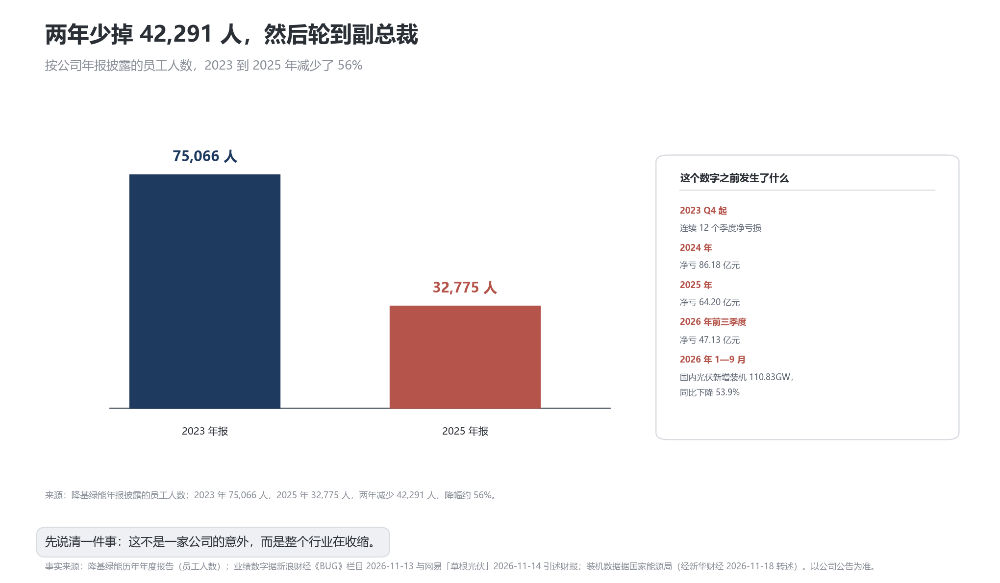
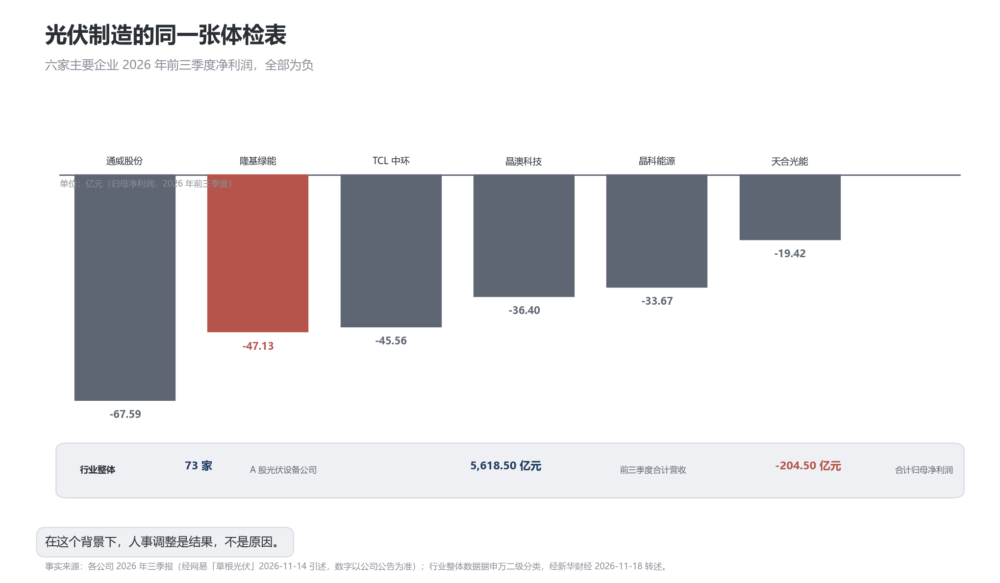
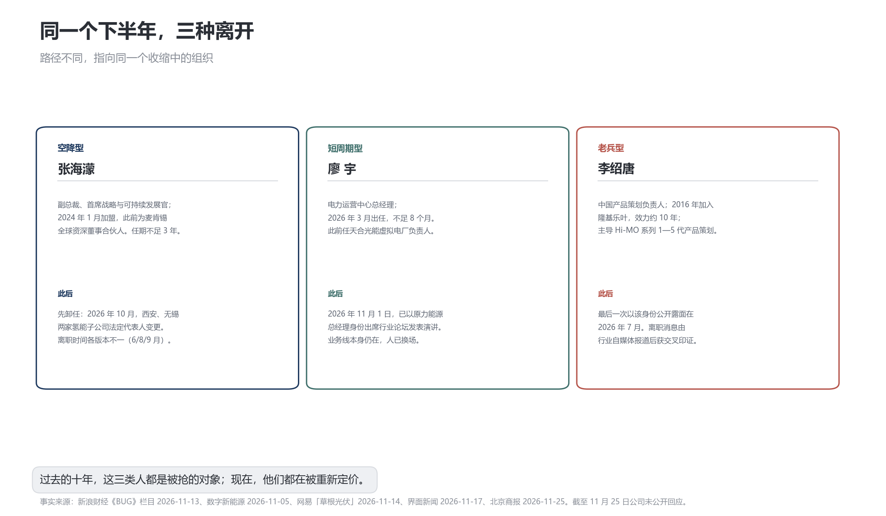

# 两年少掉 42,291 人，然后轮到副总裁：光伏周期底部，人才正在被重新定价

2026 年 11 月 13 日，新浪财经《BUG》栏目发了一条独家报道，援引消息人士的说法：隆基绿能今年多次裁员，下半年以来多位高级管理人员离职，14 级以上、总监以上的员工"裁了一大批"，部分离职管理人员被启动了竞业限制。报道称，有离职管理层人士向该栏目确认了此事。

同一天，另一家财经媒体在向公司求证时没有得到回应。到 11 月 25 日，北京商报再次向隆基绿能求证，依然未获回复。

这份沉默本身是一个值得记录的信号。在中国光伏龙头的语境里，"管理层集体离职"这四个字足以触发一轮舆论审判——这家公司过去几年连续亏损，任何人事异动都会被读成"要出事了"。

但如果把镜头拉远一点，会看到一件更值得写的事：**这不是某一家公司的人事风波，而是一个行业在周期底部，把人当成成本项重新定价的全过程。**

## 一、先看这四万两千人

按隆基绿能年报披露的员工人数：2023 年是 75,066 人，2025 年是 32,775 人。两年时间，减少了 42,291 人，降幅约 56%。

这个数字之所以重要，是因为它比任何一位高管的离职都更能说明组织的处境。一家公司的副总裁离职，可能是个人选择、可能是战略调整、也可能是被优化；但四万多人从花名册上消失，只可能有一个原因——**它不再需要那么多人来干原来的那些活。**

教授级的技术路线还在，产线还在，产品还在发布。变的是每个环节需要的人手：产能利用率下降、业务线收缩、组织架构合并，冗余岗位被直接取消。《BUG》的报道里提到，被砍掉的一条具体业务是生物质制甲醇；内部架构整合之后，"有些管理岗位已经被取消了"。有被裁员工对媒体表示，公司给了 N+1 补偿，也给了预留时间，整体流程合规。

这类细节容易被忽略，但它决定了怎么看这件事：**如果一家公司连裁员流程都在按规矩走，那它的问题不在"不讲规矩"，而在"撑不住了"。**

## 二、撑不住的，不只是隆基

2026 年前三季度，申万二级分类下 73 家 A 股光伏设备公司合计营收 5,618.50 亿元，合计归母净利润 -204.50 亿元。行业整体仍在亏损。

从单个公司看，情形更清楚。前三季度净利润：通威股份 -67.59 亿元，隆基绿能 -47.13 亿元，TCL 中环 -45.56 亿元，晶澳科技 -36.40 亿元，晶科能源 -33.67 亿元，天合光能 -19.42 亿元。**六家主要制造企业全部为负。**

需求端也在收。据国家能源局数据，2026 年 1—9 月国内光伏新增装机 110.83GW，同比下降 53.9%。

隆基本身的情况，是 2023 年第四季度起连续 12 个季度净亏损：2024 年净亏 86.18 亿元，2025 年净亏 64.20 亿元，2026 年前三季度净亏 47.13 亿元。亏损在收窄，但离转正还有距离。

把这两组数据放在一起，人事调整的性质就变了。它不是某位 CEO 的治理风格问题，而是一个行业从"抢产能"切换到"抢活下去"之后，必然发生的组织瘦身。

## 三、三种人，三种离开

回到那几位被点名的高管。如果把他们的履历摊开，会看到三种完全不同的路径——而三种路径都指向同一个方向。

**第一种是"空降型"。** 张海濛，2024 年 1 月加盟隆基，担任副总裁兼首席战略与可持续发展官，此前是麦肯锡全球资深董事合伙人。他的任务是给隆基做"绿电+绿氢"的整体战略规划。按报道，他在隆基任职不足 3 年。更早的信号出现在工商信息里：2026 年 10 月，西安隆基氢能、无锡隆基氢能两家子公司的法定代表人由张海濛变更为周国平。至于具体离职时间，行业媒体的说法从 6 月到 9 月都有，没有统一版本。

**第二种是"短周期型"。** 廖宇，2026 年 3 月出任隆基绿能电力运营中心总经理，此前在天合光能负责虚拟电厂与数字能源业务。到 11 月 1 日，他已经以"原力能源总经理"的身份出现在南方电网主办的第七届新型电力系统国际论坛上并发言——从入职到离职，不足 8 个月。

**第三种是"老兵型"。** 李绍唐，2016 年加入隆基乐叶，在隆基体系内效力约 10 年，曾主导 Hi-MO 系列 1—5 代产品的策划推广，最后一次以中国产品策划负责人身份公开露面是在 2026 年 7 月。

三个人，一个从咨询公司空降、一个从同行挖来、一个自己培养。**过去十年，这三类人都是被争抢的对象；现在，他们同时出现在一份"离职名单"上。**

## 四、"抢人"到"锁人"，中间只隔了一个周期

真正把这条新闻从"人事八卦"提升为"行业现象"的，是"竞业限制"这四个字。

在扩张期，竞业限制是一种防御性条款：公司怕核心人才带着技术去对手那里，所以签下来，多数时候并不真的执行。到了收缩期，它的性质变了——**它从"留人的绳子"变成了"锁人的锁"。**

这个转变有很现实的动因。光伏行业的核心竞争力高度集中在工艺与产线经验上，一位懂电池片工艺的总监，去了竞争对手那里，可能直接改变一条产线的效率。在产能过剩、每一点成本都要抠的当下，技术外流的代价比扩张期更高。所以企业更愿意启动竞业限制，哪怕这意味着要付出补偿金、也可能招来劳动争议。

另一方面，被限制的人也面临新的处境：过去跳槽是涨薪的常规路径，现在同样的跳槽可能触发违约诉讼。**职业安全感的定价权，从"我能带走什么"变成了"公司允许我带走什么"。**

这不是光伏独有的现象。任何一个从高速扩张转入存量竞争的行业，都会经历这个阶段——互联网、教培、房地产，都走过类似的路。区别只在于，光伏的周期来得更陡：从 2023 年装机狂飙，到 2026 年新增装机腰斩，只用了不到三年。

## 五、该问的问题，不是"隆基还行不行"

写到这里，需要明确一件事：本文不打算、也没有依据去判断隆基绿能的经营前景。一份基于匿名信源的人事报道，加上几个季度的财报，远不足以支撑"这家公司要垮了"的结论。

真正值得问的是另外三个问题。

**第一，一个行业在周期底部做组织收缩时，谁承担成本？** 从公开信息看，四万多人离开，公司按 N+1 补偿；高管离职，部分被启动竞业限制。这些都在法律框架内。但"合规"和"合理"之间还有距离：一位在隆基干了十年、主导过五代产品策划的老兵，离开时能带走什么、带不走什么，制度上有没有更细的安排？

**第二，竞业限制的边界在哪里？** 竞业限制的本意是保护商业秘密，不是限制劳动者的生存权。当一家公司大规模启动竞业限制时，需要回答的是：限制的范围是否与真实的商业秘密匹配？补偿是否合理？这些问题在中国有明确的法律框架（《劳动合同法》第二十三条、二十四条），但执行中的尺度，往往取决于企业有多强势。

**第三，也是最重要的一条：行业出清之后，人去哪里？** 光伏的产能过剩不会永远持续。当需求重新起来、技术路线（比如 BC 与 TOPCon 之争）分出胜负，行业会重新需要工程师和产线管理者。而那些在 2026 年离开的人，届时是否还愿意回来？**一个行业的长期竞争力，不只取决于它有多少产能，也取决于它在低谷期怎么对待自己的人。**

这三问没有标准答案。但它们至少说明，这条新闻的分量不在"哪几位高管走了"，而在"一个行业在最低谷时，如何对待它的人力资产"。

---

*事实来源：人事变动信息据新浪财经《BUG》栏目 2026-11-13（记者刘丽丽，援引消息人士，称"14 级以上的、总监以上的员工裁了一大批"、"有的离职管理人员还被启动了竞业限制"，并有离职管理层人士确认）；同篇报道提到生物质制甲醇业务被取消、有被裁员工称获 N+1 补偿且流程合规；张海濛履历与任期据腾讯新闻转《碳见光伏》2026-11-16、网易「草根光伏」2026-11-14（2024 年 1 月加盟，此前为麦肯锡全球资深董事合伙人，任职不足 3 年，离职时间各版本不一）；西安、无锡隆基氢能法定代表人变更据界面新闻 2026-11-17；廖宇任职与去向据数字新能源 2026-11-05（2026 年 3 月出任，11 月 1 日以原力能源总经理身份出席第七届新型电力系统国际论坛）、金融界 2026-11-13；李绍唐履历据网易「草根光伏」2026-11-14（2016 年加入隆基乐叶，主导 Hi-MO 系列 1—5 代产品策划，最后一次公开露面为 2026 年 7 月）；公司未回应据北京商报 2026-11-25（记者求证未获回复）、腾讯新闻转《碳见光伏》2026-11-16；员工人数（2023 年 75,066 人、2025 年 32,775 人）据隆基绿能年度报告；隆基业绩（2023 年四季度起连续 12 个季度净亏损、2024 年净亏 86.18 亿元、2025 年净亏 64.20 亿元、2026 年前三季度净亏 47.13 亿元）据《BUG》栏目与「草根光伏」引述财报，数字以公司公告为准；六家企业前三季度净利润数据据「草根光伏」2026-11-14 引述各公司三季报；行业整体（73 家公司合计营收 5,618.50 亿元、合计归母净利润 -204.50 亿元）与装机数据（2026 年 1—9 月新增装机 110.83GW，同比下降 53.9%）据新华财经 2026-11-18；竞业限制的法律依据为《中华人民共和国劳动合同法》第二十三条、第二十四条。*

*需说明五点。其一，本文所述人事变动主要依据新浪财经《BUG》栏目的独家报道及其被多家媒体的转述，核心信息源为匿名"消息人士"，公司截至 11 月 25 日未公开回应，其中"14 级以上、总监级裁了一大批""部分离职高管被启动竞业限制"等表述属媒体口径，本文标注为报道内容，未作事实认定。其二，张海濛的具体离职时间在公开报道中存在 6 月、8 月、9 月多个版本，无法核实，本文如实列出分歧。其三，员工人数为年报口径的年末在册人数，不等同于"因裁员离开的人数"，其中包含主动离职、退休、业务剥离等多种情形；本文未将其直接归因于裁员。其四，六家企业的净利润与行业合计数据，部分经行业自媒体引述三季报，可能与公司公告存在口径或时点差异，应以公司正式披露为准。其五，本文涉及竞业限制、裁员补偿的讨论，仅为基于公开信息的分析，不构成法律意见；相关权利义务的认定应以劳动合同、地方规定及生效裁判为准。本文不构成对隆基绿能经营前景、财务状况或投资价值的任何判断。*
