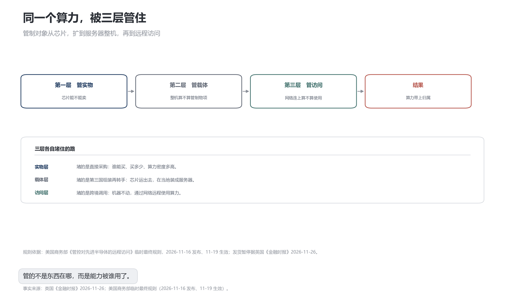
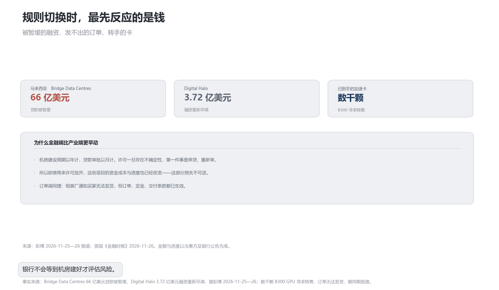
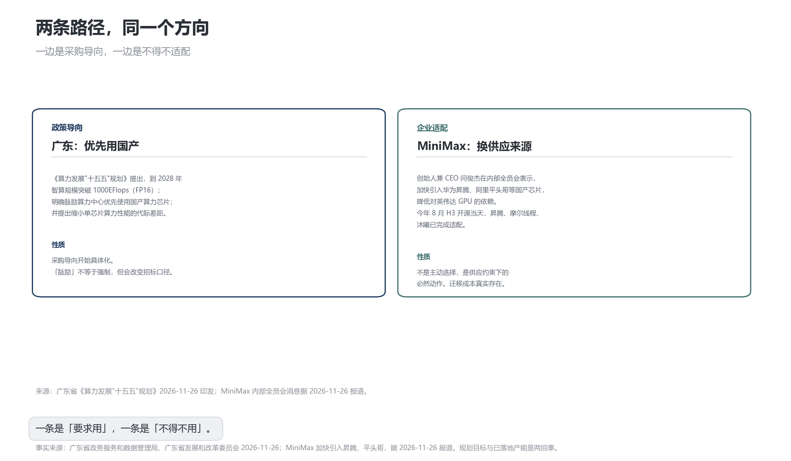

# 英伟达停发四国服务器：这次被管住的，不只是芯片

2026 年 11 月 26 日，英国《金融时报》报道了一件事：英伟达已通知其制造合作伙伴，暂停向马来西亚、新加坡、泰国和印度尼西亚四个东南亚国家交付搭载其芯片的服务器。

戴尔、超微电脑等服务器组装厂商随即通知这四国的买家，相关订单目前无法发货，恢复时间尚不明确。

这条消息在产业圈引起的震动，比"又一轮芯片管制"要大得多。因为过去几年，管制的对象一直是**芯片**——谁能买到、买到多少、什么算力密度。而这一次，被卡住的是**服务器整机**，以及被写进同一份规则的**远程算力访问**。

同一个东西，换了三个层面去管。这才是这件事真正值得写的地方。

## 一、先看清楚规则是怎么走到这一步的

据公开报道，此次动作与美国商务部 11 月 16 日发布、11 月 19 日生效的《管控对先进半导体的远程访问》临时最终规则相关。新规要求，向新加坡、马来西亚、泰国、印尼和巴西出口先进 AI 芯片须获得许可，同时把管制范围延伸至海外数据中心的远程算力访问。

三步连起来看，逻辑很清楚：

**第一步管实物。** 芯片不能随便卖，这已经执行了几年。

**第二步管载体。** 芯片装进服务器、服务器装进机柜，整机也算管制物项。这意味着"在哪里组装"开始变得重要——过去把芯片运到第三国、在当地装成服务器再转手，是一条被广泛讨论的路径。

**第三步管访问。** 算力不必跨境搬运，只要网络能连上，就等于在使用。所以规则把"远程访问"也纳进来，堵的是"东西没动、能力过去了"这条路。

**实物、载体、访问——三层封上，物理位置就不再是边界。**

这是这次规则最本质的变化。它不再只问"东西在哪"，而是问"能力被谁用了"。

## 二、为什么是这四个国家

马来西亚、新加坡、泰国、印尼，共同点不是地理位置，而是过去三年它们在数据中心版图上的位置。

新加坡是东南亚的算力枢纽，马来西亚的柔佛州承接了大量来自新加坡的机房外溢需求，泰國和印尼则是新一轮数据中心投资的热点。这四个地方合起来，是亚太区增长最快的一块机房供给。

管制落在这一片，指向的不是这四个国家本身的市场，而是**经由这里发生的转运与再分配**。

一个细节值得注意：据彭博 11 月 25—26 日报道，受先进 AI 芯片出口许可风险影响，马来西亚 Bridge Data Centres 的 66 亿美元贷款、Digital Halo 的 3.72 亿美元融资等，已被银行暂缓或重新尽调。

**金融端的反应比产业端更早。** 银行不会等到机房建好才评估风险，一旦许可存在不确定性，第一件事就是停贷、重新审。这意味着即使将来许可放开，这些项目的资金成本和进度也已经变了。

同时有报道称，新规导致数千颗 B300 GPU 寻求转售。一边是新卡进不去，一边是已到手的卡用不上、只能转手——这就是规则切换时的典型摩擦。

## 三、被改变的不是技术，是"算力的地理"

过去我们习惯把算力理解成一种技术能力：多少 PFLOPS、多少张卡、多快的互联。

但当管制从芯片延伸到服务器和远程访问之后，算力同时变成了一种**受管辖的资源**。它有三个坐标：

**物理坐标**——机器在哪里。
**法律坐标**——受谁的规则约束。
**访问坐标**——谁在通过网络使用它。

过去十年，产业界主要优化第一个坐标：把机房建在电价低、地价便宜、气候凉爽的地方。全球化让后两个坐标看起来不重要，因为能力可以自由流动。

现在三个坐标被强行绑在一起。一间建在马来西亚的机房，如果芯片来自受限来源、服务对象涉及受限方，它的价值就不再由 PUE 和电价决定。

**这是产业逻辑的一次重置：从"最优成本"，转向"最低管辖风险"。**

## 四、中国的两条应对路径，已经在同时发生

**一条是政策层的明确导向。** 11 月 26 日，广东省印发《算力发展"十五五"规划》，提出到 2028 年智算规模突破 1000EFlops（FP16），并明确"鼓励算力中心优先使用国产算力芯片"，同时提出缩小单芯片算力性能的代际差距、推动多元算力芯片高效互联。

"优先使用"这四个字，从一个省的文件里出现，意味着采购导向开始具体化。

**另一条是企业层的现实调整。** 据 11 月 26 日报道，MiniMax 创始人兼 CEO 闫俊杰在内部全员会上表示，公司将加快引入华为昇腾和阿里平头哥等国产 AI 芯片，进一步降低对英伟达 GPU 的依赖。报道提到，随着海外芯片供应与算力获取限制收紧，公司正加快调整算力来源；而国产芯片的适配其实早已展开——今年 8 月 H3 开源当天，华为昇腾、摩尔线程、沐曦等厂商即完成适配。

这两条路径的性质不同：一条是"要求用"，一条是"不得不适配"。但它们指向同一个结果——**算力供给正在从"全球统一市场"分裂成"区域性市场"**。

分裂的代价是效率。全球采购能拿到最好的性价比，区域化采购要接受性能差距、生态不成熟、迁移成本。这些成本不会消失，只会转移到使用者身上。

## 五、三个还没有答案的问题

**第一，已经签了的合同，违约成本谁来承担？** 组装厂通知买家"无法发货"，但订单、定金、交付条款都已经生效。这不是技术问题，是一连串商业合约的重新谈判。

**第二，东南亚这批在建的数据中心怎么办？** 过去三年，这一区域的机房投资是基于"服务全球客户"的假设建的。如果算力必须绑定管辖归属，这些资产的用途需要重新定义。折旧周期二十年，规则周期可能只有两年——错配就在这里。

**第三，算力会不会变成一种"区域性商品"？** 如果跨境访问受限成为常态，同一个模型在不同地区训练、推理的成本会拉开差距。技术是普适的，但算力的价格不是。

这三个问题目前都没有答案。但它们至少说明一件事：**这一轮变化的核心不是"谁被卡了"，而是"算力从此带上了归属"。**

对于不在这个行业里的人来说，这件事的传导路径其实不复杂：算力成本上升，会变成云服务涨价；云服务涨价，会变成你用的每一个 App 的成本；成本最终会体现在订阅费、广告价、商品价上。它慢，但它会到。

---

*事实来源：英伟达暂停向马来西亚、新加坡、泰国、印度尼西亚交付搭载其芯片的服务器，据英国《金融时报》2026-11-26 报道，戴尔、超微电脑已通知上述四国买家订单无法发货、恢复时间不明确（经多家媒体转述）；美国商务部《管控对先进半导体的远程访问》临时最终规则于 2026-11-16 发布、11-19 生效，要求向新加坡、马来西亚、泰国、印尼和巴西出口先进 AI 芯片须获许可，并将管制延伸至海外数据中心远程算力访问；数千颗 B300 GPU 寻求转售、东南亚数据中心运营商面临项目延期，据同期报道；Bridge Data Centres 66 亿美元贷款被暂缓、Digital Halo 3.72 亿美元融资重新尽调，据彭博 2026-11-25—26 报道；广东省《算力发展"十五五"规划》据广东省政务服务和数据管理局、广东省发展和改革委员会 2026-11-26 印发文件，提出到 2028 年智算规模突破 1000EFlops（FP16）、鼓励算力中心优先使用国产算力芯片；MiniMax 加快引入华为昇腾、阿里平头哥国产芯片，据 2026-11-26 报道，H3 开源当日昇腾、摩尔线程、沐曦完成适配；AI 芯片出口许可审查传导至融资端、亚洲多笔数据中心贷款被暂缓或重新评估，据彭博报道。*

*需说明四点。其一，本文关于英伟达暂停发货的表述，依据的是《金融时报》报道及戴尔、超微电脑对买家的通知，英伟达与相关国家主管部门截至本文写作时未就细节作进一步公开说明，"暂停"的期限与范围以官方后续口径为准。其二，报道提到"数千颗 B300 GPU 寻求转售"，该数字为媒体援引知情人士的说法，未见官方统计，本文仅作趋势描述，未作精确认定。其三，Bridge Data Centres 与 Digital Halo 的融资状态（暂缓、重新尽调）为彭博报道口径，具体金额与当前进度可能随谈判变化，应以当事方与银行公告为准。其四，本文涉及出口管制规则的梳理，仅为基于公开信息的产业分析，不构成法律意见；具体物项是否属于管制范围、许可如何申请，应以主管部门发布的规则原文与正式答复为准。本文不构成对任何企业经营前景、财务状况或投资价值的判断，也不涉及任何证券的买卖建议。*
