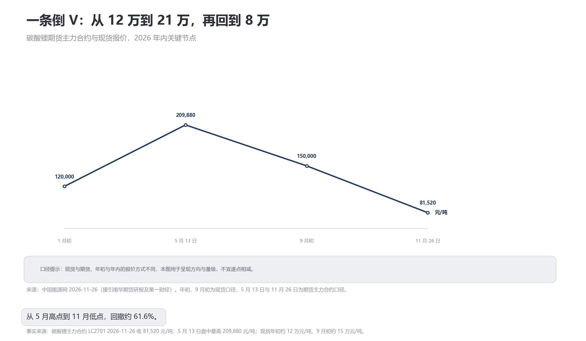
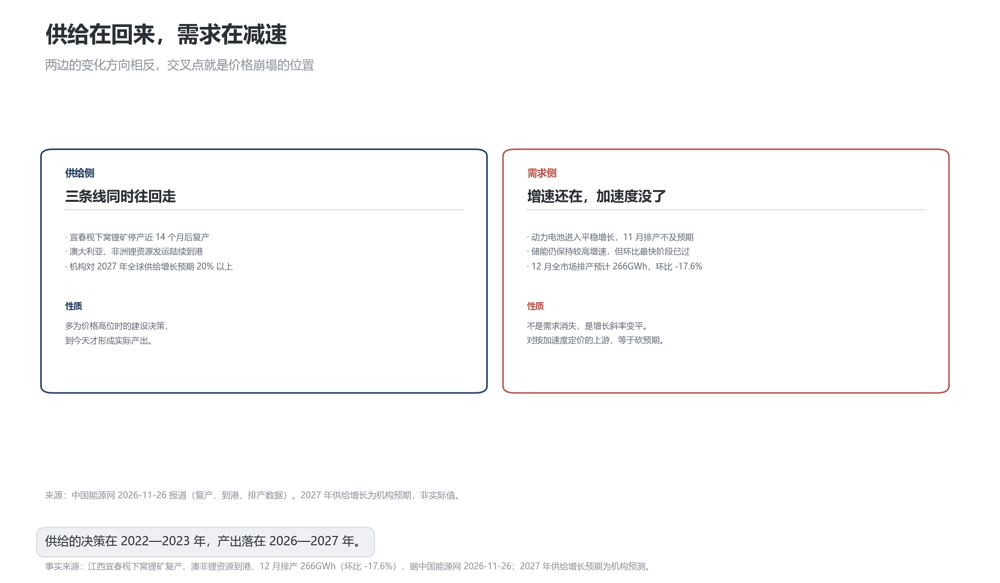
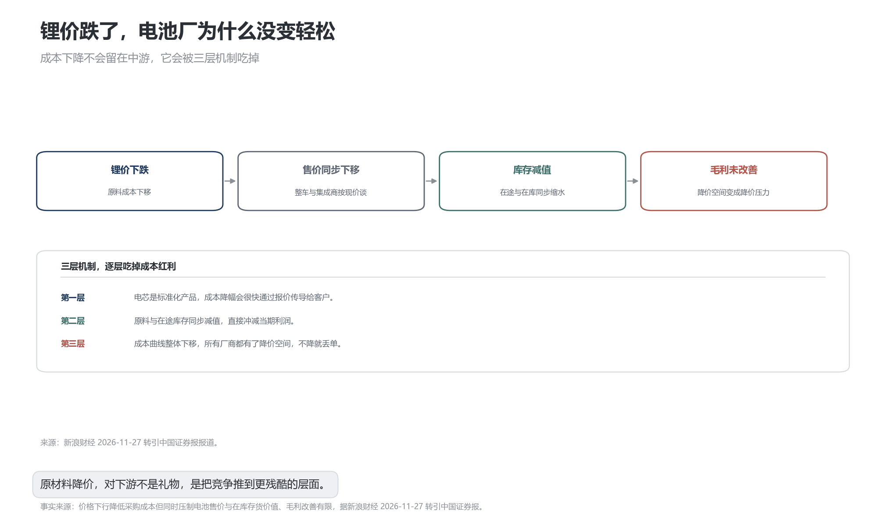

# 碳酸锂从 21 万跌回 8 万：这一轮跌的，不只是价格

2026 年 11 月 26 日，碳酸锂主力合约 LC2701 收在 81,520 元/吨，跌 3.16%，盘中最低到过 80,580 元/吨。而在此前一个交易日，这个合约刚刚大跌 8.08%。

把时间拉长一点，画面更清楚：今年 5 月 13 日，主力合约盘中最高触及 209,880 元/吨；到 11 月 26 日的盘中低点，最大回撤约 61.6%。现货端同步走弱，电池级碳酸锂报价 85,920 元/吨，单日下跌 4.83%，澳大利亚锂辉石精矿、六氟磷酸锂、储能型电解液等环节报价一起往下走。

很多人看到这条消息的第一反应是"电池要便宜了"。这个判断只对了一半。

**锂价下跌真正在发生的事，是一个行业在给两三年前的扩产决策结账。**

## 一、先看清楚这轮价格是怎么走出来的

2026 年的碳酸锂，走的是一条典型的倒 V。

年初现货价格约 12 万元/吨。上半年在供给收缩与需求景气的共同推动下震荡上行，5 月 13 日期货主力盘中最高触及 209,880 元/吨。此后行情拐头向下，一路走到 11 月的 8 万出头。

涨的时候，理由很充分：锂矿减产、下游排产旺盛、储能招标放量。跌的时候，理由同样充分，而且更有结构性。

**关键不在价格本身，在于供给和需求的变化节奏错开了。**

## 二、供给端：两三年前投的产能，现在刚好到货

这一轮供给回来的路径，有两条线索。

**一条是国内复产。** 江西宜春枧下窝锂矿在停产近 14 个月后，启动了复产。14 个月，差不多正好是一个价格周期的下行段——矿停的时候是因为价格不划算，复产的时候是因为有别的因素在推动，但产能一旦回来，对供需平衡的影响是实打实的。

**另一条是海外到货。** 澳大利亚、非洲等地的锂资源发运陆续到港。机构对 2027 年全球锂供给的增长预期普遍在 20% 以上。

注意这个时间差：这些矿的建设决策，大多是在价格高位时做的。矿山从勘探、审批、建设到达产，周期以年计。**决策在 2022—2023 年，产出落在 2026—2027 年。** 中间隔着一整个价格周期。

这和整车厂的情况几乎是同一个剧本——今天投产的产能，是三四年前的判断。区别只在于，矿山的周期更长，反应更慢，所以过剩持续的时间也更久。

## 三、需求端：12 月排产第一次明确转负

真正让市场情绪转向的，是需求侧的数字。

据机构测算，12 月国内锂电全市场排产预计降至 266GWh，环比下滑 17.6%，远超市场预期。

两个下游同时显出疲态：

**动力电池**进入平稳增长阶段。11 月以来排产不及预期——不是下滑，是没有原来预期的那么强。

**储能**仍保持较高增速，但环比扩张最快的阶段已经过去。这句话很关键：增速还在，加速度没了。对于按"加速度"给估值的上游资源品来说，这等于预期被砍掉一截。

**供给在增加，需求在减速，两条曲线交叉的位置，就是价格崩塌的位置。**

## 四、为什么锂价跌了，电池厂也没好过

这是最容易被误解的一环。按常理，原材料降价对下游是利好。但现实里的账不是这么算的。

有行业媒体在报道里写得很直白：价格下行虽降低采购成本，却同步压制电池售价与在库存货价值，毛利改善有限，价格竞争反而更为直接。

拆开看是三层：

**第一层，成本降了，售价也降了。** 电芯是标准化产品，成本下降很快会通过报价传导给客户。整车厂和储能集成商在谈价时，比谁都清楚碳酸锂今天多少钱。

**第二层，库存要减值。** 电池厂和正极材料厂手里都有原料和在途库存。原料价格跌 40%，这部分库存的价值同步缩水，直接冲减利润。

**第三层，价格战更直接了。** 当成本曲线整体下移，所有厂商都有了降价空间，于是降价变成必须动作。谁不降，谁丢单。

**原材料价格下跌，对下游不是礼物，是把竞争推到了更残酷的层面。**

这也解释了一个反常识的现象：锂价跌了这么多，电池环节的盈利并没有同步改善。

## 五、这一轮周期真正在筛选什么

从公开信息看，行业里已经在发生三件事。

**第一，成本曲线决定谁停产。** 锂资源不是同质的，盐湖、锂辉石、云母提锂的成本差别很大。价格跌到某个位置，高成本产能必须先退出，否则现金流撑不住。这是资源品行业最古老的规律。

**第二，二线电池厂开始换赛道。** 有报道提到，亿纬锂能把船舶与储能作为差异化支点，截至 2026 年 8 月船用电池累计出货突破 1GWh，国内超过 50% 的电动船舶采用其解决方案；宁德时代前三季度储能电池销量同比增长 60%；国轩高科拿下沙特首批大型电池储能项目核心 6GWh 标段。

它们的共同点不是"造更好的电芯"，而是**从通用电芯的价格竞争，转向场景定制与系统交付**。船、航空、海外储能，这些场景对循环寿命、安全冗余、认证门槛要求更高，价格敏感度更低。

**第三，政策成本在抬头。** 有报道提到，2027 年消费税税率将上调、出口退税退出、海外合规要求抬升。这三项都会直接压缩利润空间，而且是确定会来的。

## 六、三个还没答案的问题

**第一，8 万元是不是底？** 本文不做价格判断。但可以给一个观察框架：看高成本产能的实际退出速度，看 2027 年供给增量的落地节奏，看储能招标的持续性。这三件事决定平衡点在哪，而不是任何一个人的预测。

**第二，价格跌了，为什么终端车价没有同步大跌？** 因为电池只是整车成本的一部分，而且车企正在用降价换份额，两股力量方向一致但幅度不同。消费者感受到的"便宜"，是多重因素叠加的结果，不单是锂价。

**第三，这一轮出清之后，行业会变成什么样？** 从其他资源品的历史看，通常是集中度上升、成本曲线变平、价格波动收窄。但这需要时间，也需要有人真的退出。

对于不在这个行业里的人来说，这件事的意义在于：**你买的电动车、你家的储能设备、你听说的那些"新能源"故事，成本结构正在被重算一遍。** 而重算的成本，最终会以某种方式落到价格上——可能是车价，可能是电价，也可能是某个行业的就业。

---

*事实来源：碳酸锂主力合约 LC2701 于 2026-11-26 收报 81,520 元/吨、跌 3.16%、盘中最低 80,580 元/吨，前一交易日跌 8.08%；2026 年 5 月 13 日期货主力盘中最高触及 209,880 元/吨，截至 11 月 26 日盘中低点最大回撤约 61.6%；电池级碳酸锂报价 85,920 元/吨、单日跌 4.83%；年初现货价格约 12 万元/吨，9 月初约 15 万元/吨——以上据中国能源网 2026-11-26 报道（援引南华期货研报及第一财经）。江西宜春枧下窝锂矿停产近 14 个月后启动复产、澳大利亚与非洲锂资源发运陆续到港、机构对 2027 年全球锂供给增长预期普遍在 20% 以上、12 月国内锂电全市场排产预计降至 266GWh、环比下滑 17.6%——据同篇报道。动力电池进入平稳增长阶段、11 月以来排产不及预期、储能仍保持较高增速但环比扩张最快阶段已过——据同篇报道。价格下行降低采购成本但同时压制电池售价与在库存货价值、毛利改善有限——据新浪财经 2026-11-27 转引中国证券报报道。亿纬锂能船用电池累计出货突破 1GWh、国内超 50% 电动船舶采用其方案、与 Fluence 签署 206GWh 五年框架协议、2027 年已确定交付约 16GWh；宁德时代前三季度储能电池销量同比增长 60%；国轩高科拿下沙特首批大型电池储能项目核心 6GWh 标段——据中国经济网、新浪财经 2026-11-27 报道。2027 年消费税税率上调、出口退税退出、海外合规要求抬升——据新浪财经 2026-11-27 转引中国证券报报道。*

*需说明四点。其一，本文引用的价格均为期货主力合约与现货报价的公开数据，期货价格受交易情绪影响，日内波动较大，单一交易日或单一价格点不足以代表趋势，具体以交易所与报价机构公布为准。其二，12 月排产 266GWh、环比下滑 17.6% 为机构测算值，非企业公告数据，实际排产可能随订单调整，本文仅作方向性描述。其三，机构对 2027 年全球锂供给增长 20% 以上的预期，属预测性判断，存在偏差可能，本文如实转述、未作采信认定。其四，本文涉及资源品供需与价格的分析，仅为基于公开信息的产业讨论，不构成对任何商品、证券的价格预测或买卖建议；本文也不对任何企业的经营前景与财务状况作出判断。*
