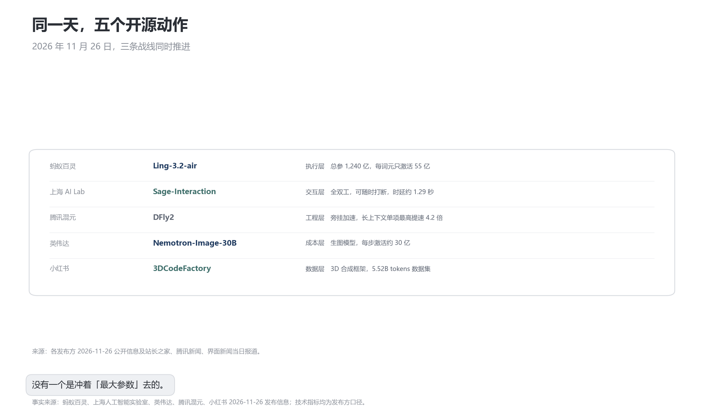
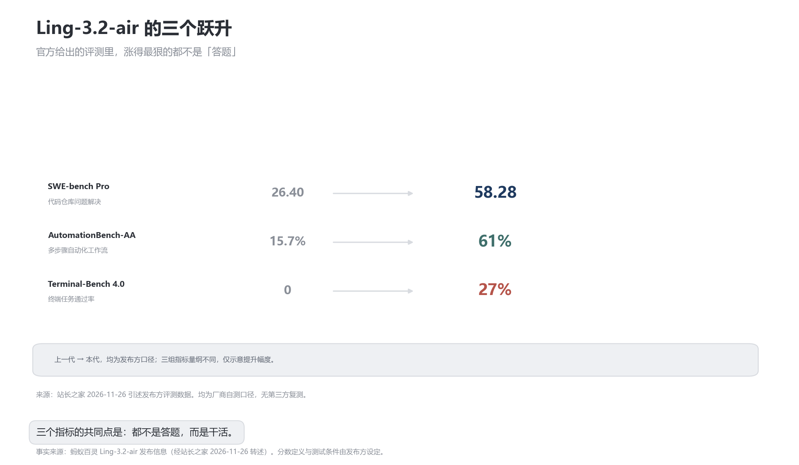
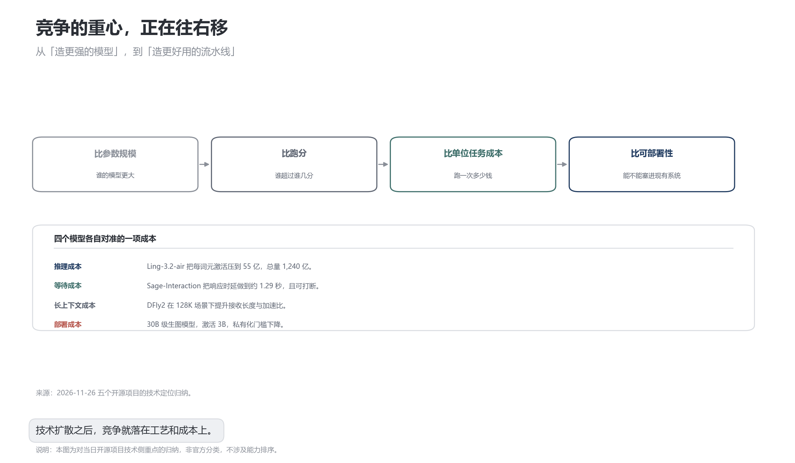

# 一天开源四个模型：AI 竞赛的赛道，悄悄换了

2026 年 11 月 26 日，中国和美国的三家机构在同一天放出了四个开源模型，外加一个 3D 数据合成框架。

- 蚂蚁百灵开源 **Ling-3.2-air**，原生多模态，总参数 1,240 亿、每词元激活 55 亿；
- 上海人工智能实验室开源 **Sage-Interaction**，主打全双工交互，响应时延约 1.29 秒，可以随时打断；
- 英伟达开源 **Nemotron-Labs-Image-30B-A3B**，300 亿参数的生图模型，每步激活约 30 亿；
- 腾讯混元开源 **DFly2** 草稿模型，作为 Hy4 flash 的旁挂加速组件，不改权重、不改输出；
- 同日，小红书开源 **3DCodeFactory**，一个全自动 3D 数据合成框架，附带 5,045 个复杂任务、5.52B tokens 的数据集。

单看每一条，都只是"又开源了一个模型"。但把它们摆在一起，能看到一件更清楚的事：**开源竞争的指标，正在从"我有多强"变成"你用得起吗"。**

## 一、先看这四个模型分别在解决什么

**Sage-Interaction 解决的是"交互"。** 传统语音助手是"说完再答"，中间有等待，也不能插话。全双工的意思是，你可以随时打断，它也能平滑切换话题。发布方给出的响应时延是 1.29 秒，还支持流式视频理解。

这个数字的意义不在于快，而在于**它把"能不能自然插话"变成了一个正式的评测目标**。过去语音交互的评价标准是识别准确率，现在开始评价"对话节奏"。

**Ling-3.2-air 解决的是"执行"。** 1,240 亿总参数，但每词元只激活 55 亿——MoE 稀疏架构的意义就是把推理成本压下来。它重点加强的是代码仓库问题解决和多步骤自动化工作流。

官方公布的评测：SWE-bench Pro 从上一代的 26.40 提升到 58.28，AutomationBench-AA 从 15.7% 提升到 61%，Terminal-Bench 4.0 通过率从 0 提升到 27%。

三个指标的共同点是：**都不是"答题"，而是"干活"。**

**DFly2 解决的是"工程"。** 它本身不是一个大模型，而是一个挂在大模型旁边的"草稿模型"，用投机采样加速生成。技术细节不展开，核心是：复用目标模型的 KV 缓存与稀疏索引，每个 draft token 最多关注 2,048 个关键位置，做到计算开销固定、零额外 KV 显存。

效果上，19 个公开评测集里，接收长度与加速比整体优于 DFlash 与 DSpark，单项最高提速 4.2 倍，128K 长上下文下接收长度比 DSpark 提升约 18%。

**Nemotron-Labs-Image-30B-A3B 解决的是"成本"。** 300 亿总参、每步激活 30 亿，融合 Mamba-2 与注意力机制，用 GRPO 优化。对需要私有化部署生图能力的企业来说，激活规模小意味着推理开销低。

四个模型，四条战线：交互层、执行层、工程层、成本层。**没有一个是冲着"最大参数"去的。**

## 二、指标变了：从"跑分"到"单位任务成本"

过去两年，开源模型的竞争语言是"我超过了 GPT-x"。现在这句话的说服力在下降，原因很实际。

企业采购时问的不是"你的 benchmark 多少分"，而是三个问题：

**跑一次多少钱？** 这由激活参数、上下文长度、推理框架共同决定。Ling-3.2-air 把激活压到 55 亿、DFly2 把长上下文提速 4.2 倍，直接对准的都是这个。

**能不能塞进我现有的系统？** 权重是否上 Hugging Face、用什么许可、支持 vLLM 还是 SGLang——Ling-3.2-air 给的是 MIT 许可，可以直接商用部署。这比多考两分重要。

**出了事谁负责？** 这是闭源模型目前还占优的地方，也是开源模型必须面对的问题。

所以这一天的四连发，本质上是四家机构在同一个方向上表态：**模型能力的边际收益在下降，使用成本的边际收益在上升。**

## 三、一份必须打折扣的成绩单

这里要说一句不客气的话：上面所有数字，都是**发布方口径**。

SWE-bench Pro 58.28 分、自动化工作流 61%、1.29 秒时延、4.2 倍提速——这些指标的定义、测试条件、基线选择，都由发布方自己设定。第三方独立复测通常要滞后几周甚至几个月，而且复测结果与原厂口径出现差距是常态。

这不是说数据造假，而是**评测本身有解释空间**。同一个模型，换一套 prompt、换一个工具链、换一种打分方式，结果可以差很多。

对使用者的实际建议只有一条：**先在自己的真实业务上跑一遍，再决定要不要迁移。** 官方榜单可以用来看方向，不能用来做决策。

## 四、真正的竞争已经不在模型层

把视角再拉远一点。这一天发生的五件事里，有三件其实不是"模型"：

- DFly2 是加速组件，属于推理工程；
- 3DCodeFactory 是数据合成框架，属于数据生产；
- Sage-Interaction 的价值一半在模型，一半在实时链路工程。

**开源社区的重心，正在从"造更好的模型"转向"造更好用的流水线"。**

原因不复杂：模型架构的收敛速度，比想象中快。今天你能做出的稀疏注意力改进，三个月后大家都有。真正拉开差距的是——谁能把训练数据造得更便宜、把推理链路压得更短、把部署门槛降得更低。

这跟制造业的演化路径几乎一样：**技术扩散之后，竞争就落在工艺和成本上。**

## 五、对普通人和企业意味着什么

**对个人用户：** 免费或低价能用上的 AI 能力，会继续变强。全双工交互、长上下文、图像生成，这些过去属于付费墙内的东西，正在被开源模型拉到可自建的水平。

**对企业：** 私有化部署的门槛在下降。一个 30B 级别、激活 3B 的生图模型，一套 MIT 许可、支持 vLLM 的多模态模型，意味着中等规模的公司也能在自己的机房里跑起来。但随之而来的是新问题：谁来维护、谁来评估效果、出了错谁负责。

**对行业：** 开源越热闹，闭源的定价压力越大。这对使用者是好事，但对靠模型能力收溢价的公司，是持续的挤压。

## 六、三个需要观察的问题

**第一，这些模型在真实业务里的表现，能不能撑住发布方的数字？** 三个月内会有第三方复测和实践反馈，那才是真正的成绩单。

**第二，开源和闭源的分界线会画在哪？** 目前看，开源拿下的是"通用能力 + 可部署性"，闭源守住的是"最强能力 + 责任兜底"。这条线会不会移动，取决于企业愿意为"出事有人负责"付多少钱。

**第三，数据从哪来？** 3DCodeFactory 这类合成框架的出现，说明一件事：高质量真实数据快用完了，接下来拼的是"造数据"的能力。这可能是下一阶段最不显眼、但最关键的战场。

---

*事实来源：蚂蚁百灵开源 Ling-3.2-air（原生多模态，支持文本、图像、视频混合输入；MoE 架构，总参数 1,240 亿、每词元激活 55 亿；SWE-bench Pro 由 26.40 提升至 58.28，AutomationBench-AA 由 15.7% 提升至 61%，Terminal-Bench 4.0 通过率由 0 提升至 27%；权重已上架 Hugging Face，MIT 许可，可结合 vLLM 或 SGLang 部署），据站长之家 2026-11-26 报道及发布方口径。上海人工智能实验室开源 Sage-Interaction（支持语音随时打断与平滑话题切换，响应时延约 1.29 秒，流式视频理解），据腾讯新闻 2026-11-26 报道。英伟达开源 Nemotron-Labs-Image-30B-A3B（MoE 架构，总参数约 300 亿、每词元激活约 30 亿，融合 Mamba-2 与注意力机制，经 GRPO 优化），据 Hugging Face 模型页及行业报道 2026-11-26。腾讯混元开源 DFly2 草稿模型（采用投机采样，通过 KV Share 与 Index Share 复用目标模型 KV 缓存与稀疏索引，每个 draft token 至多关注 2,048 个关键位置；19 个公开评测集上接收长度与加速比整体优于 DFlash 与 DSpark，单项最高提速 4.2 倍，128K 长上下文下相对 DSpark 接收长度提升约 18%），据腾讯混元 2026-11-26 发布信息。小红书开源 3DCodeFactory 及 5,045 个复杂任务、5.52B tokens 数据集，据小红书 REDtech 2026-11-26。*

*需说明四点。其一，本文引用的所有模型评测分数、响应时延、加速比均为发布方自行公布的口径，测试条件未完全披露，尚无第三方独立复测，本文如实转述、未作采信认定。其二，"一天四个模型"的统计范围为 2026-11-26 当日公开发布并开源权重的模型，同日另有数据合成框架开源，未计入模型数量。其三，模型能力与适用性高度依赖具体业务场景、部署环境与工程配套，本文不对任何模型在实际业务中的表现作出承诺。其四，本文为产业动态梳理与技术路线讨论，不构成对任何企业、产品或证券的投资判断，也不构成采购建议。*
