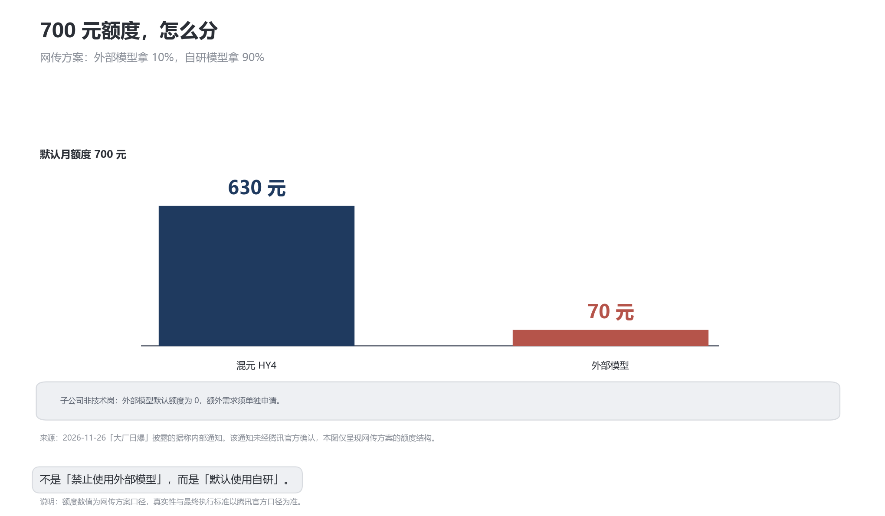
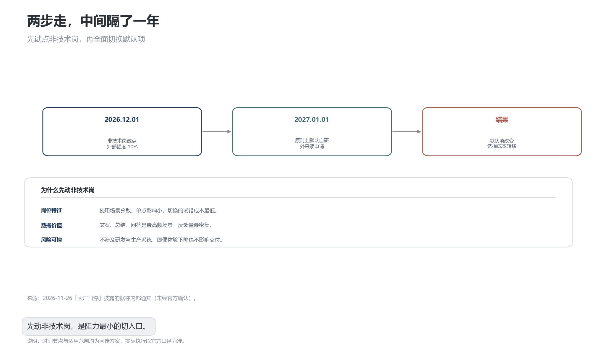
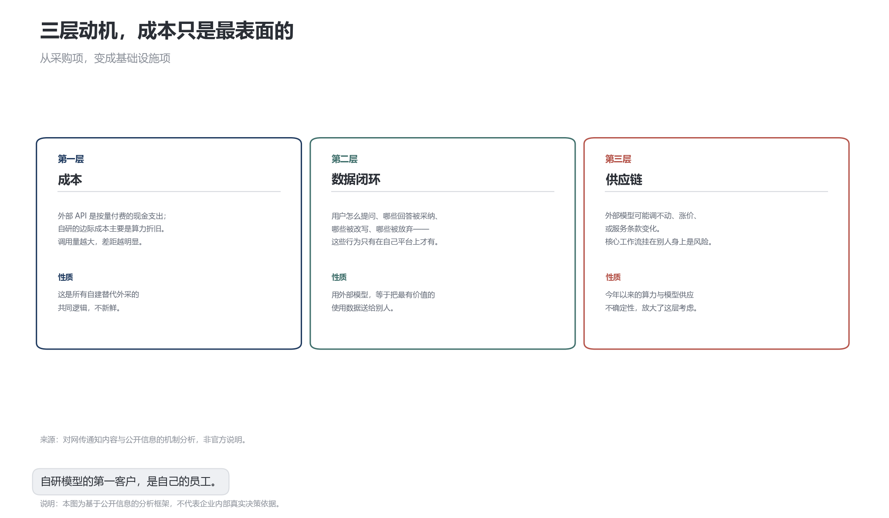

# 大厂把外部 AI 额度砍到 10%，这比发模型更能说明问题

2026 年 11 月 26 日，一个名为"大厂日爆"的账号披露了一份腾讯内部通知。按网传方案，腾讯将调整员工使用 AI 模型的额度分配：

**12 月 1 日起**，先在非技术岗位试点。非技术岗员工的外部模型默认额度为总额度的 10%——以 700 元默认总额度计算，外部模型 70 元，混元 HY4 可用 630 元。子公司非技术岗员工的外部模型默认额度为零，有额外需求需单独申请。

**2027 年 1 月 1 日起**，员工原则上默认使用自研混元模型，如需调用外部模型，须申请相应额度。

通知所述的调整目标有两条：提高 Token 额度使用效率；通过更多内部使用场景，为混元模型迭代提供反馈。

需要先说清楚：这是网传通知，腾讯官方未对此作出公开确认。以下讨论基于该披露内容本身，不涉及对腾讯实际政策的认定。

## 一、先看清这个数字的含义

700 元的月度额度，不是一个随意定的数字。

按国内主流大模型 API 的价格区间，700 元大致对应每月几百万到上千万 token 的调用量。对非技术岗来说，写文案、做总结、查资料，这个量是够用的。

关键不在额度大小，在**结构**：外部模型只能拿 10%，剩下 90% 必须用在自研模型上。

这是一种很典型的采购策略——**用内部的"保底需求"，喂养自己的供给能力。**

## 二、三个动机，成本只是最表面的那个

**第一层，成本。** 外部 API 是按量付费的现金支出，自研模型的边际成本主要是算力折旧。当调用量足够大，自建的单价一定低于外采。这不是新逻辑，云厂商、数据库、办公软件都走过同一条路。

**第二层，数据闭环。** 通知里那句"通过更多内部使用场景为混元模型迭代提供反馈"，是整份文件里最有信息量的一句。

模型要变好，需要真实场景的反馈：用户怎么提问、哪些回答被采纳、哪些被改写、哪些直接放弃。这些数据只有在自己平台上跑才能拿到。用外部模型，等于把最有价值的使用行为数据送给了别人。

**第三层，供应链自主。** 这一层的背景是今年以来的算力与模型供应不确定性。当外部模型可能因为各种原因调不动、涨价、或者服务条款变化，把核心工作流挂在别人身上就是风险。

三层叠起来，就是一句话：**AI 能力正在从"采购项"变成"基础设施项"，而基础设施必须自己控。**

## 三、这件事真正的看点在"默认"两个字

注意通知的措辞：不是"禁止使用外部模型"，而是"默认使用自研"。

这两个词的差别很大。

"禁止"会引发抵触，员工会想办法绕过，实际执行效果差。"默认"则是把选择成本转移了——你要用外部模型，得主动申请、说明理由、可能还要审批。绝大多数人不会去走这个流程。

**行为设计上，"默认选项"的力量远大于"明文禁止"。** 这也是为什么很多产品的隐私设置、订阅续费都藏在默认项里。

从管理角度看，这是一次成本可控、阻力较小的切换。从员工角度看，这意味着一件事：**你以后用的 AI 工具，越来越不由你自己选。**

## 四、对行业的含义：自研模型有了"保底市场"

这件事如果只是腾讯一家的内部管理，不值得写。但它指向一个更普遍的趋势。

大厂自研模型，过去最大的问题是"没有场景验证"。模型团队做出来的东西，要跟外面最强的模型比，比不过就没有内部用户，没有用户就没有反馈，没有反馈就迭代慢。这是个死循环。

解决方式只有一个：**用行政力量创造第一批用户。**

一旦内部有几万人日常在用，哪怕一开始效果差一点，反馈量也足够支撑迭代。而迭代速度，是模型竞争里最关键的变量。

这也解释了为什么今年几乎所有有云的厂商都在推自研模型——不是为了对外卖，首先是为了对内用。

**自研模型的第一客户，是自己的员工。**

## 五、三个值得观察的问题

**第一，内部"保底需求"会不会变成"保护落后"？** 如果内部用户没有选择权，模型团队就失去了改进的压力。这是所有"内部供应商"都会遇到的问题。腾讯方案里保留了 10% 的外部额度，可能正是为了留一个对标参照。

**第二，员工的实际体验会不会下降？** 对非技术岗来说，不同模型在写文案、做表格、读长文档上的表现差异是真实存在的。如果自研模型在某些任务上明显弱一截，效率损失会由员工承担，而且很难被统计。

**第三，这套逻辑会不会扩散？** 如果腾讯跑通了，其他有大模型的大厂大概率会跟进。到那时，"公司指定 AI 工具"会变成职场常态，就像今天的办公软件一样。

对普通职场人来说，这件事的现实意义很具体：**你未来几年用的 AI 工具，可能不是你挑的，而是你公司挑的。** 而你需要判断的，不是哪个模型更强，而是哪个模型在你的具体工作里更省时间。

---

*事实来源：2026-11-26，"大厂日爆"披露一份据称为腾讯内部的 AI 模型额度调整通知，内容包括：12 月 1 日起在非技术岗位试点，非技术岗员工外部模型默认额度为总额度的 10%（以 700 元默认总额度计算，外部模型 70 元、混元 HY4 可用 630 元）；子公司非技术岗员工外部模型默认额度为零，额外需求可提出申请；2027 年 1 月 1 日起员工原则上默认使用自研混元模型，调用外部模型须申请相应额度；调整目标包括提高 Token 额度使用效率、通过更多内部使用场景为混元模型迭代提供反馈。上述内容均据该披露，腾讯官方未作公开确认。*

*需说明四点。其一，本文的核心事实来源为第三方账号披露的据称内部通知，未经腾讯官方确认，通知的真实性、完整性与最终执行口径均存在不确定性，本文仅作"网传方案"讨论，不构成对腾讯实际政策的认定。其二，文中"700 元对应几百万到上千万 token"的换算，为按公开 API 价格区间所作的粗略估算，不同模型、不同计费方式差异很大，仅用于说明量级，不作依据。其三，本文关于"内部保底需求""默认选项"的分析，为基于公开信息的机制讨论，不涉及对任何企业内部管理的评价。其四，本文不构成对腾讯及任何相关企业的经营判断或投资判断，也不构成对任何模型产品的推荐。*
