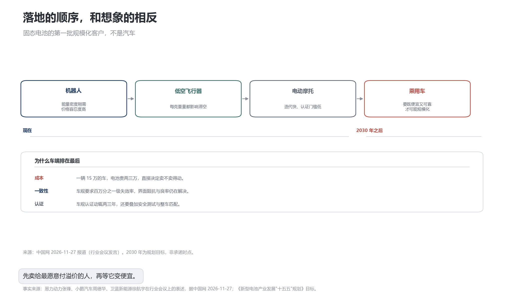
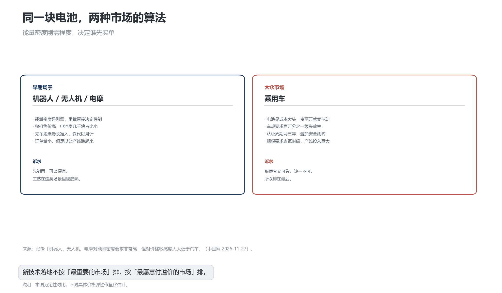
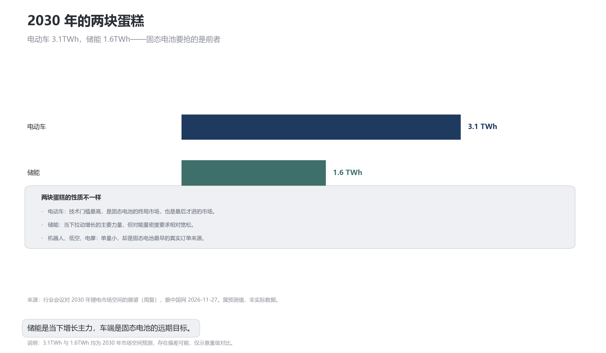

# 固态电池先给机器人用，不上车：原因很现实

固态电池喊了很多年，一直有个默认前提：它是给车用的。

这个前提正在被改掉。在近期的一场行业会议上，多家企业的说法高度一致——固态电池的第一批规模化客户，不是汽车，是机器人、无人机和电动摩托。

恩力动力公共关系副总裁张锋把今年称为"机器人电池卡位之年"。他的原话是：大家都在关心固态电池什么时候上车，"我们思考的角度是，哪些场景非固态电池不可"。

小鹏汽车电芯开发总监周德华的说法更直接：公司固态电池先从机器人切入，再稳步迁移到车端应用。

卫蓝新能源研发中心总经理徐航宇看好的也是机器人、AIDC 等场景。

**一家做车的公司，说固态电池先不给车用——这不是矛盾，这是算过账之后的顺序。**

## 一、先看清楚产业到了哪一步

政策层面已经给了时间表。《新型电池产业发展"十五五"规划》提出，到 2030 年，全固态电池初步实现规模化应用。

设备端也在动。利元亨今年交付了数百兆瓦级别的全固态电池整线，客户拿去做量产前验证。据其研究院院长杜义贤介绍，这条产线涵盖从混料（干法湿法并行）到最后高压化成的完整工序。

但他同时说了一句很实在的话：固态电池设备开发的难题是工艺的不确定性，在样机验证过程中工艺反复调整，"目前还在摸着石头过河的阶段"。

**"数百兆瓦级"是个关键量级。** 对比一下：动力电池的单厂产能通常以吉瓦时计。数百兆瓦，大概是一条中试线到小批量线的规模——够验证，不够铺量。

这就是固态电池今天的真实位置：**能造出来，但还不能便宜地、稳定地造很多。**

## 二、为什么车端最难，难在三件事

**第一件，成本。** 固态电池目前的材料体系与制造工艺，单位成本远高于成熟液态电池。汽车是价格极度敏感的市场，一辆 15 万的车，电池成本多出两三万，直接决定这款车卖不卖得动。

**第二件，一致性。** 车规级要求的是百万分之一级别的失效率。固态电解质的界面阻抗、循环过程中的体积变化、量产良率，这些都还在解决过程中。实验室数据漂亮，不代表产线上每一颗电芯都漂亮。

**第三件，认证周期。** 车规认证动辄两三年，还要叠加安全测试、整车匹配、售后体系。一款新电池从验证到上车，时间成本比研发成本更难压缩。

**这三件事叠起来，意味着固态电池在车端必须"既便宜又可靠"，才可能规模化。而这个条件，短期内不成立。**

## 三、为什么机器人可以先用

反过来看机器人、无人机、电摩这三个场景，它们的要求几乎是互补的。

**能量密度是刚需。** 人形机器人要在有限体积和重量里装下足够续航的电池，无人机更是每克重量都影响滞空时间。这类场景对能量密度的敏感度，远高于对价格的敏感度。

**价格容忍度高。** 张锋说得很清楚：这些场景对能量密度要求非常高，但对价格敏感度大大低于汽车。一台工业机器人的售价可能是几十万，电池贵几千块，占比很小；而一辆 15 万的车，电池贵两万，就是致命问题。

**认证门槛低、迭代快。** 机器人没有车规那一套漫长的准入体系，产品迭代周期以月计。电池厂可以快速拿到反馈、快速改设计、快速再验证。

**规模小，但对电池厂价值大。** 早期订单量不大，但足以让产线跑起来、让工艺稳定下来、让良率爬上去。这正是"量产前验证"最需要的东西。

所以这条路径其实很经典：**先用高价值、低敏感度的小众场景把工艺磨熟，再靠规模把成本打下来，最后进入大众市场。**

锂电池自己就是这么走过来的——最早用在摄像机、手机，等成本降下来才进汽车。光伏也是，先上天，再上屋顶。

## 四、真正在发生的，是"卡位"

这次会议上透露的另一个信息，比技术路线更重要：**电池厂在抢机器人客户的独家位置。**

据披露，恩力动力已与均胜电子成立合资公司，为智元机器人提供电池配套。欣旺达联席总裁梁锐表示，公司在机器人电池方面做了很多技术储备，已和不少厂家对接。

为什么急？因为机器人电池不是标准品。它要跟机器人的结构、散热、控制策略深度匹配，一旦定型，替换成本很高。**谁先进去，谁就吃到整个产品生命周期。**

这和当年手机电池的逻辑一样：一款机型定型，供应商就锁定了。

## 五、三个必须冷静看待的问题

**第一，机器人市场本身还没起量。** 卡位卡得再早，如果下游出货量上不去，前期投入就摊不平。今年人形机器人的实际交付量，跟"千台协议"这类新闻的数量不成正比。**卡位有可能卡空。**

**第二，固态电池的定义很宽。** 半固态、准固态、全固态，技术路线差别很大，成本和性能也差很远。宣传里的"固态"，和规划里 2030 年要规模化的"全固态"，可能不是一回事。看新闻时要分清是哪种。

**第三，2030 这个时间点是规划目标，不是承诺。** 规划写的是"初步实现规模化应用"，"初步"和"规模化"两个词都留了余地。行业里对全固态量产时间的判断，分歧一直很大。

## 六、这件事对普通人的意义

如果你在等"固态电池上车再买车"，可能要重新算一下时间。按目前的路线，固态电池会先在机器人、无人机、电摩上跑几年，把成本和良率磨出来，才可能进入主流车型。这个过程，乐观估计也要到 2030 年之后。

如果你关心的是投资或者就业方向，这里有一个更朴素的观察：**任何新技术的落地顺序，都不是按"最重要的市场"排的，而是按"最愿意付溢价的市场"排的。**

技术先服务于愿意为它多付钱的人，然后才慢慢变便宜。这条规律，从光伏到锂电池，从芯片到 AI，一次都没变过。

---

*事实来源：《新型电池产业发展"十五五"规划》提出到 2030 年全固态电池初步实现规模化应用；利元亨今年交付数百兆瓦级全固态电池整线、涵盖从混料（干法湿法并行）到高压化成的完整工序、下游客户工艺窗口在收窄、固态电池设备开发难题是工艺不确定性——据利元亨研究院院长杜义贤在行业会议上的介绍；恩力动力公共关系副总裁张锋称今年为"机器人电池卡位之年"、机器人无人机电摩对能量密度要求高但对价格敏感度大大低于汽车、2030 年之后再进入车端、恩力动力已与均胜电子成立合资公司为智元机器人提供电池配套；欣旺达联席总裁梁锐称公司在机器人电池方面做了技术储备并已与不少厂家对接；小鹏汽车电芯开发总监周德华称公司固态电池先从机器人切入再迁移到车端；卫蓝新能源研发中心总经理徐航宇看好机器人、AIDC 场景；高工锂电董事长张小飞判断储能成为拉动锂电产业增长的主要力量；对 2030 年电动车约 3.1TWh、储能约 1.6TWh 的市场展望——以上据中国网 2026-11-27 报道（经南方企业新闻网转载）。*

*需说明四点。其一，本文涉及的固态电池技术路线包含半固态、准固态、全固态等多种形态，性能与成本差异显著，本文所引"固态电池"表述沿用报道原文口径，未作技术分类认定。其二，利元亨"数百兆瓦级"整线为交付规模描述，不代表已实现吉瓦级量产，产能与良率数据以企业公告为准。其三，2030 年规模化应用为规划目标，属预期性表述，实际进度受材料、工艺、成本与下游需求多重因素影响，存在不确定性。其四，本文为产业技术路线的公开信息梳理与分析，不构成对任何企业、技术路线或证券的投资判断，也不构成购车或采购建议。*
