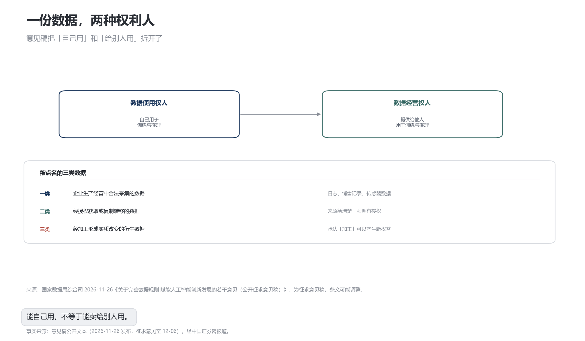
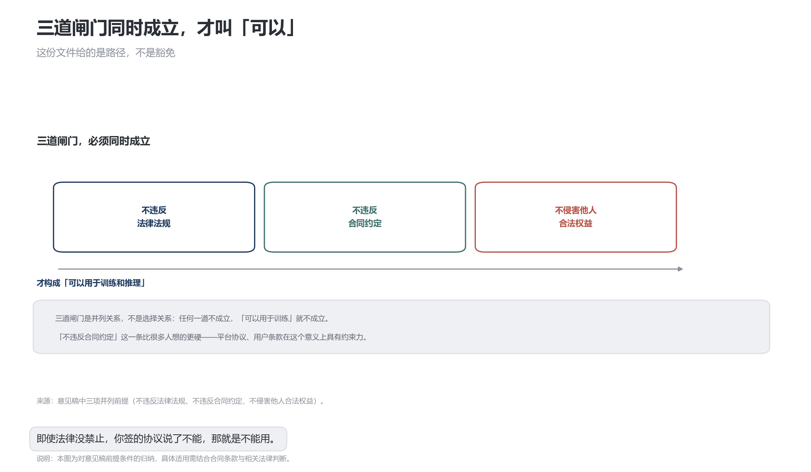
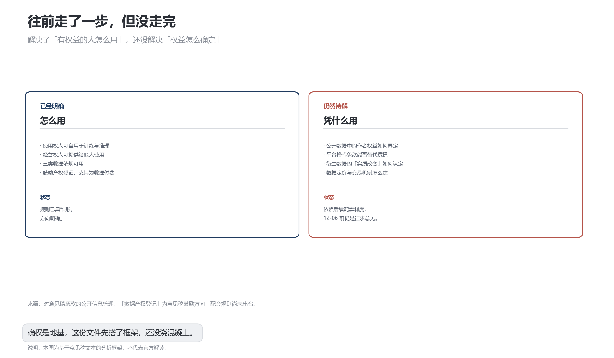

# 你的数据能不能被拿去训练 AI？这份文件给了半个答案

2026 年 11 月 26 日，国家数据局综合司发布《关于完善数据规则 赋能人工智能创新发展的若干意见（公开征求意见稿）》，面向社会征求意见，截止日期是 12 月 6 日。

这份文件不长，但它回答了一个卡了行业很久的问题：**数据到底能不能用来训练 AI，谁有权决定。**

先把核心条款摆出来。意见稿明确：各类主体通过采集生成、衍生创造、受让取得或授权许可等渠道获取数据并取得相应权益的，在不违反法律法规、合同约定且不侵害他人合法权益的前提下——

- **数据使用权人**，可以将数据用于人工智能训练和推理；
- **数据经营权人**，可以将数据提供给他人用于人工智能训练和推理。

同时明确，企业生产经营中合法采集的数据、经授权获取或复制转移的数据，以及经加工形成实质改变的衍生数据，均可依规用于训练和推理。

文件还鼓励数据产权登记、支持为数据付费，并要求人工智能企业建立输出风险防控机制与投诉反馈渠道。

## 一、这份文件真正解决的，是"权利"而不是"许可"

过去两年，AI 公司最怕的问题不是技术，是合规：**我手上的这批数据，到底能不能用？**

在实际操作里，这个问题几乎无解。因为数据来源太复杂——有的来自公开抓取，有的来自用户上传，有的来自合作方授权，有的是自己加工出来的衍生数据。每一类的法律地位都不一样，而法律上并没有一条清晰的界线。

于是行业里出现了两种极端做法：一种是"先用了再说"，赌没人追责；一种是"什么都不敢用"，模型训练被卡住。

这份意见稿的价值，在于它换了一个提问方式：**不再问"能不能用"，而是问"你以什么权益用"。**

它把权利人分成两类：

**使用权人**——你自己用，用来训练和推理。
**经营权人**——你可以给别人用，提供给别人训练和推理。

这个划分很关键。它意味着数据的权利可以被拆开：**能自己用，不等于能卖给别人用。** 这在法律上是个重要区分，在商业上也是。

## 二、三类数据被点了名

意见稿具体列了三类可以依规用于训练和推理的数据：

**第一类，企业生产经营中合法采集的数据。** 比如工厂的传感器数据、门店的销售记录、系统的运行日志。

**第二类，经授权获取或复制转移的数据。** 这一类强调的是"有授权"，来源要清楚。

**第三类，经加工形成实质改变的衍生数据。** 这一条最有意思——它承认了"加工"可以产生新的权益。原始数据可能是别人的，但你做了实质性加工，产出的衍生数据可以依规使用。

第三类是给数据加工行业留的口子。做数据清洗、标注、合成的公司，最需要的就是这条。

## 三、三道闸门，说明它没打算放开一切

很多人看到"可以用于训练"，会以为政策转向宽松。但文件里有三个限制条件，而且是并列的：

**不违反法律法规。** 这是底线，不用多说。

**不违反合同约定。** 这一条比很多人想的更硬。意思是：即使法律没禁止，但你跟用户签的协议里说了不能用于训练，那你就不能用。平台协议、用户条款，在这个意义上具有约束力。

**不侵害他人合法权益。** 这条覆盖的是个人信息、商业秘密、著作权等。

**三道闸门同时成立，才构成"可以"。** 换句话说，这份文件给的是"路径"，不是"豁免"。

## 四、对普通人来说，实际影响在哪

这件事看起来离生活很远，其实有三个具体的影响点。

**第一，你在平台上发布的内容，可能被用于训练。** 能不能用，取决于你当初同意的用户协议。这也是为什么各大平台这两年频繁更新条款——它们在为这件事做法律准备。

**第二，你的个人数据，仍然受个人信息保护相关法律约束。** 这份意见稿处理的是"数据权益"，不是"个人信息"。涉及个人信息的，另有规则。两者不能混为一谈。

**第三，投诉渠道被写进了要求。** 文件要求 AI 企业建立输出风险防控机制和投诉反馈渠道。这意味着如果 AI 生成了与你有关的不实内容，你至少有了一条明确的主张路径。

## 五、还有一个没解决的核心问题

这份文件往前走了一步，但没有走完。

它解决的是"有权益的人怎么用"，没有完全解决"权益怎么确定"。

举个例子：一张公开在网上的照片，平台能不能拿去训练？照片作者有没有权益？拍摄对象有没有权益？平台的服务条款能不能替代作者授权？

这些问题，意见稿提到了"数据产权登记"作为方向，但具体规则还要靠后续的配套制度。**确权是地基，这份文件先搭了框架，还没浇混凝土。**

这也是为什么它是"征求意见稿"——12 月 6 日之前，各方都还有表达空间。

## 六、值得关注的三个后续

**第一，正式稿会不会调整三类数据的范围？** 尤其是"衍生数据"的定义，弹性很大，产业界和权利人的诉求在这里冲突最明显。

**第二，"不违反合同约定"会怎么执行？** 如果平台利用格式条款把所有数据都锁定，这条限制就形同虚设。这需要配套的合同规制。

**第三，数据付费怎么落地？** 文件说"支持为数据付费"，但定价机制、交易场所、权属登记都还在建设中。这决定了数据要素市场是真能跑起来，还是停留在概念。

对普通读者来说，这份文件最值得记住的一句话是：**你的数据不是"公共资源"，也不是"绝对私产"，它是一组可以被拆分、被授权、被定价的权利。**

而这个认知，比文件里的任何一条具体条款都更重要。

---

*事实来源：国家数据局综合司 2026-11-26 发布《关于完善数据规则 赋能人工智能创新发展的若干意见（公开征求意见稿）》，面向社会征求意见至 12 月 6 日；意见稿明确，各类主体通过采集生成、衍生创造、受让取得或授权许可等渠道获取数据并取得相应权益的，在不违反法律法规、合同约定且不侵害他人合法权益的前提下，数据使用权人可将数据用于人工智能训练和推理，数据经营权人可将数据提供给他人用于人工智能训练和推理；企业生产经营中合法采集的数据、经授权获取或复制转移的数据、经加工形成实质改变的衍生数据，均可依规用于训练和推理；意见稿鼓励数据产权登记、支持为数据付费，并要求人工智能企业建立输出风险防控机制与投诉反馈渠道。以上据中国证券网 2026-11-26 报道及意见稿公开内容。*

*需说明三点。其一，本文所引条款均来自公开征求意见稿，尚未正式发布，条文表述与最终生效版本可能存在差异，具体以国家数据局正式公布文本为准。其二，本文关于"数据权益"与"个人信息"的区分，仅为基于公开信息的理解，不构成法律意见；涉及个人信息处理、合同效力、著作权归属的具体问题，应依据《个人信息保护法》《民法典》《著作权法》等法律法规及生效裁判认定。其三，本文为政策文本的公开信息解读，不构成对任何企业合规状况的判断，也不构成投资建议。*
