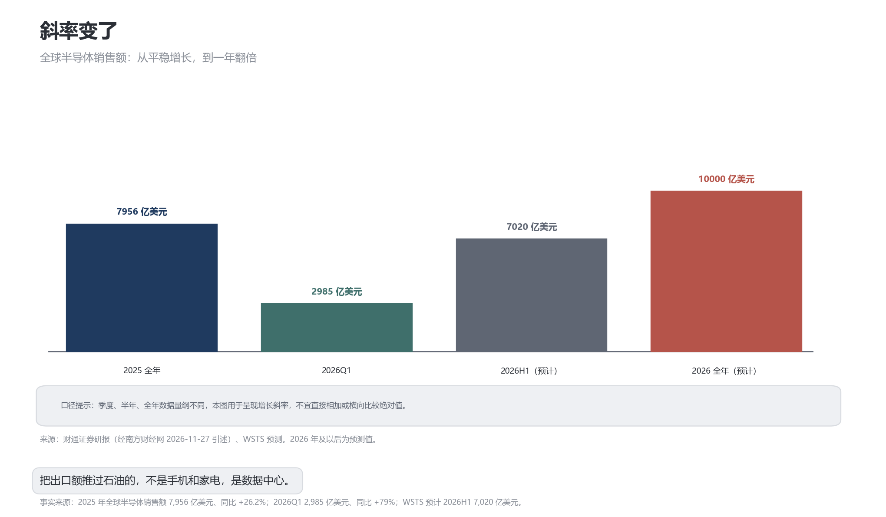
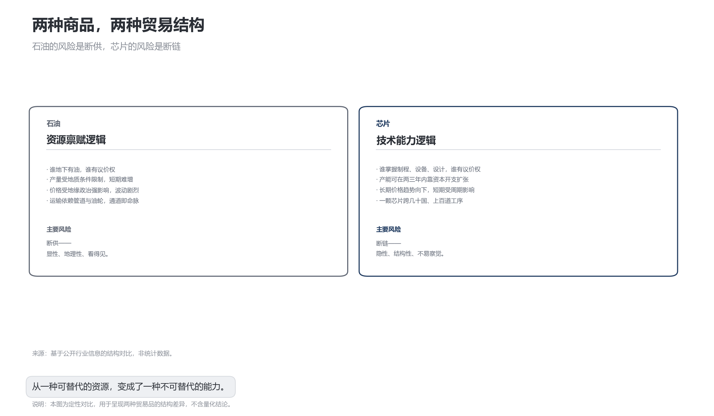
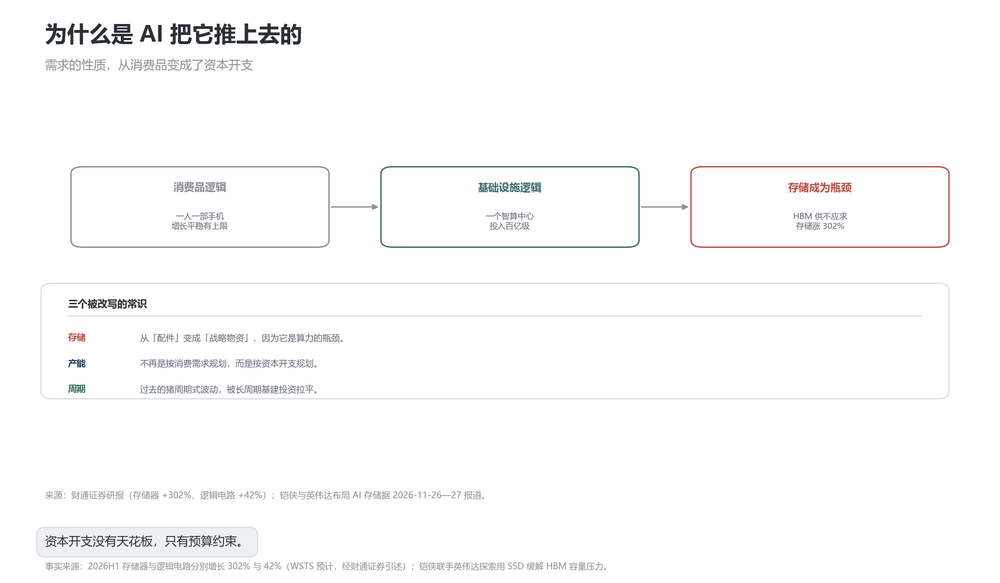

# 半导体出口额超过石油：世界贸易的底座，换了一块

2026 年 11 月 27 日，一则来自德意志银行的数据在产业圈流传：受 AI 热潮推动，全球半导体出口总额已经首次超越石油与天然气。

市场给出的解读很直接——全球贸易正在从"石油美元"步入"芯片美元"时代，算力成为推动时代变革的关键资源。

这句话听起来像口号。但它背后有一个很硬的事实：**过去五十年，世界贸易的计价锚是能源；现在，这个锚正在往硅上移。**

值得说清楚的是，这不是"芯片比石油重要"这么简单的一句话。两种商品的贸易结构完全不同，理解了差别，才能理解这个变化意味着什么。

## 一、先看这组数字

据财通证券研报引述的行业数据：2025 年全球半导体销售额达 7,956 亿美元，同比增长 26.2%，预计 2026 年将突破 1 万亿美元。

进入 2026 年，复苏势头进一步加速：第一季度全球销售额 2,985 亿美元，同比增长 79%；WSTS 预计 2026 年上半年市场规模达 7,020 亿美元，同比增长 102%，其中存储器与逻辑电路分别增长 302% 和 42%。

存储器涨 302%，这个数字比总量更值得看。它说明这一轮增长不是"所有品类一起好"，而是**极度集中在 AI 相关的那一小块**：HBM、高带宽存储、加速计算平台。

也就是说，把半导体出口额推过石油的，不是手机和家电，是数据中心。

## 二、石油和芯片，是两种完全不同的贸易品

**石油的逻辑是资源禀赋。** 谁地下有油，谁就有议价权。产量受地质条件限制，短期内难以大幅增加；价格受地缘政治强影响，波动剧烈；运输依赖管道和油轮，通道即命脉。

**芯片的逻辑是技术能力。** 谁掌握制程、设备、设计，谁就有议价权。产能可以在两三年内通过资本开支扩张；价格受供需周期影响，但长期趋势是下降的；运输靠空运和海运，一吨芯片的价值是一吨原油的成千上万倍。

两种结构带来两种风险：

**石油的风险是"断供"。** 一条海峡被封，全球油价立刻反应。这种风险是显性的、地理性的、可被看见的。

**芯片的风险是"断链"。** 一颗芯片要经过设计、晶圆制造、封装测试，涉及几十个国家的上百道工序。任何一个环节卡住，整条链就停。这种风险是隐性的、结构性的、不容易被看见的。

所以"芯片美元"这个说法，本质上描述的不是"谁更强"，而是**全球最关键的商品，从一种可替代的资源，变成了一种不可替代的能力**。

## 三、为什么这次是 AI 把它推上去的

如果没有 AI，半导体出口额大概还要几年才能超过石油。

AI 改变的是需求的性质。过去芯片的需求是"每个人买一部手机、一台电脑"，属于消费品逻辑，增长平稳、有天花板。

现在多了一层"基础设施逻辑"：训练一个前沿模型，需要数万张加速卡；建一个智算中心，需要几十亿到上百亿的投入。这不再是消费，是资本开支。

**资本开支的特点是没有天花板，只有预算约束。**

这也解释了为什么存储器能涨 302%——AI 服务器对 HBM 的渴求，把整个存储行业的产能结构都改了。近期还有一件事可以印证：铠侠宣布联手英伟达布局 AI 存储新赛道，探索用 SSD 缓解 HBM 的容量压力，美光、三星、SK 海力士等厂商也集体入局。

**当存储成为算力的瓶颈，存储就从"配件"变成了"战略物资"。**

## 四、这个变化对普通人的三层传导

**第一层，你买的东西，硅的比例在上升。** 一辆电动车的半导体含量远高于燃油车；一台变频空调、一个智能门锁、一台扫地机器人，里面都有芯片。芯片涨价，会慢慢渗进这些商品的成本里。

**第二层，就业结构在移。** 石油时代的核心岗位是地质、钻井、炼化；芯片时代的核心岗位是工艺、设备、封装、EDA。两类岗位的技能不通用，转换成本很高。这也是为什么很多传统工业城市的转型特别难。

**第三层，你所在的城市，可能被重新排序。** 石油时代，有资源的地方富；芯片时代，有产业链集群的地方富。这也是为什么各地都在抢半导体项目——抢的不是工厂，是下一轮的入场券。

## 五、三个需要冷静的地方

**第一，"超过"是一次性的还是趋势性的？** 单一年度的出口额对比，受价格周期影响很大。油价大跌的年份，芯片很容易"超过"石油。要看这个变化是否稳固，得看未来三到五年的趋势，而不是一年的数据。

**第二，芯片贸易的集中度高于石油。** 石油有很多产油国，芯片的先进制程集中在极少数地区。集中度越高，系统越脆弱。所以"芯片美元"时代不一定比"石油美元"时代更稳定，可能更不稳定。

**第三，这个说法本身带有叙事色彩。** "芯片美元"是市场的一种概括，不是官方统计口径，也不是经济学上的严格定义。它有价值，是因为它抓住了一个真实的结构变化；但它不能当成一个精确的分析工具。

## 六、一个更朴素的判断

如果把这件事压缩成一句话：**过去半个世纪，谁控制能源，谁影响世界；接下来的几十年，谁控制算力，谁影响世界。**

这个判断不需要复杂论证，看看各国在做什么就知道了：出口管制、产业补贴、算力规划、芯片法案——所有这些动作，指向的是同一件事。

而对于不在这个行业里的人来说，真正值得关心的不是"谁赢了"，而是**这个变化会不会让你的生活成本、就业选择、所在城市的前景发生变化**。

答案几乎是肯定的。只是它来得慢，慢到容易被忽略。

---

*事实来源：德意志银行数据显示受 AI 热潮推动全球半导体出口总额首次超越石油与天然气、"芯片美元"提法，据 2026-11-27 市场报道（经腾讯新闻等转述）。2025 年全球半导体销售额 7,956 亿美元、同比增长 26.2%、预计 2026 年突破 1 万亿美元；2026 年第一季度全球销售额 2,985 亿美元、同比增长 79%；WSTS 预计 2026 年上半年市场规模 7,020 亿美元、同比增长 102%，其中存储器与逻辑电路分别增长 302% 和 42%——据财通证券研报，经南方财经网 2026-11-27 引述。铠侠联手英伟达布局 AI 存储、探索用 SSD 缓解 HBM 容量压力，美光、三星、SK 海力士等集体入局——据 2026-11-26 至 27 日报道。*

*需说明四点。其一，德意志银行"半导体出口额首超石油天然气"的对比，为第三方机构基于其统计口径得出的结论，具体统计范围（商品编码、转口贸易是否计入）未在报道中完整披露，本文仅作趋势引用，未作精确认定。其二，本文引用的销售额增速为研报与 WSTS 口径，属机构测算与预测，与实际年报数据可能存在差异，应以各机构正式发布为准。其三，"芯片美元"为市场概括性说法，非官方统计口径或严格经济学定义，本文使用该词仅为描述贸易结构变化，不构成对国际货币体系的判断。其四，本文为产业与贸易结构的公开信息分析，不构成对任何企业、行业或证券的投资判断，也不涉及任何标的的买卖建议。*
