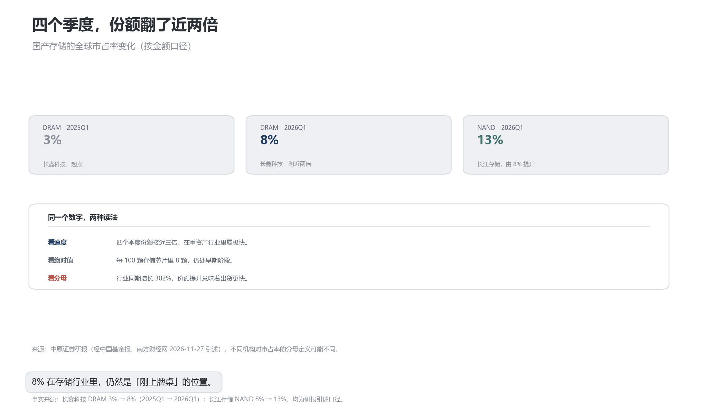
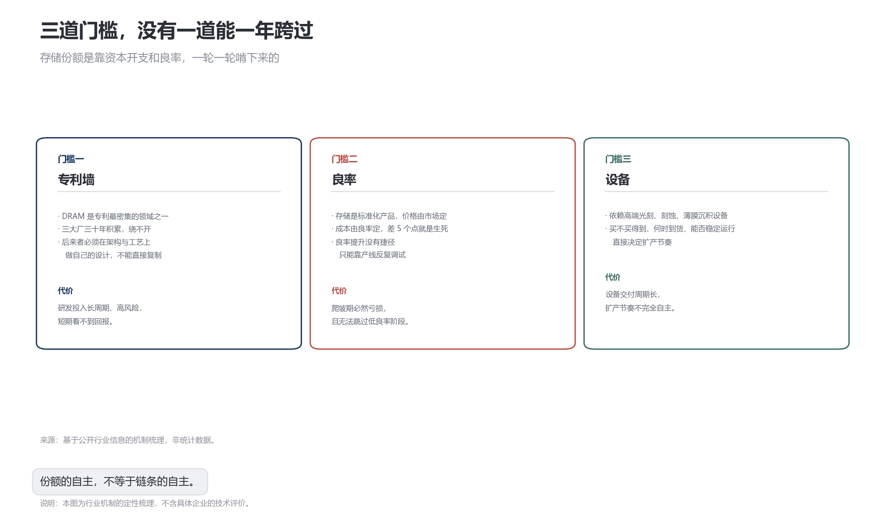
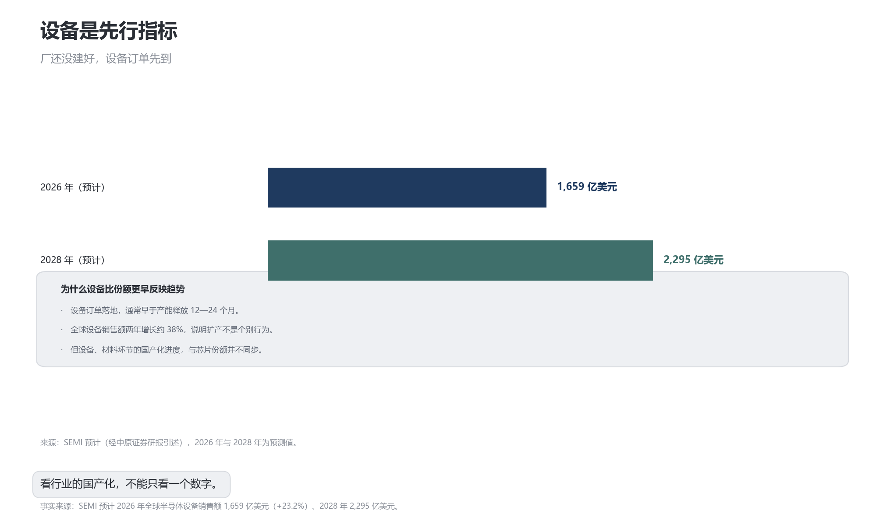

# 国产存储份额从 3% 到 8%：翻了一倍多，故事刚开始

一组容易被忽略的数字：按机构引述的行业统计，长鑫科技的 DRAM 全球市占率，从 2025 年一季度的 3% 提升到 2026 年一季度的 8%；长江存储的 NAND 市占率，从 8% 升到 13%。

中原证券据此判断：国产存储厂商快速崛起，国产自主可控空间显著扩大。

很多人看到"3% 到 8%"，第一反应是"翻了一倍多，很厉害"。这个判断没错，但它只说对了一半。

另一半是：**8% 在存储行业里，仍然是"刚上牌桌"的位置。**

## 一、先把这两个数字放回行业里看

存储芯片是个很特殊的行业，它的特点是"三高"：**高资本投入、高周期波动、高技术壁垒。**

一座 12 英寸存储晶圆厂，投资动辄数百亿人民币，建设周期两三年。这个行业从来不是靠"技术突破一次"就能改变格局的，是靠一轮一轮的资本开支和良率爬坡，慢慢把份额啃下来的。

所以看份额，要同时看三件事：

**第一，绝对值。** DRAM 的 8%、NAND 的 13%，意味着全球每 100 颗存储芯片里，有 8 颗和 13 颗来自中国大陆厂商。这个比例已经不可忽视了，但距离"主导"还很远。

**第二，速度。** DRAM 从 3% 到 8%，用了四个季度。在存储这种重资产行业里，这个速度是很快的——因为扩产周期通常以年计。

**第三，分母在变大。** 这是最容易被忽略的一点。据财通证券引述的数据，2026 年上半年全球存储器销售额同比增长 302%。分母在快速膨胀，份额还能提升，说明**绝对出货量的增速比 302% 更快。**

这不容易。在一个所有人都在抢产能的年份里抢到更多份额，靠的不是运气。

## 二、为什么存储的份额这么难抢

**第一道门槛是专利。** DRAM 是专利墙最厚的领域之一，三大厂（三星、SK 海力士、美光）在过去三十年积累了海量专利。后来者要绕开，必须在架构和工艺上做自己的设计，不能简单复制。

**第二道门槛是良率。** 存储芯片是标准化产品，价格由市场定，成本由良率定。良率差 5 个百分点，在价格战里就是生死之差。而良率的提升没有捷径，只能靠时间和产线上的反复调试。

**第三道门槛是设备。** 存储制造依赖高端光刻、刻蚀、薄膜沉积设备。设备能不能买到、什么时候到货、能不能稳定运行，直接决定扩产节奏。

这三道门槛，没有一道能在一年内跨过。所以"3% 到 8%"这个数字背后，是很多年的积累在某一个时间点集中体现出来。

## 三、份额提升，对下游意味着什么

这一点比份额本身更重要。

存储是几乎所有电子设备的必需件：手机、电脑、服务器、汽车、家电。过去这个市场由三家海外厂商主导，下游厂商议价空间很小。

**多一个供应商，就多一个选择。**

对下游整机厂来说，国产存储的意义不只是"便宜"，更是"供应确定性"——在产能紧张、交期拉长的年份，能不能拿到货，比价格更重要。

对消费者来说，这种变化是隐性的：你不会在包装盒上看到"采用国产存储"，但它会影响整机的成本和供给稳定性。

**产业链的安全感，从来不是靠一家企业强，而是靠"有得选"。**

## 四、但也要看到另一面

**第一，8% 和 13% 都是在行业高景气时取得的。** 存储是强周期行业，一旦进入下行周期，价格战会把所有厂商的利润压到极限。到那时候，份额能不能守住，才是真正的考验。

**第二，重资产行业的份额是有代价的。** 每一分份额背后都是巨额资本开支。行业景气时，这些投入能快速回收；行业下行时，折旧会变成沉重的负担。这是所有重资产行业的宿命。

**第三，设备与材料的国产化还没同步。** 存储芯片造出来了，但制造它的设备、光刻胶、电子特气，仍有相当比例依赖进口。**份额的自主，不等于链条的自主。** 这是两个不同的进度。

## 五、设备端的数字可以印证这一点

据 SEMI 预计，2026 年全球半导体设备销售额将达 1,659 亿美元，同比增长 23.2%；2028 年将达 2,295 亿美元。

这个增速说明什么？说明全球都在扩产，而且扩产的规模在加速。存储厂抢份额，本质上是抢设备、抢产能、抢时间窗口。

国内的情况也有对应的动作。据公开信息，拓荆科技收到 25 亿元收购无锡尚积项目的批复，有望补齐 PVD 设备产品线；北方华创主导的 12 英寸立式炉设备项目获 2025 年度北京市科学技术进步一等奖；中微公司 2026 年新签订单规模和增速创下历史新高，刻蚀与薄膜设备累计装机超 9,300 台并送往海外。

**设备厂的数据，往往比芯片厂的份额更早反映趋势。** 因为设备是先行指标——厂还没建好，设备订单先到了。

## 六、三个需要观察的问题

**第一，这一轮份额提升，有多少是行业缺货带来的"被动红利"？** 在产能极度紧张的年份，下游愿意给新供应商机会，因为拿不到货更麻烦。等行业宽松了，这些机会还能不能留住，需要看产品一致性。

**第二，下行周期什么时候来？** 存储行业的周期性极强，所有扩产最终都会变成过剩。这一轮 AI 驱动的需求能持续多久，决定了这一轮扩产是"及时"还是"超前"。

**第三，链条的短板在哪一段？** 芯片、设备、材料、EDA、封测，五个环节的国产化进度不一样。只看芯片份额，会高估整体能力；只看设备短板，会低估实际进展。

对普通读者来说，这件事最值得记住的其实是那个方法论：**看一个行业的国产化，不能只看一个数字。要看这个数字是在什么周期里取得的、代价是什么、链条上还差哪几段。**

单一数字最容易骗人，尤其是那些"翻了一倍"的数字。

---

*事实来源：长鑫科技 DRAM 全球市占率由 2025 年一季度 3% 提升至 2026 年一季度 8%、长江存储 NAND 市占率由 8% 升至 13%、国产存储厂商快速崛起与国产自主可控空间显著扩大——据中原证券研报，经中国基金报、南方财经网 2026-11-27 引述。2026 年上半年全球存储器销售额同比增长 302%、逻辑电路增长 42%——据 WSTS 预计，经财通证券研报引述。SEMI 预计 2026 年全球半导体设备销售额 1,659 亿美元、同比增长 23.2%，2028 年达 2,295 亿美元——据中原证券研报引述。拓荆科技 25 亿元收购无锡尚积项目获批、北方华创 12 英寸立式炉项目获 2025 年度北京市科学技术进步一等奖、中微公司 2026 年新签订单规模与增速创历史新高、刻蚀与薄膜设备累计装机超 9,300 台——据 2026-11-27 报道。*

*需说明四点。其一，本文引用的市场份额数据来自券商研报引述的第三方统计，不同机构对"全球市占率"的分母定义（是否含代工、是否按金额或按容量）可能不同，具体数值应以公司公告与权威统计机构数据为准。其二，半导体设备销售额为 SEMI 预测值，属预期性数据，实际值可能偏差。其三，本文涉及的企业经营数据（收购批复、订单、装机量）均为公开报道口径，未经公司逐一确认，以公司正式披露为准。其四，本文为产业格局的公开信息分析，不构成对任何企业、行业或证券的投资判断，也不涉及任何标的的买卖建议。*
