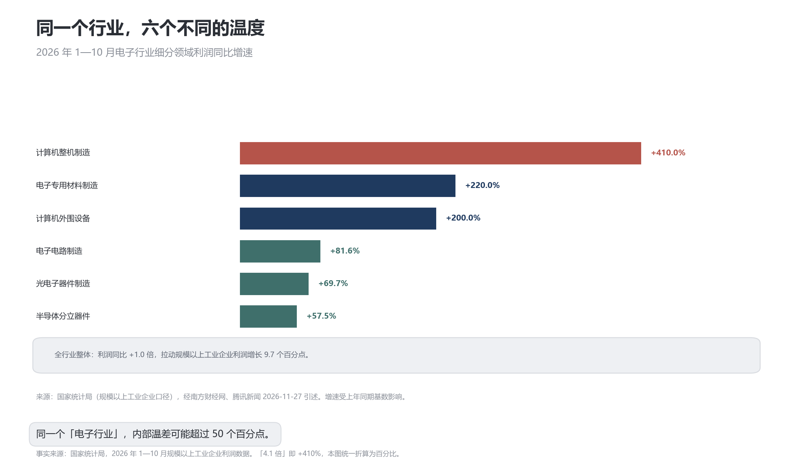
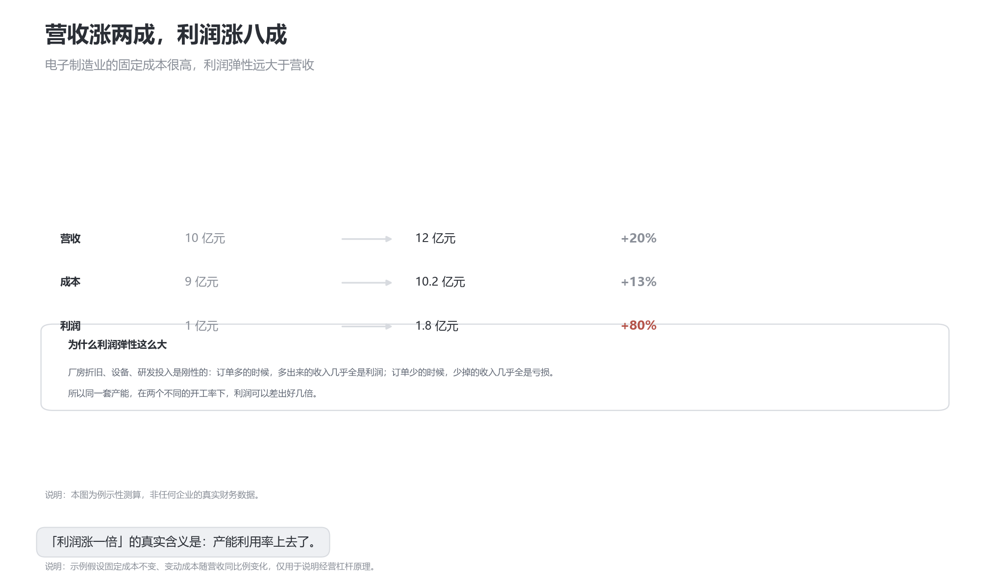
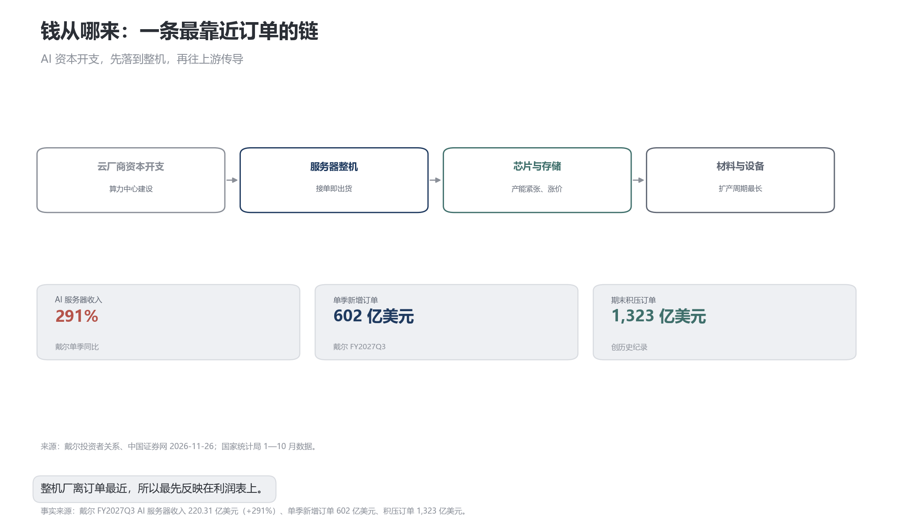

# 电子行业利润涨了一倍，为什么你一点感觉都没有

国家统计局的数据里，有一组数字很扎眼。

2026 年 1—10 月，电子行业利润同比增长 1.0 倍，拉动全部规模以上工业企业利润增长 9.7 个百分点，是规模以上工业企业利润较快增长的重要支撑。

拆到细分领域，增速更夸张：

- 计算机整机制造，利润增长 **4.1 倍**
- 计算机外围设备制造，增长 **2.0 倍**
- 电子专用材料制造，增长 **2.2 倍**
- 电子电路制造，增长 **81.6%**
- 光电子器件制造，增长 **69.7%**
- 半导体分立器件制造，增长 **57.5%**

一边是"利润涨一倍"，一边是很多电子厂的朋友说"今年没涨工资，还在担心被裁"。

这两件事同时是真的。理解它们为什么能同时成立，比记住那些数字有用得多。

## 一、先解释一个会计常识：利润的弹性远大于营收

很多人以为"利润涨一倍"意味着"生意好了一倍"。不是。

假设一家工厂：年营收 10 亿，成本 9 亿，利润 1 亿，净利率 10%。

如果营收涨 20% 到 12 亿，而固定成本（厂房折旧、设备、管理人员）基本不变，成本只涨到 10.2 亿——利润就从 1 亿变成 1.8 亿，涨了 80%。

**营收涨 20%，利润涨 80%。这就是经营杠杆。**

电子制造业是典型的高固定成本行业：产线投资巨大、折旧年限长、研发投入刚性。行情好的时候，多出来的订单几乎全是利润；行情差的时候，少掉的订单几乎全是亏损。

所以"利润增长 1.0 倍"这个数字，翻译成人话是：**这个行业的产能利用率上去了，而不是这个行业的规模翻倍了。**

## 二、4.1 倍是怎么来的

计算机整机制造利润增长 4.1 倍，是六个细分领域里最猛的。

这个数字要拆开看两层：

**第一层，低基数。** 增长 4.1 倍，意味着今年是去年的 5.1 倍。如果去年这个环节的利润本来就接近盈亏平衡，那今年稍微赚一点，增速就会非常夸张。**低基数上的高增长，绝对额可能并不大。**

**第二层，AI 服务器。** 这是今年电子行业最确定的一条主线。全球云厂商和算力中心的资本开支，直接变成了服务器整机的订单。

戴尔的数据可以印证这个量级：其 2027 财年第三季度 AI 优化服务器收入 220.31 亿美元，同比增长 291%；单季度新增 AI 服务器订单 602 亿美元，期末积压订单达 1,323 亿美元，创历史纪录。

**整机厂是这轮 AI 投资最直接的受益者**——因为它离订单最近，离客户最近。芯片厂要等设计定型，材料厂要等产能爬坡，整机厂只要接到单就能出货。

## 三、为什么你没感觉：利润池和你的位置不重合

这是最关键的一节。

**第一，利润不等于工资。** 企业利润增长，先用于弥补此前的亏损、再投入扩产、再分红或留存。工资是成本项，不是利润分配项。除非出现劳动力短缺，否则利润增长不会自动传导到工资。

**第二，利润高度集中在少数环节。** 看那六个数：4.1 倍、2.2 倍、2.0 倍、81.6%、69.7%、57.5%。差距非常大。你所在的细分环节如果只增长 10%，你当然感受不到"行业利润涨一倍"。

**第三，增长可能没有带来更多岗位。** 这一轮电子行业的增长，主要来自 AI 相关的资本开支，而这类产线是高度自动化的。**订单增加，未必等于招人增加。** 这跟上一轮靠消费电子扩产带动的增长，性质完全不同。

**第四，成本压力也在同步上升。** 存储涨价、材料涨价，会吃掉一部分中下游环节的利润。行业的"总利润"在涨，但分配很不均匀。

## 四、这组数据真正的信息量在哪

跳出"我有没有感觉"，这组数字其实说明了三件事。

**第一，AI 投资已经进入实体经济的利润表。** 过去两年，AI 更多体现在股价和融资新闻里。现在它出现在国家统计局的工业企业利润数据里，说明钱真的花出去了、货真的造出来了、账真的收到了。

**第二，产业链的利润正在向上游和整机两端集中。** 材料（+2.2 倍）和整机（+4.1 倍）是两头，中间的加工环节增速明显更低（电子电路 +81.6%、分立器件 +57.5%）。这是典型的"微笑曲线"在电子行业的再现。

**第三，这个增速大概率不可持续。** 低基数、高资本开支、产能紧张，三个条件叠加才会有这样的数字。随着基数抬高、产能释放，明年的增速大概率会回落。**看这类数据，要看趋势，不要看单点。**

## 五、对普通人的三层现实意义

**如果你在电子行业工作：** 值得关注的是自己所在的环节在不在利润池里。整机、材料、设备、封测，今年的景气度差别很大。同一个"电子行业"，内部温差可能超过 50 个百分点。

**如果你在考虑入行：** 这一轮增长的主要驱动是 AI 基础设施，而不是消费电子。技能的价值在往"高速信号、散热、电源、封装"这些方向倾斜，而不是传统的组装制造。

**如果你是普通消费者：** 这类数据通常会在一段时间后反映到产品价格上。存储涨价、材料涨价，最终会体现在手机、电脑、家电的售价里。利润高增长的年份，往往是下一轮涨价的前奏。

## 六、三个需要观察的问题

**第一，这轮利润增长能持续几个季度？** AI 资本开支的节奏决定了一切。如果云厂商的投入放缓，整机环节的订单会最先反应。

**第二，涨价的成本谁来承担？** 上游材料涨价，中游加工环节的毛利会被压缩。这部分压力最终会传导到终端，还是被中游自己消化，取决于议价能力。

**第三，就业会不会跟上？** 如果这轮增长是"高自动化 + 高资本开支"驱动的，那么利润增长和就业增长可能是脱钩的。这对整个制造业都是一个新问题。

---

*事实来源：2026 年 1—10 月电子行业利润同比增长 1.0 倍、拉动全部规模以上工业企业利润增长 9.7 个百分点；计算机整机制造利润增长 4.1 倍、计算机外围设备制造增长 2.0 倍、电子专用材料制造增长 2.2 倍、电子电路制造增长 81.6%、光电子器件制造增长 69.7%、半导体分立器件制造增长 57.5%——据国家统计局数据，经南方财经网、腾讯新闻 2026-11-27 引述。戴尔 2027 财年第三季度 AI 优化服务器收入 220.31 亿美元、同比增长 291%、单季度新增 AI 服务器订单 602 亿美元、期末积压订单 1,323 亿美元——据戴尔投资者关系及中国证券网 2026-11-26 报道。*

*需说明四点。其一，上述利润增速为国家统计局规模以上工业企业口径，"规模以上"指年主营业务收入 2,000 万元及以上的工业企业，不含规模以下企业，因此不能等同于全行业情况。其二，增速为同比数据，受上年同期基数影响显著，高增速不等于高绝对利润，本文已在正文中说明低基数效应，具体绝对额应以统计公报为准。其三，本文关于经营杠杆的举例为示意性测算，非任何企业的真实财务数据。其四，本文为宏观数据与产业结构的公开信息分析，不构成对任何企业、行业或证券的投资判断，也不构成就业或职业选择建议。*
