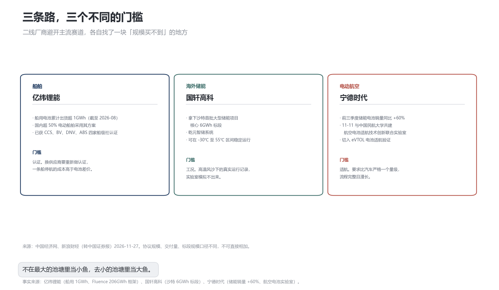
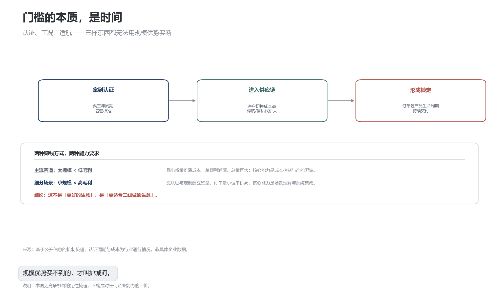
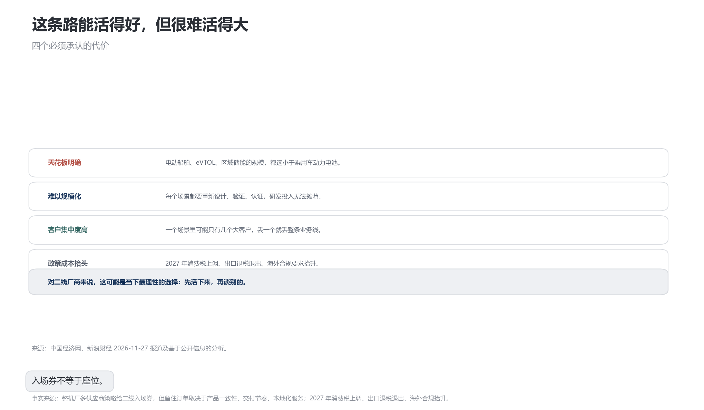

# 二线电池厂不跟宁德时代硬拼了，它们换了打法

2026 年 11 月 27 日，中国证券报的一篇报道里，有一句话很值得琢磨。

亿纬锂能董事长刘金成说：锂电企业不宜轻易做跟随者，主流赛道很难找到缝隙，应转向创新的细分市场与创新技术。

这句话不是场面话，它解释了过去两年一批二线电池厂的共同选择——**不在主流赛道硬拼，去找那些"巨头看不上、但门槛很高"的场景。**

看看它们具体在做什么：

**亿纬锂能**把船舶与储能作为差异化支点。截至 2026 年 8 月，船用电池累计出货突破 1GWh，国内超过 50% 的电动船舶采用其解决方案，产品已获 CCS、BV、DNV、ABS 等船级社认证。储能方面，与 Fluence 签署 206GWh 五年框架协议，2027 年已确定交付约 16GWh。

**国轩高科**把储能订单落到海外项目，拿下沙特首批大型电池储能项目核心 6GWh 标段，搭载乾元智储系统，可在 -30℃ 至 55℃ 区间稳定运行，以适配当地高温、风沙工况。

**宁德时代**在动力电池之外加快储能与电动航空布局，前三季度储能电池销量同比增长 60%；11 月 11 日与中国民航大学签约共建航空电池适航技术创新联合实验室，切入 eVTOL 电池适航验证环节。

三家路径不同，但逻辑一样：**从"卖电芯"，变成"卖某个场景的解决方案"。**

## 一、为什么不能硬拼

先算一笔明账。

动力电池是典型的规模游戏：产能越大，单位成本越低；成本越低，报价越有竞争力；报价越有竞争力，拿到的订单越多。这是一个正反馈循环，一旦形成，后来者很难打破。

二线厂商如果在这个循环里正面竞争，结果只有两个：要么亏本抢单，要么放弃份额。**两条路都走不通。**

而且动力电池的产品高度标准化——同样一度电，客户主要看价格、能量密度、循环寿命、安全认证。差异化的空间很小。

**在标准化市场里，规模就是唯一的护城河。** 而这恰恰是二线最缺的。

## 二、换赛道，换的是"竞争维度"

中国证券报的报道里有一句判断很准：行业集中度回落，并不意味着竞争门槛降低，而是**竞争维度切换**。

这句话值得展开。看这三个场景，门槛在哪：

**船舶：认证。** 船用电池要拿到船级社认证——CCS（中国）、BV（法国）、DNV（挪威）、ABS（美国）。四家认证意味着四套标准、四轮测试、漫长的周期。但一旦拿到，客户换供应商的成本极高：换电池要重新做认证，一条船停航的成本远高于电池差价。

**沙特储能：工况。** -30℃ 到 55℃，加上高温和风沙。这不是实验室里能模拟出来的，需要真实项目的验证数据。谁先在当地跑出运行记录，谁就有说服力。

**eVTOL：适航。** 这是门槛最高的一类。航空器对电池的能量密度、安全性、失效模式要求，比汽车严格一个量级，而且要走完整的适航验证流程。宁德时代专门跟中国民航大学共建实验室，说明这件事需要产学研一起做。

**三种门槛的共同点是：时间。** 认证要时间、工况验证要时间、适航要时间。而时间，是规模优势买不到的东西。

## 三、这套打法的收益结构，和主流赛道完全不同

在动力电池赛道，赚钱方式是：**大规模 × 低毛利。** 靠出货量摊薄成本，单颗利润很薄，但总量巨大。

在细分场景，赚钱方式是：**小规模 × 高毛利。** 订单量小，但认证壁垒、定制化程度、服务成本都支撑更高单价。

这两种模式对企业的能力要求也不同：

| | 主流赛道 | 细分场景 |
|---|---|---|
| 核心能力 | 成本控制、产能爬坡 | 场景理解、认证能力、系统集成 |
| 客户关系 | 多供应商比价 | 深度绑定，切换成本高 |
| 规模效应 | 极强 | 较弱 |
| 天花板 | 很高 | 有限 |

**所以这不是"更好的生意"，是"更适合二线做的生意"。**

对于规模不占优势的企业，与其在最大的池塘里当小鱼，不如在小的池塘里当大鱼。这个道理很朴素，但执行起来需要极强的耐心——因为认证周期动辄两三年，前期只有投入没有收入。

## 四、这条路的风险在哪

必须说清楚，这套打法不是没有代价。

**第一，天花板明确。** 全球电动船舶、eVTOL、特定区域的储能项目，市场规模都远小于乘用车动力电池。做成了，也撑不起一个巨头的体量。

**第二，定制化难以规模化。** 每个场景的电池都要重新设计、重新验证、重新认证。这意味着研发和工程投入无法摊薄，规模效应弱。

**第三，客户集中度高。** 一个场景里可能只有几个大客户。丢一个客户，就是丢掉整个业务线。

**第四，政策成本在抬头。** 有报道提到，2027 年消费税税率将上调、出口退税退出、海外合规要求抬升。这三项对出口导向的细分场景（尤其是海外储能）影响直接。

**换句话说，这是一条"能活得好、但很难活得大"的路。** 对二线厂商来说，这可能是当下最理性的选择——先活下来，再谈别的。

## 五、这件事对行业格局意味着什么

**第一，行业从"一个市场"变成"多个市场"。** 过去所有人都在抢乘用车动力电池这一块蛋糕。现在蛋糕被切成了很多块：船、航空、海外储能、数据中心备电、工程机械。每一块的规则不同，赢家也可能不同。

**第二，竞争从"比价格"变成"比交付"。** 报道里那句话很关键：整机厂的多供应商策略给了二线企业入场券，但能否留住订单，取决于产品一致性、交付节奏与本地化服务能力。

**入场券不等于座位。** 拿到订单只是开始，能不能按时交付、能不能保证一致性、能不能在当地提供服务，才决定能不能留下来。

**第三，规模不再是唯一的护城河。** 认证、工况数据、客户绑定，都可以成为壁垒。这对整个制造业都是一个启示：**当规模优势无法追赶时，就去找那些"规模买不到"的东西。**

## 六、三个需要观察的问题

**第一，这些细分场景的真实规模有多大？** 电动船舶、eVTOL 都还处在早期，实际需求可能远小于预期。**卡位有可能卡空。**

**第二，巨头会不会回头？** 如果某个细分场景做大了，宁德时代这样的巨头完全有能力进入。到那时，二线的先发优势能维持多久？

**第三，这套打法能不能复制到其他行业？** 光伏、风电、储能集成，都面临同样的"二线怎么活"的问题。锂电的答案是"换维度竞争"，这个答案在别的行业是否成立，还要看。

对普通读者来说，这件事的现实意义在于一个判断方法：**看一家公司能不能活得久，不要只看它所在的行业有多大，要看它在自己的位置上有没有别人拿不走的东西。**

规模是一种，认证是一种，客户关系也是一种。**能被买走的东西，都不算护城河。**

---

*事实来源：亿纬锂能董事长刘金成"锂电企业不宜轻易做跟随者，主流赛道很难找到缝隙，应转向创新的细分市场与创新技术"；亿纬锂能截至 2026 年 8 月船用电池累计出货突破 1GWh、国内超过 50% 电动船舶采用其解决方案、产品已获 CCS、BV、DNV、ABS 等船级社认证、与 Fluence 签署 206GWh 五年框架协议、2027 年已确定交付约 16GWh；国轩高科拿下沙特首批大型电池储能项目核心 6GWh 标段、搭载乾元智储系统、可在 -30℃ 至 55℃ 区间稳定运行；宁德时代前三季度储能电池销量同比增长 60%、11 月 11 日与中国民航大学签约共建航空电池适航技术创新联合实验室、切入 eVTOL 电池适航验证环节；行业集中度回落意味着竞争维度切换、整机厂多供应商策略给二线企业入场券但留住订单取决于产品一致性交付节奏与本地化服务能力；2027 年消费税税率上调、出口退税退出、海外合规要求抬升——以上据中国经济网、新浪财经（转中国证券报）2026-11-27 报道。*

*需说明四点。其一，本文涉及的企业订单量、出货量、认证情况均为公开报道口径，部分数据为框架协议或标段金额，不等同于已确认收入，具体以公司公告为准。其二，框架协议、中标标段与实际交付之间通常存在时间差与执行不确定性，本文引用的 206GWh、16GWh、6GWh 分别属协议规模、已确定交付量与标段规模，口径不同，不可直接相加比较。其三，本文关于"细分场景天花板有限""定制化难以规模化"的判断，为基于公开信息的机制分析，不构成对任何企业战略的评价或前景判断。其四，本文为产业竞争格局的公开信息分析，不构成对任何企业、行业或证券的投资判断，也不涉及任何标的的买卖建议。*
