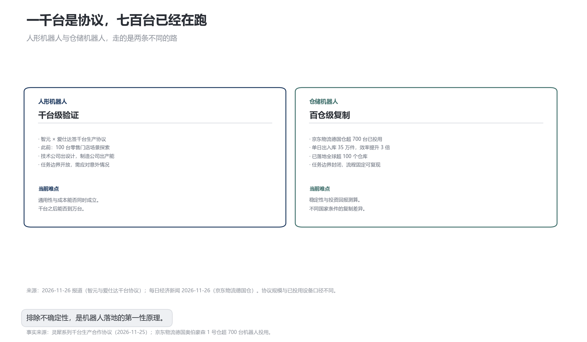
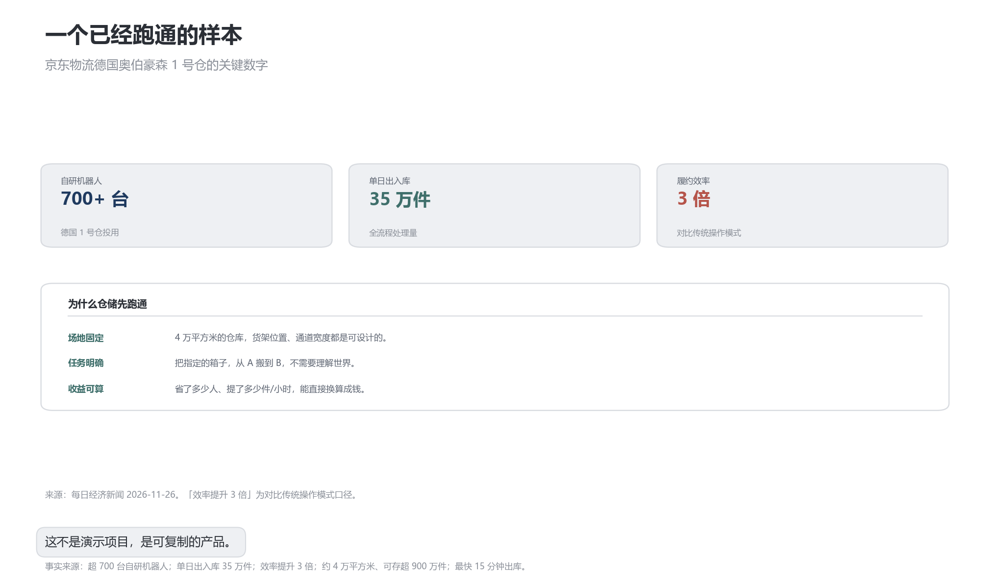
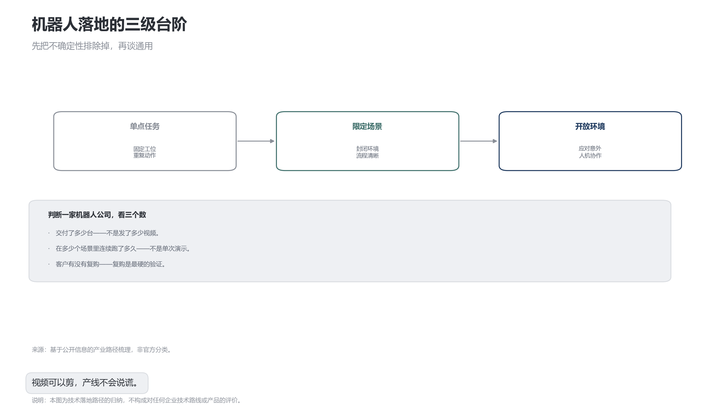

# 1000 台是协议，700 台已在跑：机器人落地分了两条路

同一周里，有两条关于机器人的消息，放在一起看很有意思。

**一条是 11 月 25 日**，智元机器人联合创始人、CTO 彭志辉到访爱仕达上海青浦智能谷具身智能创新中心，双方签署灵犀系列产品千台生产合作协议。这是双方继 2026 年 7 月战略合作、100 台人形机器人零售门店场景探索、四足机器人委托制造之后的又一次推进。

**另一条是 11 月 26 日**，京东物流完成德国奥伯豪森 1 号仓的智能化设备规模部署，投用超 700 台自研"智狼""天狼"机器人，单日出入库货物处理量可达 35 万件，全流程履约效率较传统操作模式提升 3 倍。

一千台，是"协议"；七百台，是"已经在跑"。

这两个数字不该放在一起比大小，因为它们代表的是机器人产业的两条完全不同的路。

## 一、先看人形机器人这条路：从"样机"到"千台"

智元与爱仕达的合作，解决的是一个非常具体的问题：**谁来做。**

人形机器人的公司，长项通常在算法、控制、本体设计。但要把一台样机变成一千台一致的产品，需要的是另一套能力：供应链管理、工艺工程、质量体系、交付节奏。

这些能力，恰恰是传统制造企业几十年积累下来的。

爱仕达是做什么的？锅具、小家电。听起来和机器人没关系，但它有的是压铸、注塑、精密加工、规模化组装的能力。**机器人本体的关节、结构件、外壳，需要的正是这些工艺。**

所以这个合作的本质是：**技术公司出设计，制造公司出产能。**

这也是所有硬件创业公司绕不开的一关。从 1 台到 100 台，靠工程师手工打磨；从 100 台到 1,000 台，必须靠产线和工艺。中间这道坎，倒下的公司比活下来的多。

值得注意的是，双方的合作是分步走的：先 100 台做零售门店场景探索，再四足机器人委托制造，然后才是千台协议。**这个顺序说明，他们在用真实场景验证，而不是先扩产再找客户。**

## 二、再看仓储机器人这条路：700 台已经在海外跑

京东物流德国仓的数据，是另一套逻辑。

超 700 台自研机器人，单日出入库 35 万件，效率提升 3 倍，仓库约 4 万平方米、可存超 900 万件商品，最快 15 分钟完成拣选、打包、出库。其中"智狼"区域约 30 万个周转箱位，"天狼"区域通过立体货架与智能调度提升存储能力。

更关键的一个数字是：这些自动化设备已落地全球超过 100 个物流仓库，海外仓覆盖 26 个国家和地区。

**这说明它不是演示项目，是可复制的产品。**

仓储机器人为什么能先跑通？因为它的任务边界极其清晰：在指定的仓库里，把指定的箱子，从 A 搬到 B。不需要理解世界，不需要应对意外，只需要在限定环境里稳定重复。

**这是"专用机器人"的胜利，不是"通用智能"的胜利。**

## 三、两条路的差别，在于"不确定性"

把这两件事放在一起，能看到一个清晰的对比：

| | 人形机器人 | 仓储机器人 |
|---|---|---|
| 当前阶段 | 千台级验证 | 百仓级复制 |
| 任务边界 | 开放，需要应对意外 | 封闭，任务明确 |
| 客户 | 场景方，边用边改 | 物流企业，按效率算账 |
| 核心难点 | 通用性与成本 | 稳定性与投资回报 |
| 商业模式 | 卖本体 + 卖方案 | 卖设备 + 卖系统 |

**差别的核心是一个词：不确定性。**

仓储机器人把所有不确定性都排除掉了——固定场地、固定货架、固定流程。人形机器人必须面对不确定性：不同的门店、不同的货架高度、不同的顾客、不同的突发情况。

**排除不确定性，是机器人落地的第一性原理。**

这也是为什么工业机器人比服务机器人早普及二十年：工厂的环境，本来就是为机器设计的。

## 四、为什么现在人形机器人开始"千台"了

三个条件同时在改善：

**第一，硬件成本下来了。** 关节模组、减速器、伺服系统，随着供应链成熟，成本在快速下降。这是"千台"能成立的前提。

**第二，代工体系起来了。** 像爱仕达这样的制造企业愿意接单，意味着产能不再是大问题。**硬件创业最难的一环，被专业分工解决了。**

**第三，场景开始愿意试。** 零售门店、工厂搬运、展厅导览，这些场景愿意用机器人做尝试，哪怕效率暂时不如人。因为对它们来说，这不只是效率问题，还有品牌和体验的考虑。

但要说清楚：**"千台"不等于"普及"。** 一千台放在全国，是极其有限的量。真正的普及，需要万台、十万台的规模，那需要成本再降一个量级。

## 五、对普通人的现实意义

**如果你在制造业：** 机器人代工是一个正在形成的新市场。会做精密加工、会管理产线、能做质量体系的企业，有机会接到这类订单。这比"自己造机器人"更现实。

**如果你在物流、零售：** 仓储自动化已经是成熟工具，不是未来概念。它的影响是直接的：同样的货量，需要的人更少，但对会操作、会维护设备的人需求增加。

**如果你只是关心"机器人什么时候进家门"：** 按目前两条路的进展，先到的是"限定场景的专用机器人"（扫地、配送、仓储、巡检），"通用人形机器人"还要更久。**别被发布会的时间表带偏。**

## 六、三个需要观察的问题

**第一，千台之后能不能到万台？** 这是人形机器人的关键门槛。万台级需要的是完全不同量级的供应链和成本结构。

**第二，人形机器人的"通用性"到底值多少钱？** 如果一个场景可以被专用设备解决，客户为什么要买一个更贵、更复杂的通用机器人？这个问题目前还没有好答案。

**第三，海外仓的复制能不能持续？** 京东物流的模式在海外跑通，意味着中国的仓储自动化能力可以输出。但不同国家的劳工政策、土地成本、电商密度都不一样，复制不是简单的照搬。

**最后说一句实在话：判断一个机器人公司行不行，别看它发了多少视频，看它交付了多少台、在多少个场景里连续跑了多久。** 视频可以剪，产线不会说谎。

---

*事实来源：2026-11-25 智元机器人联合创始人、CTO 彭志辉到访爱仕达上海青浦智能谷具身智能创新中心，双方签署灵犀系列产品千台生产合作协议；此前双方于 2026 年 7 月达成战略合作，开展 100 台人形机器人零售门店场景探索与四足机器人委托制造；合作依托智元的具身智能技术与产品研发能力、爱仕达的先进制造与供应链体系及规模化交付能力——据 2026-11-26 报道。京东物流完成德国奥伯豪森 1 号仓智能化设备规模部署，投用超 700 台自研"智狼""天狼"机器人等自动化设备，单日出入库货物处理量可达 35 万件，全流程履约效率较传统操作模式提升 3 倍；该仓约 4 万平方米，可存储超 900 万件商品，最快 15 分钟完成拣选、打包与出库；"智狼"区域约 30 万个周转箱位；自动化设备已落地全球超过 100 个物流仓库，海外仓覆盖 26 个国家和地区——据每日经济新闻 2026-11-26 报道。*

*需说明三点。其一，千台生产合作协议为框架性生产安排，具体交付节奏、数量与金额未公开披露，不等同于已实现千台出货，以双方正式公告为准。其二，京东物流的"效率提升 3 倍"为对比传统操作模式的口径，具体测算基准（人效、坪效或全流程时效）未在报道中完整说明，本文仅作趋势引用。其三，本文关于两条技术路线的对比，为基于公开信息的产业分析，不构成对任何企业技术能力、经营前景或证券的投资判断；机器人产品的实际表现高度依赖具体场景与部署条件，本文不作性能承诺。*
