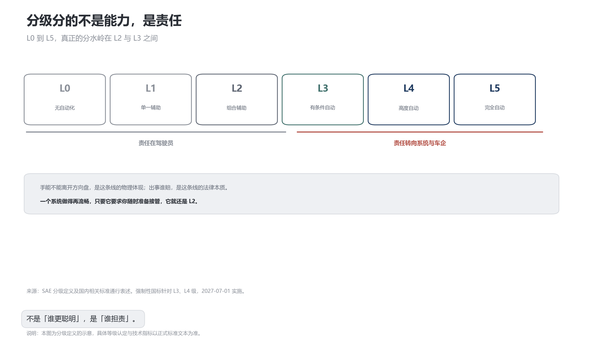
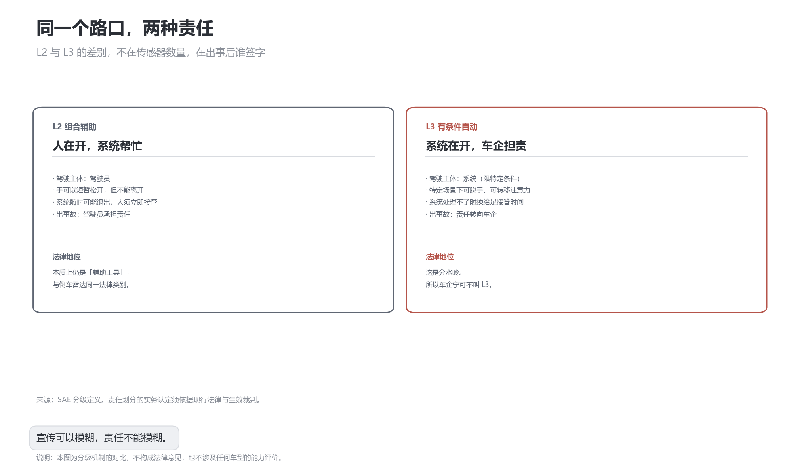
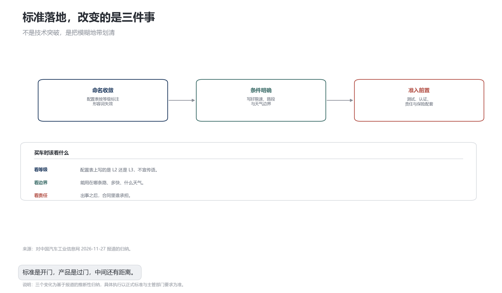

# 明年 7 月起，"自动驾驶"这四个字不能随便用了

2026 年 11 月，一条不太起眼的消息在汽车行业内部传开：《智能网联汽车 自动驾驶系统安全要求》将于 2027 年 7 月 1 日实施。

这是国内首部针对 L3、L4 级自动驾驶的**强制性**国家标准，引望是主要起草单位之一。此前行业里关于自动驾驶的标准，多数是推荐性的——推荐性标准的意思是"你可以参照，不参照也不违法"。

强制性国标不一样。它意味着：**从明年 7 月 1 日起，"自动驾驶"这个词怎么用、什么条件下能用、出了事谁负责，有了统一的法律尺度。**

很多人的第一反应是"自动驾驶要来了"。恰恰相反，这件事的真正含义是：**一大批量产车上的"自动驾驶"，从此不能再这么叫了。**

## 一、先搞清楚这套分级到底在分什么

行业里通用的 L0 到 L5 分级，很多人以为是"技术能力的等级"——L2 比 L1 聪明，L3 比 L2 更聪明。

这个理解是错的，至少是不完整的。

这套分级的核心，分的是**责任归属**：

- **L0–L2**：驾驶主体是人。系统只做辅助——预警、跟车、车道保持。手不能离开方向盘，眼睛不能离开路面，出了事，责任在驾驶员。
- **L3**：在特定条件下（比如高速公路拥堵），系统接管驾驶任务。这时候人可以脱手、可以转移注意力，**出了事，责任在车企**。
- **L4**：在特定区域内完全无人驾驶，不需要人接管。
- **L5**：任何场景、任何路况，完全无人。

关键的分水岭在 L2 和 L3 之间。**不是"谁更聪明"，是"谁担责"。**

一个系统能在高速上自动跟车、自动变道、自动超车，做得再流畅，只要它要求你随时准备接管，它就是 L2。因为它不敢承诺"出事我负责"。

## 二、为什么 L2 到 L3 这一步这么难跨

技术上看，L2 到 L3 的差距没有想象中那么大。真正的难处在另外三件事。

**第一，责任怎么划。** 系统接管期间出了事故，是车企赔、供应商赔、还是驾驶员赔？如果系统在碰撞前 0.5 秒提示"请接管"，而人来不及反应，这算谁的？这类问题在法律上没有先例，在工程上也没有标准答案。

**第二，接管时间怎么定。** L3 要求系统在遇到处理不了的情况时，给驾驶员留出足够的接管时间。留 3 秒还是 10 秒？人在放松状态下重新集中注意力需要多久？这涉及人因工程，而人因工程的结论往往不精确。

**第三，数据怎么留证。** 出事之后，靠什么证明当时是系统在开、还是人在开？这需要一套记录机制（类似飞机的黑匣子），而且这套记录必须被各方认可。

**这三件事，没有一件是纯技术问题。**

所以你会看到一个现象：过去几年，很多车企在宣传上把 L2 的能力说得接近 L3，但在法律文本上始终只承认 L2。**宣传可以模糊，责任不能模糊。**

## 三、为什么是现在出这个标准

三个背景同时成熟了。

**第一，技术到了能被规范的阶段。** 城区领航辅助这类功能，已经从旗舰车型下探到 15 万级车型。当一项能力开始大规模普及，标准就必须跟上——否则市场上会出现大量同名不同实的产品。

**第二，产业需要一个统一的口径。** 目前各家的"自动驾驶"能力描述五花八门，消费者根本无法横向比较。强制性国标给出的是一把统一的尺子：什么条件算 L3、什么条件不算、测试怎么测、失效怎么处理。

**第三，责任需要有法可依。** 如果 L3 车辆上路后出了事故，而法律上没有明确的责任划分，保险、赔偿、追责都会陷入僵局。标准是解决这个问题的前置条件。

值得注意的是起草单位的构成。引望（华为车 BU 相关主体）作为主要起草单位之一参与，说明这份标准的制定高度依赖一线企业的工程实践。这既是好事（标准贴近实际），也需要观察（起草方的技术路线会不会变成行业默认路线）。

## 四、对准备买车的人，意味着什么

**第一，"自动驾驶"这个词会变少，"辅助驾驶"会变多。** 强制性国标实施后，车企在命名和宣传上必须对应到具体等级。你在配置表上看到的，会从"XX 自动驾驶"变成"L2 级辅助驾驶"这类表述。

**第二，能叫 L3 的车，会明确写清适用条件。** 比如"仅限高速公路、时速 60 公里以下、天气良好"。这些限定不是免责声明，是法律边界。

**第三，别指望明年就能买到 L3。** 标准实施不等于产品上市。L3 车型还需要通过准入、测试、认证，以及解决保险和责任问题。标准是开门，产品是过门，中间还有距离。

**第四，现在开的车不会因为标准实施而变化。** 标准管的是新车型的准入与宣传口径，不追溯已售车辆的能力。

## 五、三个还没有答案的问题

**第一，L3 的保险怎么定？** 如果责任在车企，那保费该由谁出、怎么算？目前车险的定价逻辑是基于"驾驶人风险"，L3 会把这套逻辑打乱。

**第二，路侧设施跟不跟得上？** L3 依赖高精地图、车路协同、通信覆盖。标准只管车，路的问题在标准之外。

**第三，消费者能不能理解这套分级？** 这是最现实的麻烦。L2、L2+、L2++、L3 这些词，普通买车的人分不清。标准统一了术语，但没统一认知。**真正的风险不是技术不成熟，是人误以为自己可以脱手。**

所以明年 7 月之后，最需要记住的一句话是：**看配置表上的等级，不要看宣传里的形容词。**

---

*事实来源：《智能网联汽车 自动驾驶系统安全要求》将于 2027 年 7 月 1 日实施，为国内首部 L3、L4 级自动驾驶强制性国家标准，引望为主要起草单位之一——据中国汽车工业信息网 2026-11-27 报道，经腾讯新闻等转述。L0–L5 分级的责任划分依据国际自动机工程师学会（SAE）分级定义及国内相关标准通行表述。城区领航辅助功能下探至 15 万级车型，据 2026-11-27 广州车展相关报道（深蓝 L07、S07 搭载引望星驰，限时 14.99 万元起）。*

*需说明四点。其一，本文所述标准名称、实施时间与起草单位信息来自公开报道，标准全文尚未在本文写作时公开可查，具体要求（测试方法、适用场景、责任条款）应以正式发布文本为准。其二，L2 与 L3 的责任划分，本文采用行业通行的分级定义作解释，具体事故责任认定须依据《道路交通安全法》、相关司法解释及生效裁判，本文不构成法律意见。其三，本文不涉及任何具体车型的自动驾驶能力评价，也不构成购车建议；不同车型的实际功能表现应以厂家说明书与官方测试结果为准。其四，本文为产业与法规的公开信息分析，不构成对任何企业、产品或证券的投资判断。*
