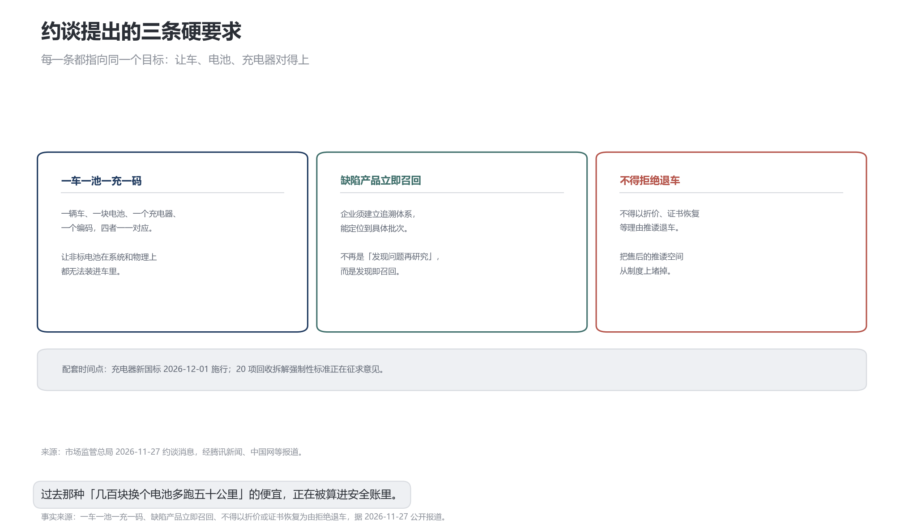
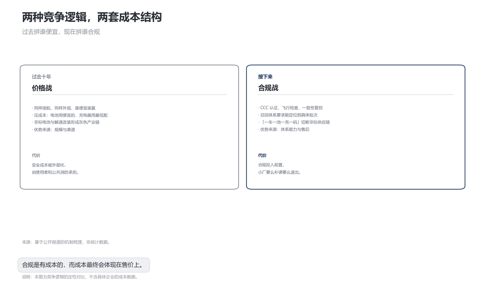
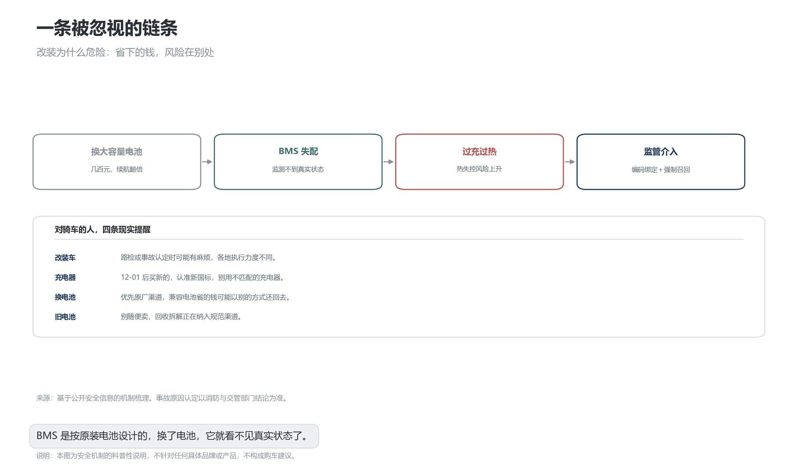

# 电动自行车被约谈 15 家：这次管的是你的电池

2026 年 11 月 27 日，市场监管总局集中约谈了 15 家电动自行车企业。据公开报道，涉及雅迪、台铃、爱玛、新日、小刀、绿源、九号、小牛、绿佳等多家头部品牌。

约谈的原因写得很具体：CCC 认证全覆盖飞行检查发现，部分企业质量主体责任落实不到位、产品一致性管控不严，有的企业违反强制性国家标准出厂销售不合格产品。

要求也很具体，三条：

- 严格执行 **"一车一池一充一码"**
- 缺陷产品**立即召回**
- **不得以折价或证书恢复为由拒绝退车**

同时还有两个时间点值得注意：**12 月 1 日，充电器新国标施行**；**20 项回收拆解强制性标准正在征求意见**。

这三件事凑在一起，指向的方向很清楚：**电动自行车这个行业，从"比谁便宜"转向了"比谁合规"。**

## 一、"一车一池一充一码"到底在管什么

这六个字是整个监管的核心，也是最容易被忽略的。

它的意思是：**一辆车、一块电池、一个充电器、一个编码，四者必须一一对应。**

为什么要这样管？因为电动自行车事故里，最大的一类风险不是车架断裂、不是刹车失灵，而是**电池起火**。而电池起火的主要原因，是"车电不匹配"——原装电池被换成了容量更大的非标电池，或者用了不匹配的充电器。

改装的逻辑很简单：原装电池跑 50 公里，换一块大容量的能跑 100 公里，成本只要几百块。对每天要跑几十公里的外卖、快递、通勤人群来说，这个诱惑太大了。

但代价是：电池管理系统（BMS）是按原装电池的参数设计的。换了电池，BMS 监测不到真实状态，过充、过放、热失控的风险就上来了。

**"一车一池一充一码"要做的，就是让这种替换在物理上和系统上都做不到。**

这不是一句口号，它意味着整车厂要在电池、充电器、车架之间建立识别关系，还要能追溯到具体车辆。对企业的要求是：生产一致性必须做到，不能一批车一个样。

## 二、为什么现在动手

三个背景。

**第一，保有量太大了。** 电动自行车是国内保有量最大的交通工具之一，涉及几亿人的日常出行。这个体量下，任何安全问题的绝对数量都很惊人。

**第二，改装已经形成了产业链。** 从电商平台的"加大容量电池"，到街边店的"解速改装"，再到二手电池的流通，这是一条完整的灰色链条。只管理整车厂，管不住终端改装。

**第三，新国标给了执法依据。** 充电器新国标 12 月 1 日施行，回收拆解标准正在制定，加上此前的整车强标，一套从生产到报废的标准体系基本成型。**有了尺子，才能量。**

所以这次约谈不是孤立动作，而是整套体系落地时的一次集中施压。

## 三、对行业意味着什么：成本结构变了

过去十年，电动自行车行业的竞争逻辑是**价格**。

同样的续航、同样的外观，谁便宜谁卖得好。这导致一个结果：为了压成本，能省的地方都省——电池用便宜的、充电器用最低配的、车架用薄一点的钢材。

转向合规竞争之后，成本结构会变：

**第一，认证成本上升。** CCC 认证、飞行检查、产品一致性管控，都需要投入。小厂没有这套体系，要么补，要么退出。

**第二，召回成本显性化。** "缺陷产品立即召回"意味着企业必须建立追溯体系，能定位到具体批次。这对管理能力是硬要求。

**第三，非标供应链被切断。** 如果"一车一池一充一码"真的执行到位，非标电池和非标充电器的市场会大幅萎缩。靠这个吃饭的小作坊会先倒。

**合规是有成本的，而成本最终会体现在售价上。** 这对消费者不是好消息，但也不全是坏消息——如果它能减少火灾，这笔钱花得值。

## 四、对骑车的人，具体意味着什么

**第一，你改过的车，可能过不了检查。** 如果换了非标电池、解了限速，在路检或事故认定时会有麻烦。目前各地执行力度不同，但方向是明确的。

**第二，12 月 1 日之后，充电器要认准新国标。** 老充电器不一定立刻失效，但新买的充电器应符合新标准。用不匹配的充电器给电池充电，是最常见的安全隐患。

**第三，换电池要去正规渠道。** 原厂电池贵，但 BMS 是匹配的。便宜的"兼容电池"省下的钱，可能会以别的方式还回去。

**第四，旧电池不要随便卖。** 20 项回收拆解标准正在制定，方向是把回收拆解前移、纳入规范渠道。目前已有"电池数字身份证"的试点，用编码串联生产、销售、维修、回收各环节。

## 五、三个还没解决的问题

**第一，存量改装车怎么办？** 全国有几亿辆在用车辆，其中相当一部分做过改装。全部整改不现实，只能靠自然淘汰和新车规范逐步替换。这个过程会很长。

**第二，执法能不能落到终端？** 约谈的是整车厂，但改装发生在街边店和电商平台。管住生产端，不等于管住使用端。

**第三，价格上涨会不会影响出行成本？** 对外卖、快递这类靠电动车谋生的群体，车价上涨是实打实的成本。合规的成本由谁承担，这个问题还没有答案。

**一句话总结：这次约谈表面上是管企业，实际上是在给"便宜"重新定价。** 过去那种"几百块换个电池多跑五十公里"的便宜，正在被算进安全账里。

---

*事实来源：2026-11-27 市场监管总局集中约谈 15 家电动自行车企业，涉及雅迪、台铃、爱玛、新日、小刀、绿源、九号、小牛、绿佳等；CCC 认证全覆盖飞行检查发现质量主体责任落实不到位、产品一致性管控不严、部分企业违反强制性国家标准出厂销售不合格产品；要求严格执行"一车一池一充一码"、缺陷产品立即召回、不得以折价或证书恢复为由拒绝退车——据市场监管总局 2026-11-27 消息，经腾讯新闻、中国网等报道。充电器新国标 2026-12-01 施行；20 项回收拆解强制性标准正在征求意见；电池数字身份证以 24 位编码串联 9 个环节 96 项信息——据同期公开报道。*

*需说明四点。其一，本文涉及的企业名单来自公开报道，约谈本身属行政监管措施，不等同于对企业产品质量的最终认定，具体问题与整改要求以市场监管总局正式通报为准。其二，本文所述"改装导致电池风险"为行业通行的安全常识性解释，不针对任何具体品牌或产品；电动自行车事故原因复杂，应以消防与交管部门的调查结论为准。其三，本文关于成本上升与价格传导的判断，为基于公开信息的机制分析，不构成对具体产品价格的预测。其四，本文为产业与监管信息的公开分析，不构成对任何企业的评价或投资判断，也不构成购车建议。*
