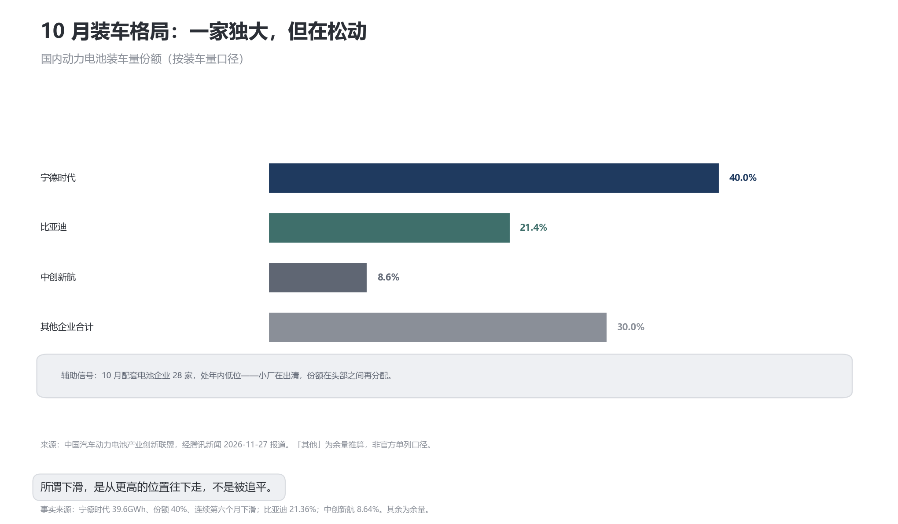
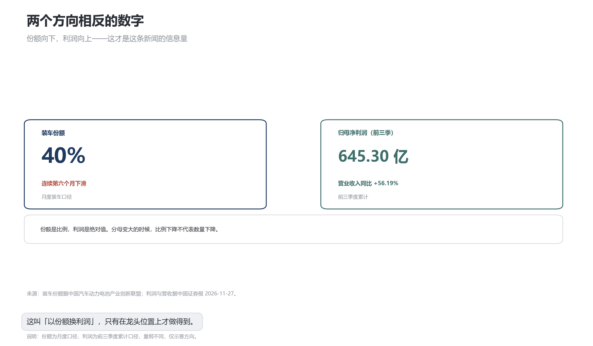
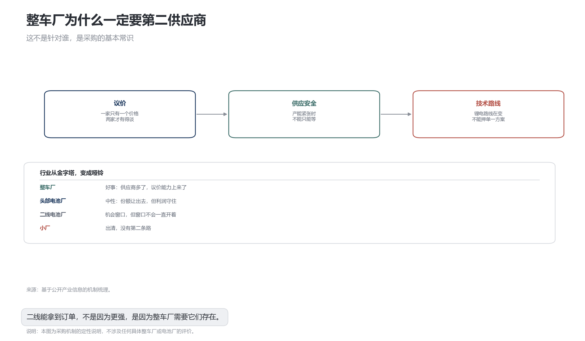

# 电池龙头的份额连降六个月，利润却创了新高

2026 年 11 月 27 日，动力电池创新联盟的 10 月装车数据出来了。

一个数字很扎眼：宁德时代国内装车 39.6GWh，市场份额降至 40%，**连续第六个月下滑**。

同期，比亚迪升至 21.36%，中创新航 8.64%。另外还有一组辅助数据：10 月配套电池企业 28 家，处于年内低位。

按常理，份额连续下滑是坏消息。但把另一组数字放在一起看，结论会完全不同：前三季度，宁德时代归母净利润 645.30 亿元，营业收入同比增长 56.19%。

**份额在掉，利润在涨。这两个方向相反的数字，才是这条新闻真正的信息量。**

## 一、先把份额这件事说清楚

40% 是什么概念？

意味着国内每卖出 10 辆新能源车，有 4 辆用的是同一家企业的电池。这个比例，在全球任何一个充分竞争的制造业里，都属于极高水平。

所以"份额下滑"要分两层看：

**第一层，40% 仍然是绝对第一。** 第二名 21.36%，第三名 8.64%，差距不是一点点。所谓下滑，是从更高的位置往下走，不是被追平。

**第二层，下滑是趋势，不是波动。** 连续六个月，这个方向是稳定的。趋势比单点更重要。

**所以正确的判断不是"龙头不行了"，而是"这个市场的结构在变"。**

## 二、为什么会下滑：整车厂不想被一家绑住

这是最核心的原因，而且跟电池厂做得好不好关系不大。

对整车厂来说，动力电池占整车成本的三到四成，是最大的一笔采购。**任何一家整车厂，都不会愿意把这么重要的部件长期交给单一供应商。**

原因有三个：

**议价。** 只有一个供应商，价格就是对方说了算。有两个，才有得谈。

**供应安全。** 电池厂产能紧张的时候，优先保谁？如果只有一家，整车厂就只能等。

**技术路线。** 电池技术在变（磷酸铁锂、三元、快充、换电），把鸡蛋放在一个篮子里，路线判断错了就全错了。

所以过去两年，主流整车厂都在做同一件事：**培养第二、第三供应商。**

这不是针对谁，是采购的基本常识。也正因如此，二线电池厂才有机会拿到订单——不是因为它们更强，是因为整车厂需要它们存在。

## 三、那为什么利润还能涨

这是很多人想不通的地方。份额降了，利润怎么反而涨？

**第一，行业总量在涨。** 份额是比例，利润是绝对值。分母变大的时候，比例下降不代表数量下降。

**第二，价格战在缓解。** 2026 年碳酸锂价格大幅回落，电池成本下来了。虽然售价也在降，但成本降幅更大，毛利空间反而改善。这一点在昨天的锂价分析里讲过：原料降价对中游不是礼物，但如果降价幅度足够大，仍然能改善盈利。

**第三，产品结构在往上走。** 高镍、快充、储能电芯，这些品类的单价和毛利都高于标准品。储能业务尤其明显——前三季度宁德储能电池销量同比增长 60%。

**第四，规模效应还在。** 40% 的份额，仍然是全球最大的采购量。同样的原材料，它能拿到更好的价格。

**这四条加起来，就是"以份额换利润"：主动放弃一部分低价订单，把产能留给更赚钱的产品。**

这个选择，只有在龙头位置上才做得到。二线厂商不敢这么干，因为它们还在抢入场券。

## 四、28 家配套企业，说明另一件事

10 月配套电池企业 28 家，处于年内低位。这个数字容易被忽略，但它说明的问题很重要。

**企业数量在减少，份额在分散。** 这两件事看起来矛盾，其实不矛盾。

数量减少，意味着小厂在出清——没有规模、没有技术、拿不到订单的企业，正在退出。

份额分散，意味着头部之间的再分配——从一家独大，变成两三家分食。

**所以行业正在从"金字塔"变成"哑铃"：中间层被挤掉，两头留下。**

这对不同角色的影响完全不同：

- 对整车厂：好事，供应商多了，议价能力上来了
- 对头部电池厂：中性，份额让出去，但利润守住
- 对二线电池厂：机会窗口，但窗口不会一直开着
- 对小厂：出清，没有第二条路

## 五、这件事对普通人的意义

**第一，电池成本还会往下走。** 多供应商竞争，直接结果是价格谈判更激烈。这对整车成本是利好。

**第二，但车价未必同步下降。** 车企正在用降价换份额，电池降的那部分，可能被拿去做价格战，也可能被拿去做配置升级。你感受到的"便宜"，是多重因素叠加的结果。

**第三，别把份额当作品质指标。** 份额高说明规模大、供应链稳，但不代表每一款产品都更好。选车时看具体车型的电池方案、质保条款、实际续航表现，比看"用了谁的电池"更有用。

## 六、三个需要观察的问题

**第一，40% 会不会继续往下？** 如果整车厂继续培养第二供应商，这个数字大概率还会降。降到什么位置算稳定，取决于整车厂的策略，不取决于电池厂。

**第二，二线厂商能接住多少？** 拿到订单是一回事，稳定交付、保证一致性是另一回事。过去两年，已经有不少"拿到定点却交不出货"的案例。

**第三，利润能不能守住？** 以份额换利润的前提是"产品结构能往高端走"。如果高端产品也被卷进价格战，这条路就走不通了。

**一句话总结：这个行业的竞争，正在从"谁装得多"变成"谁赚得稳"。** 份额榜还会有人看，但它越来越不能说明问题了。

---

*事实来源：2026 年 10 月国内动力电池装车数据——宁德时代装车 39.6GWh、市场份额降至 40%、连续第六个月下滑；比亚迪 21.36%、中创新航 8.64%；10 月配套电池企业 28 家，处年内低位——据中国汽车动力电池产业创新联盟数据，经腾讯新闻 2026-11-27 报道。宁德时代 2026 年前三季度归母净利润 645.30 亿元、营业收入同比增长 56.19%；前三季度储能电池销量同比增长 60%——据中国证券报 2026-11-27 统计及公司财报。2026 年碳酸锂价格大幅回落，据 2026-11-26 至 27 日公开报道。*

*需说明四点。其一，40% 为 10 月单月份额，另有统计显示四季度测算份额为 40.5%，月度与季度口径不同，不宜横向比较；本文引用月度数据并已注明。其二，装车量份额与出货量份额、销售额份额口径不同，本文统一采用装车量口径。其三，"连续六个月下滑"指月度装车份额的环比方向，具体各月数值未在本文逐一列出，以联盟公布数据为准。其四，本文涉及企业财务数据，仅用于说明产业机制，不构成对任何企业经营前景、财务状况或投资价值的判断，也不涉及任何证券的买卖建议。*
