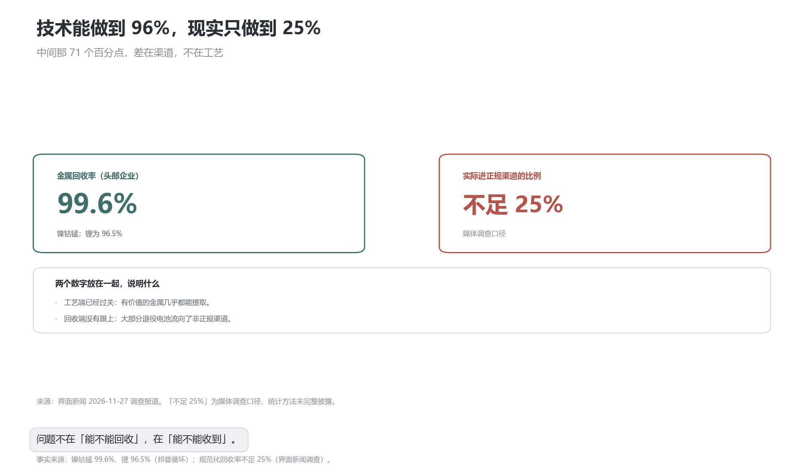
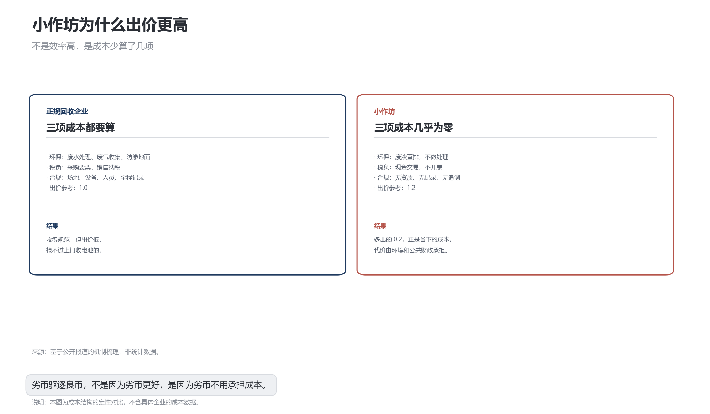
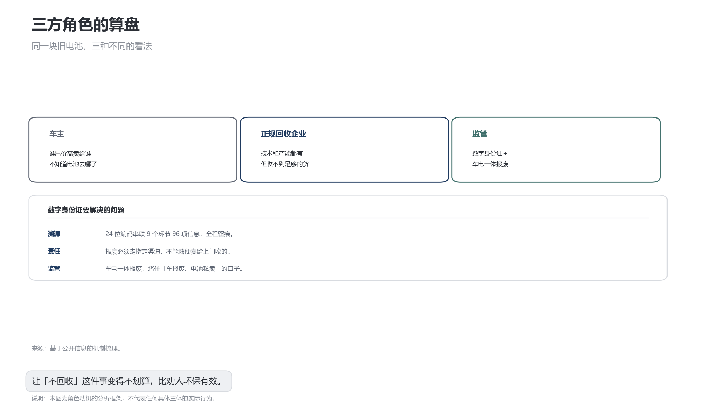

# 你换掉的旧电池，大部分没进正规回收厂

2026 年 11 月，几组关于动力电池回收的数字同时浮出来，放在一起看很有冲击力。

**一边是"能回收"。** 邦普循环 2025 年回收废旧电池及材料 21 万吨，同比增长超六成，营收 406.4 亿元；其定向循环技术对镍钴锰的回收率 99.6%、对锂的回收率 96.5%。格林美一季度回收动力电池 1.5 万吨，同比增长 40%，锂回收率 96.5%、镍钴超 99.5%。

**一边是"没回收"。** 界面新闻的调查提到：规范化回收率不足 25%，行业注册主体超过 18 万家，而进入白名单的企业只有 156 家。

**技术能做到 96%，现实只做到 25%。中间那 71 个百分点，差在哪？**

## 一、先看这块"城市矿山"有多大

动力电池的寿命，通常在 5 到 8 年。2018 年前后那一波新能源车放量，对应的退役期正好落在现在。

据公开数据，2025 年国内动力电池退役量约 38 万吨，2030 年将突破 100 万吨；对应的回收市场规模，从千亿级向更高走。2026 年锂电回收市场预计 527 亿元。

为什么叫"城市矿山"？因为退役电池里的金属品位，比原矿高得多。

一吨锂矿石，能提炼出的锂很有限；一吨退役三元电池，含镍、钴、锰、锂的比例远高于原矿。**换句话说，回收电池比挖矿更划算——前提是能规范地收上来。**

## 二、技术不是瓶颈，渠道才是

这是整件事最反直觉的地方。

从数据看，头部企业的湿法回收技术已经非常成熟：镍钴锰 99.6%、锂 96.5%，意味着几乎所有有价值的金属都能被提取出来。这个水平，在国际上也属于第一梯队。

**所以问题不在"能不能回收"，在"能不能收到"。**

退役电池的流向，大致有三条路：

**第一条，正规回收企业。** 有资质、有环保投入、有溯源记录。占比不足 25%。

**第二条，小作坊。** 没有资质、不投环保、现金结算。这一条吃掉了大部分。

**第三条，梯次利用。** 容量还有 70%–80% 的电池，被降级用在储能、低速车、备电等场景。但在 2026 年 7 月，工信部废止了梯次利用的相关条款，方向转向"能回收就回收"，这条路正在收窄。

## 三、小作坊为什么抢得过正规厂

不是技术问题，是成本结构问题。

**第一，环保成本。** 正规企业要建废水处理、废气收集、防渗地面，这些投入不产生收入。小作坊把电池拆开、把电芯泡在酸里，废液直接排掉，成本接近于零。

**第二，税负成本。** 正规企业采购要发票、销售要纳税。小作坊现金交易，不开票，价格能高出一截。

**第三，合规成本。** 白名单企业要满足一系列准入要求，包括场地、设备、人员、记录。这些都要钱。

**结果就是：正规厂出价 1 万，小作坊能出 1.2 万。** 卖电池的人当然选价高的。至于电池最后怎么处理、污染排到哪里去，跟卖的人没关系。

**这是一个典型的"劣币驱逐良币"：不是因为劣币更好，是因为劣币不用承担成本。**

## 四、数字身份证要解决的就是这个

2026 年 12 月 6 日，是电池数字身份证相关征求意见的截止日；2027 年正式施行。

核心设计是：**给每块电池一个 24 位编码，串联生产、销售、维修、更换、回收、拆解等 9 个环节、96 项信息，全程留痕、动态更新。**

这套机制要解决三个问题：

**第一，溯源。** 这块电池是谁生产的、装在哪辆车上、什么时候换的、换到谁手里——每一步都有记录。

**第二，责任。** 电池报废后必须走指定渠道，不能随便卖给上门收电池的人。

**第三，监管。** 交管、环保、工信的数据打通后，能识别出"大量电池流入非正规渠道"的异常。

配套的还有"车电一体报废"——报废车辆时，电池必须一起交回，不能单独拆卖。这一条直接堵住了"车报废、电池私自卖"的口子。

**这套东西的逻辑，跟电动自行车的"一车一池一充一码"是一样的：让物件的流向可追踪，让违规的成本上升。**

## 五、对普通车主，具体意味着什么

**第一，换电池时，旧电池别随便卖。** 上门收电池的出价高，但这些电池大概率进了小作坊。正规渠道的价格可能低一点，但流向是可控的。

**第二，2027 年之后，电池更换会有记录。** 数字身份证施行后，正规维修点更换电池需要登记。这会影响二手车的估值——有完整电池记录的车辆，更容易被信任。

**第三，电池的"健康档案"会变成车辆价值的一部分。** 现在买二手电车，最怕的就是电池状态不明。未来这套记录会成为定价依据。

**第四，别指望回收价格大涨。** 回收价取决于金属价格。2026 年碳酸锂价格大幅回落，回收的经济性在下降。这也是为什么"正规回收率低"这个问题，在锂价高的年份反而没那么突出——因为那时候小作坊抢得更凶。

## 六、三个还没解决的问题

**第一，25% 这个数字准不准？** 界面新闻的调查口径是"规范化回收率"，但统计范围、样本量未完全披露。真实比例可能更高，也可能更低，本文只作趋势引用。

**第二，18 万家 vs 156 家，差距怎么补？** 靠执法取缔，还是靠市场出清？前者成本高、容易反弹；后者需要时间，而退役潮不会等。

**第三，经济性怎么维持？** 回收是门生意，不是公益。当金属价格低迷时，正规企业收得越多亏得越多。政策能管住流向，但管不住价格。

**一句话总结：一块电池的金属回收率能做到 96%，但要让它真的被回收，靠的不是技术，是让"不回收"这件事变得不划算。**

---

*事实来源：邦普循环 2025 年回收废旧电池及材料 21 万吨、同比增长超六成、营收 406.4 亿元、DRT 定向循环技术镍钴锰回收率 99.6%、锂回收率 96.5%、动力电池回收量全球市占率超 30%；格林美一季度回收动力电池 1.5 万吨、同比增长 40%、锂回收率 96.5%、镍钴超 99.5%；规范化回收率不足 25%、注册主体超 18 万家而白名单仅 156 家——据界面新闻 2026-11-27 调查报道。2025 年动力电池退役量约 38 万吨、2030 年将突破 100 万吨、回收市场规模 1200–1500 亿元；2026 年锂电回收市场预计 527 亿元——据同期公开报道与行业机构测算。电池数字身份证以 24 位编码串联 9 个环节 96 项信息、12 月 6 日征求意见截止、2027 年施行；车电一体报废；2026 年 7 月工信部废止梯次利用相关条款——据同期公开政策信息与报道。*

*需说明四点。其一，"规范化回收率不足 25%"为媒体调查口径，统计方法与样本范围未完整披露，不同机构的估算可能存在差异，本文仅作趋势引用，未作精确认定。其二，"注册主体超 18 万家"包含经营范围涉及回收的各类主体，其中多数并非实际从事电池回收的企业，与白名单 156 家不构成严格可比关系，本文引用时已注明。其三，本文涉及的企业回收量与回收率为企业公开披露口径，具体技术指标以企业公告与第三方检测为准。其四，本文为产业与政策的公开信息分析，不构成对任何企业的评价或投资判断，也不构成电池处理方式的强制性建议；具体报废与回收流程应以当地主管部门规定为准。*
