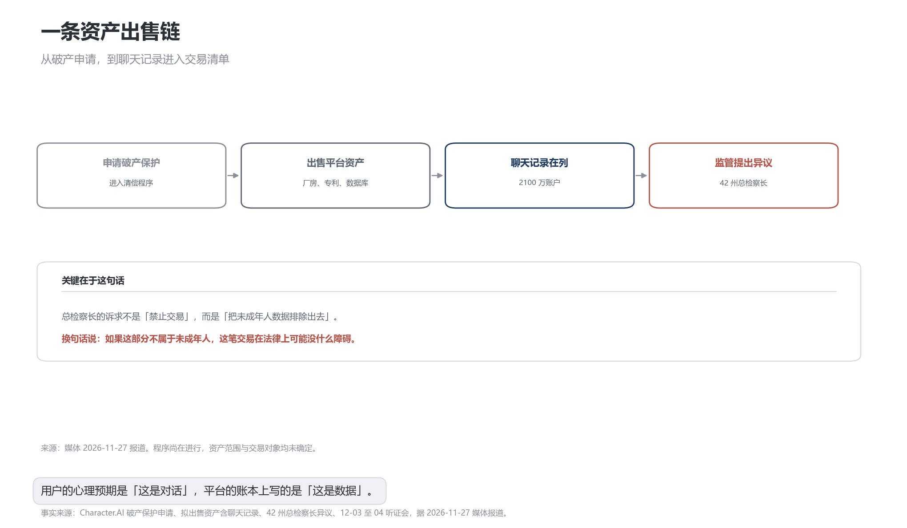
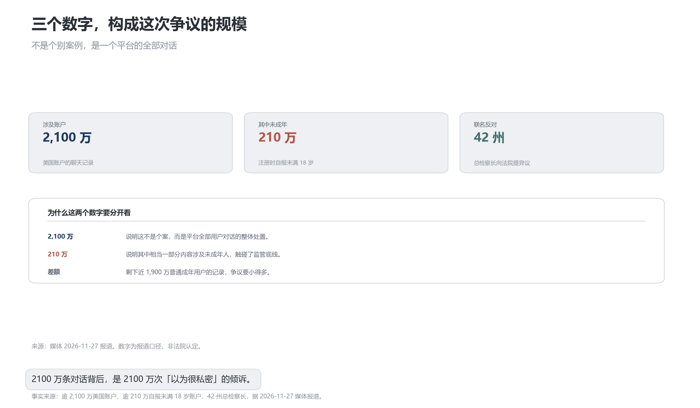
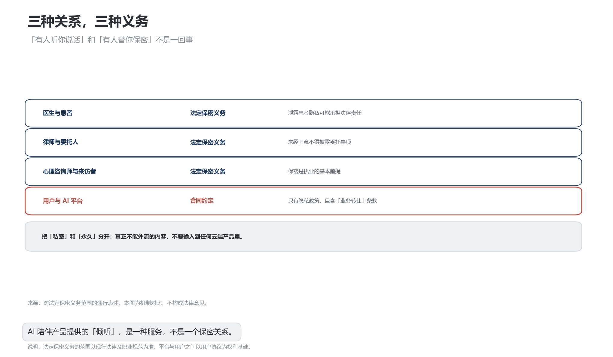

# AI 陪你聊过的天，可能被当成资产卖掉

2026 年 11 月 27 日，一条消息在海外科技媒体上传开：已申请破产保护的 AI 陪伴平台 Character.AI，拟出售平台资产，而拟出售的清单里，包括逾 2,100 万个美国账户的私密聊天记录——其中涉及逾 210 万个注册时自报未满 18 岁的账户。

11 月 20 日，美国 42 个州的总检察长联名向特拉华州破产法院提出异议，要求把未成年人的聊天记录及其他敏感数据排除在这笔交易之外。法院定于 12 月 3 日至 4 日举行出售听证会。

这件事表面上是一桩破产案的程序争议。但它把一个很少被认真讨论的问题摆到了台面上：

**你和 AI 说的那些话，到底属于谁？**

## 一、先看清楚这件事的性质

破产程序里的资产出售，逻辑跟普通商业交易不同。企业还不上债，就要把能变现的东西都拿出来卖——厂房、设备、专利、商标、用户名单、数据库。

在传统企业里，用户名单是资产，这一点没有争议。但**聊天记录是不是资产**，一直是个灰色地带。

它的特殊性在于：这些内容不是你"提交"给平台的，是你在一个以为很私密的环境里"说"出来的。很多人对着 AI 讲的东西，比对着朋友讲的还多——包括情绪、健康、家庭关系、甚至更私密的内容。

**用户的心理预期是"这是对话"，平台的账本上写的是"这是数据"。**

这个错位，平时不明显，一旦进入破产清算，就变成了法律问题。

## 二、2,100 万和 210 万，这两个数字意味着什么

2,100 万个账户的聊天记录，意味着这不是个别案例，而是一个平台的**全部用户对话**。

210 万个自报未满 18 岁的账户，意味着其中相当一部分内容涉及未成年人。这也是 42 个州总检察长介入的直接原因——他们要求的不是禁止交易，而是把这一部分排除出去。

这个诉求本身很说明问题：**监管并不否认"聊天记录可以是资产"，只是要求对特定人群做例外处理。**

换句话说，如果这部分数据不属于未成年人，这场交易可能在法律上没什么障碍。

这才是真正让人不安的地方。

## 三、你以为的"隐私政策"，在破产时能挡什么

大多数人在注册这类产品时，会点一下"同意"。那份隐私政策通常写着：我们如何收集、如何使用、如何保护你的数据，以及——在"业务转让"的情况下，数据可能作为资产的一部分被转移。

这一条几乎存在于所有互联网产品的隐私政策里，但几乎没有人会认真读。

它的实际含义是：**你同意的不只是"现在这家公司用你的数据"，还包括"如果这家公司被卖了，买家可以继续用"。**

破产出售算不算"业务转让"？在法律上，这是个需要法院认定的问题。但从商业实践看，破产程序中的资产出售，通常比正常并购更容易通过——因为它有清偿债务的正当性。

**所以隐私政策给你的是"知情"，不是"否决权"。**

## 四、这件事对中国用户的参照意义

国内没有完全对应的案例，但机制是相通的。

**第一，法律框架不同，但问题同源。** 国内的《个人信息保护法》对个人信息处理有明确要求，包括告知同意、最小必要、目的限制。但"企业破产后用户数据如何处理"，在实操层面同样缺少成熟先例。

**第二，AI 陪伴类产品在国内也在快速增长。** 这类产品的共同特点是：用户投入的情感深、对话内容私密、使用时间长。一旦平台出现经营问题，数据的处置会成为难题。

**第三，用户几乎没有议价能力。** 你无法在注册时要求"我的对话不得作为资产转让"，因为这是格式条款，不接受就不能用。

**这不是某一家公司的问题，是整个行业在产品设计时就没有把"数据归属"想清楚。**

## 五、对普通用户，三条现实建议

**第一，把"私密"和"永久"分开。** 任何在线服务，都存在数据被迁移、被出售、被泄露的可能。真正不能外流的内容，不要输入到任何云端产品里。

**第二，看清楚"业务转让"条款。** 注册前花两分钟搜一下隐私政策里的"转让""合并""破产"关键词，能大致判断这家公司对数据的态度。

**第三，别把 AI 当树洞。** 这句话听起来像说教，但它是这次事件最直接的教训：AI 陪伴产品提供的"倾听"，是一种服务，不是一个保密关系。医生、律师、心理咨询师有法定保密义务，AI 产品没有。

## 六、三个值得观察的问题

**第一，法院会怎么判？** 12 月 3 日至 4 日的听证会，会成为"AI 对话数据能否作为破产资产出售"的一个参考判例。无论结果如何，都会影响后续同类案件。

**第二，行业会不会主动改条款？** 如果这次争议引发足够关注，其他 AI 陪伴产品可能会修改隐私政策，明确"对话数据不作为资产转让"。但商业动机未必支持这么做——因为这些数据本身就有价值。

**第三，监管会不会补规则？** 目前各国对 AI 对话数据的规制，主要集中在"训练数据"和"生成内容"，对"用户与 AI 的对话记录"这个特殊类别，还缺少专门规定。

**一句话总结：你对着 AI 说的每一句话，在技术上是一条记录，在法律上可能是一项资产。这两件事之间的差距，就是这次事件真正暴露的东西。**

---

*事实来源：Character.AI 已申请破产保护，拟出售平台资产，其中包括逾 2,100 万个美国账户的私密聊天记录，涉及逾 210 万个注册时自报未满 18 岁的账户；2026 年 11 月 20 日美国 42 个州总检察长向特拉华州破产法院提出异议，要求将未成年人聊天记录及其他敏感数据排除在交易之外；法院定于 2026 年 12 月 3 日至 4 日举行出售听证会——据媒体 2026-11-27 报道。*

*需说明四点。其一，上述事实来自媒体报道，破产程序尚在进行中，资产范围、交易对象与最终处置方式均未确定，本文所述为"拟出售"状态，不构成对交易结果的判断。其二，本文关于隐私政策"业务转让"条款的说明，为互联网产品通用实践的归纳，不针对任何具体企业的条款文本；具体权利义务须以用户协议原文及适用法律为准。其三，本文涉及《个人信息保护法》的表述为原则性说明，不构成法律意见；数据出境、破产程序中数据处置等具体问题，应依据现行法律与主管部门规定判断。其四，本文为公开信息的产业与法律机制分析，不构成对任何企业的评价或投资判断。*
