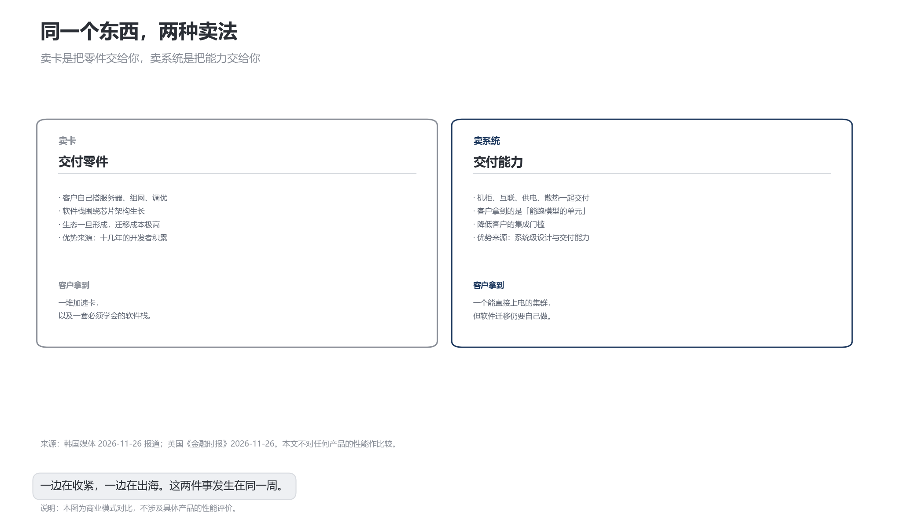
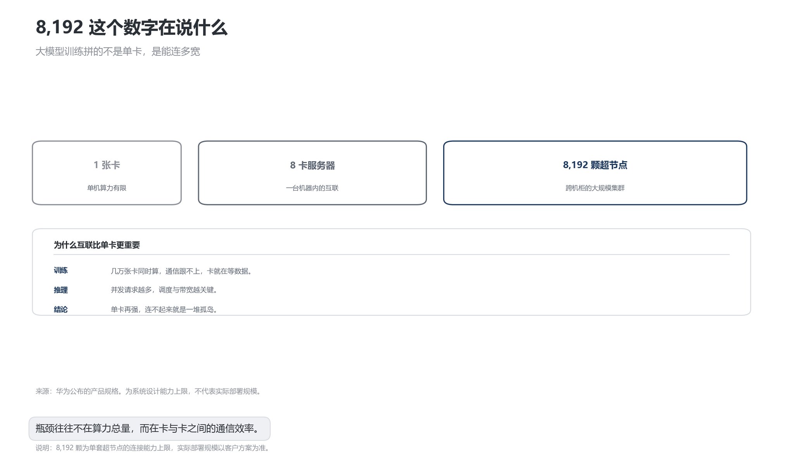
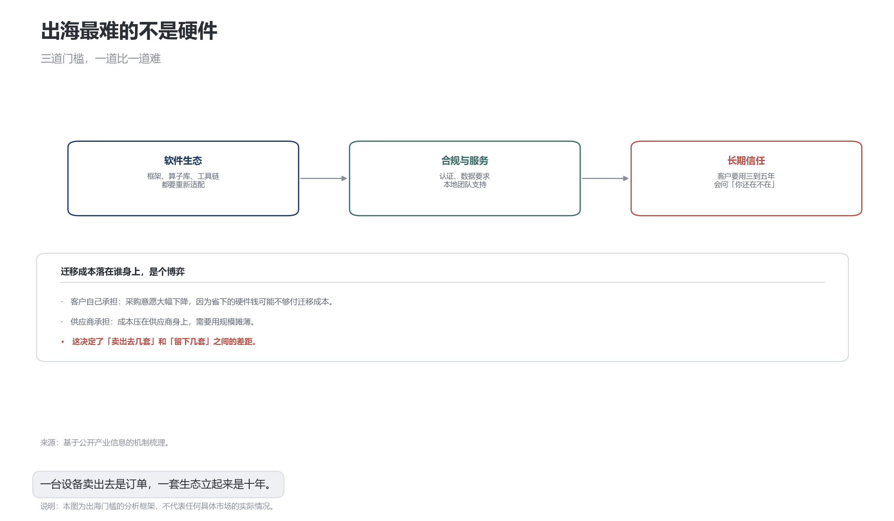

# 国产 AI 芯片卖到韩国了，这次卖的不是一张卡

2026 年 11 月 26 日，韩国媒体报道了一件事：华为已通过当地分销渠道，在韩国销售昇腾 950 系列 AI 芯片，并向客户推介 Atlas 950 超节点。

进入韩国市场的产品包括昇腾 950PR 和 950DT，前者侧重推理，后者支持模型训练和推理解码。华为公布的规格显示，一套 Atlas 950 超节点最多可连接 8,192 颗 950DT 芯片。

两天前，另一条消息是反方向的：英伟达通知合作伙伴，暂停向马来西亚、新加坡、泰国、印尼交付搭载其芯片的服务器。

**一边在收紧，一边在出海。这两件事发生在同一周，不是巧合。**

## 一、先看"卖的不是一张卡"这句话

买芯片有两种方式：买卡，或者买系统。

**买卡**，就是买加速卡，自己搭服务器、自己组网、自己调优。这是过去几年最常见的模式，也是英伟达生态的核心——卡卖给你，剩下的你自己搞定，而所有的软件栈都围绕它的架构长出来。

**买系统**，是连机柜、互联、供电、散热、软件栈一起交付。你拿到的是一个能直接跑模型的"算力单元"，而不是一堆零件。

昇腾这次在韩国推的 Atlas 950 超节点，属于后者。**8,192 颗芯片连成一套**——这个数字本身就是产品定位：它卖的不是单卡性能，是"一个集群能做到多大"。

为什么要强调这一点？

因为在大模型训练这件事上，**单卡强不强，远不如"能不能把几万张卡高效连起来"重要**。训练一个前沿模型，瓶颈往往不在算力总量，而在卡与卡之间的通信效率。谁的互联做得更好，谁的实际训练效率就更高。

所以"最多连 8,192 颗"这个规格，传递的信息是：这套系统是照着大规模集群设计的，不是给单机用的。

## 二、为什么是韩国

三个现实因素。

**第一，算力需求是刚性的。** 韩国自己有很强的半导体产业，也有大量 AI 应用需求（搜索、电商、游戏、制造）。这些场景都要算力，而全球高端算力供给这几年一直紧张。

**第二，采购需要第二来源。** 任何一家做基础设施的企业，都不会把算力供应完全押在一家身上。这在采购逻辑上，跟整车厂培养第二电池供应商是同一件事。

**第三，价格是变量。** 在算力供给紧张的时候，价格往往不是第一考虑；但当供给宽松、或者预算受限时，性价比就会变成关键因素。这一点不需要具体报价也能推断——进入一个新市场，通常意味着价格上有话可说。

**但也要说清楚：进入一个市场，不等于站稳一个市场。** 分销渠道开起来只是第一步，真正的考验在后面。

## 三、出海最难的不是硬件

芯片出海，硬件只是入场券。真正的门槛有三个，而且一个比一个难。

**第一，软件生态。** 这是最大的坎。英伟达的 CUDA 经营了十几年，几乎所有主流框架、算子库、训练工具都围绕它优化。换一套芯片，意味着大量代码要迁移、要重新调优。

迁移的成本有多大？取决于你的模型有多复杂、对底层优化的依赖有多深。用标准框架跑标准模型，迁移相对容易；自己写了很多自定义算子，迁移就是个大工程。

这就是为什么很多企业"愿意试"，但"不敢全量切"。

**第二，合规与服务。** 不同国家对进口算力设备有不同的审查要求。进入一个市场，要解决认证、数据合规、售后支持。芯片不是快消品，出了问题要有本地团队能到场。

**第三，信任。** 算力基础设施是长周期投入，客户一旦选了某套系统，通常会用三到五年。选型时考量的不只是性能和价格，还有"这家供应商五年后还在不在、这套系统五年后还有没有人维护"。

**这三条，没有一条能靠一次发布会解决。**

## 四、这件事对中国读者意味着什么

**第一，算力正在变成区域性商品。** 昨天写英伟达断供时提过一个判断：算力的地理正在被重新划分。今天这条消息是同一趋势的另一面——供给方也在寻找新的市场。

**第二，云服务的价格可能会受影响。** 算力供给的多元化，长期看会压低单位算力成本。但这个传导很慢，而且中间隔着机房、电力、网络等一堆成本。

**第三，别把"卖出去"当成"赢了"。** 一台设备卖出去，和一套生态立起来，是两件完全不同的事。前者是订单，后者是十年。

## 五、三个需要观察的问题

**第一，实际部署规模有多大？** 分销渠道开起来是一个信号，但真正的信息量在于"装了多少套、跑了什么模型"。这类数据通常不会公开，只能从后续的客户案例里看。

**第二，软件迁移的成本谁来承担？** 如果客户要自己承担迁移成本，那采购意愿会大打折扣；如果供应商提供迁移支持，那成本就压在供应商身上。这是个博弈。

**第三，其他市场会不会跟进？** 韩国是一个有象征意义的市场——它有成熟的半导体产业，也有美国的安全同盟关系。如果在这里能跑通，对其他市场的示范效应会很强。反过来，如果遇阻，也会影响后续判断。

**一句话总结：这一轮算力竞争，比的不再是谁的芯片跑分高，而是谁能把"一套能用的系统"交付到客户机房里，并且让它稳定跑三年。**

---

*事实来源：华为已通过当地分销渠道在韩国销售昇腾 950 系列 AI 芯片，并向客户推介 Atlas 950 超节点；进入韩国市场的产品包括昇腾 950PR（侧重推理）与 950DT（支持模型训练和推理解码）；华为公布规格显示一套 Atlas 950 超节点最多可连接 8,192 颗 950DT 芯片——据韩国媒体 2026-11-26 报道。英伟达暂停向马来西亚、新加坡、泰国、印尼交付搭载其芯片的服务器——据英国《金融时报》2026-11-26 报道。*

*需说明四点。其一，昇腾 950 系列在韩国的销售情况依据韩国媒体报道，华为方面未就具体客户、销售规模作公开披露，实际部署情况以官方信息为准。其二，本文引用的"最多连接 8,192 颗"为厂商公布的产品规格，属系统设计能力上限，不代表实际部署规模，也不代表实际训练性能。其三，本文未对任何芯片产品作性能比较，相关性能指标涉及测试条件与工作负载差异，不宜简单横比。其四，本文为产业格局的公开信息分析，不构成对任何企业、产品或证券的投资判断，也不构成采购建议。*
