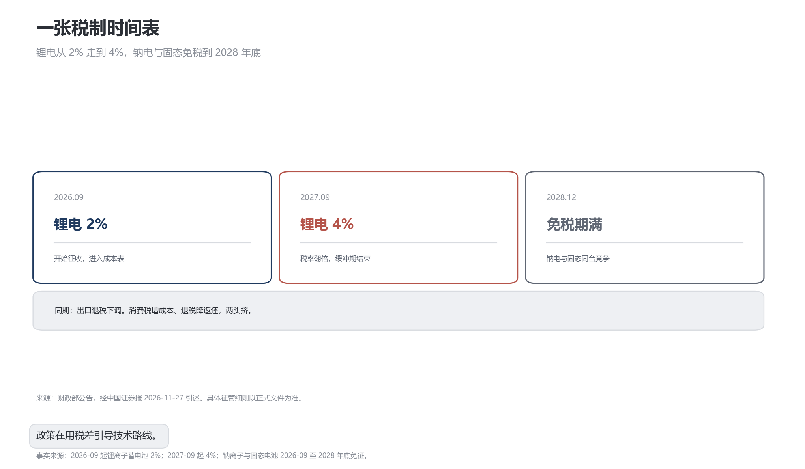
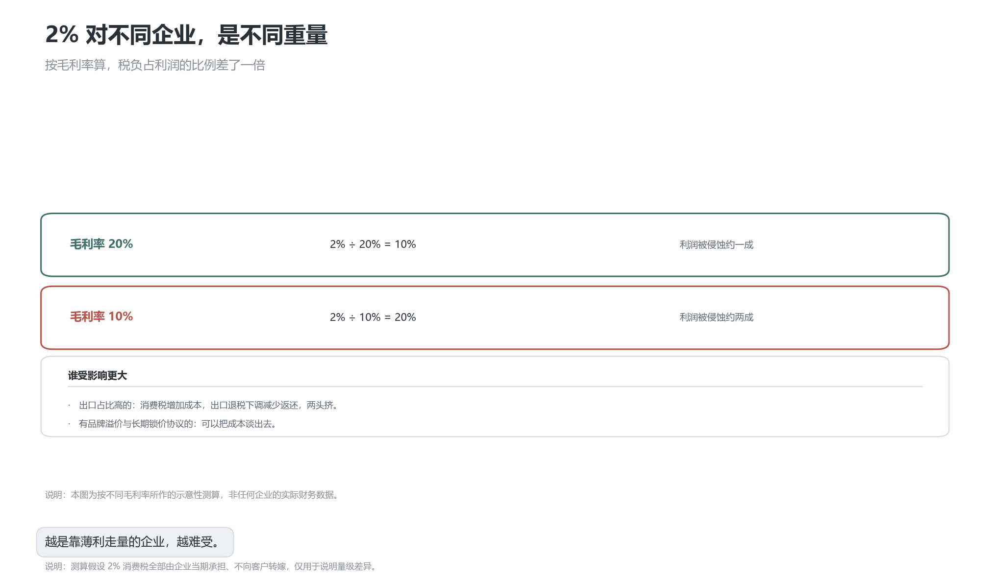
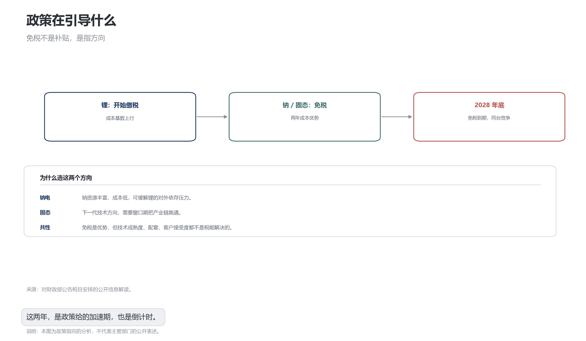

# 电池开始交消费税了，2% 到 4% 只隔一年

一条容易被忽略的税制变化，正在改变整个锂电产业的成本表。

按财政部公告，**2026 年 9 月起，锂离子蓄电池按 2% 征收消费税；2027 年 9 月，税率提高到 4%**。同期，出口退税下调。

另外还有一条配套：钠离子电池与固态电池，2026 年 9 月起免征消费税，免征期到 2028 年底。

三件事放在一起，信息量比"电池要涨价"大得多。

## 一、先搞清楚消费税是什么

这一点很多人会混淆。

**增值税**是价外税，你在发票上能看到单独一栏，最终由消费者承担，但企业在中间环节可以抵扣。

**消费税**是价内税，直接计入产品成本，在生产环节征收，不在发票上单列。你买东西的时候看不到它，但它已经在价格里了。

所以"电池按 2% 征消费税"，意思不是"买电池要多付 2% 的钱"，而是"电池的生产成本里多了 2% 这一项"，然后这个成本会顺着产业链往下传。

**对电池厂来说，这是实打实的成本增加。**

## 二、为什么是 2%，然后 4%

时间表的安排很讲究。

**2026 年 9 月起 2%，2027 年 9 月起 4%**，中间隔整一年。这个设计给了行业一年缓冲期：先是轻一点，让企业调整报价和合同；一年后再加码。

对企业的实操影响是：**长期供货合同要重新谈。** 电池的供货协议通常签一到三年，价格条款里如果没约定"税率变化如何分担"，那这部分成本就要重新协商。

据公开报道，亿纬锂能表示已与多数客户就税改达成方案，四季度产能订满。这句话背后是一轮密集的商务谈判——**能谈成的，说明议价能力够；谈不成的，就要自己吞下这部分成本。**

## 三、为什么钠电和固态免税

这是整份政策里最有指向性的一条。

**锂离子电池要交税，钠离子电池和固态电池免税到 2028 年底。**

翻译一下：**政策在用税差引导技术路线。**

为什么要引导？因为锂资源的对外依存度高，而钠资源丰富、成本低；固态电池则是下一代技术方向。给这两类免税，等于给它们一个成本优势窗口。

**这个窗口有多长？两年多。** 到 2028 年底，如果钠电和固态还没跑出规模，免税期一过，就要和锂电池在同一个税负水平上竞争。

**所以这两年，是政策给的加速期，也是倒计时。**

## 四、谁受影响最大

**第一，出口占比高的企业。** 消费税 + 出口退税下调，两个因素叠加在同一个方向上。出口退税率降低，意味着出口环节能退回来的税少了；消费税增加了，意味着成本基数上去了。两头挤，出口的利润空间会被压缩。

**第二，以低价换份额的企业。** 2% 的消费税，对毛利率 20% 的企业是 10% 的利润侵蚀；对毛利率 10% 的企业，是 20% 的侵蚀。**越是靠薄利走量的企业，越难受。**

**第三，出口到高合规市场的企业。** 欧盟的电池法规、碳足迹要求、回收责任，都在推高合规成本。税负只是其中一项。

反过来，受影响较小的，是有品牌溢价、有技术壁垒、有长期协议锁价能力的企业。

## 五、会不会传导到车价

这是普通人最关心的。

答案是：**会，但不会很明显，而且滞后。**

原因有三：

**第一，电池只是整车成本的一部分。** 电池占整车成本三到四成，2% 的消费税对应整车成本大约 0.6%–0.8%。这个幅度，在车企动辄几万块的终端优惠面前，几乎看不见。

**第二，车企正在打价格战。** 成本上升的时候，车企的第一反应通常不是涨价，而是自己消化——因为涨价会丢份额，丢份额比少赚更可怕。

**第三，规模能摊薄。** 电池厂可以通过提升产能利用率、优化材料成本来对冲一部分税负。

**所以短期看，这笔钱主要压在电池厂和车企身上，不会立刻变成你的购车账单。** 但如果税率继续往上走，或者行业进入下行周期，传导就会发生。

## 六、三个值得观察的问题

**第一，4% 之后还会不会继续加？** 目前公告只到 2027 年 9 月的 4%，之后没有明确安排。这给行业留了想象空间，也留了不确定性。**企业做五年规划时，这一项怎么估，是个难题。**

**第二，钠电和固态能不能用这两年跑出来？** 免税是优势，但技术成熟度、产业链配套、客户接受度，都不是税能解决的。窗口期给了，能不能抓住是另一回事。

**第三，成本会不会最终由消费者承担？** 从税制设计看，消费税的最终承担者是终端消费者。中间环节只是缓冲。缓冲期有多长，取决于竞争烈度。

**一句话总结：这 2% 看着不多，但它标记了一个转折——电池从"鼓励发展的新兴产业"，变成了"需要承担财政贡献的成熟产业"。** 这个身份变化，比税率本身更重要。

---

*事实来源：财政部公告，2026 年 9 月起锂离子蓄电池按 2% 征收消费税，2027 年 9 月提高至 4%；同期出口退税下调；钠离子电池与固态电池 2026 年 9 月起免征消费税至 2028 年底——据中国证券报 2026-11-27 报道引述财政部公告。亿纬锂能表示已与多数客户就税改达成方案、四季度产能订满——据中国证券报 2026-11-27 报道。*

*需说明四点。其一，本文涉及的税率与生效时间为公开报道引述的公告口径，具体征收范围、计税依据与执行细则应以财政部、国家税务总局正式文件为准，部分电池品类（如用于特定用途的）可能存在差别化规定。其二，本文关于"消费税为价内税、在生产环节征收"的说明为税制常识性表述，具体征管环节以现行税法为准。其三，本文关于成本传导幅度（整车成本 0.6%–0.8%）为基于"电池占整车成本三到四成"这一行业通行估算的示意性测算，非精确数据，实际因车型与电池方案而异。其四，本文为税制与产业的公开信息分析，不构成税务、法律或投资意见，也不构成购车建议。*
