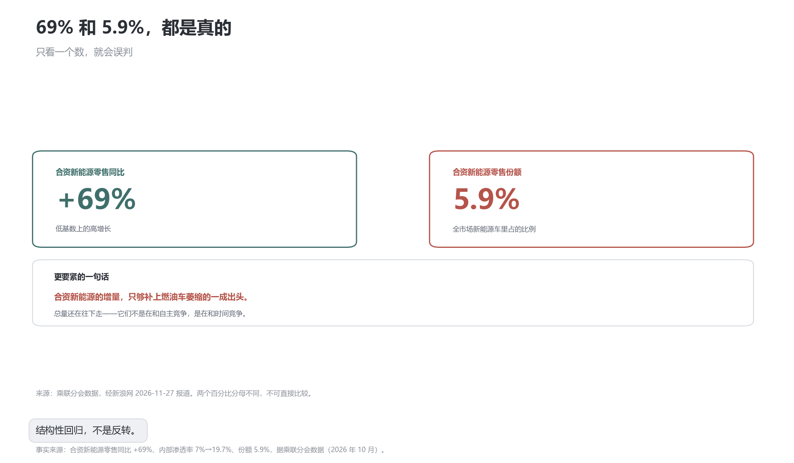
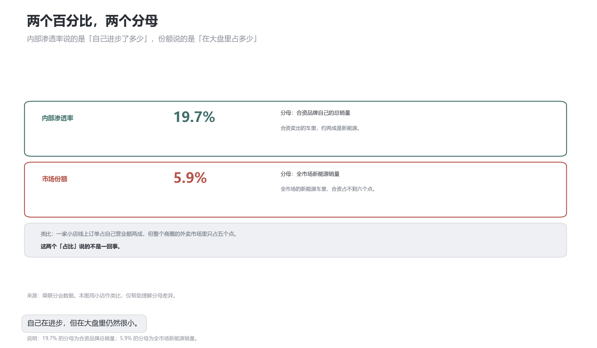
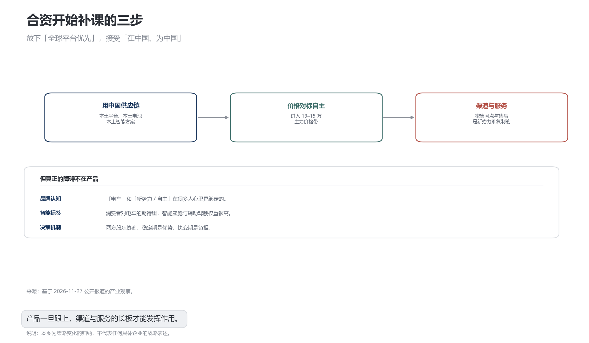

# 合资电车涨了 69%，但份额只有 5.9%

2026 年 10 月的一组数据，读起来很容易让人产生错觉。

乘联分会数据显示：10 月国内新能源乘用车零售同比下降 13.7%，自主与豪华品牌同步承压。但主流合资品牌的新能源零售，**逆势增长 69%**，内部渗透率从一年前约 7% 升到 19.7%。

看到这里，很多人的第一反应是"合资电车翻身了"。但同一份数据里还有另一个数字：

**合资新能源的零售份额，仍然只有 5.9%。**

69% 和 5.9%，两个数字放在一起，才构成完整的事实。

## 一、先搞清楚这两个百分比分别是什么

这是最容易混淆的地方，也是很多"合资翻身"判断出错的原因。

**19.7% 是"内部渗透率"。** 意思是：合资品牌自己卖出去的所有车里，有 19.7% 是新能源。分母是"合资品牌的总销量"。

**5.9% 是"市场份额"。** 意思是：全市场卖出去的新能源车里，合资只占 5.9%。分母是"全市场新能源销量"。

两个数字的分母完全不同。

打个比方：一家小店的营业额里，线上订单占了两成（内部渗透率 20%），但整个商圈的外卖市场里，这家店只占 5%（市场份额 5%）。这两个"占比"说的不是一回事。

**合资的现实是：自己在进步（从 7% 到 19.7%），但在大盘里仍然很小（5.9%）。**

## 二、69% 的增长是真的，但它有个前提

69% 这个增速没有造假，但它是在一个很低的基础上实现的。

一年前合资新能源的基数很小，从很小的数字往上走，增速自然显得惊人。**这是数学，也是叙事。**

更能说明问题的是一句话：**合资新能源的增量，只够补上燃油车萎缩的一成出头。**

也就是说，合资在新能源上多卖的车，抵不过燃油车少卖的车。总量还在往下走。

所以"69%"这个数字，准确的解读是：**结构性回归，不是反转。**

## 三、为什么现在才动

合资品牌在电动化上慢了半拍，这是共识。但 2026 年它们开始加速，有三个具体原因。

**第一，开始用中国的供应链。** 过去合资电车的思路是"把国外平台拿过来"，结果成本高、迭代慢、不符合中国用户习惯。现在的做法是：用本土平台、本土电池、本土智能方案。

这一转变很关键。它意味着合资放下了"全球平台优先"的执念，接受"在中国、为中国"。

**第二，价格开始对标。** 广州车展上，东风日产 NX7 预售价 12.99 万到 14.99 万元，直接进入自主品牌的主力价格带。这个价格带是新能源竞争最激烈的地方，进去意味着要正面硬拼。

**第三，渠道与服务体系是它们的长板。** 合资品牌在全国有密集的经销商网络和售后体系，这是新势力花很多年才能建起来的东西。电动化产品一旦跟上，这个优势就能发挥作用。

## 四、但真正的障碍不在产品

如果只看参数，合资电车现在并不差。真正的障碍在别的地方。

**第一，品牌认知。** 在很多人心里，"电车"和"新势力/自主品牌"是绑定的。合资电车要改变这个认知，需要时间和持续的产品证明，不是一次改款能解决的。

**第二，智能化标签。** 中国消费者对电车的期待里，智能座舱和辅助驾驶占了很大权重。这方面自主品牌走得更早、更激进，合资的节奏偏保守。

**第三，内部的组织惯性。** 合资企业是两方股东共同决策，产品定义、定价、迭代节奏都要协商。这个机制在稳定期是优势，在快速变化的市场上是负担。

**第四，保值率的不确定性。** 新能源车的保值率整体偏低，合资电车的二手市场还没有形成稳定的价格体系。对看重"几年后能卖多少钱"的家庭用户来说，这是个真实的顾虑。

## 五、对准备买车的人，意味着什么

**第一，选择变多了，这是好事。** 合资进入 13 万–15 万这个价格带，会逼着自主品牌继续提升产品力。竞争对买方有利。

**第二，别用"合资=可靠"的旧逻辑判断电车。** 燃油车时代，合资的优势在发动机、变速箱的成熟度；电车时代，核心是三电系统、智能化、软件迭代。评价标准变了。

**第三，也别用"合资=落后"的新偏见。** 有些合资电车在底盘调校、NVH、做工一致性上仍然有积累。这些不容易被参数表体现，但开起来能感觉到。

**第四，看服务网络。** 这是合资当下最实在的优势。买车只是开始，后面几年的维修、保养、配件供应，网点密度很重要。

## 六、三个需要观察的问题

**第一，5.9% 会不会往上走？** 如果合资继续用本土平台、本土价格，份额大概率会升。但升到 10% 还是 15%，取决于它们能不能解决品牌认知问题。

**第二，自主品牌会不会被反攻？** 13 万–15 万是自主的主力区间，合资进来必然分流。但自主在这个区间的产品迭代速度更快，短期内优势还在。

**第三，燃油车的萎缩速度有多快？** 这是决定合资命运的关键变量。如果燃油车下滑得比新能源增长快，那合资的总量还是会缩。**它们不是在和自主竞争，是在和时间竞争。**

**一句话总结：69% 说明合资终于开始认真做电车了，5.9% 说明它们才刚刚上桌。** 两个数字都是真的，只看一个都会误判。

---

*事实来源：乘联分会数据，2026 年 10 月国内新能源乘用车零售同比下降 13.7%，自主与豪华品牌同步承压；主流合资品牌新能源零售逆势增长 69%，内部渗透率由一年前约 7% 升至 19.7%；上汽大众、一汽-大众、上汽通用、广汽丰田四家月批发均破万辆，一汽-大众 ID.AURA T6 约 1.2 万辆；合资新能源零售份额仍仅 5.9%，增量仅能补上燃油车萎缩的一成出头——据新浪网 2026-11-27 报道引述乘联分会数据。东风日产 NX7 预售价 12.99 万至 14.99 万元、2026-11-27 上市；宝马新世代 i3 同日上市；仰望鼎曜 App 标示售价 208 万元、全新红旗 H9 预售 32.98 万元起、阿维塔 T09 锚定 50 万元级——据新京报 2026-11-27 报道。*

*需说明四点。其一，"内部渗透率"与"市场份额"分母不同，本文已分别说明，两者不可直接比较；19.7% 指合资品牌自身销量中新能源占比，5.9% 指全市场新能源销量中合资占比。其二，69% 为同比增速，受上年同期低基数影响显著，高增速不代表高绝对量，本文已在正文中说明。其三，本文涉及的车型价格与上市信息为公开报道口径，实际售价与配置以厂家正式公布为准，本文不构成购车建议。其四，本文为市场结构与竞争格局的公开信息分析，不构成对任何企业、品牌或证券的投资判断。*
