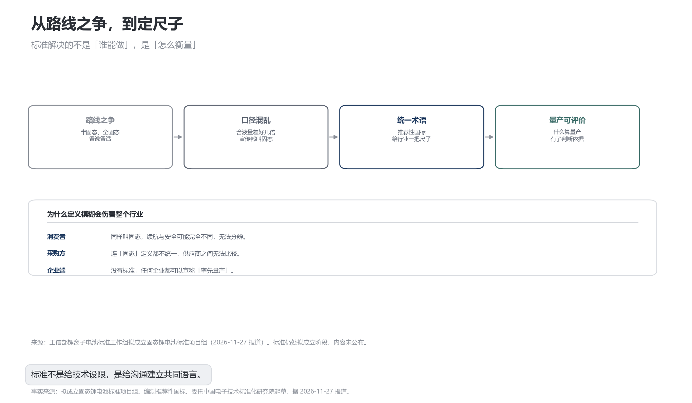
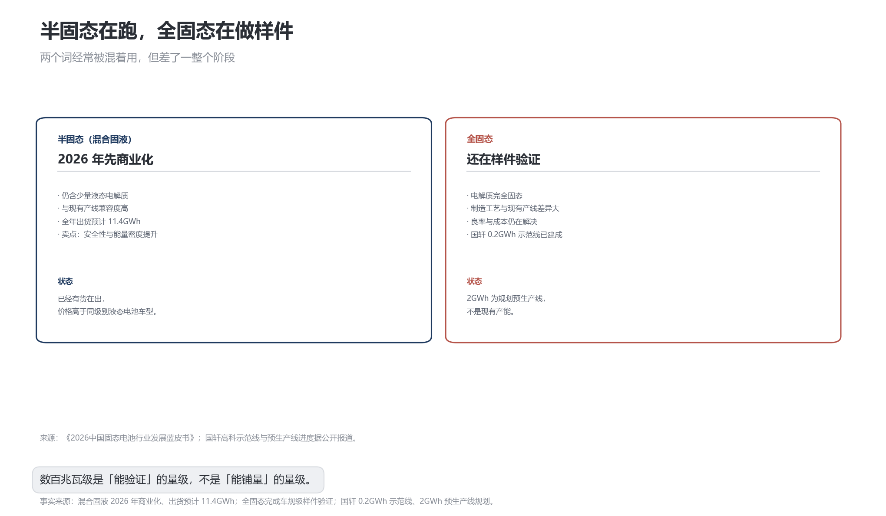
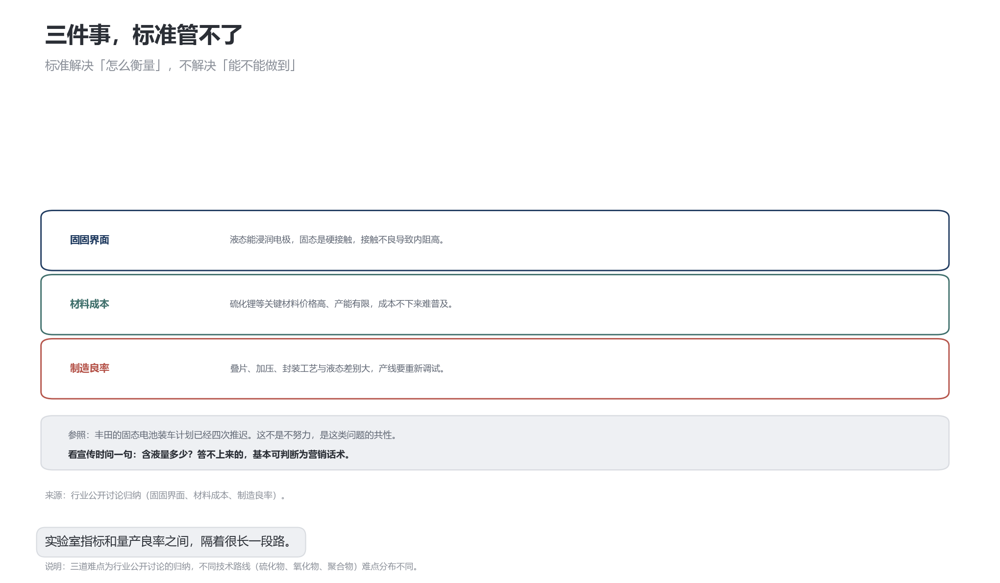

# 固态电池要定标准了，先解决"什么才算固态"

2026 年 11 月 27 日，一条行业消息引起不少关注：工信部锂离子电池标准工作组拟成立"固态锂电池标准项目组"，编制推荐性国家标准，委托中国电子技术标准化研究院起草。

很多人看到"标准"两个字就划过去了。但这件事解决的是一个很实际的问题：

**过去两年，市面上叫"固态电池"的东西，其实不是同一种东西。**

有的含液量 10%，有的 5%，有的接近 0。它们的性能、成本、量产难度差了好几倍，但宣传口径都叫"固态"。

标准要做的第一件事，不是规定谁能做、谁不能做，而是**先把定义说清楚**。

## 一、为什么"定义"这件事这么重要

在技术早期，定义模糊是常态。但模糊到一定程度，会伤害整个行业。

**第一，消费者无法判断。** 同样宣传"固态电池"，续航、充电速度、安全性可能完全不同。用户没有能力分辨，只能靠厂家说什么。

**第二，企业无法比较。** 采购方要评估供应商，第一步是知道对方的产品处在什么水平。如果连"固态"的定义都不统一，比较就无从谈起。

**第三，量产无法评价。** 一条产线跑出来的电芯，算不算"实现了固态电池量产"？按什么标准判断？没有标准，任何企业都可以宣称自己"率先量产"。

**所以标准不是给技术设限，是给沟通建立共同语言。**

这一点在别的行业也验证过。光伏的转换效率、动力电池的能量密度，都是先有统一的测试标准，行业才能横向比较、才能形成真实的竞争。

## 二、"推荐性"国标意味着什么

要注意，这次编制的是**推荐性**国家标准，不是强制性。

两者的区别很实际：

**强制性标准**是底线，不满足就不能生产、不能销售。比如电动自行车的整车安全标准。

**推荐性标准**是参照，企业可以自愿采用。但一旦采用，就要按标准执行；而且在招标、认证、政府采购中，推荐性标准往往会被作为依据。

所以推荐性国标的作用是"软约束"：它不禁止谁，但它会让市场形成一把公认的尺子。**不按这把尺子说话的企业，会在采购和宣传上吃亏。**

而且固态电池现在还在技术演进期，定义可能还会调整。这时候用强制性标准反而不合适——容易把技术路线锁死。

## 三、现在的产业现实：半固态在跑，全固态在做样件

这是最容易被宣传混淆的地方。

按《2026中国固态电池行业发展蓝皮书》的表述：**混合固液（半固态）2026 年率先商业化，全年出货预计 11.4GWh；全固态完成车规级样件验证。**

两个词要分清：

**半固态**，是液态电解质含量降低（但仍有），配合固态材料提升安全性和能量密度。它的工艺与现有产线兼容度高，所以能先量产。

**全固态**，是电解质完全固态，理论上能量密度更高、安全性更好。但它的制造工艺与现有产线差异大，良率和成本都还在解决中。

设备端的进展可以印证这个阶段：利元亨今年交付了数百兆瓦级的全固态电池整线，客户拿去做量产前验证。**数百兆瓦级，是"能验证"的量级，不是"能铺量"的量级。**

国轩高科的金石二代完成了 0.2GWh 示范线，计划建 2GWh 预生产线。0.2GWh 到 2GWh，是从"示范"到"预生产"的一步，但离真正的规模化还有距离。

材料端也在动：上海洗霸百吨级硫化锂产线调试完成，厦钨新能高纯硫化锂进入试生产。硫化锂是硫化物路线的关键原料，它的产能决定了下游能走多远。

## 四、技术上的三道坎，标准解决不了

必须说清楚：**标准解决的是"怎么衡量"，不解决"能不能做到"。**

目前全固态电池的三道坎：

**第一，固固界面接触。** 液态电解质能自然浸润电极，固态电解质和电极之间是硬接触，接触不良会导致内阻升高、循环寿命下降。这是最基础也最难的问题。

**第二，材料成本。** 硫化锂等关键材料的价格仍然很高，而且产能有限。成本不下来，全固态只能用在价格不敏感的场景。

**第三，制造良率。** 固态电池的制造工艺（尤其是叠片、加压、封装）与液态电池差别很大，产线要重新设计调试，良率爬坡需要时间。

行业里有一个值得注意的参照：丰田的固态电池装车计划已经四次推迟。这不是丰田不努力，是这类问题的共性——**实验室指标和量产良率之间，隔着很长一段路。**

## 五、对普通消费者意味着什么

**第一，未来半年到一年，"固态"的宣传会更规范。** 标准出台后，厂家在宣传时必须对应到具体类别（半固态、全固态，或者液态含量多少）。这能减少误导。

**第二，别指望明年就能买到全固态的车。** 按目前的进度，全固态还在样件验证和预生产阶段，真正上车要到 2030 年前后。规划里写的"2030 年初步实现规模化应用"，"初步"和"规模化"两个词都留了余地。

**第三，半固态车型会先多起来。** 11.4GWh 的出货量，对应的是几十万辆车级别的装车量。这类车型的卖点是安全和能量密度提升，但价格会高于同级别液态电池车型。

**第四，看宣传时问一句：含液量多少？** 这是最直接的判断方式。答不上来的，基本可以判断为营销话术。

## 六、三个需要观察的问题

**第一，标准会不会把技术路线锁死？** 推荐性标准的风险在于：一旦成为事实上的唯一尺度，其他路线可能被边缘化。硫化物、氧化物、聚合物三条路线，标准如何兼容，是个考验。

**第二，中国电子技术标准化研究院起草，企业参与度如何？** 标准的质量，取决于起草时吸收了多少一线工程经验。参与的企业越多、越深入，标准越贴近实际。

**第三，标准出台后，"伪固态"会不会消失？** 短期内会收敛，但只要有宣传空间，模糊表述就会以新的形式出现。**标准能管住术语，管不住话术。**

**一句话总结：这次不是技术突破，是行业开始给自己立规矩。** 一个行业从"讲故事"走向"讲标准"，通常意味着它开始认真对待量产了。

---

*事实来源：工信部锂离子电池标准工作组拟成立"固态锂电池标准项目组"，编制推荐性国家标准，委托中国电子技术标准化研究院起草——据腾讯新闻、新浪财经 2026-11-27 报道。《2026中国固态电池行业发展蓝皮书》：混合固液 2026 年率先商业化、全年出货预计 11.4GWh，全固态完成车规级样件验证。利元亨今年交付数百兆瓦级全固态电池整线；国轩高科金石二代完成 0.2GWh 示范线、计划建 2GWh 预生产线；亿纬锂能开发脑机接口固态电池——据上海证券报、中国网 2026-11-26 至 27 日报道。上海洗霸百吨级硫化锂产线调试完成、厦钨新能高纯硫化锂试生产——据国泰海通、能源发展网 2026-11-27。固固界面接触不良致内阻高、硫化锂成本高；丰田装车计划四次推迟——据中国网 2026-11-27 引述行业人士表述。*

*需说明四点。其一，标准项目组目前处于"拟成立"阶段，标准名称、适用范围、技术指标均未公布，本文所述为方向性判断，具体内容以正式立项文件与标准文本为准。其二，11.4GWh 为行业蓝皮书的预测值，属预期性数据，实际出货可能偏差；0.2GWh 示范线与 2GWh 预生产线分别为已建成与规划状态，不可等同。其三，本文关于三道技术难点的表述，为行业公开讨论的归纳，不针对任何具体企业的技术路线；不同路线（硫化物、氧化物、聚合物）的难点分布不同。其四，本文为产业与标准的公开信息分析，不构成对任何企业、技术路线或证券的投资判断，也不构成购车建议。*
