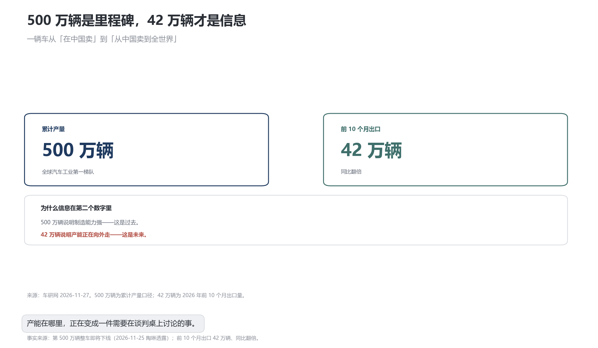
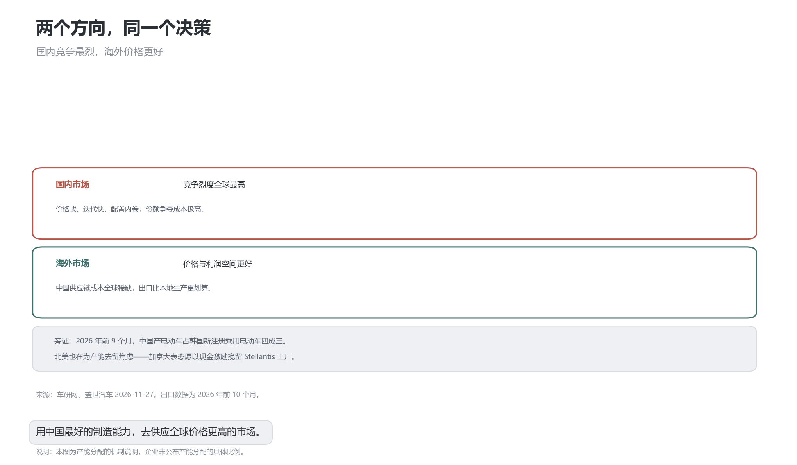
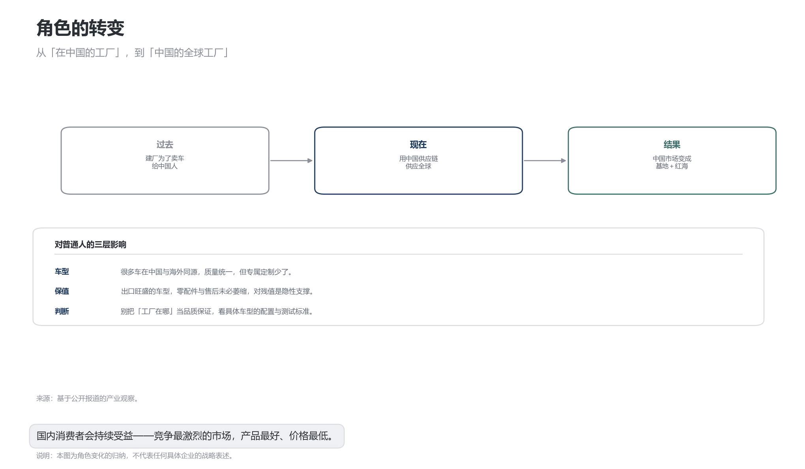

# 上海工厂 500 万辆下线，这厂越来越像出口基地

2026 年 11 月 25 日，特斯拉公司副总裁陶琳透露了一个数字：上海超级工厂第 500 万辆整车即将下线。

同时披露的还有一个更值得看的数字：该工厂 2026 年前 10 个月出口 42 万辆，同比翻倍。而同期，零售端持续承压，产能结构明显向出口倾斜。

**500 万辆是里程碑，42 万辆才是信息。**

一辆车从"在中国卖"到"从中国卖到全世界"，中间是一次角色转变。这件事对理解整个中国汽车产业，比 500 万这个数字有用得多。

## 一、500 万辆是什么概念

一座工厂累计生产 500 万辆整车，在全球汽车工业史上属于第一梯队。

这个数字的意义不只是产量，更是**制造体系的成熟度**：供应链的响应速度、产线的节拍稳定性、质量的一致性、工人的熟练度，都要达到很高的水平，才能支撑这样的累计产出。

而且这个速度不是靠"慢慢积累"实现的。上海工厂从建成投产到 500 万辆，用的时间远短于传统车企的同类工厂——这也是为什么它常被当作"中国制造效率"的样本。

但样本的意义在变化。

## 二、42 万辆出口，改变了什么

前 10 个月出口 42 万辆、同比翻倍，这个增速说明一件事：**这座工厂的产能，正在越来越多地"往外走"。**

为什么？两个原因同时作用。

**第一，国内市场的竞争烈度，已经是全球最高。** 中国新能源车市场的价格战、产品迭代速度、配置内卷程度，都远超其他市场。在这样的市场里，份额争夺的成本极高。

**第二，中国供应链的成本优势，是全球稀缺的。** 电池、电机、电控、零部件，中国的配套体系最完整、成本最低。在中国生产再出口，比在其他地方生产更划算。

**所以逻辑很自然：用中国最好的制造能力，去供应全球价格更高的市场。**

这不是某一家企业的选择。韩国市场的数据可以印证：2026 年前 9 个月，中国产电动车占韩国新注册乘用电动车的四成三。加拿大政府近期表态，愿以现金激励挽留 Stellantis 的布兰普顿工厂——北美也在为产能去留焦虑。

**产能在哪里，正在变成一件需要政府和企业在谈判桌上讨论的事。**

## 三、对中国汽车产业，这意味着什么

**第一，中国正在从"市场"变成"基地"。** 过去外资来中国，主要是为了卖车给中国人。现在越来越多的产能，是为了供给全球。这两个定位，对产业的影响完全不同：前者带来销量，后者带来就业、税收和供应链升级。

**第二，出口会越来越重要。** 当国内市场进入存量竞争，出口就成了消化产能的主要出口。这也是为什么最近两年，中国汽车出口的数据一直很受关注。

**第三，贸易摩擦会成为常态。** 出口越多，遇到的关税、反补贴调查、本地化要求就越多。欧盟的混动配额、电池法规，都是这个逻辑下的产物。

**第四，国内消费者会持续受益。** 竞争最激烈的市场，产品最好、价格最低。这是中国车市当下的现实——也是所有跨国车企必须面对的现实。

## 四、对普通人，三层现实意义

**第一，你买到的车，可能是"全球车型的中国版本"。** 因为供应链统一、平台统一，很多车型在中国和海外是同源的。这对质量是好事，但对"专属定制"的期待要降低。

**第二，保值率会受出口影响。** 如果一个车型在中国销量下滑但出口旺盛，它的零配件供应和售后网络未必会萎缩——因为全球还有需求。这对二手车残值是个隐性支撑。

**第三，别把"工厂在哪"当成"品质保证"。** 同一座工厂可能同时供应多个市场，执行不同的标准。买车时看具体车型的配置与测试标准，比看"产地"更有意义。

## 五、三个需要观察的问题

**第一，出口的天花板在哪？** 42 万辆的增速能持续多久，取决于目标市场的接受度和贸易政策。欧洲的关税、北美的准入，都是变量。

**第二，国内份额会不会继续让？** 当产能向外倾斜，国内的市场份额就会承压。这是一个主动的战略选择，还是被动结果，取决于企业的判断。

**第三，其他外资会不会跟进？** 如果"在中国制造、向全球出口"这条路跑通了，其他跨国车企大概率会复制。到那时，中国作为"全球汽车制造基地"的地位会更稳固。

**一句话总结：500 万辆证明了中国制造的能力，42 万辆出口说明这种能力正在被重新定价。** 前者是过去的成绩，后者是未来的方向。

---

*事实来源：特斯拉公司副总裁陶琳 2026-11-25 透露上海超级工厂第 500 万辆整车即将下线；该工厂 2026 年前 10 个月出口 42 万辆、同比翻倍，零售端持续承压，产能结构明显向出口倾斜——据车研网 2026-11-27 报道。2026 年前 9 个月中国产电动车占韩国新注册乘用电动车四成三；加拿大表态愿以现金激励挽留 Stellantis 布兰普顿工厂——据盖世汽车 2026-11-27 报道。*

*需说明四点。其一，500 万辆为累计产量口径，具体下线时间与统计范围以企业官方披露为准；"即将下线"为截至 2026-11-25 的状态表述。其二，42 万辆为 2026 年前 10 个月出口量，同比翻倍为增速表述，具体基数为上年同期，本文未逐一列出月度数据。其三，本文关于"产能结构向出口倾斜"的判断，依据公开报道中"零售端承压、出口翻倍"的对比，属趋势性描述，企业未公布产能分配的具体比例。其四，本文为产业格局的公开信息分析，不构成对任何企业、品牌或证券的投资判断，也不构成购车建议。*
