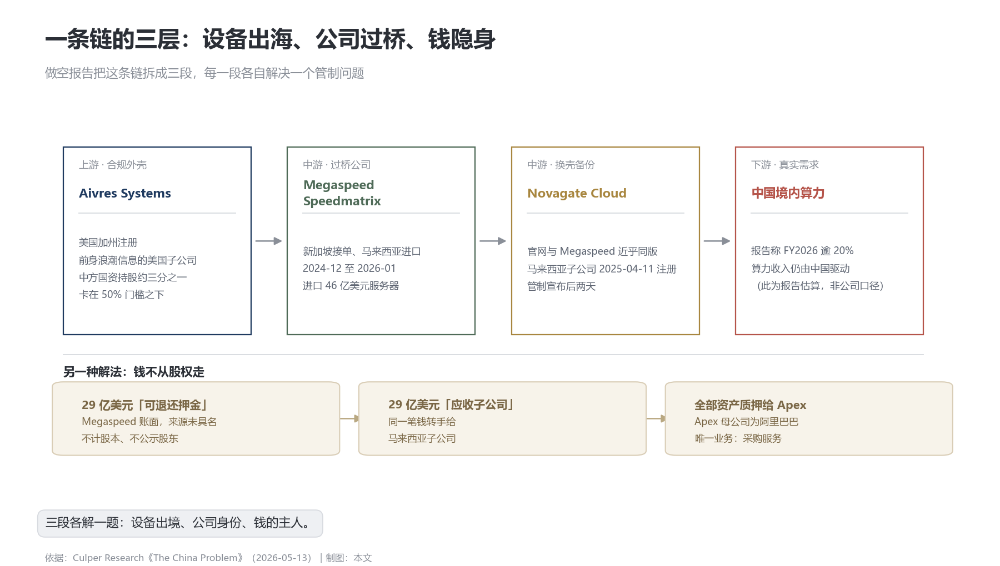
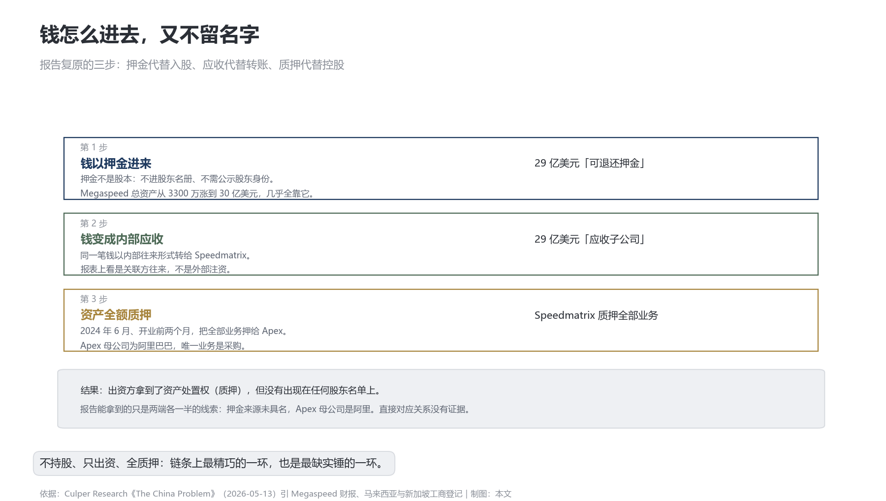
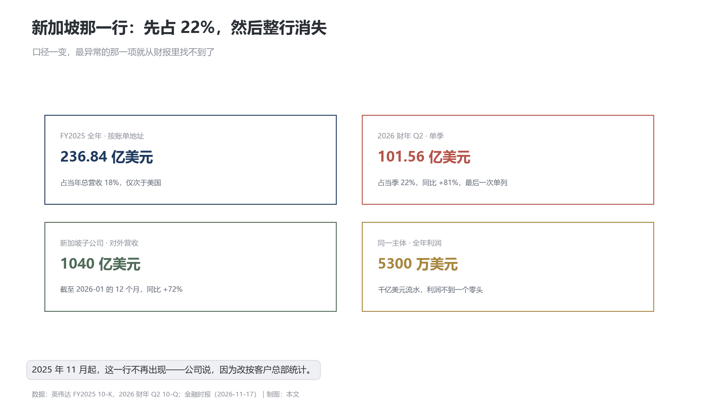
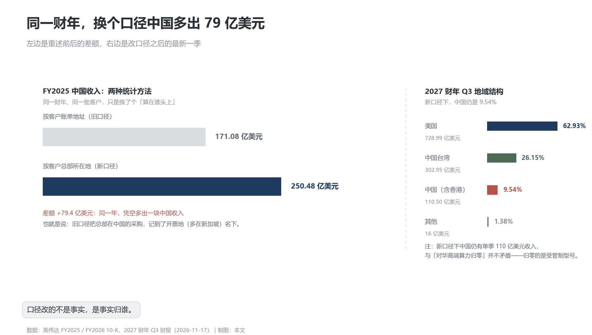
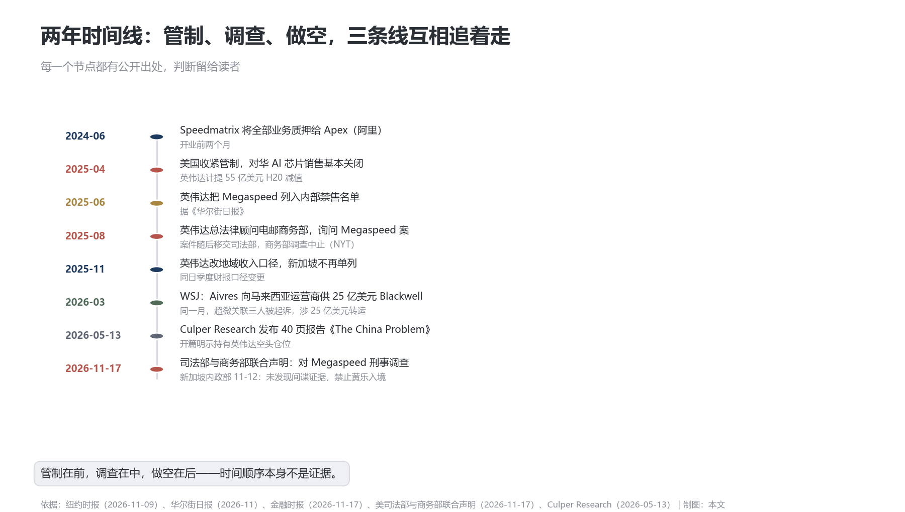
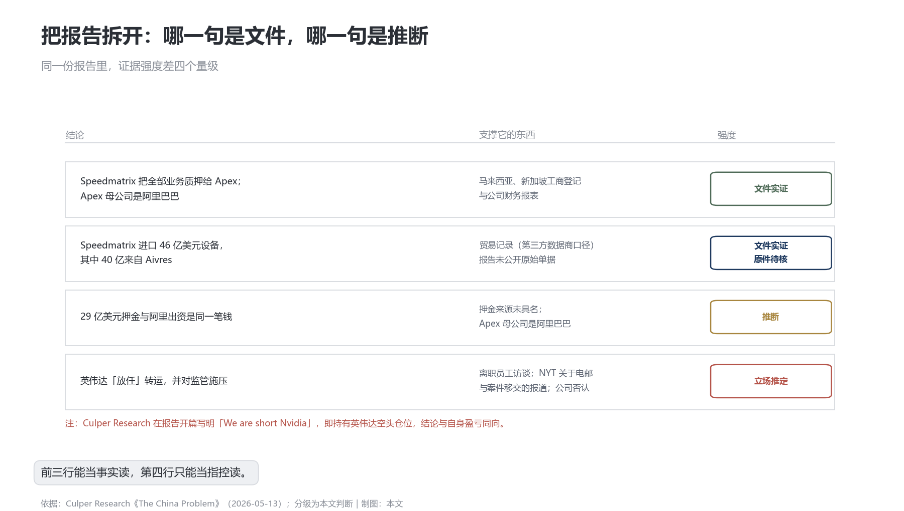

# 中国归零了，新加坡那一行却先消失：拆一份 40 页做空报告的推演与它的边界

2025 年 10 月，黄仁勋在 Citadel Securities 的一场活动上说得很干脆：英伟达在中国的算力业务"此刻 100% 退出"，份额从 95% 掉到 0。

一年之后，2026 年 11 月 17 日那份季报里，中国（含香港）仍贡献 110.50 亿美元收入，占 9.54%。同一份季报里，另一个名字不见了：新加坡。

这两件事并不矛盾。前者说的是受管制的高端算力，后者是把"这笔钱算在谁头上"的规则换了一遍。但放在一起，它们刚好凑成一份做空报告想让读者相信的那件事：账面上的归零，和实际发生的流向，可能不是同一件事。

这篇文章要做的不是复述那条链条，而是把这份报告的推演拆开——哪一句背后是工商登记和财务报表，哪一句是推论，哪一句只是立场。

## 一、先说来历：一份自己承认在做空的报告

[Culper Research 的《The China Problem》](https://culperresearch.com/wp-content/uploads/2026/05/Culper_NVDA_5-13-2026.pdf)，2026 年 5 月 13 日发布，40 页。原站有防护，正文可通过 [HedgeFundAlpha 的全文转载](https://hedgefundalpha.com/stocks/culper-research-short-nvidia-corp/)读到。

报告第一句是什么，很关键：

> "We are short Nvidia." 我们做空英伟达。

它没打算藏。**Culper Research 持有英伟达空头仓位，报告的结论与它自己的盈亏同向。**这句话我放在最前面，因为它决定了后面每一条该怎么读：不是"所以它在撒谎"，而是"所以它只讲了对自己有利的那半边，另外半边要靠别人补"。

它的核心主张有两条：

**第一条，关于过去。** 英伟达说 2025 年 4 月管制收紧后对华业务归零，但报告认为 2026 财年仍有超过 20% 的算力收入由中国需求驱动——一部分来自非法转运，一部分来自东南亚中间商。

**第二条，关于未来。** 华尔街把"中国解禁"当成英伟达的免费看涨期权。报告认为这个前提是错的。

有意思的是第二条的论证方向：它不是说"中国需求藏起来了，将来会爆"，而是说"藏起来的那部分正在消失，而明面上那部分本来就不存在"。报告称，北京 2025 年底到 2026 年初的政策开始明确挡掉英伟达，转向国产替代，2026 年一季度出货明显下滑，中国大陆运营商反馈"几乎没有订单"。按它的说法，这是"对英伟达财务的巨大打击"。

换句话说，这份报告同时否掉了两种乐观：**既否掉"中国正在偷偷买"，也否掉"中国很快会公开买"。**

## 二、第一层：一个把身份换掉的 OEM

链条上游是一家美国人不太熟、中国人很熟的公司：Aivres Systems。

它的前身是 Inspur Systems，浪潮信息在美国的子公司。母公司浪潮集团被美国列入实体清单之后，这家美国子公司改了名字、重整了股权——注册地仍在加州，中方国资持股约三分之一，刚好落在 50% 关联方认定门槛之下。

这个位置的巧妙之处在于：**它出口的是美国公司的产品，卖给的是非受限的境外客户。**从报关单看，这只是一笔正常的美国出口生意。

报告援引的贸易记录称，2024 年 12 月到 2026 年 1 月，马来西亚的 Speedmatrix 进口了 46 亿美元货物，其中 40 亿美元来自 Aivres。此外，Aivres 还经由印尼运营商 Indosat 供货给上海的 INF Tech，其创始人曾任阿里巴巴副总裁。

2026 年 3 月，《华尔街日报》报道了另一条：Aivres 将向一家马来西亚运营商供应价值 25 亿美元的 Blackwell 芯片，这些服务器随后租给字节跳动——约 500 套系统、3.6 万颗 B200。英伟达对此的回应是：不反对，交易符合美国出口管制。

这里要把一件事说清楚：**报告并没有指控 Aivres 违法。**它说的是"实质上仍是一条中国专用通道"，这是判断，不是文件。截至目前，没有任何官方机构认定 Aivres 违规。

## 三、第二层：东南亚的过桥公司

中间这一层，是整条链上最像"正常生意"的一段，也是最难看懂的一段。

核心主体是新加坡的 Megaspeed。它一度是英伟达在东南亚最大的买家之一，也是美国商务部和新加坡方面同时盯着的对象。报告的着力点在股权历史：Megaspeed 对外声称"完全由境外主体持有、没有中国股东"，但 2023 年它经历过一轮多层离岸腾挪——由黄乐（Alice Huang）实际控制，转入一家英国离岸公司并更名，最后划归一家新成立的新加坡公司。官方回应只确认"当前的股权结构"，对历史变更不予置评。

紧接着是"换壳"的痕迹。一家叫 Novagate Cloud 的新加坡公司在新注册，官网与 Megaspeed 近乎同版，一名董事的地址与 Megaspeed 总部相同；它的马来西亚子公司注册于 2025 年 4 月 11 日——管制宣布之后两天。技嘉（Giga Computing）向 Speedmatrix 与 Novagate 合计出口了超过 5 亿美元的 H200 与 Blackwell 服务器。

还有一条更侧面但更有意思：2025 年 10 月，英伟达合作方 YTL AI Cloud 在马来西亚柔佛启用了一座 43 亿美元的数据中心。据一名在职员工说，Megaspeed 是 YTL"最重要的客户之一"，但双方刻意不公开关系，理由是"不想引起媒体注意，打乱他们在数据中心上的计划"。

而拆掉这层关系的，是另一家数据中心运营商。报告称，上月贝恩旗下的 Bridge Data Centres 把 Megaspeed 清退，未说明理由；一名知情人士的说法是，BDC 发现 Megaspeed 把机房当作"安装样机的地方"，并"把硬件调走"。

"dummy servers"这个词是全篇最有画面感的一句，也是最难证的一句——它来自一个匿名消息源，没有任何书面材料。

## 四、第三层：钱怎么进去，又不留名字

这是整份报告里我最愿意承认"精巧"的一节，也是我认为最缺实锤的一节。

Megaspeed 的资产负债表提供了一个入口：2023 年底总资产 3300 万美元，2024 年底变成 30 亿美元总负债及权益。撑起这个变化的，是一笔 29 亿美元的"可退还押金"（refundable deposits received），来源未具名。同一时期，报表上还挂着 29 亿美元的"应收子公司"——这笔钱被转手给了 Speedmatrix。

押金这个工具的好处是双重的：它不是股本，所以不进股东名册，也不需要公示股东身份；它是"可退还"的，所以将来退出时也不用走股权转让。

钱进来之后，怎么保障出资方的安全？答案是质押。2024 年 6 月，开业前两个月，Speedmatrix 在马来西亚办了一份抵押登记，把全部业务质押给 Apex Enterprise Solutions（新加坡）。新加坡工商信息显示，Apex 的母公司是阿里巴巴，其唯一业务写明为"提供采购服务"；截至 2025 年 3 月 31 日，Apex 报表上是 41 亿美元的预付款，对应 42 亿美元对阿里巴巴的借款。

到这一步，设计意图已经很清楚：**出资方拿到了资产处置权，但没有出现在任何股东名单上。**

但证据到这里就断了。报告能拿到的，只是两端各一半的线索——押金的来源是"未具名"，Apex 的母公司是阿里。至于"这 29 亿就是阿里出的"，是从两端倒推出来的关联，报告自己也没有直接证据。

顺带纠正一处流传较广的说法：**"新加坡工商信息显示 Apex 母公司是阿里"是登记信息，属于硬证据；"押金等于阿里出资"是推断，两者不能混着用。**这是读懂这份报告最重要的一条分界线。

## 五、英伟达这一侧：口径与监管，两个动作

先看口径。

2025 年 11 月（2026 财年第三季度）起，英伟达把地域收入的统计方法从"客户账单地址"改成了"直接客户总部所在地"。结果是新加坡这一行不再单列。

改动之前的数字是这样的：2025 财年，按账单地址，新加坡贡献 236.84 亿美元，占全年 18%，是仅次于美国的第二大来源；2026 财年第二季度（截至 2025 年 7 月 27 日）单季 101.56 亿美元，占 22%，同比 +81%，这是最后一次单列。下一个季度，新加坡从地域拆分里消失，只剩下美国、中国台湾、中国、其他四项。

更值得看的是重述的效果：同一个 2025 财年，中国收入从 171.08 亿美元变成 250.48 亿美元，凭空多出 79.4 亿。这说明旧口径下，一批总部在中国的采购，被记在了开票地（多在新加坡）名下。

而最新的一个季度（2027 财年第三季度，2026 年 11 月 17 日公布），结构已经变成：美国 62.93%、中国台湾 26.15%、中国（含香港）9.54%（110.50 亿美元）、其他 1.38%。

这里必须插入一条对报告最不利的事实，而且它是英伟达自己披露的：**在以账单地址统计的最后一个季度，英伟达写明，在新加坡开票的受出口管制的数据中心算力收入中，超过 99% 来自美国客户的订单。**

这句话如果成立，新加坡那一行更像开票枢纽，而不是转运证据。它也顺带解释了改口径之后美国占比为什么跳到六成以上——那些美国客户的订单，被算回了美国。

所以口径这件事，两种解释都站得住：往好里说，新口径更贴近真实客户归属，旧口径确实会把美国订单算到新加坡；往坏里说，新口径同时抹掉了最异常的一行，时点又刚好卡在 Megaspeed 进入调查视野之后。哥伦比亚大学会计学教授 Shiva Rajgopal 对《财富》的说法是："时点很巧"，但"这些只是财务报表，没有违法，而且披露了"。

还有一条独立线索，是这份报告没写、也无法写的：据《金融时报》查阅的公司账目，英伟达新加坡子公司在截至 2026 年 1 月的 12 个月里对外营收约 1040 亿美元、同比 +72%，而全年利润只有 5300 万美元。千亿美元的流水，和不到一个零头的利润，这个组合本身就需要解释。

再看监管路径。

据《纽约时报》2026 年 11 月 9 日报道，美国商务部对 Megaspeed 的调查进行了数月，2025 年 8 月，英伟达总法律顾问 Tim Teter 向商务部调查人员发了一封电子邮件，询问这起调查的信息；此后案件被移交司法部，商务部的调查随之中止。2025 年 6 月，英伟达已把 Megaspeed 列入内部禁售名单——这条来自《华尔街日报》。

2026 年 11 月 17 日，美国司法部与商务部发布联合声明，确认对 Megaspeed 展开刑事调查。同一天前后，新加坡内政部公布了自己的结论：自 2025 年 2 月起调查 Megaspeed 与黄乐，未发现间谍活动的充分证据，但禁止黄乐再入境。

把这几条放在一起看：**"英伟达过问案件"是报道事实，"英伟达因此让调查中止"是推论，两者之间隔着一个"为什么移交"。**司法部接手不等于案件消失，2026 年 11 月的联合声明恰恰说明它没有消失。

## 六、把推演拆开：哪一句能当事实读

时间顺序是这样的：质押在前（2024 年 6 月），管制在中（2025 年 4 月），封禁名单与口径改动在后（2025 年 6 月、11 月），做空报告再后（2026 年 5 月），独立媒体的调查报道与官方刑事调查在最后（2026 年 11 月）。

顺序本身不是证据。但这套顺序说明一件事：**报告写于 2026 年 5 月，它不可能知道 11 月的这些进展；而这些后续的独立报道，补强的是它的事实层，不是它的结论层。**

按证据强度分开看，我认为可以这样排：

**最硬的一层**，是质押与 Apex 的股权链。马来西亚的抵押登记、新加坡的工商信息、Apex 的财务报表，都是可以查、可以引的书面材料，而且它们之间互相咬合：一个要进口几十亿美元设备的子公司，开业前把全部资产押给一家"只做采购"的公司，这家公司的母公司是阿里，账上还有 41 亿美元预付款。这个结构不需要任何解释就已经很反常。

**次一层**，是贸易记录里的那组数字：46 亿美元进口、40 亿来自 Aivres。这类数据来自第三方贸易数据商，报告没有公开原始单据，也没有说明统计口径。

**再下一层**，是"押金＝阿里出资"。两端各一半线索，中间那一段是空的。

**最软的一层**，是"英伟达放任转运、并对监管施压"。这一层的支撑是离职员工访谈加媒体报道；公司的公开立场一直是"反复测试抽样、未发现转运"。一个人说"业内都知道"，在法庭上不算证据。

## 七、对投资逻辑的冲击，其实不在"违法"两个字上

多头对英伟达的中国业务有一个很舒服的假设：现在归零，一旦放开，就是几百亿美元的增量，等于一张免费的看涨期权。

这份报告想拆的正是这张期权。它的逻辑是：如果中国的需求这一年一直通过灰色通道被满足，那么"解禁"带来的就不是增量，而是把已经发生的销售换个记账方式；更糟的是，北京现在正在主动关门，那么"解禁"甚至可能什么都带不来。

两条路都通向同一个结论：**中国这块收入的"确定性"，比财报上看起来要低。**

而这一点，其实不依赖任何一方的定性。无论最终认定是转运、是开票枢纽、还是完全合规，投资者面对的都是同一个问题：一家公司在一年里把第二大收入来源国从报表上整行撤掉，同时改了统计规则，这件事本身就是披露质量的问题，而不是法律问题。

对做空方来说，这也够用了。它不需要证明英伟达违法，只需要让"中国=免费期权"这个共识变得需要解释。

## 八、边界：这份报告不能证明什么

- **没有任何官方定性。** 美国官方仍在调查，尚未有最终结论；新加坡方面明确表示未发现间谍证据。
- **没有主体被认定违法。** Aivres 未被任何机构认定违规；报告本身也只主张"通道"，不主张"犯罪"。
- **阿里巴巴没有被定论。** 公开报道中未见其对报告具体指控的逐条回应，报告指向它的证据是登记信息加倒推。
- **Megaspeed 否认不当行为**，其官网挂有声明。
- **本文保留但标注的一处：**视频里那组价差——美国出厂约 55 万美元一套 8 卡整机、深圳现货报到 2000 万元人民币——我没有找到可核实的公开出处，它只能当作"暴利驱动"的直观说法，不能当数据用。
- **最后一条，也是最先说的那条：**Culper Research 持有英伟达空头仓位。这份报告是一份有立场、有盈亏的指控书，不是审计报告。

---

一条链能不能成立，最终不取决于它讲得多顺，而取决于中间那段空白能不能被填上：那 29 亿美元究竟是谁的钱。

在它被填上之前，能确定的只有两件事：英伟达报表上新加坡那一行确实消失了，而中国需求确实没有消失——它只是换了个地方被记账。

---

*事实来源：做空报告为 Culper Research《The China Problem》，2026 年 5 月 13 日发布，40 页，开篇明示"We are short Nvidia"（[PDF 原文](https://culperresearch.com/wp-content/uploads/2026/05/Culper_NVDA_5-13-2026.pdf)，正文可经 [HedgeFundAlpha 全文转载](https://hedgefundalpha.com/stocks/culper-research-short-nvidia-corp/)阅读），其中 Megaspeed 资产负债表（2023 年底 3300 万美元→2024 年底 30 亿美元，含 29 亿美元可退还押金与 29 亿美元应收子公司）、Speedmatrix 2024 年 6 月向 Apex Enterprise Solutions 的全业务质押、Apex 母公司为阿里巴巴及其"提供采购服务"的唯一业务、截至 2025-03-31 的 41 亿美元预付款与 42 亿美元对阿里借款、2024-12 至 2026-01 的 46 亿美元进口（其中 40 亿来自 Aivres）、技嘉向 Speedmatrix 与 Novagate 合计逾 5 亿美元出口、Novagate 马来西亚子公司 2025-04-11 注册、YTL AI Cloud 柔佛 43 亿美元数据中心、BDC 清退 Megaspeed 与"dummy servers"说法、英伟达与中国需求相关的 20% 以上估算，均出自该报告。地域收入口径：英伟达 2025 年 11 月（2026 财年第三季度）起将地域拆分由"客户账单地址"改为"直接客户总部所在地"，新加坡不再单列；2025 财年按账单地址新加坡 236.84 亿美元、占 18%，2026 财年第二季度（截至 2025-07-27）新加坡 101.56 亿美元、占 22%、同比 +81%，为最后一次单列，同季披露新加坡开票的受管制数据中心算力收入中逾 99% 来自美国客户订单——口径与数字据英伟达 10-Q／10-K、[《财富》](https://fortune.com/2026/11/12/nvidia-changed-earnings-report-format-singapore-revenue-megaspeed-probe-colette-kress/)（2026-11-12）、《华尔街日报》与 [BlockBeats](https://www.theblockbeats.info/flash/377882)（2026-11-18）转述的财报原文。2025 财年中国收入旧口径 171.08 亿美元、新口径 250.48 亿美元——据英伟达 2025／2026 财年 10-K 同年度对比。2027 财年第三季度（2026-11-17 公布）地域结构：美国 62.93%（728.99 亿美元）、中国台湾 26.15%（302.95 亿美元）、中国含香港 9.54%（110.50 亿美元）、其他 1.38%（16 亿美元）。新加坡子公司截至 2026 年 1 月的 12 个月对外营收约 1040 亿美元、同比 +72%、利润 5300 万美元——据[《金融时报》经长桥转载](https://longbridge.com/zh-CN/news/305867353)（2026-11-17）。监管线：英伟达总法律顾问 Tim Teter 于 2025 年 8 月电邮商务部调查人员询问 Megaspeed 案、案件随后移交司法部、商务部调查中止——据[《纽约时报》](https://cn.nytimes.com/usa/20261110/nvidia-megaspeed-investigation-huang/)（2026-11-09）；2025 年 6 月英伟达将 Megaspeed 列入内部禁售名单——据《华尔街日报》；2026-11-17 美国司法部与商务部[联合声明](https://www.justice.gov/opa/pr/joint-statement-department-commerce-and-department-justice-megaspeed-investigation)确认对 Megaspeed 刑事调查；新加坡内政部 2026-11-12 公布自 2025 年 2 月起对 Megaspeed 与黄乐的调查未发现间谍活动充分证据、禁止黄乐再入境（[原文](https://www.mha.gov.sg/media-room/newsroom/singapore-investigations-into-alice-huang-huang-le-and-megaspeed-international-pte-ltd/)）。Aivres 向马来西亚运营商供应 25 亿美元 Blackwell、服务器租予字节跳动——据[《华尔街日报》](https://www.wsj.com/tech/chinas-bytedance-gets-access-to-top-nvidia-ai-chips-d68bce3a)（2026-03-13）。2025 年 4 月管制收紧后英伟达计提 55 亿美元 H20 减值、预计约 80 亿美元 H20 收入损失——据英伟达披露与彭博报道。文中「这个结构不需要任何解释就已经很反常」「中国这块收入的确定性比财报上看起来要低」「报告补强的是事实层而不是结论层」「前三层能当事实读，第四层只能当指控读」等判断为作者观点，非报告原文或官方口径；「新加坡那一行消失」指地域收入拆分中不再单列新加坡；视频所称「美国出厂 55 万美元／深圳现货 2000 万元人民币」的价差未获可核实公开出处，仅作直观说法保留。*
