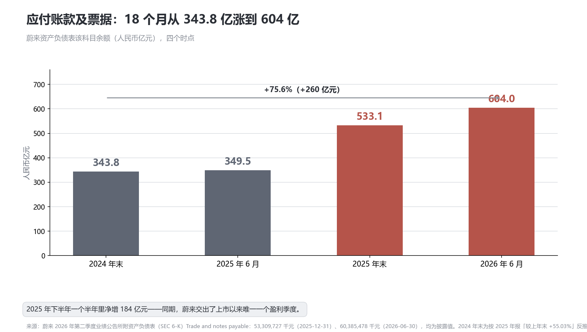
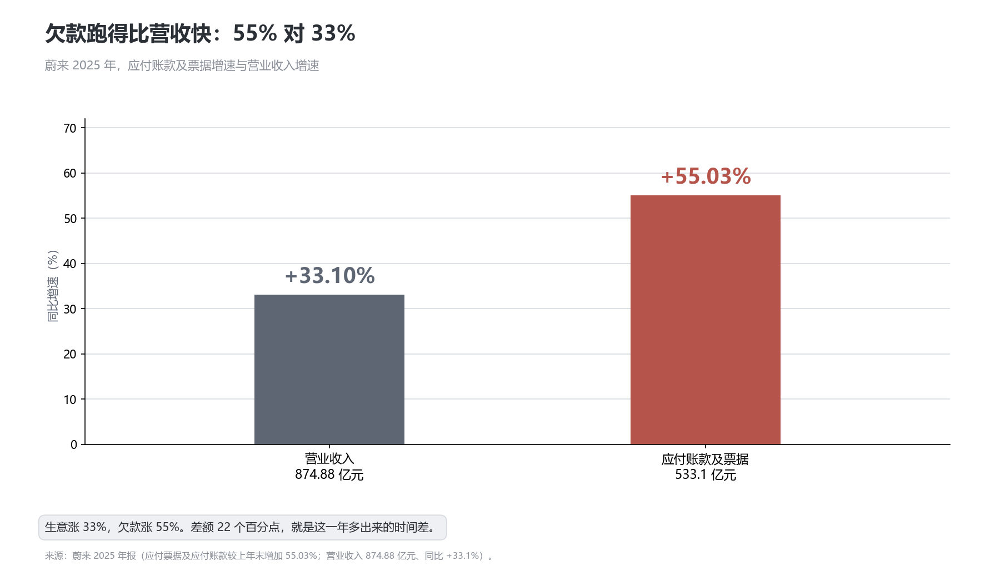
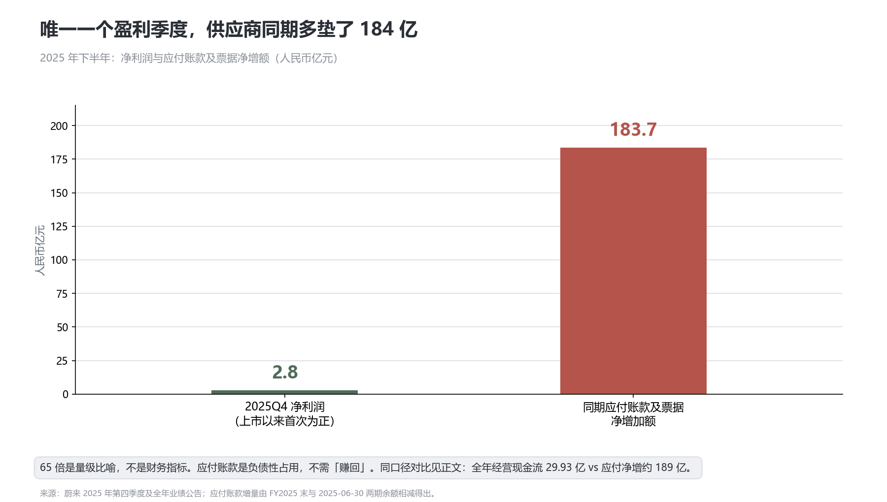
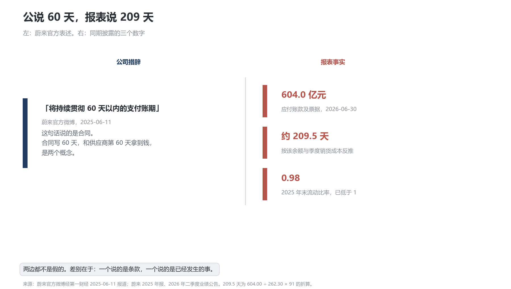
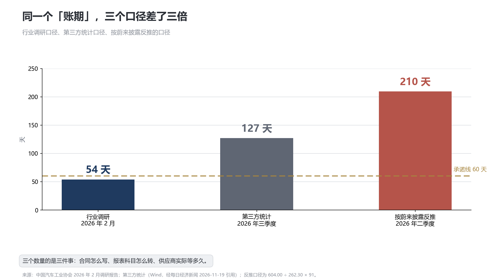
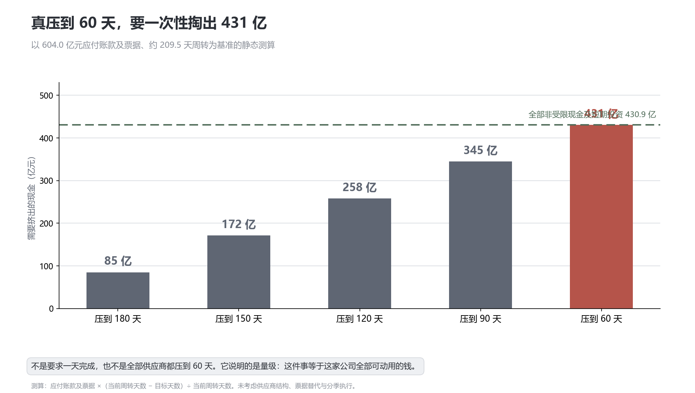
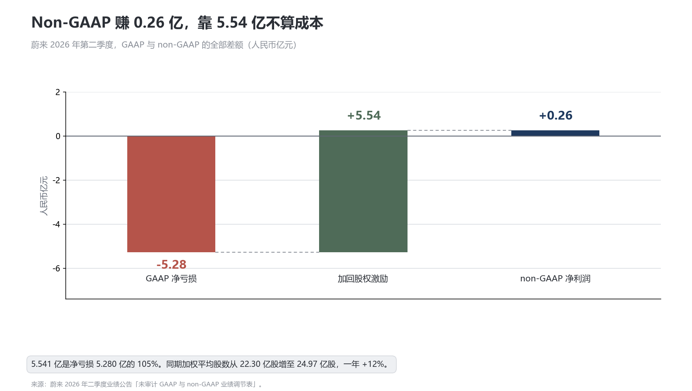
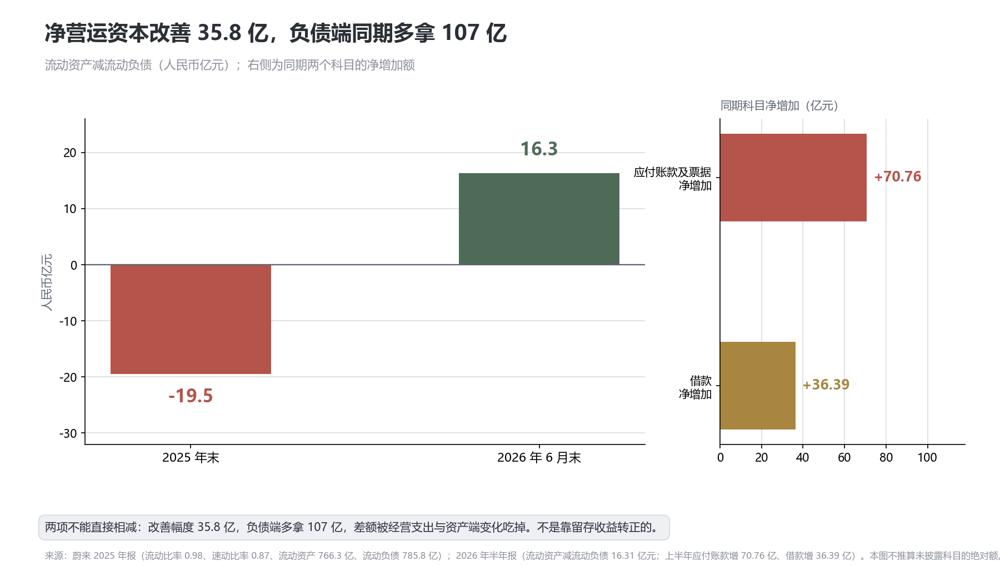
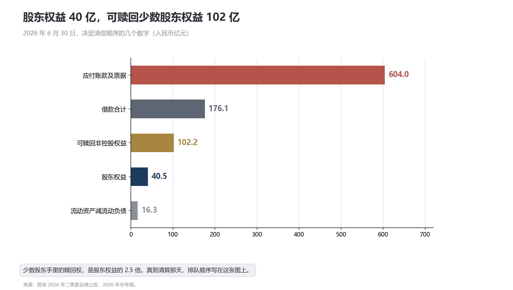
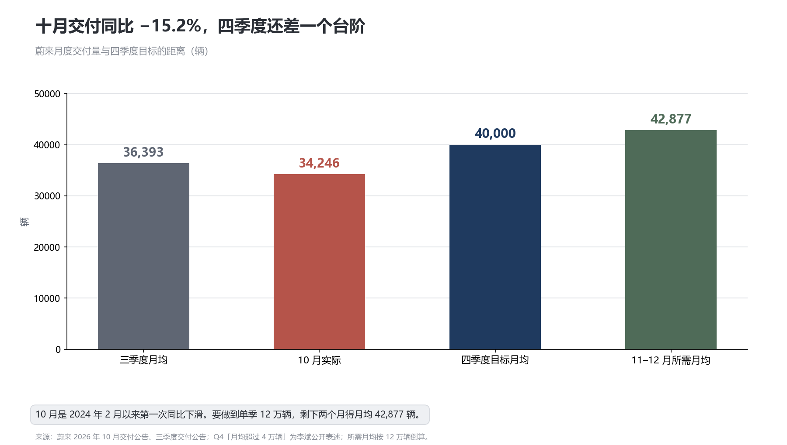

# 蔚来的亏损在缩小，欠供应商的钱在变大

## 一句话

蔚来把 2026 年定为"Non-GAAP 全年盈利"的一年。这篇文章只问一个问题：**如果一家公司的亏损总体在收窄、可欠供应商的钱涨得比营收还快，那么"经营改善"这四个字，到底改善了什么？**

先给答案：改善的是现金流的时间差。而这笔时间差，2027 年 1 月 31 日要被写进一份报告，交给工信部委托的第三方机构。

---

## 两条曲线

先看两组数，都是蔚来自己披露的。

**亏损，总体上在收窄：**

| 年度 | 合并净亏损 |
|---|---|
| 2023 | 207.2 亿元 |
| 2024 | **226.6 亿元（同比扩大 9.4%）** |
| 2025 | 155.7 亿元（同比收窄 31.3%） |

亏损不是三年一路收窄：2024 年是扩大的一年，2025 年才明显收窄。这一点写清楚，比含糊地讲"连续三年收窄"诚实。

**应付账款及票据，一路向上：**

| 时点 | 余额 |
|---|---|
| 2024 年末 | 约 343.8 亿元（推算） |
| 2025 年 6 月末 | 349.5 亿元（第三方统计） |
| 2025 年末 | **533.1 亿元（已披露）** |
| 2026 年 6 月末 | **604.0 亿元（已披露）** |

表里 533.1 亿和 604.0 亿是蔚来 2026 年第二季度业绩公告（SEC 6-K 附件）资产负债表原文，科目名「Trade and notes payable」：2025 年 12 月 31 日为 53,309,727 千元，2026 年 6 月 30 日为 60,385,478 千元。**这两个是披露值，不是推算。**

只有 2024 年末的 343.8 亿是推算：用 533.1 ÷ 1.5503（依据 2025 年报「较上年末 +55.03%」）得出。**这个数用于画趋势线和算区间涨幅（+75.6%），不用于支撑因果判断。** 支撑本文核心论点的，是上面那两个披露值，以及它们半年之间 70.76 亿元的差额——那两笔都是披露值。

从 343.8 亿到 604 亿（2024 年末到 2026 年 6 月末，**18 个月**），增幅 **75.6%**。

拿它跟营收比，必须用同一个时间窗。2025 年单年：营收 874.88 亿元，同比 **+33.1%**；应付票据及应付账款同比 **+55.03%**。**同一个年度里，欠款比营收多涨了 22 个百分点。**

更集中的跳变发生在**一个半年之内**：2025 年下半年，从 349.5 亿涨到 533.1 亿，净增约 **184 亿元**。

而同一个半年里，蔚来交出了上市以来唯一一个盈利季度——2025 年第四季度，净利润 **2.83 亿元**。

这半年的欠款增量，是当季净利润的 65 倍。**这个比值只是用来说明量级差距的比喻，不是财务指标**——应付账款是负债性的资金占用，不需要"赚回来"，只需要续期或周转。真正同口径的对比是下面这一句：

**2025 年全年经营活动现金流净额 29.93 亿元；同年应付账款及票据净增约 189 亿元。** 两个数都是全年的、都是现金流意义上的。也就是说，这一年账面上"造血"将近 30 亿，而同期从供应商那里多占用的资金是将近 190 亿。

---

## 那个盈利季度，钱是从哪省出来的

2025 年第四季度，蔚来在费用端做了三件事：

**研发费用 20.26 亿元，同比 −44.3%。** 全年研发 106 亿元，比 2024 年的 130 亿元少 24 亿，降幅 **18.5%**。

**销售及行政费用 35.37 亿元，同比 −27.5%。**

**全年员工从 4.56 万人减到 3.5 万人，净减 1.06 万人，降幅 23.2%。** 其中产品及软件开发人员从 1.15 万人减到 6,912 人，减幅 **40%**；用户体验部门减 30.8%；行政管理减 29.88%。唯一增加的是制造人员，从 7,441 人增至 9,653 人，+29.73%。

李斌自己的说法是，团队从"大投入"转向"以算账为乐趣"。这话不假，账确实算得很细。

但账算得细，和生意变好，是两件事。**一家把研发人员砍掉四成的公司，当年的利润表会很好看，产品周期会在两年后说话。** 汽车行业的研发投入有个大致的时间账：断崖式下降通常 18 到 24 个月后体现在产品竞争力上。2025 年第四季度往后推 18 个月，是 2027 年年中。

**2027 年，既是产品要交答卷的一年，也是账期评估结果要公布的一年。**

---

## "60 天"这句话，绕开了什么

2025 年 6 月 11 日，蔚来官方微博：「将持续贯彻 60 天以内的支付账期，携手上下游合作伙伴共同促进中国汽车产业高质量发展。」

这句话是真的。它说的是合同。

用蔚来自己的报表反推，2026 年第二季度应付账款周转天数约 **209.5 天**（604.0 亿元 ÷ 季度销货成本 262.30 亿元 × 91 天）。

三个口径摆在一起：

- 中国汽车工业协会 2026 年 2 月调研：重点车企平均账期约 **54 天**
- 第三方统计（2026 年 11 月）：2026 年三季度主流车企应付账款周转天数均值 **127 天**
- 按蔚来披露反推：约 **209.5 天**

54、127、210。三个数量的是三件事：合同怎么写、报表科目怎么转、供应商实际等多久。差了三倍。

这里要交代 209.5 天这个数的脾气：它用 2026 年第二季度单季的销货成本年化得来（262.30 亿 × 4 ≈ 1,049 亿），对单季成本波动很敏感。同一指标本文在正文用 209.5、在图表里写 210，指的是同一个数；而 220 天是第三方统计给出的 2025 年上半年口径，两者时间窗不同，不是同一个数。**这些全部是估算，不是公司披露的付款天数。**

**这三条路，蔚来走哪一条都不舒服：**

如果 60 天是真的，那 604 亿里有一大块是超期的。按 209.5 天压到 60 天，需要一次性挤出 **431 亿元**——约等于它全部非受限现金及短期投资（430.88 亿元）。

如果 210 天是真的，那"持续贯彻 60 天以内"这句公开表述，指向的就只能是合同条款，不是付款事实。

如果 54 天是真的，那行业调研口径和蔚来的实际口径之间隔着四倍，这个差距本身就要解释。

同一套逻辑在利润表上还有一层。"Non-GAAP 盈利"这个说法，2026 年第二季度是靠把 5.541 亿元股权激励加回来才成立的——等于当期 GAAP 净亏损的 **105%**。同期加权平均股数从 22.30 亿股增至 24.97 亿股，一年 **+12%**。股权激励不是免费的，它通过稀释支付。

**这里还要交代两个口径，否则就是双标。** 上面说的是公司自己的合并口径。如果换成更严的归母口径：2026 年第二季度归母净亏损 **7.22 亿元**（合并净亏损 5.28 亿，差额约 1.9 亿来自可赎回少数股东权益摊增），比第一季度的 4.96 亿**扩大 45.5%**。而公司披露的"调整后归母净利润"是 **0.248 亿元**——把 5.54 亿股权激励和 1.92 亿摊增都加回之后，才是正数。**用合并口径不算错，那是公司自己的披露方式；但一篇指责别人"口径宽到能盖住问题"的文章，必须把更严的那把尺子也摆出来。**

还要交代一个对本文不利的成本事实：同一场电话会上，CFO 说单车成本较 2025 年第四季度已上升约 **1.4 万元**（车规内存、电池、大宗材料），下半年预计再涨 **2,000 到 3,000 元**，全年累计抬升约 **1.6 万到 1.7 万元**。管理层称靠供应链谈判和商务手段把 Q2 整车毛利率稳在 18.5%，并希望 Q3、Q4 维持同一水平。**这意味着"毛利率守住"不是静态的，是在成本持续上行的背景下硬撑住的——它既可能是执行力的证明，也可能是下一季度失守的前兆。本文倾向前者更值得警惕，但这是判断，不是事实。**

---

## 已经贴着线走了

2025 年末，蔚来资产负债率 **89.8%**，负债总额 1,117 亿元。流动比率 **0.98**，速动比率 **0.87**。流动资产 766.3 亿元，流动负债 785.8 亿元，**缺口 19.5 亿元**。公司在年报里承认"流动负债仍超过流动资产"。

2026 年 6 月末，这个口径翻成顺差 16.31 亿元。

这 16.31 亿是怎么来的？

先把话说准：按 6-K 资产负债表原文，流动资产 892.50 亿元、流动负债 876.19 亿元，差额 16.31 亿；2025 年末对应为 766.33 亿对 785.83 亿，差额 −19.50 亿。**改善幅度 35.8 亿**，而同期应付账款多 70.76 亿、借款多 36.39 亿，两项合计 107 亿。**这两个数不能直接相减抵消**——同期流动资产也在变，经营性支出、存货、应收都在动。所以正确的说法不是"靠这两笔负债转正"，而是：

**在净营运资本只改善 35.8 亿的同时，负债端多拿了 107 亿。也就是说，这 107 亿里有相当一部分，被同期经营活动和资产端的变化吃掉了。**

这个结构比"转正"两个字更值得注意：**它不是靠留存收益转正的，是靠负债端撑着，才把经营活动的消耗盖住并略有盈余。**

把清偿顺序排一下：

- 供应商：604.0 亿
- 银行：176.1 亿
- 少数股东赎回权：102.2 亿
- 普通股东权益：40.5 亿
- 净资产缓冲（流动资产减流动负债）：16.3 亿

少数股东手里的赎回权，是股东权益的 2.5 倍。**一个季度营收 321 亿元的公司，净资产缓冲只有 16 亿。**

---

## 这不是第一次被指出来

2022 年 6 月 28 日，做空机构灰熊（Grizzly Research）发布报告，称蔚来很可能利用一个未合并的关联方"武汉蔚能"来夸大营收和利润率，并对 BaaS 电池租赁模式和公司高管提出多项质疑。

蔚来的回应是：聘请一家国际律师事务所和一家知名法证会计师事务所协助，对主要指控开展独立调查。2022 年 8 月 26 日，蔚来公告称独立调查已完成，独立委员会结论是**指控均无事实依据**。同期摩根士丹利、摩根大通、大和资本市场等多家机构发布看多报告。SEC 也曾就蔚能交易问询蔚来，蔚来回应称符合会计准则，SEC 未采取进一步行动。

**这一段必须放在前面，因为它是对这篇文章不利的事实。**

2025 年 8 月，新加坡政府投资公司（GIC）在美国纽约南区法院起诉蔚来、李斌、前 CFO 奉玮。据法庭文件与公开报道，GIC 的指控是：蔚能从"表面上独立"的电池资产公司变成蔚来实质控制的实体，蔚来未披露其在该公司的权益，从而虚增收入与利润。GIC 称其在 2020 年 8 月 11 日至 2022 年 7 月 11 日期间买入蔚来股份，因此受损。2025 年 10 月 16 日消息公开当天，蔚来港股收盘跌 8.99%，盘中跌幅一度达 12% 以上。

这一节能说什么，不能说什么，得划清楚：

**能说的：** GIC 是主权财富基金，这是公开报道所称的"首例国家级主权基金单独起诉中概股"。这类机构通常不披露对单一公司的持仓规模，所以**它的分量不在持股比例，在于它是什么身份**。一家以长期持有著称的机构选择走上法庭，这件事本身就值得记录。

**能说的另一条：** 据公开报道，GIC 在 2020 年 8 月至 2022 年 7 月间累计买入约 **5,445 万股蔚来 ADS**，有媒体按其买入区间估算损失在 5 亿至 20 亿美元之间（估算口径，非官方数字）。按蔚来总股本折算，这个量级大约相当于 2% 出头。**这恰恰是我想说的**：一个约 2% 的长期持有者起诉，比"第二大股东"这种说法更克制，也更可信——它不掌握公司，它只是买了、等了、然后不认了。**不能说的：** GIC 对蔚来的精确持股比例、以及索赔所依据的准确股数，公开报道口径不一，本文不作定论。

**必须一并交代的：** 蔚来的公开立场是，这起诉讼的根源可追溯至 2022 年那份做空报告，而公司当年已完成独立调查并认定指控无事实依据；蔚来否认诉讼指控。2025 年 10 月 3 日的法庭文件显示，法官已下令暂停审理。

**所以这篇文章和这个诉讼的关系是什么？** 我不拿它当论据。它讲的是收入确认和控制权，我讲的是付款天数和应付账款——**两件事。** 我把它放在这里，只因为它说明同一个方向上的疑问，在三年里被两拨人分别提出过：一次被公司用独立调查否掉，一次进了美国法院。仅此而已。

这篇文章的结论完全不依赖诉讼成立。**就算诉讼被驳回、被撤销，604 亿应付账款和 0.98 的流动比率也不会变。**

---

## 为什么现在才要紧

三个原因，都成立，而且都会在 2027 年被打破。

**第一，账期不在日常跟踪的指标里。** 卖方模型主要看交付、毛利率、单车售价；应付账款周转天数只在半年报和年报的附注里出现，一年两次。行业统计也只给均值，不给逐家披露。**它不是没人看，是没有被当成一个会变动的变量看。**

**第二，蔚来的流动性口径足够宽，宽到能盖住问题。** 公司口径的"现金储备"含受限现金与长期定期存款，2025 年末 459 亿元，2026 年 6 月末 567 亿元。看起来什么都能覆盖——只要你不去减掉 176 亿借款和 102 亿赎回权。

**第三，过去五年每一次"蔚来要出事"，都被融资解决了。** 2021 年 127 亿、2023 年 210 亿、2025 年 118 亿港元。市场学会了：担心现金是多余的，资本总会来。

**这个学习是对的，直到它不再对。** 融资能解决流动性，解决不了"用别人的钱做自己的生意，而别人开始要账"。前者取决于资本市场的心情，后者取决于监管和供应商的耐心——而 2026 年 11 月 16 日，后者第一次有了时间表和公示程序。

中国汽车工业协会受工信部委托发布 477 号文，17 家重点汽车企业纳入年度调研评估，蔚来控股有限公司在列。评估内容分四块：制度保障机制（是否建立账款支付管理制度与数字化系统、供货合同有效期是否不少于一年）、中小企业账款支付（账期是否不超过 60 天、是否全部现金支付）、非中小企业账款支付（现金与银行承兑汇票比例是否不低于 80%）、议价期间支付机制。**数据核算范围明确为"评估期内企业已验收合格的采购订单"**——这一句是整份文件里最要紧的，因为它把"验收"这个长期被用来拖延的环节，划进了计算口径。工信部装备工业一司说得直接：每年评估并**公布结果、晒"成绩单"**，对**应付账款规模大、故意拉长账期或投诉较多**的企业联合约谈。首份覆盖 2026 年度及第四季度的执行报告，**2027 年 1 月 31 日前**报送，评估结果向社会公开发布。

---

## 需求端也不帮忙

李斌的 2026 年目标建立在 45–49 万辆上。

- 第二季度 107,658 辆（+49.4%）
- 第三季度 109,178 辆（+25.4%）
- 9 月 37,408 辆（+7.7%）——增速在掉
- **10 月 34,246 辆，同比 −15.2%，环比 −8.5%。2024 年 2 月以来第一次同比下滑。**

四季度目标月均超 4 万辆。10 月一个月，缺口 5,754 辆；要做到单季 12 万辆，11 月和 12 月得月均 **42,877 辆**。

同时结构在往低价走（以下为**第二季度**口径，三项合计 107,658 辆，与当季总量吻合）：蔚来主品牌 60,945 辆（56.6%，一季度 58,543 辆占 70.1%），乐道 29,124 辆（27.1%，一季度 13,339 辆占 16.0%），萤火虫 17,589 辆（16.3%，一季度 11,583 辆占 13.9%）。单台确认整车营收从第一季度的 272,973 元降到 269,912 元。

**一个"接近盈亏平衡"的故事，最怕量掉到个位数增长，同时结构往低价走。10 月这两样都占了。**

---

## 我会错在哪

这一节比前面所有节都重要。以下任何一条成立，这篇文章就该被丢掉。

**一、如果核查停在纸面，落不到实际付款。** 首先要承认：核查方式已经不是未知数——文件明确了数据核算范围是"已验收合格的采购订单"，评估含制度、账期天数、支付方式、现金与承兑比例四块，还要求与供应商交叉比对。**真正开放的是执行力度**：抽查样本多少家、评估期多长、发现不符如何处理、约谈之后有无跟进。这些公开信息里没有。如果执行是"每年发一份报告"，那 604 亿可以原样存在，合同改个数字就行。

**二、如果 12 月 1 日的三季度财报显示应付账款明显下降。** 比如 604 亿降到 500 亿以下，市场会读成"风险已释放"，而不是"现金被抽走"。

**三、如果中小企业供应商在蔚来采购中占比很低。** 431 亿这个数就严重高估，真实压力可能只有几十亿，用经营现金流就能覆盖。

**四、如果四季度真做到 12 万辆以上、整车毛利率守住 18.5%。** 经营杠杆成立，费用率自然下行，GAAP 盈亏平衡可能提前到 2027 年上半年。

**五、如果再来一次大规模股权融资。** 对看空的人是坏消息——股价未必跌，只是每股价值被摊薄。

**六、如果资本开支有外部资金接走，我对现金流的担忧就被高估了。这一条是本文最该被认真对待的反面证据。** CFO 曲玉在 2026 年第二季度业绩电话会上说得很明确：今年仍计划新建 1,000 座换电站，但"今年所有新建基础设施都将由我们的 Power Up 合作伙伴出资或赞助"——已与 25 个省市、40 多家国有企业、平台与金融机构合作；全年资本开支 60 亿到 70 亿元，与上年基本持平。**如果换电网络的大头不由蔚来出钱，那么"账期一压、研发和换电就没钱投"这个推论的力量要打折扣。** 本文没有把这一点算进去，因为它无法量化——合作方出资的比例、附带的回报条款、以及蔚来是否承担隐性兜底，公开信息都没有。但这确实是一个真实的、对我方不利的事实。

**七、如果"占用供应商资金"在整车行业就是普遍且被默许的常态。** 18 家主流乘用车企 2025 年上半年应付账款周转天数均值 187.97 天。如果监管的实际执行是"抓典型、不动多数"，蔚来在第三方 2025 年上半年口径下的 220 天，这个位置不算安全也不算危险，就是行业平均偏上。

**八、也是最诚实的一条：这篇文章没有蔚来内部人或供应商的访谈。** 全部建立在公开披露之上，所以它的天花板就是公开披露的天花板。

---

## 结论

蔚来不是一家骗人的公司。它的车是真的，ES8 在 335 天内交付 14 万辆是真的，主品牌站住 40 万元价位段也是真的。十一年、累计亏损过千亿，换来这些东西，不该被一句"做空"抹掉。

但"不是骗子公司"和"现在的故事成立"是两个问题。

**现在的故事是：亏损在收窄，2026 年 Non-GAAP 盈利，2027 年 GAAP 盈利。而报表显示，这条收窄的曲线旁边，还有一条上升的曲线——604 亿应付账款，18 个月涨了 75.6%。**

2027 年 1 月 31 日，会有一份文件要求蔚来把这两条曲线放在一起说明。

**它不需要因此出事。它只需要开始还钱。** 而还钱意味着，未来两年本来该投研发、投渠道、投换电站的钱，要先拿去付供应商的账。

蔚来 2024 年研发 130 亿、2025 年 106 亿。账期每压 30 天，约等于 86 亿元现金流出——**接近它一整年的研发预算。**

这就是这篇文章要说的事：**不是它会不会倒，是它还有没有余粮，去做它说要做的事。**

---

*事实来源与口径说明。亏损：2023 年归母净亏损 207.2 亿元、2024 年 226.6 亿元、2025 年 155.7 亿元。FY2025 营业收入 874.88 亿元（同比 +33.1%）、研发 106 亿元（较 2024 年 130 亿元下降 18.5%）、经营活动现金流净额 29.93 亿元、年末现金储备（含受限现金、短期投资及长期定期存款）459 亿元；2025Q4 净利润 2.83 亿元、单季交付 12.48 万辆（+71.7%）、单季收入 346.5 亿元、研发 20.26 亿元（−44.3%）、销售及行政 35.37 亿元（−27.5%）——据蔚来 2025 年第四季度及全年业绩公告、2025 年报。员工：4.56 万→3.5 万（−23.2%），产品及软件开发 1.15 万→6,912 人（−40%），用户体验 −30.8%，行政管理 −29.88%，制造 +29.73%（7,441→9,653 人）——据 2025 年报。2025-12-31：负债总额 1,117 亿元、资产负债率 89.8%、流动比率 0.98、速动比率 0.87、流动资产 766.3 亿元、流动负债 785.8 亿元、应付票据及应付账款较上年末 +55.03%——据 2025 年报。2026-06-30：应付账款及票据 604.00 亿元（为存货 5.45 倍、账面最大负债项；存货 2025 年末 85.31 亿 → 2026 年 6 月末 110.90 亿，+30.0%）、非受限现金及短期投资 430.88 亿元、含受限现金与长期定期存款的流动性 567 亿元、借款 176.13 亿元、可赎回非控股权益 102.23 亿元、股东权益 40.455 亿元、流动资产减流动负债 16.31 亿元；上半年应付账款及票据增加 70.76 亿元、借款增加 36.39 亿元——据 2026 年二季度业绩公告与半年报。2026Q2：总营收 321.369 亿元、GAAP 净亏损 5.280 亿元、non-GAAP 净利润 0.261 亿元、股权激励 5.541 亿元、加权平均股数 24.967 亿股（上年 22.300 亿股）。**归母口径**：Q2 归属普通股股东净亏损 721.6 百万元（Q1 为 496.0 百万元，环比扩大 45.5%）、调整后归属普通股股东净利润（non-GAAP）24.8 百万元；可赎回非控股权益摊增 192.3 百万元。交付结构（第二季度）：蔚来主品牌 60,945 辆、乐道 29,124 辆、萤火虫 17,589 辆，合计 107,658 辆；第一季度对应 58,543／13,339／11,583 辆（合计 83,465 辆）。

**数据来源与口径（重要）。** 资产负债表全部科目取自蔚来 2026 年第二季度业绩公告所附「Unaudited Condensed Consolidated Balance Sheets」（SEC 6-K 附件 tm2624535d3_ex99-1.htm），单位为人民币千元，本文换算为亿元：Trade and notes payable 2025-12-31 为 53,309,727、2026-06-30 为 60,385,478；Total current assets 76,633,037 ／ 89,249,777；Total current liabilities 78,582,563 ／ 87,618,558；Inventory 8,530,854 ／ 11,089,742；Amounts due from related parties 16,078,250 ／ 14,986,044；Redeemable non-controlling interests 8,551,854 ／ 10,222,746；Total shareholders' equity 4,140,703 ／ 4,045,479；Total NIO Inc. shareholders' equity 4,159,460 ／ 4,064,040；Short-term borrowings 4,691,910 ／ 8,164,766；Long-term borrowings 8,626,272 ／ 8,550,926；Cash and cash equivalents 11,274,094 ／ 17,453,564；Restricted cash 14,745,975 ／ 13,510,507；Short-term investments 19,755,809 ／ 25,634,741。据此：非受限现金及短期投资 430.88 亿元，「含受限现金与长期定期存款」口径的流动性 567 亿元（与同季业绩电话会 CFO 表述 RMB56.7 billion 一致）；借款合计 176.14 亿元 = Short-term borrowings 8,164,766 + Long-term borrowings 8,550,926 + Current portion of long-term borrowings 897,712（千元）；应付账款／存货 = 5.45 倍；2025 年全年应付账款及票据净增约 189 亿元。

**推算项。** 2024 年末应付账款及票据约 343.8 亿元 = 533.10 ÷ 1.5503（依据 2025 年报「较上年末 +55.03%」），仅用于趋势线，不承担论证。周转天数约 209.5 天 = 604.0 ÷（2026Q2 单季销货成本 262.30）× 91；销货成本取自同季合并利润表，Total cost of sales 26,230,371 千元。该口径以单季成本年化推算，对季度成本波动敏感，**不是公司披露的付款天数**；正文与图表中的 209.5／210 指同一数值，而 220 天为第三方统计的 2025 年上半年口径，时间窗不同。431 亿元等情景为按上述周转天数线性折算，未考虑供应商结构、票据替代与分季执行；「账期每压 30 天约 86 亿元」= 604.0 × 30 ÷ 209.5。中汽协 2026 年 2 月《关于重点车企供应商货款账期承诺落实情况的调研报告》平均约 54 天；第三方统计（2026 年 11 月）2026 年三季度主流车企应付账款周转天数均值 127 天（上年同期 122 天）；18 家主流乘用车企 2025 年上半年周转天数均值 187.97 天、2024 年末 175.75 天，蔚来 220 天。

**监管。** 中国汽车工业协会《关于开展汽车企业供应商账款支付调研评估工作的通知》（中汽协函〔2026〕477 号，2026-11-16）及附件一 17 家重点汽车企业名单（含蔚来控股有限公司），受工业和信息化部委托、作为第三方机构开展；工信部装备工业一司 2026-11-16 17:00 就上述通知答记者问，明确每年开展一次系统调研评估并公布结果、对 assessed 应付账款规模大／故意拉长账期／投诉较多的企业联合约谈督促整改；首份覆盖 2026 年度执行报告报送截止 2027-01-31。注：该通知所依据的工信厅联通装函〔2026〕424 号，本文未能取得公开原文核验，仅按协会文件转述。

**诉讼。** 2022-06-28 灰熊研究（Grizzly Research）发布做空报告，指控蔚来利用未合并关联方武汉蔚能夸大营收与利润率；蔚来聘请国际律师事务所与法证会计师事务所开展独立调查，2022-08-26 公告称独立委员会结论为指控均无事实依据。2025 年 8 月，新加坡政府投资公司（GIC）在美国纽约南区法院起诉蔚来、李斌、前 CFO 奉玮，指控蔚能系蔚来实质控制实体、蔚来未披露相关权益从而虚增收入与利润，并称其于 2020-08-11 至 2022-07-11 期间买入蔚来股份受损；2025-10-16 消息公开当日蔚来港股收跌 8.99%、盘中跌幅一度达 12% 以上；2025-10-03 法庭文件显示法官已下令暂停审理。蔚来否认指控。据公开报道，GIC 于 2020-08 至 2022-07 间累计买入约 5,445 万股蔚来 ADS，有媒体估算其损失在 5 亿至 20 亿美元（估算口径）；**GIC 对蔚来的精确持股比例未见权威披露，本文不作定论。** 相关报道见澎湃新闻、财新、联合早报、Business Times 及界面新闻转载。

**交付与行情。** 交付：2026Q2 107,658 辆、Q3 109,178 辆、9 月 37,408 辆、10 月 34,246 辆（同比 −15.2%、环比 −8.5%），据蔚来各月交付公告；Q4「月均超过 4 万辆」为李斌公开表述；Q3 财报定于 2026-12-01 美股盘前。股价：美股 NIO 2026-11-20 收 2.45 美元（−7.89%），52 周区间 2.43–7.00 美元；港股 09866 收 21.00 港元（−4.89%）。

**作者判断。** 「经营现金流为正有一部分是欠来的」「研发砍四成的影响 18–24 个月后显现」「净营运资本改善靠负债端撑着」「市场尚未定价」等为作者据财务常识所作推断，非当事方表述；「65 倍」为量级比喻，非财务指标。本文不构成投资建议，作者不持有蔚来任何方向头寸。*